# Ember & Ash — Sprite Artist's Catalogue

*Read-only audit of every drawable visual in the game, for drawing replacement artwork.*  
Snapshot of build **65e70b5** (branch `claude/living-village-workshop`, Design Baseline 1.7), audited 2026-11-13. No game code, asset, canon or existing file was changed: this folder only *describes* the art.

| File | What it is |
|---|---|
| `SPRITE_ARTIST_CATALOGUE.md` | This document: how replacement works, size/anchor rules, priorities, every asset with a preview |
| [`MASTER_CHECKLIST.md`](MASTER_CHECKLIST.md) | Tick-box list of every drawing, by category then drawing priority |
| [`sprite_inventory.csv`](sprite_inventory.csv) | Sortable inventory: one row per sprite (plus missing and procedural visuals), 23 columns |
| [`contact_sheets/`](contact_sheets/) | Illustrated contact sheets (PNG) of the existing art, keyed to the reference numbers below |

## Contents
1. [At a glance](#1-at-a-glance)
2. [How replacing art works](#2-how-replacing-art-works)
3. [Canvas, transparency, anchor & orientation rules](#3-canvas-transparency-anchor--orientation-rules)
4. [Contact sheets](#4-contact-sheets)
5. [Highest-priority drawings](#5-highest-priority-drawings)
6. [Missing or placeholder artwork](#6-missing-or-placeholder-artwork)
7. [Procedural visuals that cannot be overridden](#7-procedural-visuals-that-cannot-be-overridden)
8. [How many drawings are really needed](#8-how-many-drawings-are-really-needed)
9. [The full catalogue, by category](#9-the-full-catalogue-by-category)

## 1. At a glance

- **918 shipped sprite files**, every one a Claude-made `template_` placeholder — there is **no creator art in the project yet**, so every picture can be replaced.
- **902 replacement-ready templates** are drawn by the game and pick up a replacement automatically (no code change); 16 shipped templates are not drawn by any current code (listed, but no need to redraw).
- **19 pictures are missing** (no template at all; the game shows a placeholder card or a fallback) — see §6.
- **22 procedural visuals** (shaders, particles, code-drawn maps and outlines) cannot be replaced by a PNG — see §7.
- **About 862 distinct designs / 2622 individual frames** are actually needed once reuse, masks and generated bases are accounted for — see §8.
- Drawing priority: **A** = on screen nearly all the time (173), **A (missing)** = currently a placeholder (19), **B** = seen regularly (566), **C** = rare/specialist (163), **—** = unused (16).

| Category | Files | A | A (missing) | B | C | unused | Contact sheets |
|---|---:|---:|---:|---:|---:|---:|---|
| [1. Characters, NPCs, adventurers & hirelings](#91-characters) | 162 | 48 | 0 | 56 | 58 | 0 | [1](contact_sheets/1_characters_p1.png), [2](contact_sheets/1_characters_p2.png) |
| [2. Workshop stations, tools, furniture & interiors](#92-workshop) | 171 | 70 | 0 | 71 | 30 | 0 | [1](contact_sheets/2_workshop_p1.png), [2](contact_sheets/2_workshop_p2.png) |
| [3. Buildings, village scenery, terrain & vegetation](#93-village) | 124 | 22 | 0 | 102 | 0 | 0 | [1](contact_sheets/3_village_p1.png), [2](contact_sheets/3_village_p2.png) |
| [4. Equipment, inventory icons & crafting materials](#94-items) | 179 | 0 | 2 | 167 | 10 | 0 | [1](contact_sheets/4_items_p1.png), [2](contact_sheets/4_items_p2.png) |
| [5. Creatures, companions & expeditions](#95-creatures) | 66 | 0 | 14 | 52 | 0 | 0 | [sheet](contact_sheets/5_creatures.png) |
| [6. UI, maps & decorative elements](#96-ui) | 233 | 33 | 3 | 118 | 63 | 16 | [1](contact_sheets/6_ui_p1.png), [2](contact_sheets/6_ui_p2.png) |
| [7. Weather, particles & effects](#97-effects) | 2 | 0 | 0 | 0 | 2 | 0 | [sheet](contact_sheets/7_effects.png) |

Folders under `game/assets/sprites/`: `cards/` 55, `chars/` 88, `contracts/` 3, `creatures/` 9, `enemies/` 35, `icons/` 167, `ironfront/` 20, `marks/` 7, `portraits/` 82, `props/` 203, `roofs/` 20, `stations/` 30, `stations/bases/` 30, `textures/` 14, `ui/` 133, `ui/maps/` 9, `ui/world/` 13.

## 2. How replacing art works

Every sprite is requested by an id such as `stations/forge`. `Assets.get_tex(id)` (`game/scripts/autoload/assets.gd`) looks, in order, for:

1. `user://overrides/sprites/<id>.png` — a **player/modder override** outside the project (works in any build, no import step).  
   Windows: `%APPDATA%\Godot\app_userdata\Ember & Ash\overrides\sprites\<folder>\<name>.png` · Linux: `~/.local/share/godot/app_userdata/Ember & Ash/overrides/sprites/…`
2. `game/assets/sprites/<id>.png` — **creator art**: the same name *without* the `template_` prefix, next to the template. This is how your art ships with the game.
3. `game/assets/sprites/<folder>/template_<name>.png` — the shipped template (the fallback).
4. A generated parchment **placeholder card** with the id written on it (never a crash).

So to replace `game/assets/sprites/stations/template_forge.png`, save your drawing as **`game/assets/sprites/stations/forge.png`**. Rules:

- **Never overwrite or rename a `template_` file** — it stays as the fallback; your file wins automatically (canonical safety contract: creator art is never overwritten).
- Creator art inside `game/` must be **imported by the Godot editor once** (open the project; it imports new PNGs automatically) before a Windows build is exported. Files in `user://overrides/` need no import.
- Textures are cached for the session; restart the game (or reload the scene) to see a newly dropped file.
- **Exceptions that need care (not code changes):** player look layers must stay pixel-registered with their masks; station bases have anchor points in `stations/bases/anchors.json` (read from `res://` only); props and stations are drawn at native pixel size (a bigger canvas makes the object bigger in the world). Details in §3.
- **Things that would need code changes:** new *frame counts* or sheet layouts (e.g. more walk frames), animated props, different card layouts, and everything listed in §7. A few ids are only used if present (`has_tex` checks: button frames, tutorial art, stamps, expedition maps, map marker, pin).

## 3. Canvas, transparency, anchor & orientation rules

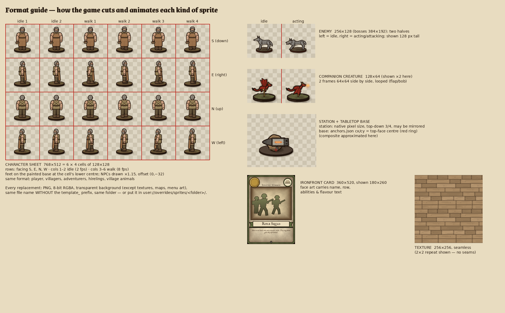

All files: **PNG, 8-bit RGBA, sRGB**, painted in the house style (`ink_parchment_gothic_80_20`: inked outlines, parchment palette, ~80% muted / 20% accent colour), **top-down three-quarter view**, lit consistently with the templates, with a soft contact shadow baked in where the templates have one.

| Kind | Canvas (keep it) | Transparency | Anchor / pivot | Orientation & animation |
|---|---|---|---|---|
| Character sheet `chars/*` (player, NPCs, adventurers, hirelings, village animals) | **768×512** = 6×4 cells of 128×128 | transparent | each figure stands on its round painted base at the cell's **lower centre**; NPCs are shown ×1.15, offset (0, −32) | rows S, E, N, W; cols 1–2 idle (2 fps), cols 3–6 walk cycle (8 fps). W may be drawn as a mirror of E |
| Portrait `portraits/*` | **256×256** (any square works, scaled 40–260 px) | opaque or transparent | head-and-shoulders, centred | facing the viewer / slight 3/4 |
| Player look layers `*/player_l_*` (+ `_mask`) | exactly as base (768×512 / 256×256) | transparent | **pixel-registered** with `player_l_base` | mask = flat colours marking recolourable regions (see `game/data/appearance.json`) |
| Workstation `stations/*` | as template (80–160 px); drawn **1:1** | transparent | sprite centre; collision from `stations.json` size | top-down 3/4; can be mirrored (`flip_h`) by the player — avoid text/handedness |
| Station base `stations/bases/*` | as template; drawn 1:1 | transparent | top-face centre = `anchors.json` cx/cy (fixed) | flat painted oval |
| Prop / furniture `props/*` | as template; drawn **1:1** | transparent | sprite centre; Y-sort foot at ~80% height; collision from `props.json` size | top-down 3/4; some placed rotated in 90° steps (layout rot) — keep them readable turned; plants sway by shader (stem at bottom centre) |
| Floor/ground decal (non-solid props) | as template | transparent, soft edges | centre | flat on the floor, may be rotated |
| Roof `roofs/*` | any size with the **same aspect ratio** (stretched to the building) | transparent outside the roof outline | top-left = building rect | seen from above; fades when the player enters |
| Texture `textures/*` | **256×256** | opaque | — | **seamless tiling** in both directions |
| Item icon `icons/*`, marks, contracts | 64×64 (marks 32×32) — any square, scaled 28–96 px | transparent | centred, ~4 px margin | single object, 3/4 view, readable at 32 px |
| Companion creature `creatures/*` | **128×64** = 2 frames of 64×64 | transparent | creature on its base at frame lower centre | 2-frame loop (flap/bob); keep the template's facing |
| Enemy `enemies/*` | **256×128** (bosses 384×192), 2:1 | transparent | figure on its base, lower centre of each half | left half idle, right half acting/attacking; keep the facing of the existing template |
| Ironfront card face `cards/*` | **360×520** (shown 180×260) | opaque | — | the face carries name, row, abilities and flavour text; strength is drawn by code |
| UI icons `ui/*` | as template; scaled | transparent | centred | flat, high contrast |
| Button frames `ui/button_*`, panels `ui/panel_*` | as template | transparent outside | **9-slice**: keep borders inside 18 px (buttons) | — |
| Maps `ui/maps/*`, `ui/world` | **1920×1080** (16:9) | opaque | full panel | north up; routes/nodes drawn on top by code |

## 4. Contact sheets

Each cell shows the current template (characters: first south-facing idle frame; enemies and creatures: the idle frame) on a checkerboard (= transparency), labelled with its reference number from §9 and the CSV.

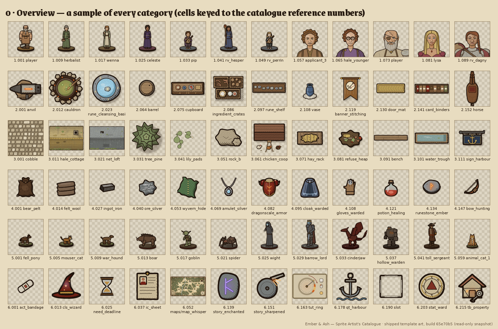

- **1. Characters, NPCs, adventurers & hirelings:** [1_characters_p1.png](contact_sheets/1_characters_p1.png) · [1_characters_p2.png](contact_sheets/1_characters_p2.png)
- **2. Workshop stations, tools, furniture & interiors:** [2_workshop_p1.png](contact_sheets/2_workshop_p1.png) · [2_workshop_p2.png](contact_sheets/2_workshop_p2.png)
- **3. Buildings, village scenery, terrain & vegetation:** [3_village_p1.png](contact_sheets/3_village_p1.png) · [3_village_p2.png](contact_sheets/3_village_p2.png)
- **4. Equipment, inventory icons & crafting materials:** [4_items_p1.png](contact_sheets/4_items_p1.png) · [4_items_p2.png](contact_sheets/4_items_p2.png)
- **5. Creatures, companions & expeditions:** [5_creatures.png](contact_sheets/5_creatures.png)
- **6. UI, maps & decorative elements:** [6_ui_p1.png](contact_sheets/6_ui_p1.png) · [6_ui_p2.png](contact_sheets/6_ui_p2.png)
- **7. Weather, particles & effects:** [7_effects.png](contact_sheets/7_effects.png)
- **Missing artwork:** [missing_art.png](contact_sheets/missing_art.png) · **Format guide:** [format_guide.png](contact_sheets/format_guide.png)

## 5. Highest-priority drawings

Ranked by how much screen time they get × how many places reuse them. Draw these first for the biggest visual change:

| # | Drawing(s) | Why |
|---:|---|---|
| 1 | `chars/player, portraits/player` | The blacksmith — on screen every second of play (also the base of every customised look). |
| 2 | `chars/applicant_0 … applicant_5 (+ portraits)` | Six looks shared by **every** hireling, apprentice and steward the player ever hires. |
| 3 | `textures/grass, dirt_road, cobble, water` | The village ground: covers most of the screen outdoors. |
| 4 | `textures/floor_soot, floor_stone, floor_wood, wall_stone, wall_timber` | The smithy's floors and walls (plus the other rooms' floors). |
| 5 | `stations/forge, anvil, quench_trough, grinding_wheel, bellows, crucible, project_bench` | The classic smithing stations — the core loop happens here. |
| 6 | `Smithy furniture (§9.2: shop_counter, tool_wall, weapon_rack, ore/coal piles, iron_bars, …)` | The workshop the player stands in most of the time. |
| 7 | `roofs/smithy, inn, grocery; props/watermill, mill_wheel, well, market_stall` | The landmark buildings of the village square and millpond. |
| 8 | `props/tree_oak_a/b, tree_pine, tree_small, bush, bush_flower` | Repeated hundreds of times by the procedural groves. |
| 9 | `ui/panel_parchment, panel_dark, button_*, toolbar_bar, tb_* (12), qt_* (13)` | Every window, button and toolbar icon; venue icons on the map and quick-travel wheel. |
| 10 | `Villagers (Hilde, Aldric, Martha, Tobin, Oswin, Barnaby, the rival smith…)` | Seen daily around the square and as customers. |
| 11 | `enemies/* — 14 missing v1.6 enemies (bosses: astral_warden, weeping_commander, blackglass_maw)` | Currently **placeholder cards** in the expedition battle view. |
| 12 | `ui/maps/map_starfall_observatory, map_weeping_fortress, map_blackglass_rift` | Currently plain parchment in the expedition observer. |
| 13 | `icons/rune, icons/skull` | Currently placeholder cards in the spirit voice and threat entries. |

## 6. Missing or placeholder artwork

No template exists for these ids, so the game currently shows its generated placeholder card or a fallback. Saving a file at the given path makes it appear **with no code change**.

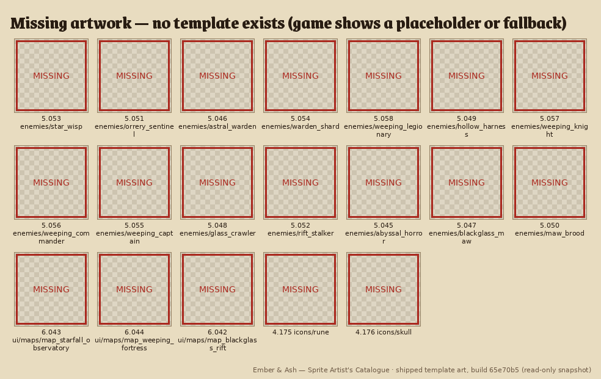

| Ref | Sprite id | What it is | Canvas | Save as | Today the game shows |
|---|---|---|---|---|---|
| 4.175 | `icons/rune` | Awakened-item rune icon — Lore 'awakened' events and the spirit voice default icon (personality.gd, spirit_voice.gd) | 64×64  | `game/assets/sprites/icons/rune.png` | placeholder card in the spirit-voice bubble |
| 4.176 | `icons/skull` | Threat / danger icon — Lore 'threat' chronicle entries for dangerous sites (world_sites.gd) | 64×64  | `game/assets/sprites/icons/skull.png` | placeholder card where the chronicle shows it (help panel hides it) |
| 5.045 | `enemies/abyssal_horror` | Abyssal Horror — spirit — A shape the rift's darkness takes when it is hungry. | 256×128 (2 halves) | `game/assets/sprites/enemies/abyssal_horror.png` | placeholder parchment card with the id in the expedition battle view |
| 5.046 | `enemies/astral_warden` | The Astral Warden — construct — Built to guard the great lens; it measures intruders the way it once measured… | 384×192 (2 halves) | `game/assets/sprites/enemies/astral_warden.png` | placeholder parchment card with the id in the expedition battle view |
| 5.047 | `enemies/blackglass_maw` | The Blackglass Maw — beast — The thing at the bottom of the rift. The glass grows from its breath. | 384×192 (2 halves) | `game/assets/sprites/enemies/blackglass_maw.png` | placeholder parchment card with the id in the expedition battle view |
| 5.048 | `enemies/glass_crawler` | Blackglass Crawler — beast — Many-legged, glass-shelled; its bite cuts like a shard. | 256×128 (2 halves) | `game/assets/sprites/enemies/glass_crawler.png` | placeholder parchment card with the id in the expedition battle view |
| 5.049 | `enemies/hollow_harness` | Hollow Harness — construct — An empty suit of cursed plate that walks the armoury. Steel rings off it; spe… | 256×128 (2 halves) | `game/assets/sprites/enemies/hollow_harness.png` | placeholder parchment card with the id in the expedition battle view |
| 5.050 | `enemies/maw_brood` | A Maw-Brood — beast — The Maw's offspring, grown fat on what falls into the dark. | 256×128 (2 halves) | `game/assets/sprites/enemies/maw_brood.png` | placeholder parchment card with the id in the expedition battle view |
| 5.051 | `enemies/orrery_sentinel` | Orrery Sentinel — construct — Brass and starstone, still keeping the observatory's hours. | 256×128 (2 halves) | `game/assets/sprites/enemies/orrery_sentinel.png` | placeholder parchment card with the id in the expedition battle view |
| 5.052 | `enemies/rift_stalker` | Rift Stalker — beast — Blind, patient, and drawn to the sound of breathing. | 256×128 (2 halves) | `game/assets/sprites/enemies/rift_stalker.png` | placeholder parchment card with the id in the expedition battle view |
| 5.053 | `enemies/star_wisp` | Starfall Wisp — spirit — A shard of fallen starlight. Blades find little to cut; frost puts it out. | 256×128 (2 halves) | `game/assets/sprites/enemies/star_wisp.png` | placeholder parchment card with the id in the expedition battle view |
| 5.054 | `enemies/warden_shard` | A Shard of the Warden — construct — What the Warden left in the dome: smaller, slower, still sworn. | 256×128 (2 halves) | `game/assets/sprites/enemies/warden_shard.png` | placeholder parchment card with the id in the expedition battle view |
| 5.055 | `enemies/weeping_captain` | Captain Orrin of the Weeping Banner — undead — The Marshal's captain, keeping her last order. | 256×128 (2 halves) | `game/assets/sprites/enemies/weeping_captain.png` | placeholder parchment card with the id in the expedition battle view |
| 5.056 | `enemies/weeping_commander` | Marshal Ysolde, the Weeping Commander — undead — She held the fortress for a king who never came back, and holds it still. | 384×192 (2 halves) | `game/assets/sprites/enemies/weeping_commander.png` | placeholder parchment card with the id in the expedition battle view |
| 5.057 | `enemies/weeping_knight` | Knight of the Weeping Banner — undead — Their tears are salt and their oaths are older than the village. | 256×128 (2 halves) | `game/assets/sprites/enemies/weeping_knight.png` | placeholder parchment card with the id in the expedition battle view |
| 5.058 | `enemies/weeping_legionary` | Weeping Legionary — undead — A soldier of a garrison that never stood down. They still keep formation. | 256×128 (2 halves) | `game/assets/sprites/enemies/weeping_legionary.png` | placeholder parchment card with the id in the expedition battle view |
| 6.042 | `ui/maps/map_blackglass_rift` | Expedition map — The Blackglass Rift — a subterranean abyss: dreadful creatures, razor glass, the Maw | 1920×1080  | `game/assets/sprites/ui/maps/map_blackglass_rift.png` | observer panel falls back to plain parchment (nodes and route still drawn) |
| 6.043 | `ui/maps/map_starfall_observatory` | Expedition map — The Starfall Observatory — an abandoned arcane observatory: constructs, unstable starlight, a guardian | 1920×1080  | `game/assets/sprites/ui/maps/map_starfall_observatory.png` | observer panel falls back to plain parchment (nodes and route still drawn) |
| 6.044 | `ui/maps/map_weeping_fortress` | Expedition map — The Weeping Fortress — a haunted military fortress: elite undead, cursed armouries, a commander | 1920×1080  | `game/assets/sprites/ui/maps/map_weeping_fortress.png` | observer panel falls back to plain parchment (nodes and route still drawn) |

**Placeholder-quality or reused art worth a dedicated drawing** (not missing, but standing in):

- **All 918 shipped sprites are `template_` placeholders** (generator `game/tools/art/make_world.py` and friends); none is final creator art.
- **World-map site icons are reused** for the v1.6 regions: Starfall Observatory uses `site_temple`, Weeping Fortress `site_stronghold`, Blackglass Rift `site_deep` (set by `icon` in `expeditions.json`). New icons would need a data change (new `icon` value), not code.
- **Hirelings, apprentices and the steward have no individual art** — they wear the six `applicant_*` looks. More looks would need data (new `applicant_look` entries) — a design decision, not drawn here.
- **Station bases** are generated ovals (`tools/art/make_station_bases.py`); optional to redraw.
- **Unused templates (16)** — drawn by no current code, no need to redraw: `ironfront/ab_artillery`, `ironfront/ab_assault`, `ironfront/ab_barrage`, `ironfront/ab_combined`, `ironfront/ab_elite`, `ironfront/ab_entrench`, `ironfront/ab_medic`, `ironfront/ab_rally`, `ironfront/ab_reinforce`, `ironfront/ab_spotter`, `ironfront/ab_supply`, `ironfront/ab_tactic`, `ui/corner_ornament`, `ui/parchment_vignette`, `ui/tooltip_bg`, `ui/slot_select`.
- Test-only ids (`icons/test_companion`, `creatures/test_companion`) appear only in automated tests — ignore.

## 7. Procedural visuals that cannot be overridden

These are drawn by code or shaders; a PNG cannot replace them. Changing their look needs code/shader work (a separate, approved task).

| Ref | Category | Visual | How it is made | Where |
|---|---|---|---|---|
| P.01 | 7 | Rain, snow, blossom & leaf particles | SeasonDressing CPUParticles2D; rain streak 3×30 and leaf 10×7 images generated in code | `scripts/world/season_dressing.gd` |
| P.02 | 7 | Weather overlay (fog, overcast, wet sheen) | weather.gdshader full-screen overlay | `shaders/weather.gdshader` |
| P.03 | 7 | Snow cover, autumn/spring ground tint | season_ground.gdshader / season_snow.gdshader over the terrain and roofs | `shaders/season_ground.gdshader, shaders/season_snow.gdshader` |
| P.04 | 7 | Foliage sway & falling blossom/snow on plants | sway.gdshader on tree/bush/flower props | `shaders/sway.gdshader` |
| P.05 | 7 | Forge embers, sparks, smoke, motes, chimney smoke | FX.embers / sparks / smoke / motes (CPUParticles2D, generated dot textures) | `scripts/world/fx.gd, world.gd` |
| P.06 | 7 | Point lights (forge, candles, lamps, fireplaces) | FX.light: generated radial GradientTexture2D | `scripts/world/fx.gd` |
| P.07 | 7 | Day/night colour grading | CanvasModulate tint + night lights (world._update_light) | `scripts/world/world.gd` |
| P.08 | 7 | Ghosts / memorial spirits | ghost.gdshader applied to character sprites (the sprite itself IS overridable) | `shaders/ghost.gdshader` |
| P.09 | 3 | Road & path edges, soft ground blending | road_ground.gdshader / soft_ground.gdshader blend grass, dirt_road and cobble (the textures ARE overridable) | `scripts/world/village_ground.gd` |
| P.10 | 3 | Pond, millpond, stream, harbour water bodies & banks | Polygons drawn in code with textures/water fill; banks and outlines are drawn lines | `scripts/world/world.gd` |
| P.11 | 3 | Plank decks, quays, bridges | Drawn rectangles/lines in code | `scripts/world/world.gd` |
| P.12 | 3 | Building walls, door gaps, room outlines | Wall strips use textures/wall_* (overridable); thresholds, outlines and shadows are code-drawn | `scripts/world/world.gd` |
| P.13 | 2 | Main-station marker, interaction highlights, build-mode ghost | Code-drawn rings, outlines and tints | `scripts/world/world.gd, world_prompts.gd` |
| P.14 | 1 | Customised player look (colours) | Composited from player_l_* layers + gradient-mapped colour swatches (appearance.json) | `scripts/systems/appearance.gd` |
| P.15 | 1 | Activity bubbles' frames, name tags, speech bubbles | Code-drawn (icons inside are ui/act_* and overridable) | `scripts/world/activity_bubbles.gd` |
| P.16 | 6 | Illustrated village map & minimap | VillageMapView draws the whole map (land, roads, water, buildings, labels) in code; only the qt_* venue icons are sprites | `scripts/ui/village_map_view.gd` |
| P.17 | 6 | Compass rose, cartouche, map frame | Drawn in code | `scripts/ui/village_map_view.gd` |
| P.18 | 6 | Expedition route, nodes, party marker trail | Drawn over ui/maps/map_* in the observer panel | `scripts/ui/panels/observer_panel.gd` |
| P.19 | 6 | Health/progress bars, curves, charts | Drawn in code (observer bars, hireling health curve, ledgers) | `various panels` |
| P.20 | 6 | Most panel/tooltip StyleBoxes | StyleBoxFlat built in Assets._build_theme (panel_parchment/panel_dark and button_* textures are used where present) | `scripts/autoload/assets.gd` |
| P.21 | 6 | Missing-art placeholder card | Assets._placeholder: parchment card with the sprite id | `scripts/autoload/assets.gd` |
| P.22 | 6 | Fonts | EB Garamond, IM Fell English, Grenze (Gotisch) — woff2 in assets/fonts (not sprites) | `assets/fonts` |

## 8. How many drawings are really needed

| Count | Number | Notes |
|---|---:|---|
| Shipped template files | 918 | every PNG under `game/assets/sprites/` |
| − unused templates | 16 | not drawn by any code |
| − colour-region masks | 29 | trace of their layer (flat fills), redraw together with it |
| − generated station bases | 30 | optional; ~4 colour families of the same oval |
| + missing pictures | 19 | §6 |
| **= distinct designs to draw** | **862** | one subject each (a character, a prop, an icon…) |
| of which priority A / A (missing) | 173 / 19 | the core set — biggest visual change |
| **individual frames/pictures** | **2622** | character sheets count 24 frames, enemies and creatures 2 |
| frames if W is mirrored from E | 2178 | saves 6 frames per sheet (74 sheets) |

Reuse already built in (one drawing, many places): the 6 applicant looks dress every hireling/apprentice/steward; a station sprite serves every installed copy; furniture is placed many times (see *Shared / reuse* in §9 and the CSV — e.g. crates, barrels, fences, benches); trees and bushes fill every grove; floor and wall textures tile across every room; one item icon can serve several items; site icons serve several regions; each portrait and sheet is reused across every panel, map and battle view. Of the 88 character sheets, 52 are people (1248 frames), 8 village animals, 28 player-look layers/masks.

## 9. The full catalogue, by category

Columns: **Ref** (matches the contact sheets and CSV) · **Preview** (the current template) · **Sprite id / what it is** · **Size & frames** · **Save your art as** (creator file; a `user://overrides/sprites/<id>.png` works too) · **Works?** (✅ automatic drop-in, ⚠ automatic with a rule from §3, ❌ missing, — unused) · **Shared / notes**. Every template exists unless marked missing. Full descriptions, used-by scripts and animation details are in the CSV.

### 9.1 Characters, NPCs, adventurers & hirelings

Contact sheets: [1_characters_p1.png](contact_sheets/1_characters_p1.png) · [1_characters_p2.png](contact_sheets/1_characters_p2.png)

#### Player (1)

| Ref | Preview | Sprite id — what it is | Size & frames | Pri | Save your art as | Works? | Shared / notes |
|---|---|---|---|---|---|---|---|
| 1.001 | 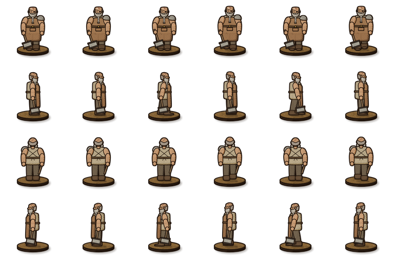 | `chars/player` — The blacksmith (player), default look | 768×512 · 6×4 sheet | A | `chars/player.png` | ⚠ auto (default look) |  |

#### Villagers & shopkeepers (16)

| Ref | Preview | Sprite id — what it is | Size & frames | Pri | Save your art as | Works? | Shared / notes |
|---|---|---|---|---|---|---|---|
| 1.002 | 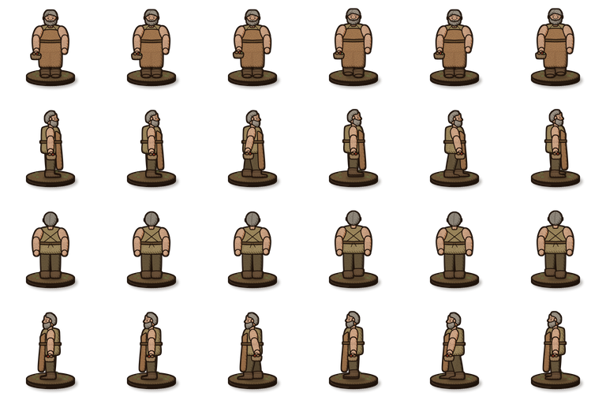 | `chars/aldric` — Aldric Pell — Grocer | 768×512 · 6×4 sheet | A | `chars/aldric.png` | ✅ auto · keep size |  |
| 1.003 | 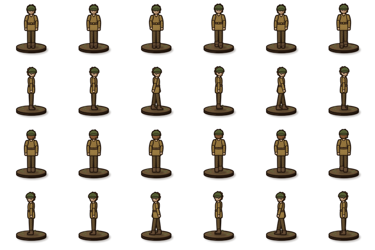 | `chars/barnaby` — Barnaby Quill — Ironfront enthusiast and host of the basement war-room | 768×512 · 6×4 sheet | A | `chars/barnaby.png` | ✅ auto · keep size |  |
| 1.004 | 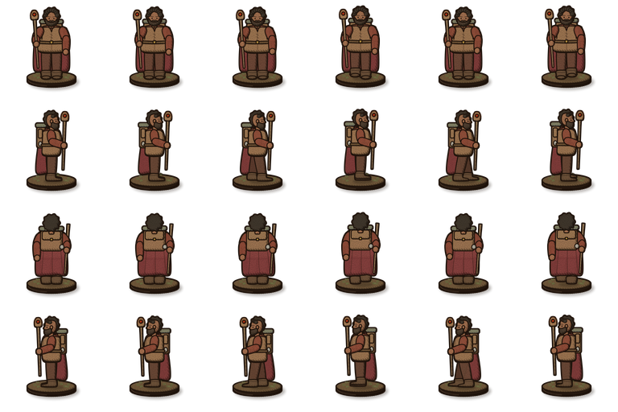 | `chars/caravan_master` — Ottavio Brask — Caravan Master | 768×512 · 6×4 sheet | A | `chars/caravan_master.png` | ✅ auto · keep size |  |
| 1.005 | 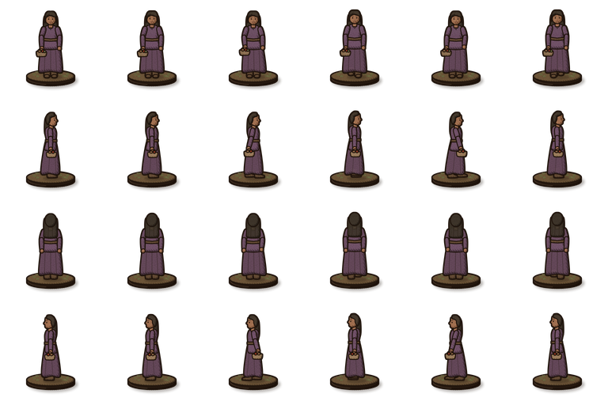 | `chars/eda` — Eda Rook — Washerwoman | 768×512 · 6×4 sheet | A | `chars/eda.png` | ✅ auto · keep size |  |
| 1.006 | 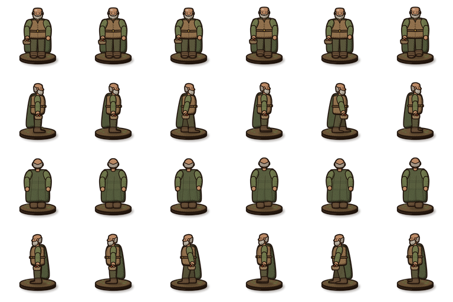 | `chars/hale_elder` — Bram Hale — Keeper of Beasts | 768×512 · 6×4 sheet | A | `chars/hale_elder.png` | ✅ auto · keep size |  |
| 1.007 | 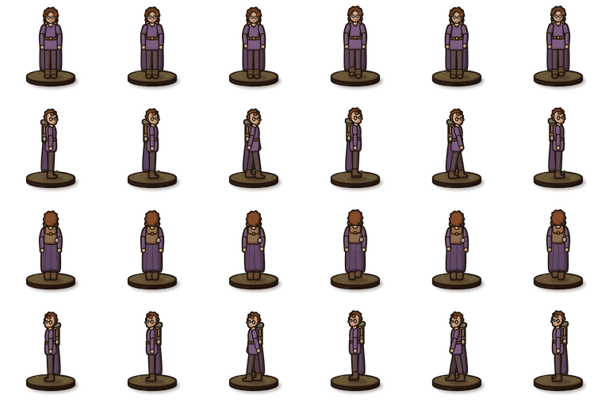 | `chars/hale_younger` — Ellery Hale — Keeper of Curious Creatures | 768×512 · 6×4 sheet | A | `chars/hale_younger.png` | ✅ auto · keep size |  |
| 1.008 | 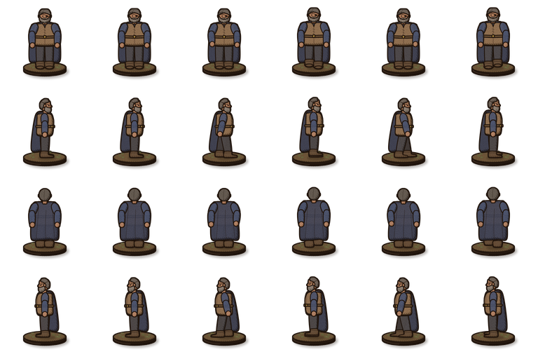 | `chars/harbourmaster` — Captain Hal Brackwater — Harbourmaster | 768×512 · 6×4 sheet | A | `chars/harbourmaster.png` | ✅ auto · keep size |  |
| 1.009 | 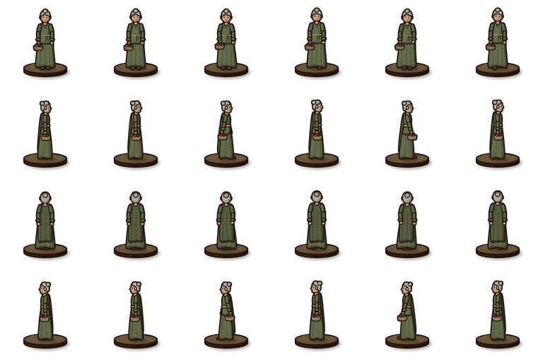 | `chars/herbalist` — Maud Fennimore — Herbalist | 768×512 · 6×4 sheet | A | `chars/herbalist.png` | ✅ auto · keep size |  |
| 1.010 | 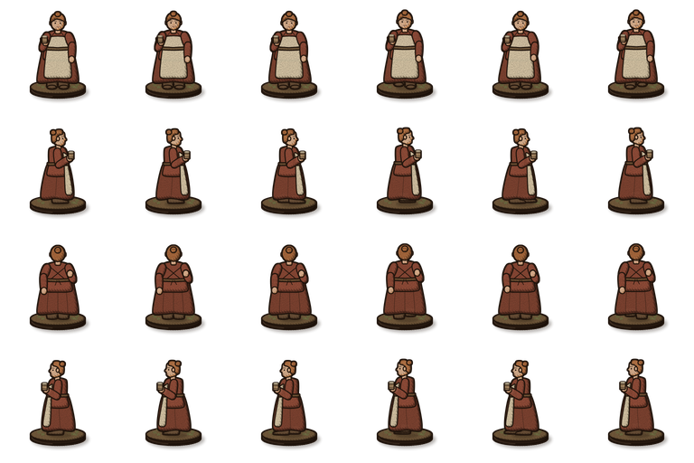 | `chars/hilde` — Hilde Brask — Innkeeper of the Tipsy Wyvern | 768×512 · 6×4 sheet | A | `chars/hilde.png` | ✅ auto · keep size |  |
| 1.011 | 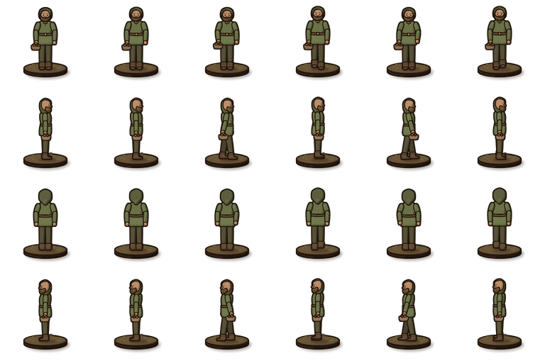 | `chars/jory` — Jory Thatch — Farmer | 768×512 · 6×4 sheet | A | `chars/jory.png` | ✅ auto · keep size |  |
| 1.012 | 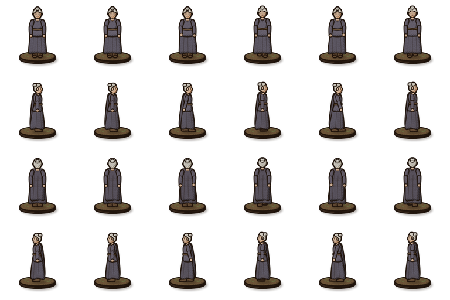 | `chars/martha` — Old Martha — Widow | 768×512 · 6×4 sheet | A | `chars/martha.png` | ✅ auto · keep size |  |
| 1.013 | 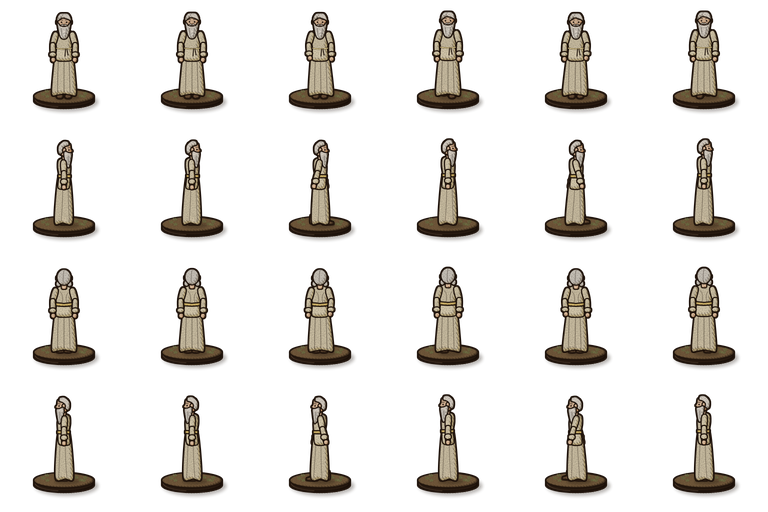 | `chars/oswin` — Father Oswin — Priest of the Dawn | 768×512 · 6×4 sheet | A | `chars/oswin.png` | ✅ auto · keep size |  |
| 1.014 | 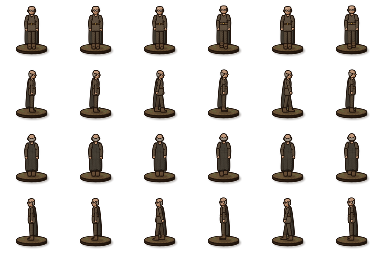 | `chars/pawnbroker` — Silas Quell — Pawnbroker | 768×512 · 6×4 sheet | A | `chars/pawnbroker.png` | ✅ auto · keep size |  |
| 1.015 | 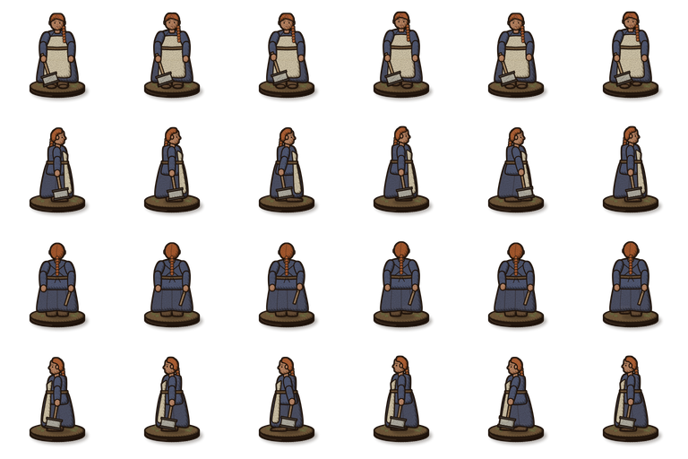 | `chars/rival_smith` — Maren Tallowgate — Smith of the Salt Anvil | 768×512 · 6×4 sheet | A | `chars/rival_smith.png` | ✅ auto · keep size |  |
| 1.016 | 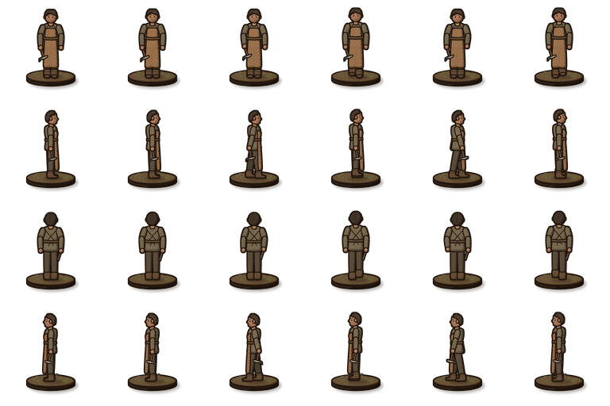 | `chars/tobin` — Tobin Dunmore — Carpenter | 768×512 · 6×4 sheet | A | `chars/tobin.png` | ✅ auto · keep size |  |
| 1.017 | 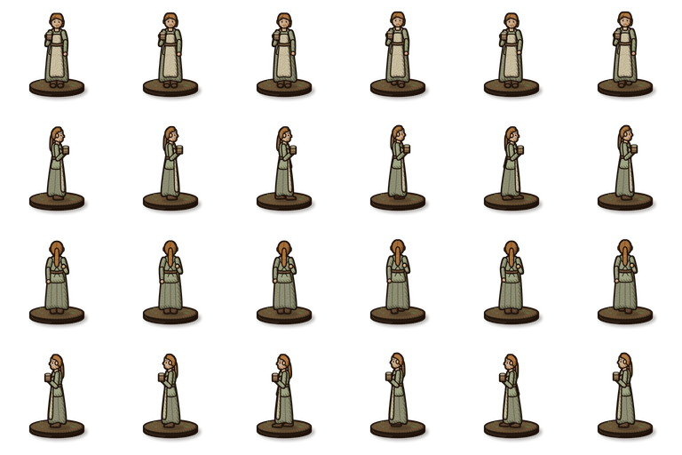 | `chars/wenna` — Wenna — Barmaid | 768×512 · 6×4 sheet | A | `chars/wenna.png` | ✅ auto · keep size |  |

#### Hireling / apprentice / steward looks (6)

| Ref | Preview | Sprite id — what it is | Size & frames | Pri | Save your art as | Works? | Shared / notes |
|---|---|---|---|---|---|---|---|
| 1.018 | 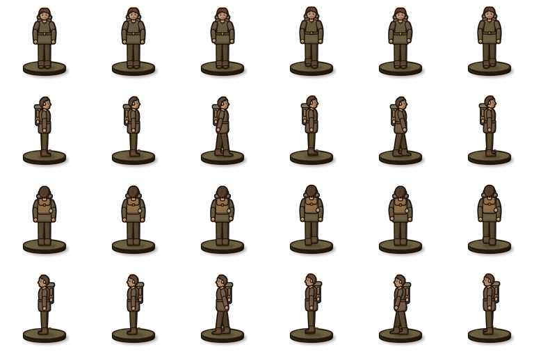 | `chars/applicant_0` — Hireling look 0 (applicant / hireling / apprentice / steward) | 768×512 · 6×4 sheet | A | `chars/applicant_0.png` | ✅ auto · keep size | Shared: every generated hireling, apprentice and steward wears one of the six applicant looks (their 'look' field). |
| 1.019 | 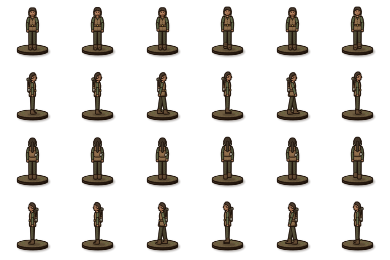 | `chars/applicant_1` — Hireling look 1 (applicant / hireling / apprentice / steward) | 768×512 · 6×4 sheet | A | `chars/applicant_1.png` | ✅ auto · keep size | Shared: every generated hireling, apprentice and steward wears one of the six applicant looks (their 'look' field). |
| 1.020 | 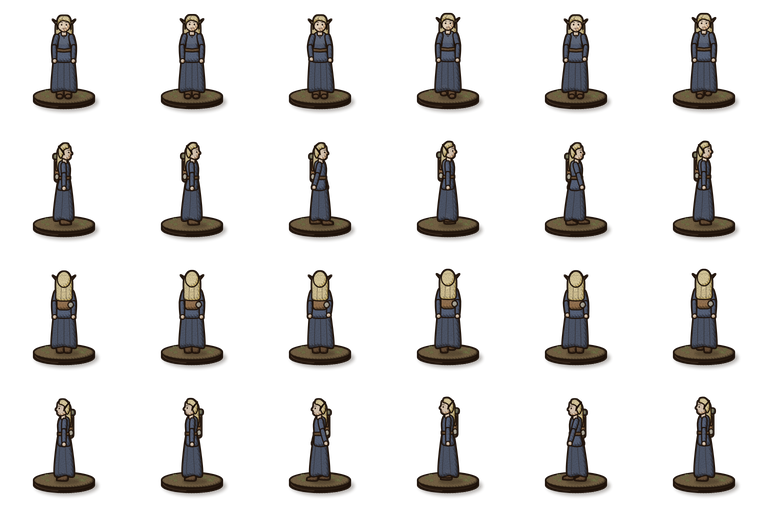 | `chars/applicant_2` — Hireling look 2 (applicant / hireling / apprentice / steward) | 768×512 · 6×4 sheet | A | `chars/applicant_2.png` | ✅ auto · keep size | Shared: every generated hireling, apprentice and steward wears one of the six applicant looks (their 'look' field). |
| 1.021 | 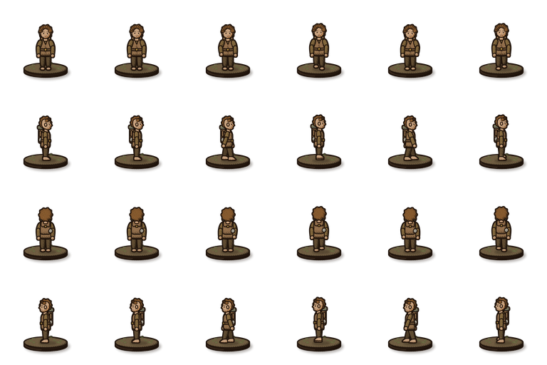 | `chars/applicant_3` — Hireling look 3 (applicant / hireling / apprentice / steward) | 768×512 · 6×4 sheet | A | `chars/applicant_3.png` | ✅ auto · keep size | Shared: every generated hireling, apprentice and steward wears one of the six applicant looks (their 'look' field). |
| 1.022 | 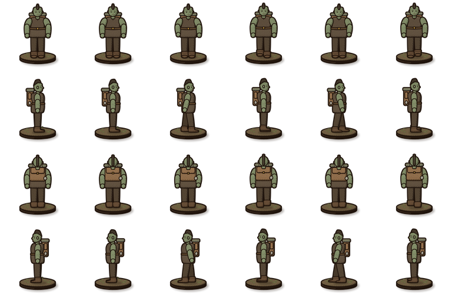 | `chars/applicant_4` — Hireling look 4 (applicant / hireling / apprentice / steward) | 768×512 · 6×4 sheet | A | `chars/applicant_4.png` | ✅ auto · keep size | Shared: every generated hireling, apprentice and steward wears one of the six applicant looks (their 'look' field). |
| 1.023 | 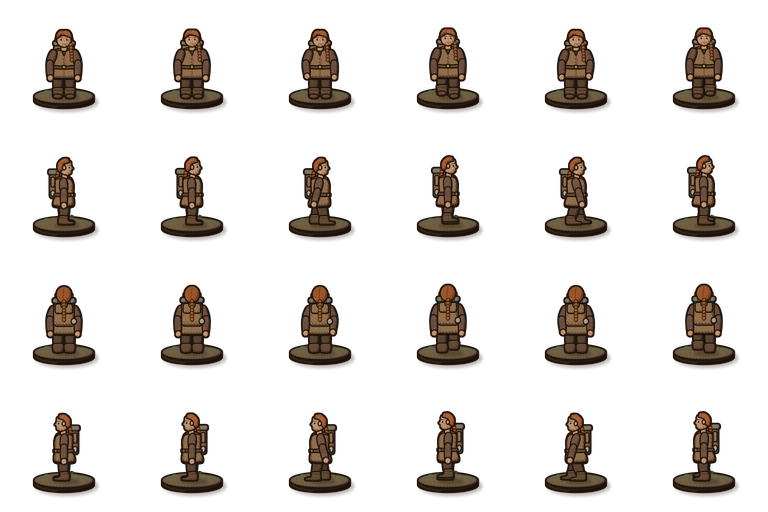 | `chars/applicant_5` — Hireling look 5 (applicant / hireling / apprentice / steward) | 768×512 · 6×4 sheet | A | `chars/applicant_5.png` | ✅ auto · keep size | Shared: every generated hireling, apprentice and steward wears one of the six applicant looks (their 'look' field). |

#### Hirelings (1)

| Ref | Preview | Sprite id — what it is | Size & frames | Pri | Save your art as | Works? | Shared / notes |
|---|---|---|---|---|---|---|---|
| 1.024 | 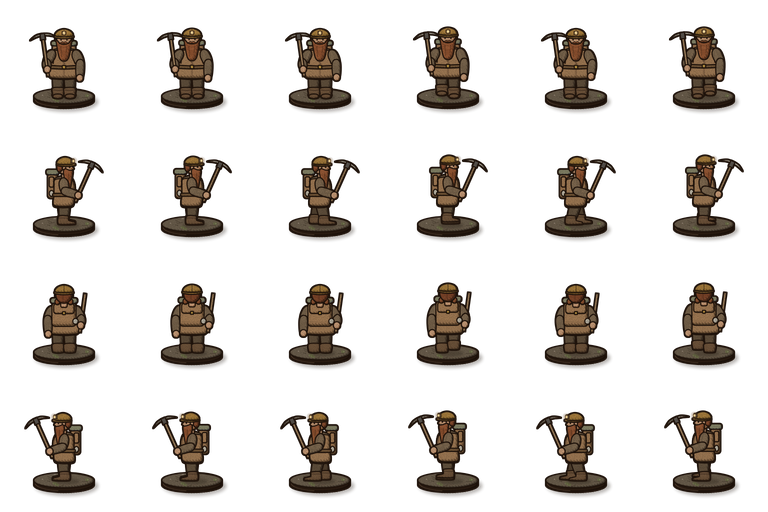 | `chars/borin` — Borin Flintbeard — Miner & procurer | 768×512 · 6×4 sheet | A | `chars/borin.png` | ✅ auto · keep size |  |

#### Companions (travelling) (4)

| Ref | Preview | Sprite id — what it is | Size & frames | Pri | Save your art as | Works? | Shared / notes |
|---|---|---|---|---|---|---|---|
| 1.025 | 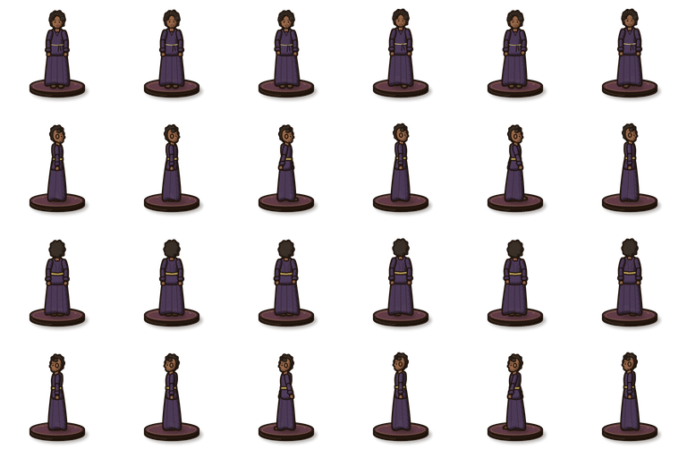 | `chars/celeste` — Celeste — Companion | 768×512 · 6×4 sheet | B | `chars/celeste.png` | ✅ auto · keep size | Also drawn in the expedition observer battle view (south row cells) |
| 1.026 | 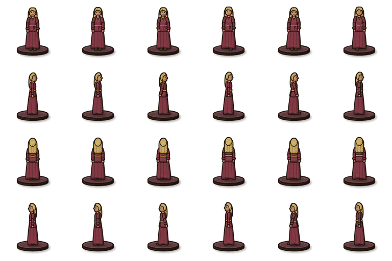 | `chars/lysa` — Lysa — Companion | 768×512 · 6×4 sheet | B | `chars/lysa.png` | ✅ auto · keep size | Also drawn in the expedition observer battle view (south row cells) |
| 1.027 | 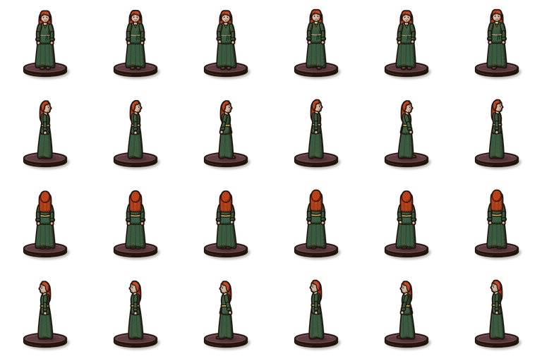 | `chars/roisin` — Róisín — Companion at the Velvet Lantern | 768×512 · 6×4 sheet | B | `chars/roisin.png` | ✅ auto · keep size | Also drawn in the expedition observer battle view (south row cells) |
| 1.028 | 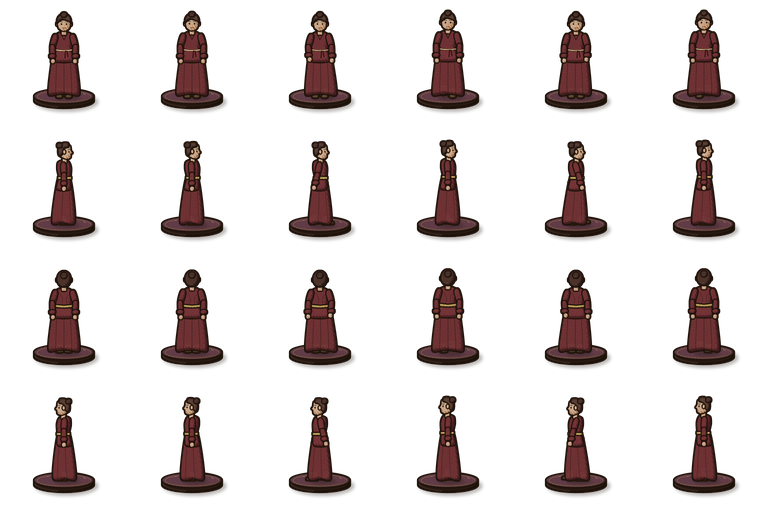 | `chars/rosalind` — Madam Rosalind — Keeper of the Velvet Lantern | 768×512 · 6×4 sheet | B | `chars/rosalind.png` | ✅ auto · keep size | Also drawn in the expedition observer battle view (south row cells) |

#### Adventurers (24)

| Ref | Preview | Sprite id — what it is | Size & frames | Pri | Save your art as | Works? | Shared / notes |
|---|---|---|---|---|---|---|---|
| 1.029 | 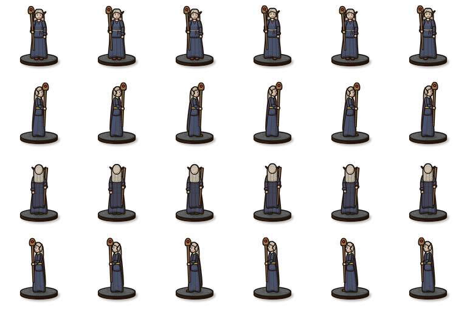 | `chars/elowen` — Elowen Vey | 768×512 · 6×4 sheet | B | `chars/elowen.png` | ✅ auto · keep size | Also drawn in the expedition observer battle view (south row cells) |
| 1.030 | 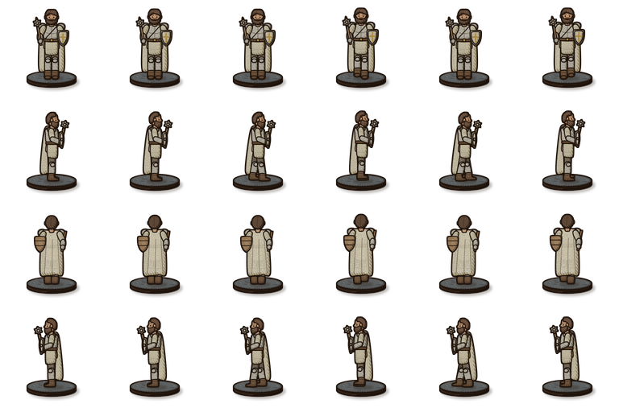 | `chars/garrick` — Garrick Stone | 768×512 · 6×4 sheet | B | `chars/garrick.png` | ✅ auto · keep size | Also drawn in the expedition observer battle view (south row cells) |
| 1.031 | 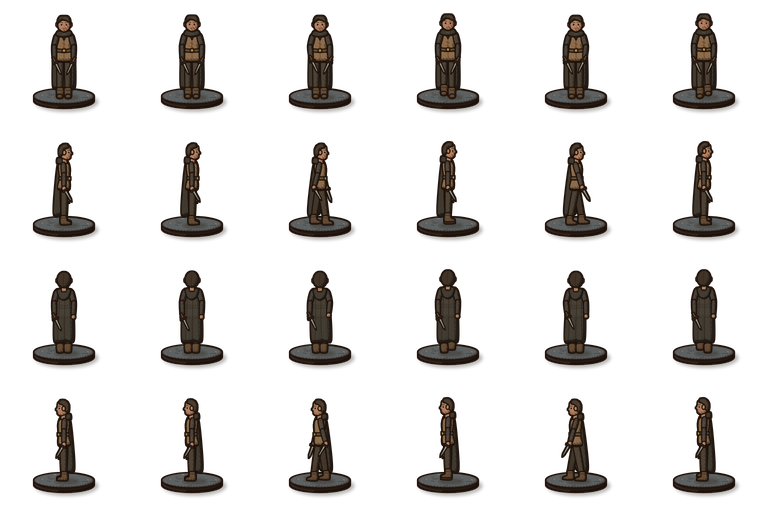 | `chars/kestra` — Kestra Dunmore | 768×512 · 6×4 sheet | B | `chars/kestra.png` | ✅ auto · keep size | Also drawn in the expedition observer battle view (south row cells) |
| 1.032 | 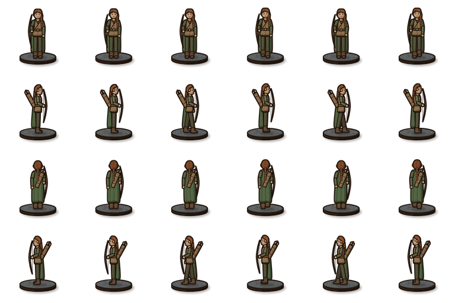 | `chars/mira` — Mira Pell | 768×512 · 6×4 sheet | B | `chars/mira.png` | ✅ auto · keep size | Also drawn in the expedition observer battle view (south row cells) |
| 1.033 | 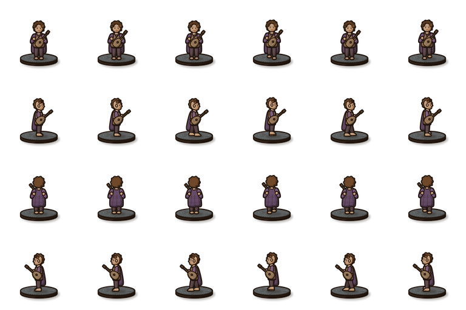 | `chars/pip` — Pip Underbough | 768×512 · 6×4 sheet | B | `chars/pip.png` | ✅ auto · keep size | Also drawn in the expedition observer battle view (south row cells) |
| 1.034 | 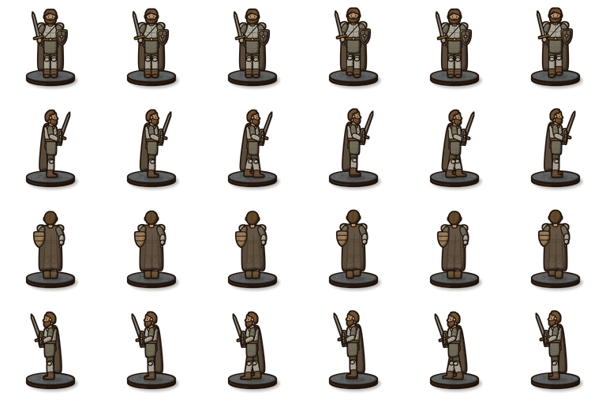 | `chars/rv_aldous` — Aldous Brack | 768×512 · 6×4 sheet | B | `chars/rv_aldous.png` | ✅ auto · keep size | Also drawn in the expedition observer battle view (south row cells) |
| 1.035 | 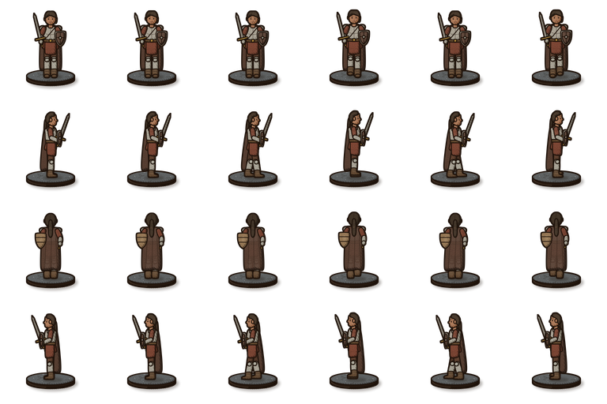 | `chars/rv_brenna` — Brenna Thorn | 768×512 · 6×4 sheet | B | `chars/rv_brenna.png` | ✅ auto · keep size | Also drawn in the expedition observer battle view (south row cells) |
| 1.036 | 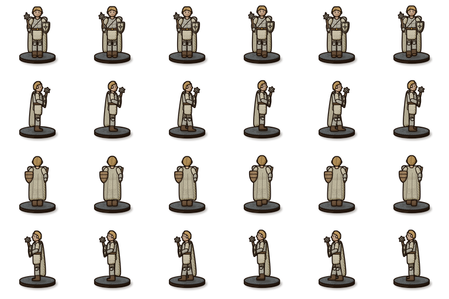 | `chars/rv_corwin` — Corwin Ashby | 768×512 · 6×4 sheet | B | `chars/rv_corwin.png` | ✅ auto · keep size | Also drawn in the expedition observer battle view (south row cells) |
| 1.037 | 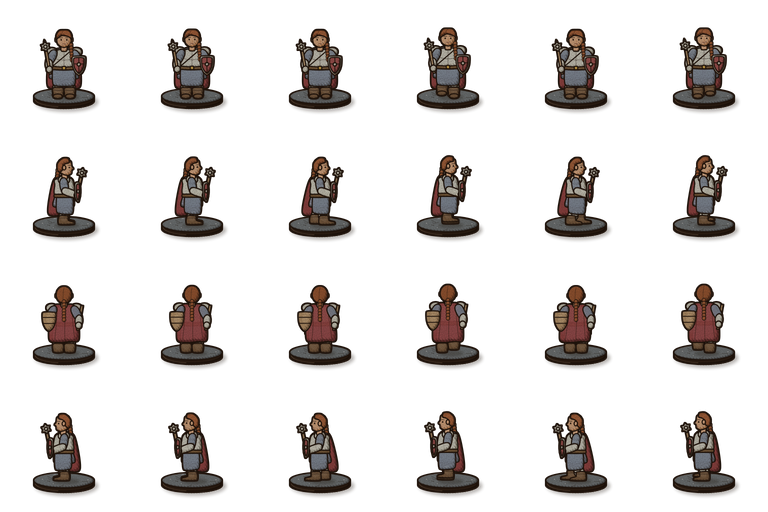 | `chars/rv_dagny` — Dagny Ironvein | 768×512 · 6×4 sheet | B | `chars/rv_dagny.png` | ✅ auto · keep size | Also drawn in the expedition observer battle view (south row cells) |
| 1.038 | 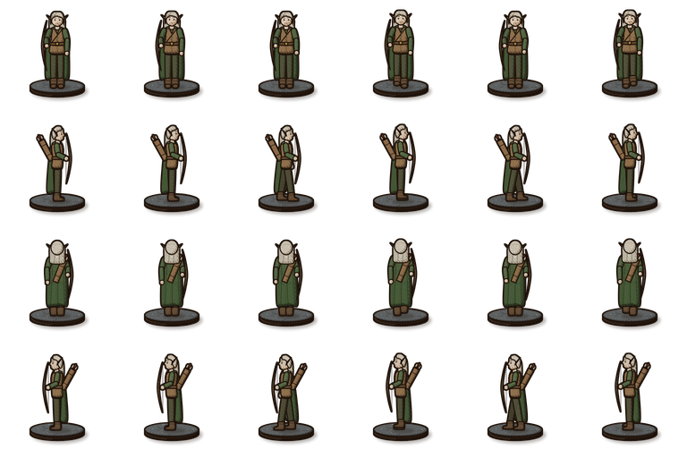 | `chars/rv_ewan` — Ewan Greyleaf | 768×512 · 6×4 sheet | B | `chars/rv_ewan.png` | ✅ auto · keep size | Also drawn in the expedition observer battle view (south row cells) |
| 1.039 | 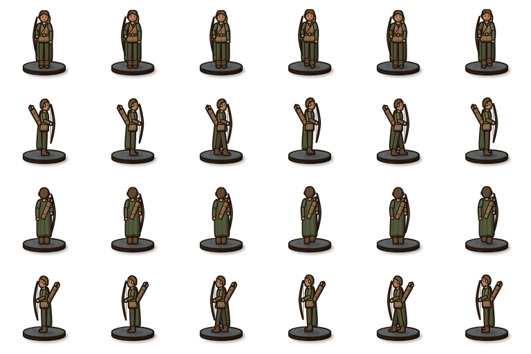 | `chars/rv_fen` — Fen Marlow | 768×512 · 6×4 sheet | B | `chars/rv_fen.png` | ✅ auto · keep size | Also drawn in the expedition observer battle view (south row cells) |
| 1.040 | 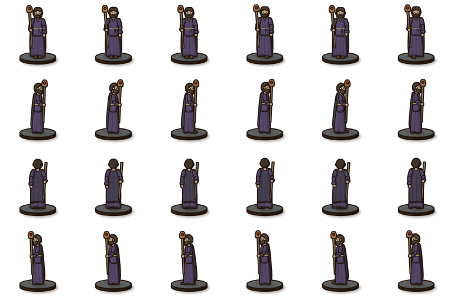 | `chars/rv_galen` — Galen Voss | 768×512 · 6×4 sheet | B | `chars/rv_galen.png` | ✅ auto · keep size | Also drawn in the expedition observer battle view (south row cells) |
| 1.041 | 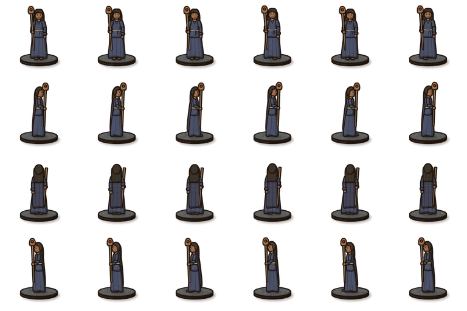 | `chars/rv_hesper` — Hesper Quill | 768×512 · 6×4 sheet | B | `chars/rv_hesper.png` | ✅ auto · keep size | Also drawn in the expedition observer battle view (south row cells) |
| 1.042 | 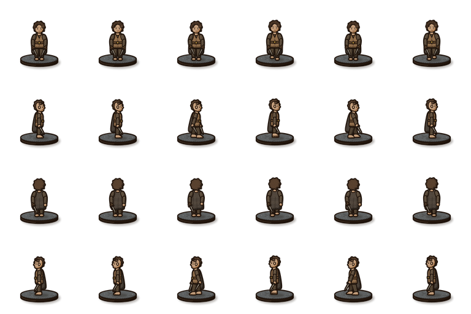 | `chars/rv_ivo` — Ivo Kettle | 768×512 · 6×4 sheet | B | `chars/rv_ivo.png` | ✅ auto · keep size | Also drawn in the expedition observer battle view (south row cells) |
| 1.043 | 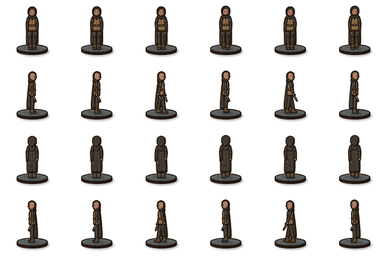 | `chars/rv_juno` — Juno Sable | 768×512 · 6×4 sheet | B | `chars/rv_juno.png` | ✅ auto · keep size | Also drawn in the expedition observer battle view (south row cells) |
| 1.044 |  | `chars/rv_korvak` — Korvak Redmaw | 768×512 · 6×4 sheet | B | `chars/rv_korvak.png` | ✅ auto · keep size | Also drawn in the expedition observer battle view (south row cells) |
| 1.045 | 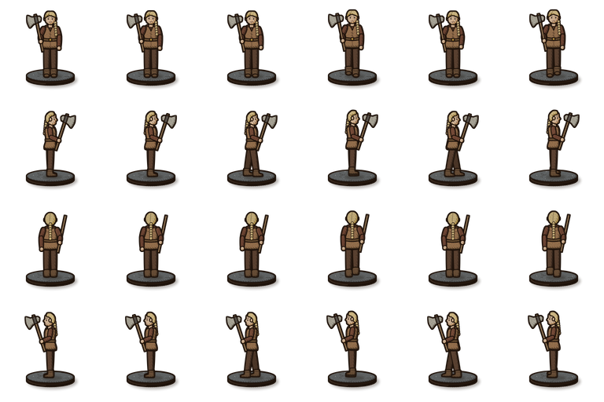 | `chars/rv_liesl` — Liesl Harrow | 768×512 · 6×4 sheet | B | `chars/rv_liesl.png` | ✅ auto · keep size | Also drawn in the expedition observer battle view (south row cells) |
| 1.046 | 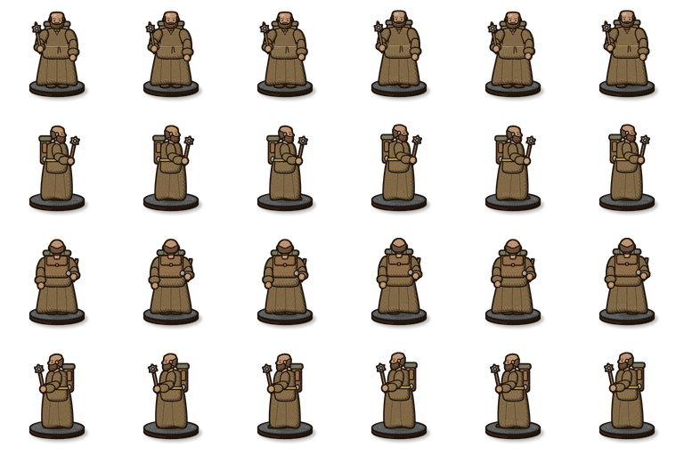 | `chars/rv_mattias` — Brother Mattias | 768×512 · 6×4 sheet | B | `chars/rv_mattias.png` | ✅ auto · keep size | Also drawn in the expedition observer battle view (south row cells) |
| 1.047 | 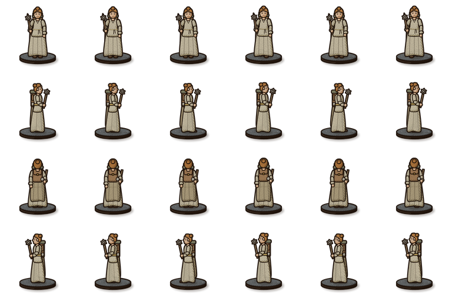 | `chars/rv_nell` — Nell Ashgrove | 768×512 · 6×4 sheet | B | `chars/rv_nell.png` | ✅ auto · keep size | Also drawn in the expedition observer battle view (south row cells) |
| 1.048 | 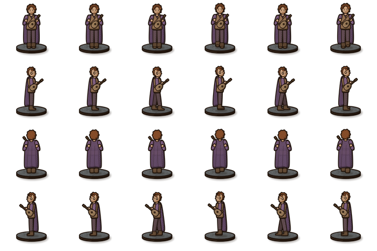 | `chars/rv_oskar` — Oskar Fiddle | 768×512 · 6×4 sheet | B | `chars/rv_oskar.png` | ✅ auto · keep size | Also drawn in the expedition observer battle view (south row cells) |
| 1.049 |  | `chars/rv_perrin` — Perrin Lark | 768×512 · 6×4 sheet | B | `chars/rv_perrin.png` | ✅ auto · keep size | Also drawn in the expedition observer battle view (south row cells) |
| 1.050 |  | `chars/sigrun` — Sigrun Halvard | 768×512 · 6×4 sheet | B | `chars/sigrun.png` | ✅ auto · keep size | Also drawn in the expedition observer battle view (south row cells) |
| 1.051 |  | `chars/tomas` — Brother Tomas | 768×512 · 6×4 sheet | B | `chars/tomas.png` | ✅ auto · keep size | Also drawn in the expedition observer battle view (south row cells) |
| 1.052 |  | `chars/varn` — Varn Ashfang | 768×512 · 6×4 sheet | B | `chars/varn.png` | ✅ auto · keep size | Also drawn in the expedition observer battle view (south row cells) |

#### Portraits (52)

| Ref | Preview | Sprite id — what it is | Size & frames | Pri | Save your art as | Works? | Shared / notes |
|---|---|---|---|---|---|---|---|
| 1.053 |  | `portraits/aldric` — Portrait — Aldric Pell | 256×256 | A | `portraits/aldric.png` | ✅ auto |  |
| 1.054 |  | `portraits/applicant_0` — Portrait — hireling look 0 | 256×256 | A | `portraits/applicant_0.png` | ✅ auto | Shared: every generated hireling, apprentice and steward wears one of the six applicant looks (their 'look' field). |
| 1.055 |  | `portraits/applicant_1` — Portrait — hireling look 1 | 256×256 | A | `portraits/applicant_1.png` | ✅ auto | Shared: every generated hireling, apprentice and steward wears one of the six applicant looks (their 'look' field). |
| 1.056 |  | `portraits/applicant_2` — Portrait — hireling look 2 | 256×256 | A | `portraits/applicant_2.png` | ✅ auto | Shared: every generated hireling, apprentice and steward wears one of the six applicant looks (their 'look' field). |
| 1.057 |  | `portraits/applicant_3` — Portrait — hireling look 3 | 256×256 | A | `portraits/applicant_3.png` | ✅ auto | Shared: every generated hireling, apprentice and steward wears one of the six applicant looks (their 'look' field). |
| 1.058 |  | `portraits/applicant_4` — Portrait — hireling look 4 | 256×256 | A | `portraits/applicant_4.png` | ✅ auto | Shared: every generated hireling, apprentice and steward wears one of the six applicant looks (their 'look' field). |
| 1.059 |  | `portraits/applicant_5` — Portrait — hireling look 5 | 256×256 | A | `portraits/applicant_5.png` | ✅ auto | Shared: every generated hireling, apprentice and steward wears one of the six applicant looks (their 'look' field). |
| 1.060 |  | `portraits/barnaby` — Portrait — Barnaby Quill | 256×256 | A | `portraits/barnaby.png` | ✅ auto |  |
| 1.061 |  | `portraits/borin` — Portrait — Borin Flintbeard | 256×256 | A | `portraits/borin.png` | ✅ auto |  |
| 1.062 |  | `portraits/caravan_master` — Portrait — Ottavio Brask | 256×256 | A | `portraits/caravan_master.png` | ✅ auto |  |
| 1.063 |  | `portraits/eda` — Portrait — Eda Rook | 256×256 | A | `portraits/eda.png` | ✅ auto |  |
| 1.064 |  | `portraits/hale_elder` — Portrait — Bram Hale | 256×256 | A | `portraits/hale_elder.png` | ✅ auto |  |
| 1.065 |  | `portraits/hale_younger` — Portrait — Ellery Hale | 256×256 | A | `portraits/hale_younger.png` | ✅ auto |  |
| 1.066 |  | `portraits/harbourmaster` — Portrait — Captain Hal Brackwater | 256×256 | A | `portraits/harbourmaster.png` | ✅ auto |  |
| 1.067 |  | `portraits/herbalist` — Portrait — Maud Fennimore | 256×256 | A | `portraits/herbalist.png` | ✅ auto |  |
| 1.068 |  | `portraits/hilde` — Portrait — Hilde Brask | 256×256 | A | `portraits/hilde.png` | ✅ auto |  |
| 1.069 |  | `portraits/jory` — Portrait — Jory Thatch | 256×256 | A | `portraits/jory.png` | ✅ auto |  |
| 1.070 |  | `portraits/martha` — Portrait — Old Martha | 256×256 | A | `portraits/martha.png` | ✅ auto |  |
| 1.071 |  | `portraits/oswin` — Portrait — Father Oswin | 256×256 | A | `portraits/oswin.png` | ✅ auto |  |
| 1.072 |  | `portraits/pawnbroker` — Portrait — Silas Quell | 256×256 | A | `portraits/pawnbroker.png` | ✅ auto |  |
| 1.073 |  | `portraits/player` — Portrait — Brannoc Ironhand | 256×256 | A | `portraits/player.png` | ⚠ auto (default look) |  |
| 1.074 |  | `portraits/rival_smith` — Portrait — Maren Tallowgate | 256×256 | A | `portraits/rival_smith.png` | ✅ auto |  |
| 1.075 |  | `portraits/tobin` — Portrait — Tobin Dunmore | 256×256 | A | `portraits/tobin.png` | ✅ auto |  |
| 1.076 |  | `portraits/wenna` — Portrait — Wenna | 256×256 | A | `portraits/wenna.png` | ✅ auto |  |
| 1.077 |  | `portraits/celeste` — Portrait — Celeste | 256×256 | B | `portraits/celeste.png` | ✅ auto |  |
| 1.078 |  | `portraits/elowen` — Portrait — Elowen Vey | 256×256 | B | `portraits/elowen.png` | ✅ auto |  |
| 1.079 |  | `portraits/garrick` — Portrait — Garrick Stone | 256×256 | B | `portraits/garrick.png` | ✅ auto |  |
| 1.080 |  | `portraits/kestra` — Portrait — Kestra Dunmore | 256×256 | B | `portraits/kestra.png` | ✅ auto |  |
| 1.081 |  | `portraits/lysa` — Portrait — Lysa | 256×256 | B | `portraits/lysa.png` | ✅ auto |  |
| 1.082 |  | `portraits/mira` — Portrait — Mira Pell | 256×256 | B | `portraits/mira.png` | ✅ auto |  |
| 1.083 |  | `portraits/pip` — Portrait — Pip Underbough | 256×256 | B | `portraits/pip.png` | ✅ auto |  |
| 1.084 |  | `portraits/roisin` — Portrait — Róisín | 256×256 | B | `portraits/roisin.png` | ✅ auto |  |
| 1.085 |  | `portraits/rosalind` — Portrait — Madam Rosalind | 256×256 | B | `portraits/rosalind.png` | ✅ auto |  |
| 1.086 |  | `portraits/rv_aldous` — Portrait — Aldous Brack | 256×256 | B | `portraits/rv_aldous.png` | ✅ auto |  |
| 1.087 |  | `portraits/rv_brenna` — Portrait — Brenna Thorn | 256×256 | B | `portraits/rv_brenna.png` | ✅ auto |  |
| 1.088 |  | `portraits/rv_corwin` — Portrait — Corwin Ashby | 256×256 | B | `portraits/rv_corwin.png` | ✅ auto |  |
| 1.089 |  | `portraits/rv_dagny` — Portrait — Dagny Ironvein | 256×256 | B | `portraits/rv_dagny.png` | ✅ auto |  |
| 1.090 |  | `portraits/rv_ewan` — Portrait — Ewan Greyleaf | 256×256 | B | `portraits/rv_ewan.png` | ✅ auto |  |
| 1.091 |  | `portraits/rv_fen` — Portrait — Fen Marlow | 256×256 | B | `portraits/rv_fen.png` | ✅ auto |  |
| 1.092 |  | `portraits/rv_galen` — Portrait — Galen Voss | 256×256 | B | `portraits/rv_galen.png` | ✅ auto |  |
| 1.093 |  | `portraits/rv_hesper` — Portrait — Hesper Quill | 256×256 | B | `portraits/rv_hesper.png` | ✅ auto |  |
| 1.094 |  | `portraits/rv_ivo` — Portrait — Ivo Kettle | 256×256 | B | `portraits/rv_ivo.png` | ✅ auto |  |
| 1.095 |  | `portraits/rv_juno` — Portrait — Juno Sable | 256×256 | B | `portraits/rv_juno.png` | ✅ auto |  |
| 1.096 |  | `portraits/rv_korvak` — Portrait — Korvak Redmaw | 256×256 | B | `portraits/rv_korvak.png` | ✅ auto |  |
| 1.097 |  | `portraits/rv_liesl` — Portrait — Liesl Harrow | 256×256 | B | `portraits/rv_liesl.png` | ✅ auto |  |
| 1.098 |  | `portraits/rv_mattias` — Portrait — Brother Mattias | 256×256 | B | `portraits/rv_mattias.png` | ✅ auto |  |
| 1.099 |  | `portraits/rv_nell` — Portrait — Nell Ashgrove | 256×256 | B | `portraits/rv_nell.png` | ✅ auto |  |
| 1.100 |  | `portraits/rv_oskar` — Portrait — Oskar Fiddle | 256×256 | B | `portraits/rv_oskar.png` | ✅ auto |  |
| 1.101 |  | `portraits/rv_perrin` — Portrait — Perrin Lark | 256×256 | B | `portraits/rv_perrin.png` | ✅ auto |  |
| 1.102 |  | `portraits/sigrun` — Portrait — Sigrun Halvard | 256×256 | B | `portraits/sigrun.png` | ✅ auto |  |
| 1.103 |  | `portraits/tomas` — Portrait — Brother Tomas | 256×256 | B | `portraits/tomas.png` | ✅ auto |  |
| 1.104 |  | `portraits/varn` — Portrait — Varn Ashfang | 256×256 | B | `portraits/varn.png` | ✅ auto |  |

#### Player look layers (customisation) (58)

| Ref | Preview | Sprite id — what it is | Size & frames | Pri | Save your art as | Works? | Shared / notes |
|---|---|---|---|---|---|---|---|
| 1.105 |  | `chars/player_l_base` — Player appearance layer: base | 768×512 · 6×4 sheet | C | `chars/player_l_base.png` | ⚠ auto · pixel-registered | Combined into every customised player look (minimap sprite) |
| 1.106 |  | `chars/player_l_base_mask` — Player appearance layer: base — colour-region MASK | 768×512 · 6×4 sheet | C | `chars/player_l_base_mask.png` | ⚠ auto · pixel-registered | Combined into every customised player look (minimap sprite) |
| 1.107 |  | `chars/player_l_beard_braided` — Player appearance layer: beard braided | 768×512 · 6×4 sheet | C | `chars/player_l_beard_braided.png` | ⚠ auto · pixel-registered | Combined into every customised player look (minimap sprite) |
| 1.108 |  | `chars/player_l_beard_braided_mask` — Player appearance layer: beard braided — colour-region MASK | 768×512 · 6×4 sheet | C | `chars/player_l_beard_braided_mask.png` | ⚠ auto · pixel-registered | Combined into every customised player look (minimap sprite) |
| 1.109 |  | `chars/player_l_beard_long` — Player appearance layer: beard long | 768×512 · 6×4 sheet | C | `chars/player_l_beard_long.png` | ⚠ auto · pixel-registered | Combined into every customised player look (minimap sprite) |
| 1.110 |  | `chars/player_l_beard_long_mask` — Player appearance layer: beard long — colour-region MASK | 768×512 · 6×4 sheet | C | `chars/player_l_beard_long_mask.png` | ⚠ auto · pixel-registered | Combined into every customised player look (minimap sprite) |
| 1.111 |  | `chars/player_l_beard_short` — Player appearance layer: beard short | 768×512 · 6×4 sheet | C | `chars/player_l_beard_short.png` | ⚠ auto · pixel-registered | Combined into every customised player look (minimap sprite) |
| 1.112 |  | `chars/player_l_beard_short_mask` — Player appearance layer: beard short — colour-region MASK | 768×512 · 6×4 sheet | C | `chars/player_l_beard_short_mask.png` | ⚠ auto · pixel-registered | Combined into every customised player look (minimap sprite) |
| 1.113 |  | `chars/player_l_beard_stubble` — Player appearance layer: beard stubble | 768×512 · 6×4 sheet | C | `chars/player_l_beard_stubble.png` | ⚠ auto · pixel-registered | Combined into every customised player look (minimap sprite) |
| 1.114 |  | `chars/player_l_beard_stubble_mask` — Player appearance layer: beard stubble — colour-region MASK | 768×512 · 6×4 sheet | C | `chars/player_l_beard_stubble_mask.png` | ⚠ auto · pixel-registered | Combined into every customised player look (minimap sprite) |
| 1.115 |  | `chars/player_l_hair_bald_fringe` — Player appearance layer: hair bald fringe | 768×512 · 6×4 sheet | C | `chars/player_l_hair_bald_fringe.png` | ⚠ auto · pixel-registered | Combined into every customised player look (minimap sprite) |
| 1.116 |  | `chars/player_l_hair_bald_fringe_mask` — Player appearance layer: hair bald fringe — colour-region MASK | 768×512 · 6×4 sheet | C | `chars/player_l_hair_bald_fringe_mask.png` | ⚠ auto · pixel-registered | Combined into every customised player look (minimap sprite) |
| 1.117 |  | `chars/player_l_hair_cropped` — Player appearance layer: hair cropped | 768×512 · 6×4 sheet | C | `chars/player_l_hair_cropped.png` | ⚠ auto · pixel-registered | Combined into every customised player look (minimap sprite) |
| 1.118 |  | `chars/player_l_hair_cropped_mask` — Player appearance layer: hair cropped — colour-region MASK | 768×512 · 6×4 sheet | C | `chars/player_l_hair_cropped_mask.png` | ⚠ auto · pixel-registered | Combined into every customised player look (minimap sprite) |
| 1.119 |  | `chars/player_l_hair_long` — Player appearance layer: hair long | 768×512 · 6×4 sheet | C | `chars/player_l_hair_long.png` | ⚠ auto · pixel-registered | Combined into every customised player look (minimap sprite) |
| 1.120 |  | `chars/player_l_hair_long_mask` — Player appearance layer: hair long — colour-region MASK | 768×512 · 6×4 sheet | C | `chars/player_l_hair_long_mask.png` | ⚠ auto · pixel-registered | Combined into every customised player look (minimap sprite) |
| 1.121 |  | `chars/player_l_hair_ponytail` — Player appearance layer: hair ponytail | 768×512 · 6×4 sheet | C | `chars/player_l_hair_ponytail.png` | ⚠ auto · pixel-registered | Combined into every customised player look (minimap sprite) |
| 1.122 |  | `chars/player_l_hair_ponytail_mask` — Player appearance layer: hair ponytail — colour-region MASK | 768×512 · 6×4 sheet | C | `chars/player_l_hair_ponytail_mask.png` | ⚠ auto · pixel-registered | Combined into every customised player look (minimap sprite) |
| 1.123 |  | `chars/player_l_hair_short` — Player appearance layer: hair short | 768×512 · 6×4 sheet | C | `chars/player_l_hair_short.png` | ⚠ auto · pixel-registered | Combined into every customised player look (minimap sprite) |
| 1.124 |  | `chars/player_l_hair_short_mask` — Player appearance layer: hair short — colour-region MASK | 768×512 · 6×4 sheet | C | `chars/player_l_hair_short_mask.png` | ⚠ auto · pixel-registered | Combined into every customised player look (minimap sprite) |
| 1.125 |  | `chars/player_l_x_eyepatch` — Player appearance layer: x eyepatch | 768×512 · 6×4 sheet | C | `chars/player_l_x_eyepatch.png` | ⚠ auto · pixel-registered | Combined into every customised player look (minimap sprite) |
| 1.126 |  | `chars/player_l_x_eyepatch_mask` — Player appearance layer: x eyepatch — colour-region MASK | 768×512 · 6×4 sheet | C | `chars/player_l_x_eyepatch_mask.png` | ⚠ auto · pixel-registered | Combined into every customised player look (minimap sprite) |
| 1.127 |  | `chars/player_l_x_headscarf` — Player appearance layer: x headscarf | 768×512 · 6×4 sheet | C | `chars/player_l_x_headscarf.png` | ⚠ auto · pixel-registered | Combined into every customised player look (minimap sprite) |
| 1.128 |  | `chars/player_l_x_headscarf_mask` — Player appearance layer: x headscarf — colour-region MASK | 768×512 · 6×4 sheet | C | `chars/player_l_x_headscarf_mask.png` | ⚠ auto · pixel-registered | Combined into every customised player look (minimap sprite) |
| 1.129 |  | `chars/player_l_x_scalp_scar` — Player appearance layer: x scalp scar | 768×512 · 6×4 sheet | C | `chars/player_l_x_scalp_scar.png` | ⚠ auto · pixel-registered | Combined into every customised player look (minimap sprite) |
| 1.130 |  | `chars/player_l_x_scalp_scar_mask` — Player appearance layer: x scalp scar — colour-region MASK | 768×512 · 6×4 sheet | C | `chars/player_l_x_scalp_scar_mask.png` | ⚠ auto · pixel-registered | Combined into every customised player look (minimap sprite) |
| 1.131 |  | `chars/player_l_x_spectacles` — Player appearance layer: x spectacles | 768×512 · 6×4 sheet | C | `chars/player_l_x_spectacles.png` | ⚠ auto · pixel-registered | Combined into every customised player look (minimap sprite) |
| 1.132 |  | `chars/player_l_x_spectacles_mask` — Player appearance layer: x spectacles — colour-region MASK | 768×512 · 6×4 sheet | C | `chars/player_l_x_spectacles_mask.png` | ⚠ auto · pixel-registered | Combined into every customised player look (minimap sprite) |
| 1.133 |  | `portraits/player_l_base` — Player portrait layer: base | 256×256 | C | `portraits/player_l_base.png` | ⚠ auto · pixel-registered |  |
| 1.134 |  | `portraits/player_l_base_mask` — Player portrait layer: base — colour-region MASK | 256×256 | C | `portraits/player_l_base_mask.png` | ⚠ auto · pixel-registered |  |
| 1.135 |  | `portraits/player_l_beard_braided` — Player portrait layer: beard braided | 256×256 | C | `portraits/player_l_beard_braided.png` | ⚠ auto · pixel-registered |  |
| 1.136 |  | `portraits/player_l_beard_braided_mask` — Player portrait layer: beard braided — colour-region MASK | 256×256 | C | `portraits/player_l_beard_braided_mask.png` | ⚠ auto · pixel-registered |  |
| 1.137 |  | `portraits/player_l_beard_long` — Player portrait layer: beard long | 256×256 | C | `portraits/player_l_beard_long.png` | ⚠ auto · pixel-registered |  |
| 1.138 |  | `portraits/player_l_beard_long_mask` — Player portrait layer: beard long — colour-region MASK | 256×256 | C | `portraits/player_l_beard_long_mask.png` | ⚠ auto · pixel-registered |  |
| 1.139 |  | `portraits/player_l_beard_short` — Player portrait layer: beard short | 256×256 | C | `portraits/player_l_beard_short.png` | ⚠ auto · pixel-registered |  |
| 1.140 |  | `portraits/player_l_beard_short_mask` — Player portrait layer: beard short — colour-region MASK | 256×256 | C | `portraits/player_l_beard_short_mask.png` | ⚠ auto · pixel-registered |  |
| 1.141 |  | `portraits/player_l_beard_stubble` — Player portrait layer: beard stubble | 256×256 | C | `portraits/player_l_beard_stubble.png` | ⚠ auto · pixel-registered |  |
| 1.142 |  | `portraits/player_l_beard_stubble_mask` — Player portrait layer: beard stubble — colour-region MASK | 256×256 | C | `portraits/player_l_beard_stubble_mask.png` | ⚠ auto · pixel-registered |  |
| 1.143 |  | `portraits/player_l_hair_bald` — Player portrait layer: hair bald | 256×256 | C | `portraits/player_l_hair_bald.png` | ⚠ auto · pixel-registered |  |
| 1.144 |  | `portraits/player_l_hair_bald_fringe` — Player portrait layer: hair bald fringe | 256×256 | C | `portraits/player_l_hair_bald_fringe.png` | ⚠ auto · pixel-registered |  |
| 1.145 |  | `portraits/player_l_hair_bald_fringe_mask` — Player portrait layer: hair bald fringe — colour-region MASK | 256×256 | C | `portraits/player_l_hair_bald_fringe_mask.png` | ⚠ auto · pixel-registered |  |
| 1.146 |  | `portraits/player_l_hair_bald_mask` — Player portrait layer: hair bald — colour-region MASK | 256×256 | C | `portraits/player_l_hair_bald_mask.png` | ⚠ auto · pixel-registered |  |
| 1.147 |  | `portraits/player_l_hair_cropped` — Player portrait layer: hair cropped | 256×256 | C | `portraits/player_l_hair_cropped.png` | ⚠ auto · pixel-registered |  |
| 1.148 |  | `portraits/player_l_hair_cropped_mask` — Player portrait layer: hair cropped — colour-region MASK | 256×256 | C | `portraits/player_l_hair_cropped_mask.png` | ⚠ auto · pixel-registered |  |
| 1.149 |  | `portraits/player_l_hair_long` — Player portrait layer: hair long | 256×256 | C | `portraits/player_l_hair_long.png` | ⚠ auto · pixel-registered |  |
| 1.150 |  | `portraits/player_l_hair_long_mask` — Player portrait layer: hair long — colour-region MASK | 256×256 | C | `portraits/player_l_hair_long_mask.png` | ⚠ auto · pixel-registered |  |
| 1.151 |  | `portraits/player_l_hair_ponytail` — Player portrait layer: hair ponytail | 256×256 | C | `portraits/player_l_hair_ponytail.png` | ⚠ auto · pixel-registered |  |
| 1.152 |  | `portraits/player_l_hair_ponytail_mask` — Player portrait layer: hair ponytail — colour-region MASK | 256×256 | C | `portraits/player_l_hair_ponytail_mask.png` | ⚠ auto · pixel-registered |  |
| 1.153 |  | `portraits/player_l_hair_short` — Player portrait layer: hair short | 256×256 | C | `portraits/player_l_hair_short.png` | ⚠ auto · pixel-registered |  |
| 1.154 |  | `portraits/player_l_hair_short_mask` — Player portrait layer: hair short — colour-region MASK | 256×256 | C | `portraits/player_l_hair_short_mask.png` | ⚠ auto · pixel-registered |  |
| 1.155 |  | `portraits/player_l_x_eyepatch` — Player portrait layer: x eyepatch | 256×256 | C | `portraits/player_l_x_eyepatch.png` | ⚠ auto · pixel-registered |  |
| 1.156 |  | `portraits/player_l_x_eyepatch_mask` — Player portrait layer: x eyepatch — colour-region MASK | 256×256 | C | `portraits/player_l_x_eyepatch_mask.png` | ⚠ auto · pixel-registered |  |
| 1.157 |  | `portraits/player_l_x_headscarf` — Player portrait layer: x headscarf | 256×256 | C | `portraits/player_l_x_headscarf.png` | ⚠ auto · pixel-registered |  |
| 1.158 |  | `portraits/player_l_x_headscarf_mask` — Player portrait layer: x headscarf — colour-region MASK | 256×256 | C | `portraits/player_l_x_headscarf_mask.png` | ⚠ auto · pixel-registered |  |
| 1.159 |  | `portraits/player_l_x_scalp_scar` — Player portrait layer: x scalp scar | 256×256 | C | `portraits/player_l_x_scalp_scar.png` | ⚠ auto · pixel-registered |  |
| 1.160 |  | `portraits/player_l_x_scalp_scar_mask` — Player portrait layer: x scalp scar — colour-region MASK | 256×256 | C | `portraits/player_l_x_scalp_scar_mask.png` | ⚠ auto · pixel-registered |  |
| 1.161 |  | `portraits/player_l_x_spectacles` — Player portrait layer: x spectacles | 256×256 | C | `portraits/player_l_x_spectacles.png` | ⚠ auto · pixel-registered |  |
| 1.162 |  | `portraits/player_l_x_spectacles_mask` — Player portrait layer: x spectacles — colour-region MASK | 256×256 | C | `portraits/player_l_x_spectacles_mask.png` | ⚠ auto · pixel-registered |  |

### 9.2 Workshop stations, tools, furniture & interiors

Contact sheets: [2_workshop_p1.png](contact_sheets/2_workshop_p1.png) · [2_workshop_p2.png](contact_sheets/2_workshop_p2.png)

#### Workstations (30)

| Ref | Preview | Sprite id — what it is | Size & frames | Pri | Save your art as | Works? | Shared / notes |
|---|---|---|---|---|---|---|---|
| 2.001 |  | `stations/anvil` — The Anvil | 112×80 | A | `stations/anvil.png` | ✅ auto · keep size | One sprite for every installed instance of this station (anvil#2 etc.); Top-down 3/4 view; may be mirrored (flip_h) when the player flips i… |
| 2.002 |  | `stations/bellows` — Bellows | 96×96 | A | `stations/bellows.png` | ✅ auto · keep size | One sprite for every installed instance of this station (anvil#2 etc.); Top-down 3/4 view; may be mirrored (flip_h) when the player flips i… |
| 2.003 |  | `stations/crucible` — Crucible | 96×96 | A | `stations/crucible.png` | ✅ auto · keep size | One sprite for every installed instance of this station (anvil#2 etc.); Top-down 3/4 view; may be mirrored (flip_h) when the player flips i… |
| 2.004 |  | `stations/forge` — Forge / Hearth | 160×128 | A | `stations/forge.png` | ✅ auto · keep size | One sprite for every installed instance of this station (anvil#2 etc.); Top-down 3/4 view; may be mirrored (flip_h) when the player flips i… |
| 2.005 |  | `stations/grinding_wheel` — Grinding Wheel | 96×96 | A | `stations/grinding_wheel.png` | ✅ auto · keep size | One sprite for every installed instance of this station (anvil#2 etc.); Top-down 3/4 view; may be mirrored (flip_h) when the player flips i… |
| 2.006 |  | `stations/project_bench` — Project Bench | 128×96 | A | `stations/project_bench.png` | ✅ auto · keep size | One sprite for every installed instance of this station (anvil#2 etc.); Top-down 3/4 view; may be mirrored (flip_h) when the player flips i… |
| 2.007 |  | `stations/quench_trough` — Quenching Trough | 128×64 | A | `stations/quench_trough.png` | ✅ auto · keep size | One sprite for every installed instance of this station (anvil#2 etc.); Top-down 3/4 view; may be mirrored (flip_h) when the player flips i… |
| 2.008 |  | `stations/aetheric_stabilizer` — Aetheric Stabilizer | 112×112 | B | `stations/aetheric_stabilizer.png` | ✅ auto · keep size | One sprite for every installed instance of this station (anvil#2 etc.); Top-down 3/4 view; may be mirrored (flip_h) when the player flips i… |
| 2.009 |  | `stations/alembic` — Alembic | 112×96 | B | `stations/alembic.png` | ✅ auto · keep size | One sprite for every installed instance of this station (anvil#2 etc.); Top-down 3/4 view; may be mirrored (flip_h) when the player flips i… |
| 2.010 |  | `stations/arcane_anvil` — Arcane Imprinting Anvil | 128×96 | B | `stations/arcane_anvil.png` | ✅ auto · keep size | One sprite for every installed instance of this station (anvil#2 etc.); Top-down 3/4 view; may be mirrored (flip_h) when the player flips i… |
| 2.011 |  | `stations/arcane_crucible` — Arcane Crucible | 128×128 | B | `stations/arcane_crucible.png` | ✅ auto · keep size | One sprite for every installed instance of this station (anvil#2 etc.); Top-down 3/4 view; may be mirrored (flip_h) when the player flips i… |
| 2.012 |  | `stations/cauldron` — Alchemical Cauldron | 112×112 | B | `stations/cauldron.png` | ✅ auto · keep size | One sprite for every installed instance of this station (anvil#2 etc.); Top-down 3/4 view; may be mirrored (flip_h) when the player flips i… |
| 2.013 |  | `stations/cutting_table` — Pattern Cutting Table | 128×80 | B | `stations/cutting_table.png` | ✅ auto · keep size | One sprite for every installed instance of this station (anvil#2 etc.); Top-down 3/4 view; may be mirrored (flip_h) when the player flips i… |
| 2.014 |  | `stations/embroidery_frame` — Arcane Embroidery Frame | 112×112 | B | `stations/embroidery_frame.png` | ✅ auto · keep size | One sprite for every installed instance of this station (anvil#2 etc.); Top-down 3/4 view; may be mirrored (flip_h) when the player flips i… |
| 2.015 |  | `stations/fitting_mannequin` — Enchanted Fitting Mannequin | 80×96 | B | `stations/fitting_mannequin.png` | ✅ auto · keep size | One sprite for every installed instance of this station (anvil#2 etc.); Top-down 3/4 view; may be mirrored (flip_h) when the player flips i… |
| 2.016 |  | `stations/infusion_rack` — Infusion Rack | 128×64 | B | `stations/infusion_rack.png` | ✅ auto · keep size | One sprite for every installed instance of this station (anvil#2 etc.); Top-down 3/4 view; may be mirrored (flip_h) when the player flips i… |
| 2.017 |  | `stations/leather_vat` — Leather Treatment Vat | 112×112 | B | `stations/leather_vat.png` | ✅ auto · keep size | One sprite for every installed instance of this station (anvil#2 etc.); Top-down 3/4 view; may be mirrored (flip_h) when the player flips i… |
| 2.018 |  | `stations/leyline_conductor` — Leyline Conductor | 96×128 | B | `stations/leyline_conductor.png` | ✅ auto · keep size | One sprite for every installed instance of this station (anvil#2 etc.); Top-down 3/4 view; may be mirrored (flip_h) when the player flips i… |
| 2.019 |  | `stations/loom` — Weaving Loom | 128×112 | B | `stations/loom.png` | ✅ auto · keep size | One sprite for every installed instance of this station (anvil#2 etc.); Top-down 3/4 view; may be mirrored (flip_h) when the player flips i… |
| 2.020 |  | `stations/mortar_station` — Mortar & Pestle Station | 96×80 | B | `stations/mortar_station.png` | ✅ auto · keep size | One sprite for every installed instance of this station (anvil#2 etc.); Top-down 3/4 view; may be mirrored (flip_h) when the player flips i… |
| 2.021 |  | `stations/reagent_table` — Reagent Separation Table | 128×80 | B | `stations/reagent_table.png` | ✅ auto · keep size | One sprite for every installed instance of this station (anvil#2 etc.); Top-down 3/4 view; may be mirrored (flip_h) when the player flips i… |
| 2.022 |  | `stations/resonance_pedestal` — Resonance Pedestal | 96×96 | B | `stations/resonance_pedestal.png` | ✅ auto · keep size | One sprite for every installed instance of this station (anvil#2 etc.); Top-down 3/4 view; may be mirrored (flip_h) when the player flips i… |
| 2.023 |  | `stations/rune_cleansing_basin` — Runic Cleansing Basin | 96×96 | B | `stations/rune_cleansing_basin.png` | ✅ auto · keep size | One sprite for every installed instance of this station (anvil#2 etc.); Top-down 3/4 view; may be mirrored (flip_h) when the player flips i… |
| 2.024 |  | `stations/rune_cutting_bench` — Runestone Cutting Bench | 128×80 | B | `stations/rune_cutting_bench.png` | ✅ auto · keep size | One sprite for every installed instance of this station (anvil#2 etc.); Top-down 3/4 view; may be mirrored (flip_h) when the player flips i… |
| 2.025 |  | `stations/rune_engraving_stand` — Rune Engraving Stand | 96×96 | B | `stations/rune_engraving_stand.png` | ✅ auto · keep size | One sprite for every installed instance of this station (anvil#2 etc.); Top-down 3/4 view; may be mirrored (flip_h) when the player flips i… |
| 2.026 |  | `stations/rune_polishing_wheel` — Runestone Polishing Wheel | 96×96 | B | `stations/rune_polishing_wheel.png` | ✅ auto · keep size | One sprite for every installed instance of this station (anvil#2 etc.); Top-down 3/4 view; may be mirrored (flip_h) when the player flips i… |
| 2.027 |  | `stations/spellbinding_array` — Spellbinding Array | 160×160 | B | `stations/spellbinding_array.png` | ✅ auto · keep size | One sprite for every installed instance of this station (anvil#2 etc.); Top-down 3/4 view; may be mirrored (flip_h) when the player flips i… |
| 2.028 |  | `stations/stitching_table` — Enchanted Stitching Table | 128×80 | B | `stations/stitching_table.png` | ✅ auto · keep size | One sprite for every installed instance of this station (anvil#2 etc.); Top-down 3/4 view; may be mirrored (flip_h) when the player flips i… |
| 2.029 |  | `stations/tailors_bench` — Tailor's Bench | 112×80 | B | `stations/tailors_bench.png` | ✅ auto · keep size | One sprite for every installed instance of this station (anvil#2 etc.); Top-down 3/4 view; may be mirrored (flip_h) when the player flips i… |
| 2.030 |  | `stations/thread_spinner` — Ethereal Thread Spinner | 112×96 | B | `stations/thread_spinner.png` | ✅ auto · keep size | One sprite for every installed instance of this station (anvil#2 etc.); Top-down 3/4 view; may be mirrored (flip_h) when the player flips i… |

#### Station tabletop bases (30)

| Ref | Preview | Sprite id — what it is | Size & frames | Pri | Save your art as | Works? | Shared / notes |
|---|---|---|---|---|---|---|---|
| 2.031 |  | `stations/bases/aetheric_stabilizer` — Painted tabletop base under the Aetheric Stabilizer | 157×96 | C | `stations/bases/aetheric_stabilizer.png` | ⚠ auto · keep canvas (anchors) | One base per station type |
| 2.032 |  | `stations/bases/alembic` — Painted tabletop base under the Alembic | 157×89 | C | `stations/bases/alembic.png` | ⚠ auto · keep canvas (anchors) | One base per station type |
| 2.033 |  | `stations/bases/anvil` — Painted tabletop base under the The Anvil | 157×81 | C | `stations/bases/anvil.png` | ⚠ auto · keep canvas (anchors) | One base per station type |
| 2.034 |  | `stations/bases/arcane_anvil` — Painted tabletop base under the Arcane Imprinting Anvil | 175×89 | C | `stations/bases/arcane_anvil.png` | ⚠ auto · keep canvas (anchors) | One base per station type |
| 2.035 |  | `stations/bases/arcane_crucible` — Painted tabletop base under the Arcane Crucible | 175×105 | C | `stations/bases/arcane_crucible.png` | ⚠ auto · keep canvas (anchors) | One base per station type |
| 2.036 |  | `stations/bases/bellows` — Painted tabletop base under the Bellows | 140×88 | C | `stations/bases/bellows.png` | ⚠ auto · keep canvas (anchors) | One base per station type |
| 2.037 |  | `stations/bases/cauldron` — Painted tabletop base under the Alchemical Cauldron | 157×96 | C | `stations/bases/cauldron.png` | ⚠ auto · keep canvas (anchors) | One base per station type |
| 2.038 |  | `stations/bases/crucible` — Painted tabletop base under the Crucible | 140×88 | C | `stations/bases/crucible.png` | ⚠ auto · keep canvas (anchors) | One base per station type |
| 2.039 |  | `stations/bases/cutting_table` — Painted tabletop base under the Pattern Cutting Table | 175×82 | C | `stations/bases/cutting_table.png` | ⚠ auto · keep canvas (anchors) | One base per station type |
| 2.040 |  | `stations/bases/embroidery_frame` — Painted tabletop base under the Arcane Embroidery Frame | 157×96 | C | `stations/bases/embroidery_frame.png` | ⚠ auto · keep canvas (anchors) | One base per station type |
| 2.041 |  | `stations/bases/fitting_mannequin` — Painted tabletop base under the Enchanted Fitting Mannequin | 122×88 | C | `stations/bases/fitting_mannequin.png` | ⚠ auto · keep canvas (anchors) | One base per station type |
| 2.042 |  | `stations/bases/forge` — Painted tabletop base under the Forge / Hearth | 211×106 | C | `stations/bases/forge.png` | ⚠ auto · keep canvas (anchors) | One base per station type |
| 2.043 |  | `stations/bases/grinding_wheel` — Painted tabletop base under the Grinding Wheel | 140×88 | C | `stations/bases/grinding_wheel.png` | ⚠ auto · keep canvas (anchors) | One base per station type |
| 2.044 |  | `stations/bases/infusion_rack` — Painted tabletop base under the Infusion Rack | 175×82 | C | `stations/bases/infusion_rack.png` | ⚠ auto · keep canvas (anchors) | One base per station type |
| 2.045 |  | `stations/bases/leather_vat` — Painted tabletop base under the Leather Treatment Vat | 157×96 | C | `stations/bases/leather_vat.png` | ⚠ auto · keep canvas (anchors) | One base per station type |
| 2.046 |  | `stations/bases/leyline_conductor` — Painted tabletop base under the Leyline Conductor | 140×103 | C | `stations/bases/leyline_conductor.png` | ⚠ auto · keep canvas (anchors) | One base per station type |
| 2.047 |  | `stations/bases/loom` — Painted tabletop base under the Weaving Loom | 175×97 | C | `stations/bases/loom.png` | ⚠ auto · keep canvas (anchors) | One base per station type |
| 2.048 |  | `stations/bases/mortar_station` — Painted tabletop base under the Mortar & Pestle Station | 140×80 | C | `stations/bases/mortar_station.png` | ⚠ auto · keep canvas (anchors) | One base per station type |
| 2.049 |  | `stations/bases/project_bench` — Painted tabletop base under the Project Bench | 175×89 | C | `stations/bases/project_bench.png` | ⚠ auto · keep canvas (anchors) | One base per station type |
| 2.050 |  | `stations/bases/quench_trough` — Painted tabletop base under the Quenching Trough | 175×82 | C | `stations/bases/quench_trough.png` | ⚠ auto · keep canvas (anchors) | One base per station type |
| 2.051 |  | `stations/bases/reagent_table` — Painted tabletop base under the Reagent Separation Table | 175×82 | C | `stations/bases/reagent_table.png` | ⚠ auto · keep canvas (anchors) | One base per station type |
| 2.052 |  | `stations/bases/resonance_pedestal` — Painted tabletop base under the Resonance Pedestal | 140×88 | C | `stations/bases/resonance_pedestal.png` | ⚠ auto · keep canvas (anchors) | One base per station type |
| 2.053 |  | `stations/bases/rune_cleansing_basin` — Painted tabletop base under the Runic Cleansing Basin | 140×88 | C | `stations/bases/rune_cleansing_basin.png` | ⚠ auto · keep canvas (anchors) | One base per station type |
| 2.054 |  | `stations/bases/rune_cutting_bench` — Painted tabletop base under the Runestone Cutting Bench | 175×82 | C | `stations/bases/rune_cutting_bench.png` | ⚠ auto · keep canvas (anchors) | One base per station type |
| 2.055 |  | `stations/bases/rune_engraving_stand` — Painted tabletop base under the Rune Engraving Stand | 140×88 | C | `stations/bases/rune_engraving_stand.png` | ⚠ auto · keep canvas (anchors) | One base per station type |
| 2.056 |  | `stations/bases/rune_polishing_wheel` — Painted tabletop base under the Runestone Polishing Wheel | 140×88 | C | `stations/bases/rune_polishing_wheel.png` | ⚠ auto · keep canvas (anchors) | One base per station type |
| 2.057 |  | `stations/bases/spellbinding_array` — Painted tabletop base under the Spellbinding Array | 211×121 | C | `stations/bases/spellbinding_array.png` | ⚠ auto · keep canvas (anchors) | One base per station type |
| 2.058 |  | `stations/bases/stitching_table` — Painted tabletop base under the Enchanted Stitching Table | 175×82 | C | `stations/bases/stitching_table.png` | ⚠ auto · keep canvas (anchors) | One base per station type |
| 2.059 |  | `stations/bases/tailors_bench` — Painted tabletop base under the Tailor's Bench | 157×81 | C | `stations/bases/tailors_bench.png` | ⚠ auto · keep canvas (anchors) | One base per station type |
| 2.060 |  | `stations/bases/thread_spinner` — Painted tabletop base under the Ethereal Thread Spinner | 157×89 | C | `stations/bases/thread_spinner.png` | ⚠ auto · keep canvas (anchors) | One base per station type |

#### Smithy furniture & craft clutter (53)

| Ref | Preview | Sprite id — what it is | Size & frames | Pri | Save your art as | Works? | Shared / notes |
|---|---|---|---|---|---|---|---|
| 2.061 |  | `props/arcane_glyph_decal` — Arcane glyph decal | 192×192 | A | `props/arcane_glyph_decal.png` | ✅ auto · keep size | Placed once (smithy_basement×1); Also placed by code as discipline-room clutter / tier racks (world.gd CLUTTER, TIER_RACK); Flat floor/grou… |
| 2.062 |  | `props/arcane_rack` — Arcane rack | 112×56 | A | `props/arcane_rack.png` | ✅ auto · keep size | Placed once (smithy_basement×1); Also placed by code as discipline-room clutter / tier racks (world.gd CLUTTER, TIER_RACK) |
| 2.063 |  | `props/armor_stand` — Armor stand | 72×88 | A | `props/armor_stand.png` | ✅ auto · keep size | Reused 3× in layout (smithy×2, rival_forge×1) |
| 2.064 |  | `props/barrel` — Barrel | 56×56 | A | `props/barrel.png` | ✅ auto · keep size | Reused 26× in layout (outdoors/outdoor_props×6, inn×3, grocery×2, house_wenna×2, ironfront_basement×2, smithy×1, house_tobin×1, house_jory×… |
| 2.065 |  | `props/bath_tub` — Bath tub | 128×80 | A | `props/bath_tub.png` | ✅ auto · keep size | Placed once (smithy_loft×1) |
| 2.066 |  | `props/bed` — Bed | 96×160 | A | `props/bed.png` | ✅ auto · keep size | Reused 18× in layout (inn_upstairs×4, grocery×2, inn×1, house_martha×1, house_tobin×1, house_oswin×1, house_jory×1, house_eda×1) |
| 2.067 |  | `props/bed_double` — Bed double | 128×160 | A | `props/bed_double.png` | ✅ auto · keep size | Placed once (smithy_loft×1) |
| 2.068 |  | `props/bookshelf` — Bookshelf | 128×40 | A | `props/bookshelf.png` | ✅ auto · keep size | Reused 5× in layout (smithy_loft×2, house_oswin×1, barnaby_house×1, ironfront_basement×1) |
| 2.069 |  | `props/bottle_shelf` — Bottle shelf | 128×48 | A | `props/bottle_shelf.png` | ✅ auto · keep size | Reused 2× in layout (smithy×1, herbalist×1); Also placed by code as discipline-room clutter / tier racks (world.gd CLUTTER, TIER_RACK) |
| 2.070 |  | `props/candle` — Candle | 24×24 | A | `props/candle.png` | ✅ auto · keep size | Reused 43× in layout (house_oswin×7, inn_upstairs×5, smithy_loft×5, smithy×3, inn×3, house_martha×2, chandler×2, pawnshop×2); Also placed b… |
| 2.071 |  | `props/chair` — Chair | 40×40 | A | `props/chair.png` | ✅ auto · keep size | Reused 27× in layout (inn_upstairs×6, ironfront_basement×4, smithy×3, smithy_loft×3, inn×1, grocery×1, house_martha×1, house_tobin×1) |
| 2.072 |  | `props/chest` — Chest | 72×56 | A | `props/chest.png` | ✅ auto · keep size | Reused 17× in layout (inn_upstairs×2, smithy_loft×2, smithy×1, inn×1, house_martha×1, house_tobin×1, house_oswin×1, house_jory×1) |
| 2.073 |  | `props/coal_pile` — Coal pile | 80×64 | A | `props/coal_pile.png` | ✅ auto · keep size | Reused 3× in layout (smithy×1, rival_forge×1, smithy_basement×1); Also placed by code as discipline-room clutter / tier racks (world.gd CLU… |
| 2.074 |  | `props/crate` — Crate | 56×56 | A | `props/crate.png` | ✅ auto · keep size | Reused 20× in layout (smithy×4, grocery×3, ironfront_basement×3, smithy_loft×2, smithy_basement×2, outdoors/outdoor_props×2, house_tobin×1,… |
| 2.075 |  | `props/cupboard` — Cupboard | 112×48 | A | `props/cupboard.png` | ✅ auto · keep size | Reused 5× in layout (inn×1, grocery×1, house_martha×1, house_eda×1, smithy_loft×1) |
| 2.076 |  | `props/desk_ledger` — Desk ledger | 144×80 | A | `props/desk_ledger.png` | ✅ auto · keep size | Placed once (smithy_loft×1) |
| 2.077 |  | `props/dining_table` — Dining table | 192×96 | A | `props/dining_table.png` | ✅ auto · keep size | Placed once (smithy_loft×1) |
| 2.078 |  | `props/display_table` — Display table | 128×80 | A | `props/display_table.png` | ✅ auto · keep size | Placed once (smithy×1) |
| 2.079 |  | `props/dresser` — Dresser | 96×48 | A | `props/dresser.png` | ✅ auto · keep size | Reused 3× in layout (smithy_loft×2, inn×1) |
| 2.080 |  | `props/fireplace` — Fireplace | 128×72 | A | `props/fireplace.png` | ✅ auto · keep size | Reused 2× in layout (inn×1, smithy_loft×1) |
| 2.081 |  | `props/grain_sacks` — Grain sacks | 80×64 | A | `props/grain_sacks.png` | ✅ auto · keep size | Reused 4× in layout (inn×1, grocery×1, house_jory×1, smithy_basement×1) |
| 2.082 |  | `props/hall_of_fame_board` — Hall of fame board | 192×96 | A | `props/hall_of_fame_board.png` | ✅ auto · keep size | Placed once (smithy×1) |
| 2.083 |  | `props/herb_garlands` — Herb garlands | 192×48 | A | `props/herb_garlands.png` | ✅ auto · keep size | Reused 7× in layout (herbalist×2, smithy_loft×2, house_martha×1, house_eda×1, house_ashby×1); Flat floor/ground decal (not Y-sorted) |
| 2.084 |  | `props/herb_rack` — Herb rack | 160×48 | A | `props/herb_rack.png` | ✅ auto · keep size | Reused 3× in layout (smithy×1, inn×1, herbalist×1); Also placed by code as discipline-room clutter / tier racks (world.gd CLUTTER, TIER_RAC… |
| 2.085 |  | `props/hide_rack` — Hide rack | 128×96 | A | `props/hide_rack.png` | ✅ auto · keep size | Placed once (smithy×1); Also placed by code as discipline-room clutter / tier racks (world.gd CLUTTER, TIER_RACK) |
| 2.086 |  | `props/ingredient_crates` — Ingredient crates | 96×80 | A | `props/ingredient_crates.png` | ✅ auto · keep size | Reused 3× in layout (grocery×1, herbalist×1, smithy_basement×1); Also placed by code as discipline-room clutter / tier racks (world.gd CLUT… |
| 2.087 |  | `props/iron_bars` — Iron bars | 96×64 | A | `props/iron_bars.png` | ✅ auto · keep size | Reused 2× in layout (smithy×1, rival_forge×1); Also placed by code as discipline-room clutter / tier racks (world.gd CLUTTER, TIER_RACK) |
| 2.088 |  | `props/kitchen_stove` — Kitchen stove | 112×80 | A | `props/kitchen_stove.png` | ✅ auto · keep size | Reused 12× in layout (inn×1, grocery×1, house_martha×1, house_tobin×1, house_jory×1, house_eda×1, house_wenna×1, barnaby_house×1) |
| 2.089 |  | `props/leather_bundle` — Leather bundle | 80×56 | A | `props/leather_bundle.png` | ✅ auto · keep size | Reused 3× in layout (smithy×1, smithy_loft×1, smithy_basement×1); Also placed by code as discipline-room clutter / tier racks (world.gd CLU… |
| 2.090 |  | `props/nightstand` — Nightstand | 48×48 | A | `props/nightstand.png` | ✅ auto · keep size | Reused 12× in layout (inn_upstairs×2, inn×1, house_martha×1, house_tobin×1, house_jory×1, house_eda×1, house_wenna×1, barnaby_house×1) |
| 2.091 |  | `props/ore_pile` — Ore pile | 80×64 | A | `props/ore_pile.png` | ✅ auto · keep size | Reused 2× in layout (smithy×1, smithy_basement×1); Also placed by code as discipline-room clutter / tier racks (world.gd CLUTTER, TIER_RACK) |
| 2.092 |  | `props/pattern_board` — Pattern board | 128×40 | A | `props/pattern_board.png` | ✅ auto · keep size | Placed once (smithy×1); Also placed by code as discipline-room clutter / tier racks (world.gd CLUTTER, TIER_RACK) |
| 2.093 |  | `props/produce_crate` — Produce crate | 64×64 | A | `props/produce_crate.png` | ✅ auto · keep size | Reused 5× in layout (grocery×2, inn×1, house_jory×1, smithy_loft×1) |
| 2.094 |  | `props/rug_brown` — Rug brown | 160×112 | A | `props/rug_brown.png` | ✅ auto · keep size | Reused 17× in layout (inn_upstairs×4, house_martha×2, smithy×1, inn×1, grocery×1, house_jory×1, herbalist×1, barnaby_house×1); Also placed … |
| 2.095 |  | `props/rug_red` — Rug red | 192×128 | A | `props/rug_red.png` | ✅ auto · keep size | Reused 8× in layout (inn_upstairs×2, smithy×1, inn×1, house_oswin×1, house_eda×1, house_wenna×1, house_ashby×1); Also placed by code as dis… |
| 2.096 |  | `props/rune_glyph_decal` — Rune glyph decal | 160×160 | A | `props/rune_glyph_decal.png` | ✅ auto · keep size | Placed once (smithy×1); Also placed by code as discipline-room clutter / tier racks (world.gd CLUTTER, TIER_RACK); Flat floor/ground decal … |
| 2.097 |  | `props/rune_shelf` — Rune shelf | 128×48 | A | `props/rune_shelf.png` | ✅ auto · keep size | Placed once (smithy×1); Also placed by code as discipline-room clutter / tier racks (world.gd CLUTTER, TIER_RACK) |
| 2.098 |  | `props/sack` — Sack | 48×48 | A | `props/sack.png` | ✅ auto · keep size | Reused 23× in layout (outdoors/outdoor_props×3, smithy×2, inn×2, grocery×2, herbalist×2, chandler×2, smithy_loft×2, house_martha×1) |
| 2.099 |  | `props/shelf` — Shelf | 128×40 | A | `props/shelf.png` | ✅ auto · keep size | Reused 12× in layout (smithy×2, grocery×1, house_martha×1, house_tobin×1, house_jory×1, house_eda×1, house_wenna×1, chandler×1) |
| 2.100 |  | `props/shop_counter` — Shop counter | 256×64 | A | `props/shop_counter.png` | ✅ auto · keep size | Reused 2× in layout (smithy×1, grocery×1) |
| 2.101 |  | `props/soot_decal` — Soot decal | 192×160 | A | `props/soot_decal.png` | ✅ auto · keep size | Reused 2× in layout (smithy×1, rival_forge×1); Also placed by code as discipline-room clutter / tier racks (world.gd CLUTTER, TIER_RACK); F… |
| 2.102 |  | `props/spill_decal` — Spill decal | 96×72 | A | `props/spill_decal.png` | ✅ auto · keep size | Placed once (smithy×1); Also placed by code as discipline-room clutter / tier racks (world.gd CLUTTER, TIER_RACK); Flat floor/ground decal … |
| 2.103 |  | `props/stone_blocks` — Stone blocks | 80×72 | A | `props/stone_blocks.png` | ✅ auto · keep size | Reused 5× in layout (smithy_basement×4, smithy×1); Also placed by code as discipline-room clutter / tier racks (world.gd CLUTTER, TIER_RACK) |
| 2.104 |  | `props/table_round` — Table round | 96×96 | A | `props/table_round.png` | ✅ auto · keep size | Reused 18× in layout (inn×5, smithy×1, grocery×1, house_martha×1, house_tobin×1, house_jory×1, house_eda×1, house_wenna×1) |
| 2.105 |  | `props/thread_spools` — Thread spools | 72×56 | A | `props/thread_spools.png` | ✅ auto · keep size | Placed once (smithy×1); Also placed by code as discipline-room clutter / tier racks (world.gd CLUTTER, TIER_RACK) |
| 2.106 |  | `props/tool_wall` — Tool wall | 160×48 | A | `props/tool_wall.png` | ✅ auto · keep size | Reused 2× in layout (smithy×1, rival_forge×1) |
| 2.107 |  | `props/trophy_wall` — Trophy wall | 128×40 | A | `props/trophy_wall.png` | ✅ auto · keep size | Placed once (smithy_loft×1) |
| 2.108 |  | `props/vase` — Vase | 48×64 | A | `props/vase.png` | ✅ auto · keep size | Placed once (smithy_loft×1) |
| 2.109 |  | `props/wardrobe` — Wardrobe | 112×48 | A | `props/wardrobe.png` | ✅ auto · keep size | Reused 3× in layout (smithy_loft×2, inn×1) |
| 2.110 |  | `props/washtub` — Washtub | 72×72 | A | `props/washtub.png` | ✅ auto · keep size | Reused 8× in layout (smithy×2, inn_upstairs×2, inn×1, house_martha×1, house_eda×1, house_fenn×1) |
| 2.111 |  | `props/weapon_rack` — Weapon rack | 160×56 | A | `props/weapon_rack.png` | ✅ auto · keep size | Reused 2× in layout (smithy×1, rival_forge×1); Also placed by code as discipline-room clutter / tier racks (world.gd CLUTTER, TIER_RACK) |
| 2.112 |  | `props/woodpile` — Woodpile | 96×64 | A | `props/woodpile.png` | ✅ auto · keep size | Reused 10× in layout (outdoors/outdoor_props×4, smithy×1, inn×1, house_tobin×1, chandler×1, cooperage×1, ironfront_basement×1) |
| 2.113 |  | `props/workbench` — Workbench | 160×64 | A | `props/workbench.png` | ✅ auto · keep size | Reused 4× in layout (smithy×2, house_tobin×1, cooperage×1) |

#### Discipline banners & room dressing (6)

| Ref | Preview | Sprite id — what it is | Size & frames | Pri | Save your art as | Works? | Shared / notes |
|---|---|---|---|---|---|---|---|
| 2.114 |  | `props/banner_alchemy` — Room banner — alchemy craft | 64×80 | B | `props/banner_alchemy.png` | ✅ auto · keep size | One per discipline room; 'gilt' variant for Masterwork rooms; Flat floor/ground decal (not Y-sorted) |
| 2.115 |  | `props/banner_arcane` — Room banner — arcane craft | 64×80 | B | `props/banner_arcane.png` | ✅ auto · keep size | One per discipline room; 'gilt' variant for Masterwork rooms; Flat floor/ground decal (not Y-sorted) |
| 2.116 |  | `props/banner_classic` — Room banner — classic craft | 64×80 | B | `props/banner_classic.png` | ✅ auto · keep size | One per discipline room; 'gilt' variant for Masterwork rooms; Flat floor/ground decal (not Y-sorted) |
| 2.117 |  | `props/banner_gilt` — Room banner — gilt craft | 64×80 | B | `props/banner_gilt.png` | ✅ auto · keep size | One per discipline room; 'gilt' variant for Masterwork rooms; Flat floor/ground decal (not Y-sorted) |
| 2.118 |  | `props/banner_runecraft` — Room banner — runecraft craft | 64×80 | B | `props/banner_runecraft.png` | ✅ auto · keep size | One per discipline room; 'gilt' variant for Masterwork rooms; Flat floor/ground decal (not Y-sorted) |
| 2.119 |  | `props/banner_stitching` — Room banner — stitching craft | 64×80 | B | `props/banner_stitching.png` | ✅ auto · keep size | One per discipline room; 'gilt' variant for Masterwork rooms; Flat floor/ground decal (not Y-sorted) |

#### Floor & wall textures (10)

| Ref | Preview | Sprite id — what it is | Size & frames | Pri | Save your art as | Works? | Shared / notes |
|---|---|---|---|---|---|---|---|
| 2.120 |  | `textures/floor_arcane` — Tiling texture — floor arcane | 256×256 · tiles | A | `textures/floor_arcane.png` | ✅ auto · must tile | Repeated across every room/area that uses it |
| 2.121 |  | `textures/floor_herb` — Tiling texture — floor herb | 256×256 · tiles | A | `textures/floor_herb.png` | ✅ auto · must tile | Repeated across every room/area that uses it |
| 2.122 |  | `textures/floor_slate` — Tiling texture — floor slate | 256×256 · tiles | A | `textures/floor_slate.png` | ✅ auto · must tile | Repeated across every room/area that uses it |
| 2.123 |  | `textures/floor_soot` — Tiling texture — floor soot | 256×256 · tiles | A | `textures/floor_soot.png` | ✅ auto · must tile | Repeated across every room/area that uses it |
| 2.124 |  | `textures/floor_stone` — Tiling texture — floor stone | 256×256 · tiles | A | `textures/floor_stone.png` | ✅ auto · must tile | Repeated across every room/area that uses it |
| 2.125 |  | `textures/floor_tavern` — Tiling texture — floor tavern | 256×256 · tiles | A | `textures/floor_tavern.png` | ✅ auto · must tile | Repeated across every room/area that uses it |
| 2.126 |  | `textures/floor_wood` — Tiling texture — floor wood | 256×256 · tiles | A | `textures/floor_wood.png` | ✅ auto · must tile | Repeated across every room/area that uses it |
| 2.127 |  | `textures/wall_plaster` — Tiling texture — wall plaster | 256×256 · tiles | A | `textures/wall_plaster.png` | ✅ auto · must tile | Repeated across every room/area that uses it |
| 2.128 |  | `textures/wall_stone` — Tiling texture — wall stone | 256×256 · tiles | A | `textures/wall_stone.png` | ✅ auto · must tile | Repeated across every room/area that uses it |
| 2.129 |  | `textures/wall_timber` — Tiling texture — wall timber | 256×256 · tiles | A | `textures/wall_timber.png` | ✅ auto · must tile | Repeated across every room/area that uses it |

#### Interior structure (4)

| Ref | Preview | Sprite id — what it is | Size & frames | Pri | Save your art as | Works? | Shared / notes |
|---|---|---|---|---|---|---|---|
| 2.130 |  | `props/door_mat` — Door mat | 96×40 | B | `props/door_mat.png` | ✅ auto · keep size | Placed once (smithy×1); Flat floor/ground decal (not Y-sorted) |
| 2.131 |  | `props/lift_platform` — Lift platform | 96×96 | B | `props/lift_platform.png` | ✅ auto · keep size | Flat floor/ground decal (not Y-sorted) |
| 2.132 |  | `props/stairs_down` — Stairs down | 96×128 | B | `props/stairs_down.png` | ✅ auto · keep size | Flat floor/ground decal (not Y-sorted) |
| 2.133 |  | `props/stairs_up` — Stairs up | 96×128 | B | `props/stairs_up.png` | ✅ auto · keep size | Flat floor/ground decal (not Y-sorted) |

#### Interior furniture (village buildings) (38)

| Ref | Preview | Sprite id — what it is | Size & frames | Pri | Save your art as | Works? | Shared / notes |
|---|---|---|---|---|---|---|---|
| 2.134 |  | `props/altar` — Altar | 128×64 | B | `props/altar.png` | ✅ auto · keep size | Placed once (house_oswin×1) |
| 2.135 |  | `props/bar_counter` — Bar counter | 320×64 | B | `props/bar_counter.png` | ✅ auto · keep size | Placed once (inn×1) |
| 2.136 |  | `props/bar_shelf` — Bar shelf | 192×40 | B | `props/bar_shelf.png` | ✅ auto · keep size | Reused 2× in layout (inn×1, inn_upstairs×1) |
| 2.137 |  | `props/barrel_stack` — Barrel stack | 112×96 | B | `props/barrel_stack.png` | ✅ auto · keep size | Placed once (cooperage×1) |
| 2.138 |  | `props/bed_fancy` — Bed fancy | 112×160 | B | `props/bed_fancy.png` | ✅ auto · keep size | Reused 2× in layout (inn_upstairs×2) |
| 2.139 |  | `props/bestiary_desk` — Bestiary desk | 128×56 | B | `props/bestiary_desk.png` | ✅ auto · keep size | Placed once (hale_cottage×1) |
| 2.140 |  | `props/candle_rack` — Candle rack | 128×40 | B | `props/candle_rack.png` | ✅ auto · keep size | Reused 3× in layout (chandler×3) |
| 2.141 |  | `props/card_binders` — Card binders | 128×40 | B | `props/card_binders.png` | ✅ auto · keep size | Reused 2× in layout (barnaby_house×1, ironfront_basement×1) |
| 2.142 |  | `props/card_cabinet` — Card cabinet | 128×44 | B | `props/card_cabinet.png` | ✅ auto · keep size | Placed once (ironfront_basement×1) |
| 2.143 |  | `props/creature_cages` — Creature cages | 128×48 | B | `props/creature_cages.png` | ✅ auto · keep size | Placed once (hale_cottage×1) |
| 2.144 |  | `props/curio_shelf` — Curio shelf | 128×40 | B | `props/curio_shelf.png` | ✅ auto · keep size | Reused 3× in layout (pawnshop×3) |
| 2.145 |  | `props/diagram_board` — Diagram board | 128×40 | B | `props/diagram_board.png` | ✅ auto · keep size | Reused 2× in layout (ironfront_basement×2) |
| 2.146 |  | `props/diorama_table` — Diorama table | 160×96 | B | `props/diorama_table.png` | ✅ auto · keep size | Placed once (ironfront_basement×1) |
| 2.147 |  | `props/display_case` — Display case | 96×56 | B | `props/display_case.png` | ✅ auto · keep size | Placed once (pawnshop×1) |
| 2.148 |  | `props/felt_table` — Felt table | 288×176 | B | `props/felt_table.png` | ✅ auto · keep size | Placed once (ironfront_basement×1) |
| 2.149 |  | `props/herb_baskets` — Herb baskets | 96×72 | B | `props/herb_baskets.png` | ✅ auto · keep size | Reused 2× in layout (grocery×1, herbalist×1) |
| 2.150 |  | `props/herb_counter` — Herb counter | 256×64 | B | `props/herb_counter.png` | ✅ auto · keep size | Placed once (herbalist×1) |
| 2.151 |  | `props/hoop_pile` — Hoop pile | 64×64 | B | `props/hoop_pile.png` | ✅ auto · keep size | Reused 2× in layout (house_wenna×1, cooperage×1); Flat floor/ground decal (not Y-sorted) |
| 2.152 |  | `props/horse` — Horse | 72×144 | B | `props/horse.png` | ✅ auto · keep size | Reused 2× in layout (stable×2) |
| 2.153 |  | `props/jar_shelf` — Jar shelf | 128×40 | B | `props/jar_shelf.png` | ✅ auto · keep size | Reused 2× in layout (herbalist×2) |
| 2.154 |  | `props/keg` — Keg | 56×56 | B | `props/keg.png` | ✅ auto · keep size | Reused 2× in layout (inn×2) |
| 2.155 |  | `props/most_wanted_board` — Most wanted board | 192×96 | B | `props/most_wanted_board.png` | ✅ auto · keep size | Placed once (inn×1) |
| 2.156 |  | `props/paint_desk` — Paint desk | 128×64 | B | `props/paint_desk.png` | ✅ auto · keep size | Reused 2× in layout (barnaby_house×1, ironfront_basement×1) |
| 2.157 |  | `props/pawn_counter` — Pawn counter | 192×56 | B | `props/pawn_counter.png` | ✅ auto · keep size | Placed once (pawnshop×1) |
| 2.158 |  | `props/pew` — Pew | 160×40 | B | `props/pew.png` | ✅ auto · keep size | Reused 4× in layout (house_oswin×4) |
| 2.159 |  | `props/potting_bench` — Potting bench | 128×56 | B | `props/potting_bench.png` | ✅ auto · keep size | Placed once (herbalist×1) |
| 2.160 |  | `props/rival_anvil` — Rival anvil | 80×48 | B | `props/rival_anvil.png` | ✅ auto · keep size | Placed once (rival_forge×1) |
| 2.161 |  | `props/rival_counter` — Rival counter | 160×56 | B | `props/rival_counter.png` | ✅ auto · keep size | Placed once (rival_forge×1) |
| 2.162 |  | `props/rival_display` — Rival display | 160×40 | B | `props/rival_display.png` | ✅ auto · keep size | Placed once (rival_forge×1) |
| 2.163 |  | `props/rival_forge` — Rival forge | 128×96 | B | `props/rival_forge.png` | ✅ auto · keep size | Placed once (rival_forge×1) |
| 2.164 |  | `props/saddle_rack` — Saddle rack | 128×40 | B | `props/saddle_rack.png` | ✅ auto · keep size | Placed once (stable×1) |
| 2.165 |  | `props/standing_lamp` — Standing lamp | 40×40 | B | `props/standing_lamp.png` | ✅ auto · keep size | Reused 5× in layout (ironfront_basement×3, inn_upstairs×2) |
| 2.166 |  | `props/stave_bundle` — Stave bundle | 112×48 | B | `props/stave_bundle.png` | ✅ auto · keep size | Reused 3× in layout (cooperage×2, house_wenna×1) |
| 2.167 |  | `props/stool` — Stool | 32×32 | B | `props/stool.png` | ✅ auto · keep size | Reused 10× in layout (inn×10) |
| 2.168 |  | `props/table_long` — Table long | 192×80 | B | `props/table_long.png` | ✅ auto · keep size | Placed once (inn×1) |
| 2.169 |  | `props/tank_shelf` — Tank shelf | 128×40 | B | `props/tank_shelf.png` | ✅ auto · keep size | Reused 3× in layout (ironfront_basement×2, barnaby_house×1) |
| 2.170 |  | `props/war_map_wall` — War map wall | 192×40 | B | `props/war_map_wall.png` | ✅ auto · keep size | Reused 2× in layout (barnaby_house×1, ironfront_basement×1) |
| 2.171 |  | `props/wax_vat` — Wax vat | 80×80 | B | `props/wax_vat.png` | ✅ auto · keep size | Placed once (chandler×1) |

### 9.3 Buildings, village scenery, terrain & vegetation

Contact sheets: [3_village_p1.png](contact_sheets/3_village_p1.png) · [3_village_p2.png](contact_sheets/3_village_p2.png)

#### Terrain textures (4)

| Ref | Preview | Sprite id — what it is | Size & frames | Pri | Save your art as | Works? | Shared / notes |
|---|---|---|---|---|---|---|---|
| 3.001 |  | `textures/cobble` — Tiling texture — cobble | 256×256 · tiles | A | `textures/cobble.png` | ✅ auto · must tile | Village-wide ground; Blended by road_ground / soft_ground / season_ground shaders (seasonal tint and snow are shader-made) |
| 3.002 |  | `textures/dirt_road` — Tiling texture — dirt road | 256×256 · tiles | A | `textures/dirt_road.png` | ✅ auto · must tile | Village-wide ground; Blended by road_ground / soft_ground / season_ground shaders (seasonal tint and snow are shader-made) |
| 3.003 |  | `textures/grass` — Tiling texture — grass | 256×256 · tiles | A | `textures/grass.png` | ✅ auto · must tile | Village-wide ground; Blended by road_ground / soft_ground / season_ground shaders (seasonal tint and snow are shader-made) |
| 3.004 |  | `textures/water` — Tiling texture — water | 256×256 · tiles | A | `textures/water.png` | ✅ auto · must tile | Village-wide ground; Scrolled/tinted by code over drawn water shapes (pond, millpond, stream, harbour) |

#### Roofs (building exteriors) (20)

| Ref | Preview | Sprite id — what it is | Size & frames | Pri | Save your art as | Works? | Shared / notes |
|---|---|---|---|---|---|---|---|
| 3.005 |  | `roofs/grocery` — Roof of Pell's Provisions | 704×576 | A | `roofs/grocery.png` | ✅ auto | Chimney smoke is a code particle at layout chimney tiles |
| 3.006 |  | `roofs/inn` — Roof of The Tipsy Wyvern | 1280×896 | A | `roofs/inn.png` | ✅ auto | Chimney smoke is a code particle at layout chimney tiles |
| 3.007 |  | `roofs/smithy` — Roof of Ironhand Forge | 1920×1472 | A | `roofs/smithy.png` | ✅ auto | Chimney smoke is a code particle at layout chimney tiles |
| 3.008 |  | `roofs/barnaby_house` — Roof of Barnaby's House | 640×448 | B | `roofs/barnaby_house.png` | ✅ auto | Chimney smoke is a code particle at layout chimney tiles |
| 3.009 |  | `roofs/chandler` — Roof of Wick & Tallow Chandlery | 576×448 | B | `roofs/chandler.png` | ✅ auto | Chimney smoke is a code particle at layout chimney tiles |
| 3.010 |  | `roofs/cooperage` — Roof of Coopers' Workshop | 448×384 | B | `roofs/cooperage.png` | ✅ auto | Chimney smoke is a code particle at layout chimney tiles |
| 3.011 |  | `roofs/hale_cottage` — Roof of The Hales' Cottage | 448×320 | B | `roofs/hale_cottage.png` | ✅ auto | Chimney smoke is a code particle at layout chimney tiles |
| 3.012 |  | `roofs/herbalist` — Roof of Fennimore's Simples | 576×448 | B | `roofs/herbalist.png` | ✅ auto | Chimney smoke is a code particle at layout chimney tiles |
| 3.013 |  | `roofs/house_ashby` — Roof of Ashby Cottage | 448×384 | B | `roofs/house_ashby.png` | ✅ auto | Chimney smoke is a code particle at layout chimney tiles |
| 3.014 |  | `roofs/house_eda` — Roof of Eda's House | 512×448 | B | `roofs/house_eda.png` | ✅ auto | Chimney smoke is a code particle at layout chimney tiles |
| 3.015 |  | `roofs/house_fenn` — Roof of Fenn Cottage | 512×384 | B | `roofs/house_fenn.png` | ✅ auto | Chimney smoke is a code particle at layout chimney tiles |
| 3.016 |  | `roofs/house_jory` — Roof of Jory's Farmhouse | 640×512 | B | `roofs/house_jory.png` | ✅ auto | Chimney smoke is a code particle at layout chimney tiles |
| 3.017 |  | `roofs/house_martha` — Roof of Martha's Cottage | 576×512 | B | `roofs/house_martha.png` | ✅ auto | Chimney smoke is a code particle at layout chimney tiles |
| 3.018 |  | `roofs/house_oswin` — Roof of Chapel of the Dawn | 640×576 | B | `roofs/house_oswin.png` | ✅ auto | Chimney smoke is a code particle at layout chimney tiles |
| 3.019 |  | `roofs/house_tobin` — Roof of Tobin's Workshop | 576×512 | B | `roofs/house_tobin.png` | ✅ auto | Chimney smoke is a code particle at layout chimney tiles |
| 3.020 |  | `roofs/house_wenna` — Roof of Cooper's Row | 576×448 | B | `roofs/house_wenna.png` | ✅ auto | Chimney smoke is a code particle at layout chimney tiles |
| 3.021 |  | `roofs/net_loft` — Roof of Net Loft | 384×256 | B | `roofs/net_loft.png` | ✅ auto | Chimney smoke is a code particle at layout chimney tiles |
| 3.022 |  | `roofs/pawnshop` — Roof of The Three Brass Balls | 448×320 | B | `roofs/pawnshop.png` | ✅ auto | Chimney smoke is a code particle at layout chimney tiles |
| 3.023 |  | `roofs/rival_forge` — Roof of The Salt Anvil | 576×384 | B | `roofs/rival_forge.png` | ✅ auto | Chimney smoke is a code particle at layout chimney tiles |
| 3.024 |  | `roofs/stable` — Roof of Brindle Stable | 384×320 | B | `roofs/stable.png` | ✅ auto | Chimney smoke is a code particle at layout chimney tiles |

#### Buildings & landmarks (2)

| Ref | Preview | Sprite id — what it is | Size & frames | Pri | Save your art as | Works? | Shared / notes |
|---|---|---|---|---|---|---|---|
| 3.025 |  | `props/mill_wheel` — Mill wheel | 120×120 | A | `props/mill_wheel.png` | ✅ auto · keep size |  |
| 3.026 |  | `props/watermill` — Watermill | 192×176 | A | `props/watermill.png` | ✅ auto · keep size |  |

#### Vegetation (20)

| Ref | Preview | Sprite id — what it is | Size & frames | Pri | Save your art as | Works? | Shared / notes |
|---|---|---|---|---|---|---|---|
| 3.027 |  | `props/bush` — Bush | 80×80 | A | `props/bush.png` | ✅ auto · keep size | Placed once (outdoors/outdoor_props×1) |
| 3.028 |  | `props/bush_flower` — Bush flower | 80×80 | A | `props/bush_flower.png` | ✅ auto · keep size |  |
| 3.029 |  | `props/tree_oak_a` — Tree oak a | 224×224 | A | `props/tree_oak_a.png` | ✅ auto · keep size | Also scattered procedurally through every grove/forest edge (layout.json groves) |
| 3.030 |  | `props/tree_oak_b` — Tree oak b | 192×192 | A | `props/tree_oak_b.png` | ✅ auto · keep size | Placed once (outdoors/outdoor_props×1); Also scattered procedurally through every grove/forest edge (layout.json groves) |
| 3.031 |  | `props/tree_pine` — Tree pine | 176×176 | A | `props/tree_pine.png` | ✅ auto · keep size | Also scattered procedurally through every grove/forest edge (layout.json groves) |
| 3.032 |  | `props/tree_small` — Tree small | 128×128 | A | `props/tree_small.png` | ✅ auto · keep size | Placed once (outdoors/outdoor_props×1); Also scattered procedurally through every grove/forest edge (layout.json groves) |
| 3.033 |  | `props/crop_rows` — Crop rows | 192×128 | B | `props/crop_rows.png` | ✅ auto · keep size | Reused 12× in layout (outdoors/outdoor_props×12); Flat floor/ground decal (not Y-sorted) |
| 3.034 |  | `props/fern` — Fern | 56×48 | B | `props/fern.png` | ✅ auto · keep size | Flat floor/ground decal (not Y-sorted) |
| 3.035 |  | `props/flower_patch_a` — Flower patch a | 48×48 | B | `props/flower_patch_a.png` | ✅ auto · keep size | Reused 2× in layout (outdoors/outdoor_props×2); Flat floor/ground decal (not Y-sorted) |
| 3.036 |  | `props/flower_patch_b` — Flower patch b | 48×48 | B | `props/flower_patch_b.png` | ✅ auto · keep size | Placed once (outdoors/outdoor_props×1); Flat floor/ground decal (not Y-sorted) |
| 3.037 |  | `props/flowers` — Flowers | 64×64 | B | `props/flowers.png` | ✅ auto · keep size | Flat floor/ground decal (not Y-sorted) |
| 3.038 |  | `props/hedge_h` — Hedge h | 128×40 | B | `props/hedge_h.png` | ✅ auto · keep size | Reused 10× in layout (outdoors/outdoor_props×10) |
| 3.039 |  | `props/hedge_v` — Hedge v | 40×128 | B | `props/hedge_v.png` | ✅ auto · keep size | Reused 7× in layout (outdoors/outdoor_props×7) |
| 3.040 |  | `props/herb_garden` — Herb garden | 128×96 | B | `props/herb_garden.png` | ✅ auto · keep size | Reused 2× in layout (outdoors/outdoor_props×2); Flat floor/ground decal (not Y-sorted) |
| 3.041 |  | `props/lily_pads` — Lily pads | 96×64 | B | `props/lily_pads.png` | ✅ auto · keep size | Flat floor/ground decal (not Y-sorted) |
| 3.042 |  | `props/moss_decal` — Moss decal | 96×40 | B | `props/moss_decal.png` | ✅ auto · keep size | Reused 22× in layout (outdoors/outdoor_props×22); Flat floor/ground decal (not Y-sorted) |
| 3.043 |  | `props/reeds` — Reeds | 64×64 | B | `props/reeds.png` | ✅ auto · keep size | Reused 4× in layout (outdoors/outdoor_props×4); Flat floor/ground decal (not Y-sorted) |
| 3.044 |  | `props/stump` — Stump | 48×48 | B | `props/stump.png` | ✅ auto · keep size | Reused 3× in layout (outdoors/outdoor_props×3) |
| 3.045 |  | `props/undergrowth` — Undergrowth | 112×80 | B | `props/undergrowth.png` | ✅ auto · keep size | Flat floor/ground decal (not Y-sorted) |
| 3.046 |  | `props/wildflowers_bundle` — Wildflowers bundle | 48×40 | B | `props/wildflowers_bundle.png` | ✅ auto · keep size | Flat floor/ground decal (not Y-sorted) |

#### Village scenery & props (43)

| Ref | Preview | Sprite id — what it is | Size & frames | Pri | Save your art as | Works? | Shared / notes |
|---|---|---|---|---|---|---|---|
| 3.047 |  | `props/fence_h` — Fence h | 64×24 | A | `props/fence_h.png` | ✅ auto · keep size | Reused 43× in layout (outdoors/outdoor_props×43) |
| 3.048 |  | `props/market_stall` — Market stall | 192×128 | A | `props/market_stall.png` | ✅ auto · keep size |  |
| 3.049 |  | `props/notice_board` — Notice board | 144×72 | A | `props/notice_board.png` | ✅ auto · keep size |  |
| 3.050 |  | `props/rock_a` — Rock a | 64×48 | A | `props/rock_a.png` | ✅ auto · keep size |  |
| 3.051 |  | `props/rock_b` — Rock b | 88×64 | A | `props/rock_b.png` | ✅ auto · keep size | Placed once (outdoors/outdoor_props×1) |
| 3.052 |  | `props/street_lamp` — Street lamp | 64×128 | A | `props/street_lamp.png` | ✅ auto · keep size | Flat floor/ground decal (not Y-sorted) |
| 3.053 |  | `props/well` — Well | 112×112 | A | `props/well.png` | ✅ auto · keep size |  |
| 3.054 |  | `props/arcane_enclosure` — Arcane enclosure | 176×128 | B | `props/arcane_enclosure.png` | ✅ auto · keep size | Placed once (outdoors/outdoor_props×1) |
| 3.055 |  | `props/beer_table` — Beer table | 128×96 | B | `props/beer_table.png` | ✅ auto · keep size |  |
| 3.056 |  | `props/bunting` — Bunting | 384×56 | B | `props/bunting.png` | ✅ auto · keep size | Placed once (outdoors/overhead_props×1); Flat floor/ground decal (not Y-sorted) |
| 3.057 |  | `props/campfire` — Campfire | 72×72 | B | `props/campfire.png` | ✅ auto · keep size | Placed once (outdoors/outdoor_props×1) |
| 3.058 |  | `props/caravan_pennant` — Caravan pennant | 80×40 | B | `props/caravan_pennant.png` | ✅ auto · keep size | Placed once (outdoors/outdoor_props×1) |
| 3.059 |  | `props/caravan_wagon` — Caravan wagon | 224×144 | B | `props/caravan_wagon.png` | ✅ auto · keep size |  |
| 3.060 |  | `props/cart` — Cart | 128×96 | B | `props/cart.png` | ✅ auto · keep size | Reused 2× in layout (outdoors/outdoor_props×2) |
| 3.061 |  | `props/chicken_coop` — Chicken coop | 112×96 | B | `props/chicken_coop.png` | ✅ auto · keep size | Reused 2× in layout (outdoors/outdoor_props×2) |
| 3.062 |  | `props/craft_display` — Craft display | 192×96 | B | `props/craft_display.png` | ✅ auto · keep size |  |
| 3.063 |  | `props/duck` — Duck | 32×28 | B | `props/duck.png` | ✅ auto · keep size | Flat floor/ground decal (not Y-sorted) |
| 3.064 |  | `props/dummy_target` — Dummy target | 64×64 | B | `props/dummy_target.png` | ✅ auto · keep size | Placed once (outdoors/outdoor_props×1) |
| 3.065 |  | `props/feed_scatter` — Feed scatter | 64×48 | B | `props/feed_scatter.png` | ✅ auto · keep size | Reused 2× in layout (outdoors/outdoor_props×2); Flat floor/ground decal (not Y-sorted) |
| 3.066 |  | `props/fence_gate_h` — Fence gate h | 64×24 | B | `props/fence_gate_h.png` | ✅ auto · keep size | Placed once (outdoors/outdoor_props×1) |
| 3.067 |  | `props/fence_gate_v` — Fence gate v | 24×64 | B | `props/fence_gate_v.png` | ✅ auto · keep size | Placed once (outdoors/outdoor_props×1) |
| 3.068 |  | `props/grave_plot` — Grave plot | 72×48 | B | `props/grave_plot.png` | ✅ auto · keep size | Reused 8× in layout (outdoors/outdoor_props×8); Flat floor/ground decal (not Y-sorted) |
| 3.069 |  | `props/gravestone` — Gravestone | 40×48 | B | `props/gravestone.png` | ✅ auto · keep size | Reused 5× in layout (outdoors/outdoor_props×5) |
| 3.070 |  | `props/harbour_booth` — Harbour booth | 128×112 | B | `props/harbour_booth.png` | ✅ auto · keep size |  |
| 3.071 |  | `props/hay_rack` — Hay rack | 80×48 | B | `props/hay_rack.png` | ✅ auto · keep size | Reused 2× in layout (outdoors/outdoor_props×2) |
| 3.072 |  | `props/headstone_hireling` — Headstone hireling | 64×80 | B | `props/headstone_hireling.png` | ✅ auto · keep size |  |
| 3.073 |  | `props/lantern_post` — Lantern post | 48×48 | B | `props/lantern_post.png` | ✅ auto · keep size |  |
| 3.074 |  | `props/log_seat` — Log seat | 96×40 | B | `props/log_seat.png` | ✅ auto · keep size | Reused 2× in layout (outdoors/outdoor_props×2) |
| 3.075 |  | `props/loot_pile` — Loot pile | 64×48 | B | `props/loot_pile.png` | ✅ auto · keep size | Flat floor/ground decal (not Y-sorted) |
| 3.076 |  | `props/mooring_post` — Mooring post | 32×40 | B | `props/mooring_post.png` | ✅ auto · keep size |  |
| 3.077 |  | `props/net_rack` — Net rack | 128×56 | B | `props/net_rack.png` | ✅ auto · keep size | Reused 2× in layout (outdoors/outdoor_props×2) |
| 3.078 |  | `props/podium_board` — Podium board | 128×64 | B | `props/podium_board.png` | ✅ auto · keep size | Placed once (outdoors/outdoor_props×1) |
| 3.079 |  | `props/puddle` — Puddle | 96×56 | B | `props/puddle.png` | ✅ auto · keep size | Reused 8× in layout (outdoors/outdoor_props×8); Flat floor/ground decal (not Y-sorted) |
| 3.080 |  | `props/rabbit_hutch` — Rabbit hutch | 96×72 | B | `props/rabbit_hutch.png` | ✅ auto · keep size | Placed once (outdoors/outdoor_props×1) |
| 3.081 |  | `props/refuse_heap` — Refuse heap | 80×64 | B | `props/refuse_heap.png` | ✅ auto · keep size | Reused 4× in layout (outdoors/outdoor_props×4) |
| 3.082 |  | `props/rowboat` — Rowboat | 112×48 | B | `props/rowboat.png` | ✅ auto · keep size | Flat floor/ground decal (not Y-sorted) |
| 3.083 |  | `props/square_stage` — Square stage | 352×208 | B | `props/square_stage.png` | ✅ auto · keep size | Placed once (outdoors/outdoor_props×1); Flat floor/ground decal (not Y-sorted) |
| 3.084 |  | `props/stone_wall_h` — Stone wall h | 128×32 | B | `props/stone_wall_h.png` | ✅ auto · keep size | Reused 9× in layout (outdoors/outdoor_props×9) |
| 3.085 |  | `props/stone_wall_v` — Stone wall v | 32×128 | B | `props/stone_wall_v.png` | ✅ auto · keep size | Reused 5× in layout (outdoors/outdoor_props×5) |
| 3.086 |  | `props/tether_post` — Tether post | 32×32 | B | `props/tether_post.png` | ✅ auto · keep size | Placed once (outdoors/outdoor_props×1) |
| 3.087 |  | `props/vase_flowers` — Vase flowers | 48×64 | B | `props/vase_flowers.png` | ✅ auto · keep size |  |
| 3.088 |  | `props/waiting_awning` — Waiting awning | 192×64 | B | `props/waiting_awning.png` | ✅ auto · keep size |  |
| 3.089 |  | `props/waiting_seat` — Waiting seat | 64×64 | B | `props/waiting_seat.png` | ✅ auto · keep size |  |

#### Village props (indoor & outdoor) (12)

| Ref | Preview | Sprite id — what it is | Size & frames | Pri | Save your art as | Works? | Shared / notes |
|---|---|---|---|---|---|---|---|
| 3.090 |  | `props/anchor` — Anchor | 72×72 | B | `props/anchor.png` | ✅ auto · keep size | Reused 2× in layout (net_loft×1, outdoors/outdoor_props×1); Flat floor/ground decal (not Y-sorted) |
| 3.091 |  | `props/bench` — Bench | 160×36 | B | `props/bench.png` | ✅ auto · keep size | Reused 4× in layout (outdoors/outdoor_props×2, inn×1, inn_upstairs×1) |
| 3.092 |  | `props/broken_crate` — Broken crate | 64×56 | B | `props/broken_crate.png` | ✅ auto · keep size | Reused 6× in layout (outdoors/outdoor_props×4, inn×1, house_tobin×1) |
| 3.093 |  | `props/chopping_block` — Chopping block | 48×52 | B | `props/chopping_block.png` | ✅ auto · keep size | Reused 5× in layout (outdoors/outdoor_props×3, house_tobin×1, cooperage×1) |
| 3.094 |  | `props/crate_stack` — Crate stack | 96×96 | B | `props/crate_stack.png` | ✅ auto · keep size | Reused 2× in layout (ironfront_basement×1, outdoors/outdoor_props×1) |
| 3.095 |  | `props/fence_v` — Fence v | 24×64 | B | `props/fence_v.png` | ✅ auto · keep size | Reused 41× in layout (outdoors/outdoor_props×39, stable×2) |
| 3.096 |  | `props/haybale` — Haybale | 64×64 | B | `props/haybale.png` | ✅ auto · keep size | Reused 7× in layout (outdoors/outdoor_props×4, stable×2, house_jory×1) |
| 3.097 |  | `props/lobster_pots` — Lobster pots | 64×48 | B | `props/lobster_pots.png` | ✅ auto · keep size | Reused 2× in layout (net_loft×1, outdoors/outdoor_props×1) |
| 3.098 |  | `props/mud_patch` — Mud patch | 128×80 | B | `props/mud_patch.png` | ✅ auto · keep size | Reused 15× in layout (outdoors/outdoor_props×12, inn×1, grocery×1, stable×1); Flat floor/ground decal (not Y-sorted) |
| 3.099 |  | `props/net_pile` — Net pile | 72×48 | B | `props/net_pile.png` | ✅ auto · keep size | Reused 2× in layout (net_loft×1, outdoors/outdoor_props×1) |
| 3.100 |  | `props/rope_coil` — Rope coil | 48×48 | B | `props/rope_coil.png` | ✅ auto · keep size | Reused 4× in layout (outdoors/outdoor_props×3, net_loft×1); Flat floor/ground decal (not Y-sorted) |
| 3.101 |  | `props/water_trough` — Water trough | 112×44 | B | `props/water_trough.png` | ✅ auto · keep size | Reused 5× in layout (outdoors/outdoor_props×4, stable×1) |

#### Shop & house signs (19)

| Ref | Preview | Sprite id — what it is | Size & frames | Pri | Save your art as | Works? | Shared / notes |
|---|---|---|---|---|---|---|---|
| 3.102 |  | `props/sign_barnaby` — Hanging sign — barnaby | 80×48 | B | `props/sign_barnaby.png` | ✅ auto · keep size | Flat floor/ground decal (not Y-sorted) |
| 3.103 |  | `props/sign_carpenter` — Hanging sign — carpenter | 80×48 | B | `props/sign_carpenter.png` | ✅ auto · keep size | Flat floor/ground decal (not Y-sorted) |
| 3.104 |  | `props/sign_chandler` — Hanging sign — chandler | 80×48 | B | `props/sign_chandler.png` | ✅ auto · keep size | Flat floor/ground decal (not Y-sorted) |
| 3.105 |  | `props/sign_chapel` — Hanging sign — chapel | 80×48 | B | `props/sign_chapel.png` | ✅ auto · keep size | Flat floor/ground decal (not Y-sorted) |
| 3.106 |  | `props/sign_cooper` — Hanging sign — cooper | 80×48 | B | `props/sign_cooper.png` | ✅ auto · keep size | Flat floor/ground decal (not Y-sorted) |
| 3.107 |  | `props/sign_cottage_a` — Hanging sign — cottage a | 80×48 | B | `props/sign_cottage_a.png` | ✅ auto · keep size | Flat floor/ground decal (not Y-sorted) |
| 3.108 |  | `props/sign_cottage_b` — Hanging sign — cottage b | 80×48 | B | `props/sign_cottage_b.png` | ✅ auto · keep size | Flat floor/ground decal (not Y-sorted) |
| 3.109 |  | `props/sign_farm` — Hanging sign — farm | 80×48 | B | `props/sign_farm.png` | ✅ auto · keep size | Flat floor/ground decal (not Y-sorted) |
| 3.110 |  | `props/sign_grocer` — Hanging sign — grocer | 80×48 | B | `props/sign_grocer.png` | ✅ auto · keep size | Flat floor/ground decal (not Y-sorted) |
| 3.111 |  | `props/sign_harbour` — Hanging sign — harbour | 80×48 | B | `props/sign_harbour.png` | ✅ auto · keep size | Placed once (outdoors/overhead_props×1); Flat floor/ground decal (not Y-sorted) |
| 3.112 |  | `props/sign_herbalist` — Hanging sign — herbalist | 80×48 | B | `props/sign_herbalist.png` | ✅ auto · keep size | Flat floor/ground decal (not Y-sorted) |
| 3.113 |  | `props/sign_inn` — Hanging sign — inn | 80×48 | B | `props/sign_inn.png` | ✅ auto · keep size | Flat floor/ground decal (not Y-sorted) |
| 3.114 |  | `props/sign_laundry` — Hanging sign — laundry | 80×48 | B | `props/sign_laundry.png` | ✅ auto · keep size | Flat floor/ground decal (not Y-sorted) |
| 3.115 |  | `props/sign_menagerie` — Hanging sign — menagerie | 80×48 | B | `props/sign_menagerie.png` | ✅ auto · keep size | Flat floor/ground decal (not Y-sorted) |
| 3.116 |  | `props/sign_netloft` — Hanging sign — netloft | 80×48 | B | `props/sign_netloft.png` | ✅ auto · keep size | Flat floor/ground decal (not Y-sorted) |
| 3.117 |  | `props/sign_pawn` — Hanging sign — pawn | 80×48 | B | `props/sign_pawn.png` | ✅ auto · keep size | Flat floor/ground decal (not Y-sorted) |
| 3.118 |  | `props/sign_rival` — Hanging sign — rival | 80×48 | B | `props/sign_rival.png` | ✅ auto · keep size | Flat floor/ground decal (not Y-sorted) |
| 3.119 |  | `props/sign_smithy` — Hanging sign — smithy | 80×48 | B | `props/sign_smithy.png` | ✅ auto · keep size | Flat floor/ground decal (not Y-sorted) |
| 3.120 |  | `props/sign_stable` — Hanging sign — stable | 80×48 | B | `props/sign_stable.png` | ✅ auto · keep size | Flat floor/ground decal (not Y-sorted) |

#### Harbour & ships (4)

| Ref | Preview | Sprite id — what it is | Size & frames | Pri | Save your art as | Works? | Shared / notes |
|---|---|---|---|---|---|---|---|
| 3.121 |  | `props/ship_barge` — Merchant ship — barge | 512×192 | B | `props/ship_barge.png` | ✅ auto · keep size | Shown in the harbour panel (512×192 banner) — scaled to fit |
| 3.122 |  | `props/ship_flag` — Merchant ship — flag | 48×96 | B | `props/ship_flag.png` | ✅ auto · keep size | Shown in the harbour panel (512×192 banner) — scaled to fit |
| 3.123 |  | `props/ship_spice` — Merchant ship — spice | 512×192 | B | `props/ship_spice.png` | ✅ auto · keep size | Shown in the harbour panel (512×192 banner) — scaled to fit |
| 3.124 |  | `props/ship_whaler` — Merchant ship — whaler | 512×192 | B | `props/ship_whaler.png` | ✅ auto · keep size | Shown in the harbour panel (512×192 banner) — scaled to fit |

### 9.4 Equipment, inventory icons & crafting materials

Contact sheets: [4_items_p1.png](contact_sheets/4_items_p1.png) · [4_items_p2.png](contact_sheets/4_items_p2.png)

#### Crafting materials (55)

| Ref | Preview | Sprite id — what it is | Size & frames | Pri | Save your art as | Works? | Shared / notes |
|---|---|---|---|---|---|---|---|
| 4.001 |  | `icons/bear_pelt` — Bear Pelt | 64×64 | B | `icons/bear_pelt.png` | ✅ auto |  |
| 4.002 |  | `icons/bread_cheese` — Bread & Cheese | 64×64 | B | `icons/bread_cheese.png` | ✅ auto |  |
| 4.003 |  | `icons/canvas_oiled` — Oiled Canvas | 64×64 | B | `icons/canvas_oiled.png` | ✅ auto |  |
| 4.004 |  | `icons/cloth_ethereal` — Ethereal-thread Cloth | 64×64 | B | `icons/cloth_ethereal.png` | ✅ auto |  |
| 4.005 |  | `icons/cloth_linen` — Linen Cloth | 64×64 | B | `icons/cloth_linen.png` | ✅ auto |  |
| 4.006 |  | `icons/cloth_moonweave` — Moonweave | 64×64 | B | `icons/cloth_moonweave.png` | ✅ auto |  |
| 4.007 |  | `icons/cloth_silk` — Silk Cloth | 64×64 | B | `icons/cloth_silk.png` | ✅ auto |  |
| 4.008 |  | `icons/cloth_spidersilk` — Spidersilk Cloth | 64×64 | B | `icons/cloth_spidersilk.png` | ✅ auto |  |
| 4.009 |  | `icons/cloth_warded` — Warded Cloth | 64×64 | B | `icons/cloth_warded.png` | ✅ auto |  |
| 4.010 |  | `icons/cloth_wool` — Woollen Cloth | 64×64 | B | `icons/cloth_wool.png` | ✅ auto |  |
| 4.011 |  | `icons/coal` — Coal | 64×64 | B | `icons/coal.png` | ✅ auto |  |
| 4.012 |  | `icons/dragon_bone` — Dragon Bone | 64×64 | B | `icons/dragon_bone.png` | ✅ auto |  |
| 4.013 |  | `icons/dragon_scale` — Dragon Scale | 64×64 | B | `icons/dragon_scale.png` | ✅ auto |  |
| 4.014 |  | `icons/felt_wool` — Felted Wool | 64×64 | B | `icons/felt_wool.png` | ✅ auto |  |
| 4.015 |  | `icons/flax_bundle` — Flax | 64×64 | B | `icons/flax_bundle.png` | ✅ auto |  |
| 4.016 |  | `icons/flowers_remembrance` — Wildflowers | 64×64 | B | `icons/flowers_remembrance.png` | ✅ auto |  |
| 4.017 |  | `icons/gem_garnet` — Garnet | 64×64 | B | `icons/gem_garnet.png` | ✅ auto |  |
| 4.018 |  | `icons/gem_moonstone` — Moonstone | 64×64 | B | `icons/gem_moonstone.png` | ✅ auto |  |
| 4.019 |  | `icons/gem_sapphire` — Sapphire | 64×64 | B | `icons/gem_sapphire.png` | ✅ auto |  |
| 4.020 |  | `icons/gem_starstone` — Starstone | 64×64 | B | `icons/gem_starstone.png` | ✅ auto |  |
| 4.021 |  | `icons/herb_bloodroot` — Bloodroot | 64×64 | B | `icons/herb_bloodroot.png` | ✅ auto |  |
| 4.022 |  | `icons/herb_emberleaf` — Emberleaf | 64×64 | B | `icons/herb_emberleaf.png` | ✅ auto |  |
| 4.023 |  | `icons/herb_frostcap` — Frostcap | 64×64 | B | `icons/herb_frostcap.png` | ✅ auto |  |
| 4.024 |  | `icons/herb_moonwort` — Moonwort | 64×64 | B | `icons/herb_moonwort.png` | ✅ auto |  |
| 4.025 |  | `icons/herb_silverleaf` — Silverleaf | 64×64 | B | `icons/herb_silverleaf.png` | ✅ auto |  |
| 4.026 |  | `icons/ingot_adamantine` — Charged Adamantine Ingot | 64×64 | B | `icons/ingot_adamantine.png` | ✅ auto |  |
| 4.027 |  | `icons/ingot_iron` — Iron Ingot | 64×64 | B | `icons/ingot_iron.png` | ✅ auto |  |
| 4.028 |  | `icons/ingot_mithril` — Charged Mithril Ingot | 64×64 | B | `icons/ingot_mithril.png` | ✅ auto |  |
| 4.029 |  | `icons/ingot_orichalcum` — Orichalcum Ingot | 64×64 | B | `icons/ingot_orichalcum.png` | ✅ auto |  |
| 4.030 |  | `icons/ingot_steel` — Steel Ingot | 64×64 | B | `icons/ingot_steel.png` | ✅ auto |  |
| 4.031 |  | `icons/leather_bear` — Bear Leather | 64×64 | B | `icons/leather_bear.png` | ✅ auto |  |
| 4.032 |  | `icons/leather_cured` — Cured Leather | 64×64 | B | `icons/leather_cured.png` | ✅ auto |  |
| 4.033 |  | `icons/leather_hide` — Raw Hide | 64×64 | B | `icons/leather_hide.png` | ✅ auto |  |
| 4.034 |  | `icons/leather_wyrm` — Wyrm Leather | 64×64 | B | `icons/leather_wyrm.png` | ✅ auto |  |
| 4.035 |  | `icons/ore_adamantine` — Adamantine Ore | 64×64 | B | `icons/ore_adamantine.png` | ✅ auto |  |
| 4.036 |  | `icons/ore_copper` — Copper Ore | 64×64 | B | `icons/ore_copper.png` | ✅ auto |  |
| 4.037 |  | `icons/ore_iron` — Iron Ore | 64×64 | B | `icons/ore_iron.png` | ✅ auto |  |
| 4.038 |  | `icons/ore_mithril` — Mithril Ore | 64×64 | B | `icons/ore_mithril.png` | ✅ auto |  |
| 4.039 |  | `icons/ore_orichalcum` — Orichalcum Ore | 64×64 | B | `icons/ore_orichalcum.png` | ✅ auto |  |
| 4.040 |  | `icons/ore_silver` — Silver Ore | 64×64 | B | `icons/ore_silver.png` | ✅ auto |  |
| 4.041 |  | `icons/padding_quilted` — Quilted Padding | 64×64 | B | `icons/padding_quilted.png` | ✅ auto |  |
| 4.042 |  | `icons/reagent_aether_dust` — Aether Dust | 64×64 | B | `icons/reagent_aether_dust.png` | ✅ auto |  |
| 4.043 |  | `icons/reagent_quintessence` — Silverleaf Quintessence | 64×64 | B | `icons/reagent_quintessence.png` | ✅ auto |  |
| 4.044 |  | `icons/reagent_salt` — Quicksalt | 64×64 | B | `icons/reagent_salt.png` | ✅ auto |  |
| 4.045 |  | `icons/reagent_wyrm_ash` — Wyrm Ash | 64×64 | B | `icons/reagent_wyrm_ash.png` | ✅ auto |  |
| 4.046 |  | `icons/silk_raw` — Raw Silk | 64×64 | B | `icons/silk_raw.png` | ✅ auto |  |
| 4.047 |  | `icons/spider_silk` — Giant Spider Silk | 64×64 | B | `icons/spider_silk.png` | ✅ auto |  |
| 4.048 |  | `icons/starmetal_fragment` — Starmetal Fragment | 64×64 | B | `icons/starmetal_fragment.png` | ✅ auto |  |
| 4.049 |  | `icons/thread_ethereal` — Ethereal Thread | 64×64 | B | `icons/thread_ethereal.png` | ✅ auto |  |
| 4.050 |  | `icons/thread_linen` — Linen Thread | 64×64 | B | `icons/thread_linen.png` | ✅ auto |  |
| 4.051 |  | `icons/troll_hide` — Troll Hide | 64×64 | B | `icons/troll_hide.png` | ✅ auto |  |
| 4.052 |  | `icons/wool_fleece` — Wool Fleece | 64×64 | B | `icons/wool_fleece.png` | ✅ auto |  |
| 4.053 |  | `icons/wyvern_hide` — Wyvern Hide | 64×64 | B | `icons/wyvern_hide.png` | ✅ auto |  |
| 4.054 |  | `icons/yarn_wool` — Wool Yarn | 64×64 | B | `icons/yarn_wool.png` | ✅ auto |  |
| 4.055 |  | `icons/yew_stave` — Yew Stave | 64×64 | B | `icons/yew_stave.png` | ✅ auto |  |

#### Companion items (inventory) (9)

| Ref | Preview | Sprite id — what it is | Size & frames | Pri | Save your art as | Works? | Shared / notes |
|---|---|---|---|---|---|---|---|
| 4.056 |  | `icons/comp_fell_pony` — Fell Pony | 64×64 | B | `icons/comp_fell_pony.png` | ✅ auto |  |
| 4.057 |  | `icons/comp_glimmer_fox` — Glimmer-Fox | 64×64 | B | `icons/comp_glimmer_fox.png` | ✅ auto |  |
| 4.058 |  | `icons/comp_hunting_falcon` — Hunting Falcon | 64×64 | B | `icons/comp_hunting_falcon.png` | ✅ auto |  |
| 4.059 |  | `icons/comp_moon_moth` — Moon-Moth | 64×64 | B | `icons/comp_moon_moth.png` | ✅ auto |  |
| 4.060 |  | `icons/comp_mouser_cat` — Mouser Cat | 64×64 | B | `icons/comp_mouser_cat.png` | ✅ auto |  |
| 4.061 |  | `icons/comp_pack_mule` — Pack Mule | 64×64 | B | `icons/comp_pack_mule.png` | ✅ auto |  |
| 4.062 |  | `icons/comp_pocket_drake` — Pocket Drake | 64×64 | B | `icons/comp_pocket_drake.png` | ✅ auto |  |
| 4.063 |  | `icons/comp_stone_toad` — Stone-Toad Familiar | 64×64 | B | `icons/comp_stone_toad.png` | ✅ auto |  |
| 4.064 |  | `icons/comp_war_hound` — War Hound | 64×64 | B | `icons/comp_war_hound.png` | ✅ auto |  |

#### Contract plaques (3)

| Ref | Preview | Sprite id — what it is | Size & frames | Pri | Save your art as | Works? | Shared / notes |
|---|---|---|---|---|---|---|---|
| 4.065 |  | `contracts/crate_goods` — Crate goods | 64×56 | C | `contracts/crate_goods.png` | ✅ auto |  |
| 4.066 |  | `contracts/crate_patron` — Crate patron | 64×56 | C | `contracts/crate_patron.png` | ✅ auto |  |
| 4.067 |  | `contracts/letter` — Letter | 96×80 | C | `contracts/letter.png` | ✅ auto |  |

#### Items — amulet (2)

| Ref | Preview | Sprite id — what it is | Size & frames | Pri | Save your art as | Works? | Shared / notes |
|---|---|---|---|---|---|---|---|
| 4.068 |  | `icons/amulet_sapphire` — Sapphire Amulet | 64×64 | B | `icons/amulet_sapphire.png` | ✅ auto |  |
| 4.069 |  | `icons/amulet_silver` — Silver Amulet | 64×64 | B | `icons/amulet_silver.png` | ✅ auto |  |

#### Items — armor cloth (5)

| Ref | Preview | Sprite id — what it is | Size & frames | Pri | Save your art as | Works? | Shared / notes |
|---|---|---|---|---|---|---|---|
| 4.070 |  | `icons/gambeson` — Quilted Gambeson | 64×64 | B | `icons/gambeson.png` | ✅ auto |  |
| 4.071 |  | `icons/robe_archmage` — Archmage's Robe | 64×64 | B | `icons/robe_archmage.png` | ✅ auto |  |
| 4.072 |  | `icons/robe_novice` — Novice's Robe | 64×64 | B | `icons/robe_novice.png` | ✅ auto |  |
| 4.073 |  | `icons/robe_scholar` — Scholar's Robe | 64×64 | B | `icons/robe_scholar.png` | ✅ auto |  |
| 4.074 |  | `icons/tunic_linen` — Linen Tunic | 64×64 | B | `icons/tunic_linen.png` | ✅ auto |  |

#### Items — armor leather (4)

| Ref | Preview | Sprite id — what it is | Size & frames | Pri | Save your art as | Works? | Shared / notes |
|---|---|---|---|---|---|---|---|
| 4.075 |  | `icons/armor_hide` — Hide Armour | 64×64 | B | `icons/armor_hide.png` | ✅ auto |  |
| 4.076 |  | `icons/armor_studded` — Studded Leather | 64×64 | B | `icons/armor_studded.png` | ✅ auto |  |
| 4.077 |  | `icons/bearhide_brigandine` — Bearhide Brigandine | 64×64 | B | `icons/bearhide_brigandine.png` | ✅ auto |  |
| 4.078 |  | `icons/jerkin_leather` — Leather Jerkin | 64×64 | B | `icons/jerkin_leather.png` | ✅ auto |  |

#### Items — armor metal (9)

| Ref | Preview | Sprite id — what it is | Size & frames | Pri | Save your art as | Works? | Shared / notes |
|---|---|---|---|---|---|---|---|
| 4.079 |  | `icons/chainmail` — Chain Hauberk | 64×64 | B | `icons/chainmail.png` | ✅ auto |  |
| 4.080 |  | `icons/cuirass_iron` — Iron Cuirass | 64×64 | B | `icons/cuirass_iron.png` | ✅ auto |  |
| 4.081 |  | `icons/cuirass_steel` — Steel Cuirass | 64×64 | B | `icons/cuirass_steel.png` | ✅ auto |  |
| 4.082 |  | `icons/dragonscale_armor` — Dragonscale Armour | 64×64 | B | `icons/dragonscale_armor.png` | ✅ auto |  |
| 4.083 |  | `icons/mithril_plated_cuirass` — Mithril-plated Cuirass | 64×64 | B | `icons/mithril_plated_cuirass.png` | ✅ auto |  |
| 4.084 |  | `icons/plate_full` — Full Plate Harness | 64×64 | B | `icons/plate_full.png` | ✅ auto |  |
| 4.085 |  | `icons/plate_half` — Steel Half-Plate | 64×64 | B | `icons/plate_half.png` | ✅ auto |  |
| 4.086 |  | `icons/warplate_adamantine` — Adamantine Warplate | 64×64 | B | `icons/warplate_adamantine.png` | ✅ auto |  |
| 4.087 |  | `icons/wyvernscale_pauldron` — Wyvernscale Pauldron | 64×64 | B | `icons/wyvernscale_pauldron.png` | ✅ auto |  |

#### Items — belt (2)

| Ref | Preview | Sprite id — what it is | Size & frames | Pri | Save your art as | Works? | Shared / notes |
|---|---|---|---|---|---|---|---|
| 4.088 |  | `icons/belt_leather` — Leather Belt | 64×64 | B | `icons/belt_leather.png` | ✅ auto |  |
| 4.089 |  | `icons/sash_silk` — Silk Sash | 64×64 | B | `icons/sash_silk.png` | ✅ auto |  |

#### Items — boots (3)

| Ref | Preview | Sprite id — what it is | Size & frames | Pri | Save your art as | Works? | Shared / notes |
|---|---|---|---|---|---|---|---|
| 4.090 |  | `icons/boots_leather` — Leather Boots | 64×64 | B | `icons/boots_leather.png` | ✅ auto |  |
| 4.091 |  | `icons/boots_ranger` — Ranger's Soft Boots | 64×64 | B | `icons/boots_ranger.png` | ✅ auto |  |
| 4.092 |  | `icons/boots_wyrmleather` — Wyrmleather Boots | 64×64 | B | `icons/boots_wyrmleather.png` | ✅ auto |  |

#### Items — cloak (3)

| Ref | Preview | Sprite id — what it is | Size & frames | Pri | Save your art as | Works? | Shared / notes |
|---|---|---|---|---|---|---|---|
| 4.093 |  | `icons/cloak_shadow` — Shadow Cloak | 64×64 | B | `icons/cloak_shadow.png` | ✅ auto |  |
| 4.094 |  | `icons/cloak_travel` — Travel Cloak | 64×64 | B | `icons/cloak_travel.png` | ✅ auto |  |
| 4.095 |  | `icons/cloak_warded` — Warded Cloak | 64×64 | B | `icons/cloak_warded.png` | ✅ auto |  |

#### Items — container (6)

| Ref | Preview | Sprite id — what it is | Size & frames | Pri | Save your art as | Works? | Shared / notes |
|---|---|---|---|---|---|---|---|
| 4.096 |  | `icons/bag_traveller` — Traveller's Bag | 64×64 | B | `icons/bag_traveller.png` | ✅ auto |  |
| 4.097 |  | `icons/chest_recovered` — Recovered Chest | 64×64 | B | `icons/chest_recovered.png` | ✅ auto |  |
| 4.098 |  | `icons/package_reward` — Reward Package | 64×64 | B | `icons/package_reward.png` | ✅ auto |  |
| 4.099 |  | `icons/purse_gift` — Gift Purse | 64×64 | B | `icons/purse_gift.png` | ✅ auto |  |
| 4.100 |  | `icons/satchel_relic` — Relic Hunter's Satchel | 64×64 | B | `icons/satchel_relic.png` | ✅ auto |  |
| 4.101 |  | `icons/shipment_miner` — Miner's Shipment | 64×64 | B | `icons/shipment_miner.png` | ✅ auto |  |

#### Items — curio (4)

| Ref | Preview | Sprite id — what it is | Size & frames | Pri | Save your art as | Works? | Shared / notes |
|---|---|---|---|---|---|---|---|
| 4.102 |  | `icons/curio_seer_glass` — Seer's Lens | 64×64 | B | `icons/curio_seer_glass.png` | ✅ auto |  |
| 4.103 |  | `icons/curio_songbird` — Clockwork Songbird | 64×64 | B | `icons/curio_songbird.png` | ✅ auto |  |
| 4.104 |  | `icons/curio_star_chart` — Southern Star Chart | 64×64 | B | `icons/curio_star_chart.png` | ✅ auto |  |
| 4.105 |  | `icons/curio_tide_compass` — Tide Compass | 64×64 | B | `icons/curio_tide_compass.png` | ✅ auto |  |

#### Items — gloves (3)

| Ref | Preview | Sprite id — what it is | Size & frames | Pri | Save your art as | Works? | Shared / notes |
|---|---|---|---|---|---|---|---|
| 4.106 |  | `icons/gloves_leather` — Leather Gloves | 64×64 | B | `icons/gloves_leather.png` | ✅ auto |  |
| 4.107 |  | `icons/gloves_spellweaver` — Spellweaver's Gloves | 64×64 | B | `icons/gloves_spellweaver.png` | ✅ auto |  |
| 4.108 |  | `icons/gloves_warded` — Warded Gloves | 64×64 | B | `icons/gloves_warded.png` | ✅ auto |  |

#### Items — helmet (6)

| Ref | Preview | Sprite id — what it is | Size & frames | Pri | Save your art as | Works? | Shared / notes |
|---|---|---|---|---|---|---|---|
| 4.109 |  | `icons/helm_brinecap` — Brine-Cap Helm | 64×64 | B | `icons/helm_brinecap.png` | ✅ auto |  |
| 4.110 |  | `icons/helm_iron` — Iron Helm | 64×64 | B | `icons/helm_iron.png` | ✅ auto |  |
| 4.111 |  | `icons/hood_embroidered` — Embroidered Hood | 64×64 | B | `icons/hood_embroidered.png` | ✅ auto |  |
| 4.112 |  | `icons/hood_leather` — Leather Hood | 64×64 | B | `icons/hood_leather.png` | ✅ auto |  |
| 4.113 |  | `icons/hood_moonweave` — Moonweave Cowl | 64×64 | B | `icons/hood_moonweave.png` | ✅ auto |  |
| 4.114 |  | `icons/hood_wool` — Felted Hood | 64×64 | B | `icons/hood_wool.png` | ✅ auto |  |

#### Items — potion (7)

| Ref | Preview | Sprite id — what it is | Size & frames | Pri | Save your art as | Works? | Shared / notes |
|---|---|---|---|---|---|---|---|
| 4.115 |  | `icons/ale_mug` — Tankard of Ale | 64×64 | B | `icons/ale_mug.png` | ✅ auto |  |
| 4.116 |  | `icons/coating_flame` — Flame Coating | 64×64 | B | `icons/coating_flame.png` | ✅ auto |  |
| 4.117 |  | `icons/coating_frost` — Frost Coating | 64×64 | B | `icons/coating_frost.png` | ✅ auto |  |
| 4.118 |  | `icons/coating_wyrmfire` — Wyrmfire Coating | 64×64 | B | `icons/coating_wyrmfire.png` | ✅ auto |  |
| 4.119 |  | `icons/infusion_aether` — Aether Infusion | 64×64 | B | `icons/infusion_aether.png` | ✅ auto |  |
| 4.120 |  | `icons/oil_whetstone` — Whetstone Oil | 64×64 | B | `icons/oil_whetstone.png` | ✅ auto |  |
| 4.121 |  | `icons/potion_healing` — Healing Draught | 64×64 | B | `icons/potion_healing.png` | ✅ auto |  |

#### Items — relic (8)

| Ref | Preview | Sprite id — what it is | Size & frames | Pri | Save your art as | Works? | Shared / notes |
|---|---|---|---|---|---|---|---|
| 4.122 |  | `icons/recipe_scroll` — Forgotten Design | 64×64 | B | `icons/recipe_scroll.png` | ✅ auto |  |
| 4.123 |  | `icons/relic_coin` — Drowned King's Coin | 64×64 | B | `icons/relic_coin.png` | ✅ auto |  |
| 4.124 |  | `icons/relic_crown_shard` — Crown Shard | 64×64 | B | `icons/relic_crown_shard.png` | ✅ auto |  |
| 4.125 |  | `icons/relic_idol` — Barrow Idol | 64×64 | B | `icons/relic_idol.png` | ✅ auto |  |
| 4.126 |  | `icons/relic_map` — Faded Delve Map | 64×64 | B | `icons/relic_map.png` | ✅ auto |  |
| 4.127 |  | `icons/relic_unknown_arms` — Corroded Ancient Arms | 64×64 | B | `icons/relic_unknown_arms.png` | ✅ auto |  |
| 4.128 |  | `icons/relic_unknown_reliquary` — Sealed Reliquary | 64×64 | B | `icons/relic_unknown_reliquary.png` | ✅ auto |  |
| 4.129 |  | `icons/relic_unknown_tablet` — Weathered Rune Tablet | 64×64 | B | `icons/relic_unknown_tablet.png` | ✅ auto |  |

#### Items — ring (2)

| Ref | Preview | Sprite id — what it is | Size & frames | Pri | Save your art as | Works? | Shared / notes |
|---|---|---|---|---|---|---|---|
| 4.130 |  | `icons/ring_garnet` — Garnet Ring | 64×64 | B | `icons/ring_garnet.png` | ✅ auto |  |
| 4.131 |  | `icons/ring_silver` — Silver Band | 64×64 | B | `icons/ring_silver.png` | ✅ auto |  |

#### Items — runestone (6)

| Ref | Preview | Sprite id — what it is | Size & frames | Pri | Save your art as | Works? | Shared / notes |
|---|---|---|---|---|---|---|---|
| 4.132 |  | `icons/runestone_blank` — Raw Runestone | 64×64 | B | `icons/runestone_blank.png` | ✅ auto |  |
| 4.133 |  | `icons/runestone_concord` — Concord Runestone | 64×64 | B | `icons/runestone_concord.png` | ✅ auto |  |
| 4.134 |  | `icons/runestone_ember` — Ember Runestone | 64×64 | B | `icons/runestone_ember.png` | ✅ auto |  |
| 4.135 |  | `icons/runestone_frost` — Frost Runestone | 64×64 | B | `icons/runestone_frost.png` | ✅ auto |  |
| 4.136 |  | `icons/runestone_original` — Smith's Own Rune | 64×64 | B | `icons/runestone_original.png` | ✅ auto |  |
| 4.137 |  | `icons/runestone_ward` — Ward Runestone | 64×64 | B | `icons/runestone_ward.png` | ✅ auto |  |

#### Items — shield (5)

| Ref | Preview | Sprite id — what it is | Size & frames | Pri | Save your art as | Works? | Shared / notes |
|---|---|---|---|---|---|---|---|
| 4.138 |  | `icons/buckler_seabronze` — Sea-Bronze Buckler | 64×64 | B | `icons/buckler_seabronze.png` | ✅ auto |  |
| 4.139 |  | `icons/shield_buckler` — Buckler | 64×64 | B | `icons/shield_buckler.png` | ✅ auto |  |
| 4.140 |  | `icons/shield_kite` — Kite Shield | 64×64 | B | `icons/shield_kite.png` | ✅ auto |  |
| 4.141 |  | `icons/shield_round` — Round Shield | 64×64 | B | `icons/shield_round.png` | ✅ auto |  |
| 4.142 |  | `icons/shield_tower` — Steel Tower Shield | 64×64 | B | `icons/shield_tower.png` | ✅ auto |  |

#### Items — weapon (25)

| Ref | Preview | Sprite id — what it is | Size & frames | Pri | Save your art as | Works? | Shared / notes |
|---|---|---|---|---|---|---|---|
| 4.143 |  | `icons/axe_battle` — Steel Battle Axe | 64×64 | B | `icons/axe_battle.png` | ✅ auto |  |
| 4.144 |  | `icons/axe_great` — Steel Great Axe | 64×64 | B | `icons/axe_great.png` | ✅ auto |  |
| 4.145 |  | `icons/axe_hand` — Hand Axe | 64×64 | B | `icons/axe_hand.png` | ✅ auto |  |
| 4.146 |  | `icons/axe_hatchet` — Hatchet | 64×64 | B | `icons/axe_hatchet.png` | ✅ auto |  |
| 4.147 |  | `icons/bow_hunting` — Hunting Bow | 64×64 | B | `icons/bow_hunting.png` | ✅ auto |  |
| 4.148 |  | `icons/bow_recurve` — Recurve Bow | 64×64 | B | `icons/bow_recurve.png` | ✅ auto |  |
| 4.149 |  | `icons/bow_short` — Shortbow | 64×64 | B | `icons/bow_short.png` | ✅ auto |  |
| 4.150 |  | `icons/bow_warbow` — Silverleaf Warbow | 64×64 | B | `icons/bow_warbow.png` | ✅ auto |  |
| 4.151 |  | `icons/bow_yew` — Yew Longbow | 64×64 | B | `icons/bow_yew.png` | ✅ auto |  |
| 4.152 |  | `icons/cutlass_seabronze` — Sea-Bronze Cutlass | 64×64 | B | `icons/cutlass_seabronze.png` | ✅ auto |  |
| 4.153 |  | `icons/dagger` — Dagger | 64×64 | B | `icons/dagger.png` | ✅ auto |  |
| 4.154 |  | `icons/grimhold` — Grimhold, the Last Hammer | 64×64 | B | `icons/grimhold.png` | ✅ auto |  |
| 4.155 |  | `icons/hammer_war` — Steel Warhammer | 64×64 | B | `icons/hammer_war.png` | ✅ auto |  |
| 4.156 |  | `icons/harpoon_barbed` — Barbed Harpoon-Spear | 64×64 | B | `icons/harpoon_barbed.png` | ✅ auto |  |
| 4.157 |  | `icons/mace_flanged` — Flanged Mace | 64×64 | B | `icons/mace_flanged.png` | ✅ auto |  |
| 4.158 |  | `icons/sabre_ripple` — Ripple-Steel Sabre | 64×64 | B | `icons/sabre_ripple.png` | ✅ auto |  |
| 4.159 |  | `icons/sword_cutlass` — Steel Cutlass | 64×64 | B | `icons/sword_cutlass.png` | ✅ auto |  |
| 4.160 |  | `icons/sword_emberwarden` — Emberwarden Longsword | 64×64 | B | `icons/sword_emberwarden.png` | ✅ auto |  |
| 4.161 |  | `icons/sword_great` — Steel Greatsword | 64×64 | B | `icons/sword_great.png` | ✅ auto |  |
| 4.162 |  | `icons/sword_iron` — Iron Longsword | 64×64 | B | `icons/sword_iron.png` | ✅ auto |  |
| 4.163 |  | `icons/sword_mithril` — Mithril Runeblade | 64×64 | B | `icons/sword_mithril.png` | ✅ auto |  |
| 4.164 |  | `icons/sword_rapier` — Steel Rapier | 64×64 | B | `icons/sword_rapier.png` | ✅ auto |  |
| 4.165 |  | `icons/sword_short` — Shortsword | 64×64 | B | `icons/sword_short.png` | ✅ auto |  |
| 4.166 |  | `icons/sword_starsteel` — Starsteel Blade | 64×64 | B | `icons/sword_starsteel.png` | ✅ auto |  |
| 4.167 |  | `icons/sword_steel` — Steel Longsword / Steel Bastard Sword | 64×64 | B | `icons/sword_steel.png` | ✅ auto | Shared by 2 items: sword_steel, sword_bastard |

#### Maker's marks (7)

| Ref | Preview | Sprite id — what it is | Size & frames | Pri | Save your art as | Works? | Shared / notes |
|---|---|---|---|---|---|---|---|
| 4.168 |  | `marks/apprentice` — Maker's mark — apprentice | 32×32 | C | `marks/apprentice.png` | ✅ auto | Generic mark for every apprentice; Existence checked directly at res://…/marks/(template_)apprentice.png — a user:// override still replace… |
| 4.169 |  | `marks/barrow` — Maker's mark — barrow | 32×32 | C | `marks/barrow.png` | ✅ auto |  |
| 4.170 |  | `marks/hand` — Maker's mark — hand | 32×32 | C | `marks/hand.png` | ✅ auto |  |
| 4.171 |  | `marks/ironhand` — Maker's mark — ironhand | 32×32 | C | `marks/ironhand.png` | ✅ auto |  |
| 4.172 |  | `marks/ironroot` — Maker's mark — ironroot | 32×32 | C | `marks/ironroot.png` | ✅ auto |  |
| 4.173 |  | `marks/salt_anvil` — Maker's mark — salt anvil | 32×32 | C | `marks/salt_anvil.png` | ✅ auto |  |
| 4.174 |  | `marks/unknown` — Maker's mark — unknown | 32×32 | C | `marks/unknown.png` | ✅ auto |  |

#### Other icons (5)

| Ref | Preview | Sprite id — what it is | Size & frames | Pri | Save your art as | Works? | Shared / notes |
|---|---|---|---|---|---|---|---|
| 4.175 | *(none)* | `icons/rune` — Awakened-item rune icon | 64×64 | A (missing) | `icons/rune.png` | ❌ missing — auto once added |  |
| 4.176 | *(none)* | `icons/skull` — Threat / danger icon | 64×64 | A (missing) | `icons/skull.png` | ❌ missing — auto once added |  |
| 4.177 |  | `icons/gold` — Gold | 32×32 | B | `icons/gold.png` | ✅ auto |  |
| 4.178 |  | `icons/lock` — Lock | 32×32 | B | `icons/lock.png` | ✅ auto |  |
| 4.179 |  | `icons/star` — Star | 32×32 | B | `icons/star.png` | ✅ auto |  |

### 9.5 Creatures, companions & expeditions

Contact sheets: [5_creatures.png](contact_sheets/5_creatures.png)

#### Companion creatures (world) (9)

| Ref | Preview | Sprite id — what it is | Size & frames | Pri | Save your art as | Works? | Shared / notes |
|---|---|---|---|---|---|---|---|
| 5.001 |  | `creatures/fell_pony` — fell pony | 128×64 · 2 frames | B | `creatures/fell_pony.png` | ✅ auto · keep size | Inventory icon is separate: icons/fell_pony |
| 5.002 |  | `creatures/glimmer_fox` — glimmer fox | 128×64 · 2 frames | B | `creatures/glimmer_fox.png` | ✅ auto · keep size | Inventory icon is separate: icons/glimmer_fox |
| 5.003 |  | `creatures/hunting_falcon` — hunting falcon | 128×64 · 2 frames | B | `creatures/hunting_falcon.png` | ✅ auto · keep size | Inventory icon is separate: icons/hunting_falcon |
| 5.004 |  | `creatures/moon_moth` — moon moth | 128×64 · 2 frames | B | `creatures/moon_moth.png` | ✅ auto · keep size | Inventory icon is separate: icons/moon_moth |
| 5.005 |  | `creatures/mouser_cat` — mouser cat | 128×64 · 2 frames | B | `creatures/mouser_cat.png` | ✅ auto · keep size | Inventory icon is separate: icons/mouser_cat |
| 5.006 |  | `creatures/pack_mule` — pack mule | 128×64 · 2 frames | B | `creatures/pack_mule.png` | ✅ auto · keep size | Inventory icon is separate: icons/pack_mule |
| 5.007 |  | `creatures/pocket_drake` — pocket drake | 128×64 · 2 frames | B | `creatures/pocket_drake.png` | ✅ auto · keep size | Inventory icon is separate: icons/pocket_drake |
| 5.008 |  | `creatures/stone_toad` — stone toad | 128×64 · 2 frames | B | `creatures/stone_toad.png` | ✅ auto · keep size | Inventory icon is separate: icons/stone_toad |
| 5.009 |  | `creatures/war_hound` — war hound | 128×64 · 2 frames | B | `creatures/war_hound.png` | ✅ auto · keep size | Inventory icon is separate: icons/war_hound |

#### Expedition enemies (18)

| Ref | Preview | Sprite id — what it is | Size & frames | Pri | Save your art as | Works? | Shared / notes |
|---|---|---|---|---|---|---|---|
| 5.010 |  | `enemies/bandit` — Road Bandit | 256×128 · 2 frames | B | `enemies/bandit.png` | ✅ auto · keep size |  |
| 5.011 |  | `enemies/bandit_archer` — Hold Crossbowman | 256×128 · 2 frames | B | `enemies/bandit_archer.png` | ✅ auto · keep size |  |
| 5.012 |  | `enemies/bear` — Whisperwood Cave Bear | 256×128 · 2 frames | B | `enemies/bear.png` | ✅ auto · keep size |  |
| 5.013 |  | `enemies/boar` — Tusked Boar | 256×128 · 2 frames | B | `enemies/boar.png` | ✅ auto · keep size |  |
| 5.014 |  | `enemies/bog_wraith` — Bog Wraith | 256×128 · 2 frames | B | `enemies/bog_wraith.png` | ✅ auto · keep size |  |
| 5.015 |  | `enemies/drakeling` — Ashen Drakeling | 256×128 · 2 frames | B | `enemies/drakeling.png` | ✅ auto · keep size |  |
| 5.016 |  | `enemies/drowned` — Drowned Acolyte | 256×128 · 2 frames | B | `enemies/drowned.png` | ✅ auto · keep size |  |
| 5.017 |  | `enemies/goblin` — Tunnel Goblin | 256×128 · 2 frames | B | `enemies/goblin.png` | ✅ auto · keep size |  |
| 5.018 |  | `enemies/harpy` — Crag Harpy | 256×128 · 2 frames | B | `enemies/harpy.png` | ✅ auto · keep size |  |
| 5.019 |  | `enemies/shadow` — Shadow Crawler | 256×128 · 2 frames | B | `enemies/shadow.png` | ✅ auto · keep size |  |
| 5.020 |  | `enemies/skeleton` — Skeleton Warden | 256×128 · 2 frames | B | `enemies/skeleton.png` | ✅ auto · keep size |  |
| 5.021 |  | `enemies/spider` — Cave Spider | 256×128 · 2 frames | B | `enemies/spider.png` | ✅ auto · keep size |  |
| 5.022 |  | `enemies/temple_serpent` — Temple Serpent | 256×128 · 2 frames | B | `enemies/temple_serpent.png` | ✅ auto · keep size |  |
| 5.023 |  | `enemies/troll` — Marsh Troll | 256×128 · 2 frames | B | `enemies/troll.png` | ✅ auto · keep size |  |
| 5.024 |  | `enemies/war_hound` — Hold War-hound | 256×128 · 2 frames | B | `enemies/war_hound.png` | ✅ auto · keep size |  |
| 5.025 |  | `enemies/wight` — Barrow Wight | 256×128 · 2 frames | B | `enemies/wight.png` | ✅ auto · keep size |  |
| 5.026 |  | `enemies/wolf` — Grey Wolf | 256×128 · 2 frames | B | `enemies/wolf.png` | ✅ auto · keep size |  |
| 5.027 |  | `enemies/wyvern` — Barrow Wyvern | 256×128 · 2 frames | B | `enemies/wyvern.png` | ✅ auto · keep size |  |

#### Expedition enemies (bosses) (17)

| Ref | Preview | Sprite id — what it is | Size & frames | Pri | Save your art as | Works? | Shared / notes |
|---|---|---|---|---|---|---|---|
| 5.028 |  | `enemies/bandit_captain` — Captain Vell of the Toll Bridge | 384×192 · 2 frames | B | `enemies/bandit_captain.png` | ✅ auto · keep size |  |
| 5.029 |  | `enemies/barrow_lord` — The Barrow Wight-Lord | 384×192 · 2 frames | B | `enemies/barrow_lord.png` | ✅ auto · keep size |  |
| 5.030 |  | `enemies/black_maud` — Black Maud, Warlord of Raven's Hold | 384×192 · 2 frames | B | `enemies/black_maud.png` | ✅ auto · keep size |  |
| 5.031 |  | `enemies/brood_daughter` — A Brood-Daughter | 384×192 · 2 frames | B | `enemies/brood_daughter.png` | ✅ auto · keep size |  |
| 5.032 |  | `enemies/brood_mother` — The Brood Mother | 384×192 · 2 frames | B | `enemies/brood_mother.png` | ✅ auto · keep size |  |
| 5.033 |  | `enemies/cinderjaw` — Cinderjaw, the Old Drake | 384×192 · 2 frames | B | `enemies/cinderjaw.png` | ✅ auto · keep size |  |
| 5.034 |  | `enemies/corvin` — Corvin Blackfeather | 384×192 · 2 frames | B | `enemies/corvin.png` | ✅ auto · keep size |  |
| 5.035 |  | `enemies/drowned_oracle` — The Drowned Oracle | 384×192 · 2 frames | B | `enemies/drowned_oracle.png` | ✅ auto · keep size |  |
| 5.036 |  | `enemies/golem` — Stone Golem | 384×192 · 2 frames | B | `enemies/golem.png` | ✅ auto · keep size |  |
| 5.037 |  | `enemies/hollow_warden` — The Hollow Warden | 384×192 · 2 frames | B | `enemies/hollow_warden.png` | ✅ auto · keep size |  |
| 5.038 |  | `enemies/oracle_echo` — The Oracle's Echo | 384×192 · 2 frames | B | `enemies/oracle_echo.png` | ✅ auto · keep size |  |
| 5.039 |  | `enemies/revenant` — The Dwarf-King's Revenant | 384×192 · 2 frames | B | `enemies/revenant.png` | ✅ auto · keep size |  |
| 5.040 |  | `enemies/smoulderwing` — Smoulderwing, a Young Drake | 384×192 · 2 frames | B | `enemies/smoulderwing.png` | ✅ auto · keep size |  |
| 5.041 |  | `enemies/toll_sergeant` — Sergeant Hask of the Toll | 384×192 · 2 frames | B | `enemies/toll_sergeant.png` | ✅ auto · keep size |  |
| 5.042 |  | `enemies/wight_steward` — The Wight-Steward | 384×192 · 2 frames | B | `enemies/wight_steward.png` | ✅ auto · keep size |  |
| 5.043 |  | `enemies/wolf_alpha` — The Whisperwood Alpha | 384×192 · 2 frames | B | `enemies/wolf_alpha.png` | ✅ auto · keep size |  |
| 5.044 |  | `enemies/young_alpha` — Greyfang, the Young Alpha | 384×192 · 2 frames | B | `enemies/young_alpha.png` | ✅ auto · keep size |  |

#### Expedition enemies (v1.6 regions) (14)

| Ref | Preview | Sprite id — what it is | Size & frames | Pri | Save your art as | Works? | Shared / notes |
|---|---|---|---|---|---|---|---|
| 5.045 | *(none)* | `enemies/abyssal_horror` — Abyssal Horror | 256×128 · 2 frames | A (missing) | `enemies/abyssal_horror.png` | ❌ missing — auto once added | Regions:  |
| 5.046 | *(none)* | `enemies/astral_warden` — The Astral Warden | 384×192 · 2 frames | A (missing) | `enemies/astral_warden.png` | ❌ missing — auto once added | Regions:  |
| 5.047 | *(none)* | `enemies/blackglass_maw` — The Blackglass Maw | 384×192 · 2 frames | A (missing) | `enemies/blackglass_maw.png` | ❌ missing — auto once added | Regions:  |
| 5.048 | *(none)* | `enemies/glass_crawler` — Blackglass Crawler | 256×128 · 2 frames | A (missing) | `enemies/glass_crawler.png` | ❌ missing — auto once added | Regions:  |
| 5.049 | *(none)* | `enemies/hollow_harness` — Hollow Harness | 256×128 · 2 frames | A (missing) | `enemies/hollow_harness.png` | ❌ missing — auto once added | Regions:  |
| 5.050 | *(none)* | `enemies/maw_brood` — A Maw-Brood | 256×128 · 2 frames | A (missing) | `enemies/maw_brood.png` | ❌ missing — auto once added | Regions:  |
| 5.051 | *(none)* | `enemies/orrery_sentinel` — Orrery Sentinel | 256×128 · 2 frames | A (missing) | `enemies/orrery_sentinel.png` | ❌ missing — auto once added | Regions:  |
| 5.052 | *(none)* | `enemies/rift_stalker` — Rift Stalker | 256×128 · 2 frames | A (missing) | `enemies/rift_stalker.png` | ❌ missing — auto once added | Regions:  |
| 5.053 | *(none)* | `enemies/star_wisp` — Starfall Wisp | 256×128 · 2 frames | A (missing) | `enemies/star_wisp.png` | ❌ missing — auto once added | Regions:  |
| 5.054 | *(none)* | `enemies/warden_shard` — A Shard of the Warden | 256×128 · 2 frames | A (missing) | `enemies/warden_shard.png` | ❌ missing — auto once added | Regions:  |
| 5.055 | *(none)* | `enemies/weeping_captain` — Captain Orrin of the Weeping Banner | 256×128 · 2 frames | A (missing) | `enemies/weeping_captain.png` | ❌ missing — auto once added | Regions:  |
| 5.056 | *(none)* | `enemies/weeping_commander` — Marshal Ysolde, the Weeping Commander | 384×192 · 2 frames | A (missing) | `enemies/weeping_commander.png` | ❌ missing — auto once added | Regions:  |
| 5.057 | *(none)* | `enemies/weeping_knight` — Knight of the Weeping Banner | 256×128 · 2 frames | A (missing) | `enemies/weeping_knight.png` | ❌ missing — auto once added | Regions:  |
| 5.058 | *(none)* | `enemies/weeping_legionary` — Weeping Legionary | 256×128 · 2 frames | A (missing) | `enemies/weeping_legionary.png` | ❌ missing — auto once added | Regions:  |

#### Village animals (8)

| Ref | Preview | Sprite id — what it is | Size & frames | Pri | Save your art as | Works? | Shared / notes |
|---|---|---|---|---|---|---|---|
| 5.059 |  | `chars/animal_cat_1` — Village cat (variant 1) | 768×512 · 6×4 sheet | B | `chars/animal_cat_1.png` | ✅ auto · keep size | Shared by every cat of variant 1 in the village |
| 5.060 |  | `chars/animal_cat_2` — Village cat (variant 2) | 768×512 · 6×4 sheet | B | `chars/animal_cat_2.png` | ✅ auto · keep size | Shared by every cat of variant 2 in the village |
| 5.061 |  | `chars/animal_cow_1` — Village cow (variant 1) | 768×512 · 6×4 sheet | B | `chars/animal_cow_1.png` | ✅ auto · keep size | Shared by every cow of variant 1 in the village |
| 5.062 |  | `chars/animal_cow_2` — Village cow (variant 2) | 768×512 · 6×4 sheet | B | `chars/animal_cow_2.png` | ✅ auto · keep size | Shared by every cow of variant 2 in the village |
| 5.063 |  | `chars/animal_dog_1` — Village dog (variant 1) | 768×512 · 6×4 sheet | B | `chars/animal_dog_1.png` | ✅ auto · keep size | Shared by every dog of variant 1 in the village |
| 5.064 |  | `chars/animal_dog_2` — Village dog (variant 2) | 768×512 · 6×4 sheet | B | `chars/animal_dog_2.png` | ✅ auto · keep size | Shared by every dog of variant 2 in the village |
| 5.065 |  | `chars/animal_horse_1` — Village horse (variant 1) | 768×512 · 6×4 sheet | B | `chars/animal_horse_1.png` | ✅ auto · keep size | Shared by every horse of variant 1 in the village |
| 5.066 |  | `chars/animal_horse_2` — Village horse (variant 2) | 768×512 · 6×4 sheet | B | `chars/animal_horse_2.png` | ✅ auto · keep size | Shared by every horse of variant 2 in the village |

### 9.6 UI, maps & decorative elements

Contact sheets: [6_ui_p1.png](contact_sheets/6_ui_p1.png) · [6_ui_p2.png](contact_sheets/6_ui_p2.png)

#### Activity bubbles (5)

| Ref | Preview | Sprite id — what it is | Size & frames | Pri | Save your art as | Works? | Shared / notes |
|---|---|---|---|---|---|---|---|
| 6.001 |  | `ui/act_bandage` — Act bandage | 64×64 | B | `ui/act_bandage.png` | ✅ auto |  |
| 6.002 |  | `ui/act_candle` — Act candle | 64×64 | B | `ui/act_candle.png` | ✅ auto |  |
| 6.003 |  | `ui/act_hammer` — Act hammer | 64×64 | B | `ui/act_hammer.png` | ✅ auto |  |
| 6.004 |  | `ui/act_road` — Act road | 64×64 | B | `ui/act_road.png` | ✅ auto |  |
| 6.005 |  | `ui/act_zzz` — Act zzz | 64×64 | B | `ui/act_zzz.png` | ✅ auto |  |

#### Adventurer class icons (8)

| Ref | Preview | Sprite id — what it is | Size & frames | Pri | Save your art as | Works? | Shared / notes |
|---|---|---|---|---|---|---|---|
| 6.006 |  | `ui/cls_barbarian` — Cls barbarian | 96×96 | B | `ui/cls_barbarian.png` | ✅ auto |  |
| 6.007 |  | `ui/cls_bard` — Cls bard | 96×96 | B | `ui/cls_bard.png` | ✅ auto |  |
| 6.008 |  | `ui/cls_cleric` — Cls cleric | 96×96 | B | `ui/cls_cleric.png` | ✅ auto |  |
| 6.009 |  | `ui/cls_fighter` — Cls fighter | 96×96 | B | `ui/cls_fighter.png` | ✅ auto |  |
| 6.010 |  | `ui/cls_paladin` — Cls paladin | 96×96 | B | `ui/cls_paladin.png` | ✅ auto |  |
| 6.011 |  | `ui/cls_ranger` — Cls ranger | 96×96 | B | `ui/cls_ranger.png` | ✅ auto |  |
| 6.012 |  | `ui/cls_rogue` — Cls rogue | 96×96 | B | `ui/cls_rogue.png` | ✅ auto |  |
| 6.013 |  | `ui/cls_wizard` — Cls wizard | 96×96 | B | `ui/cls_wizard.png` | ✅ auto |  |

#### Attribute icons (5)

| Ref | Preview | Sprite id — what it is | Size & frames | Pri | Save your art as | Works? | Shared / notes |
|---|---|---|---|---|---|---|---|
| 6.014 |  | `ui/attr_con` — Attr con | 96×96 | B | `ui/attr_con.png` | ✅ auto |  |
| 6.015 |  | `ui/attr_dex` — Attr dex | 96×96 | B | `ui/attr_dex.png` | ✅ auto |  |
| 6.016 |  | `ui/attr_int` — Attr int | 96×96 | B | `ui/attr_int.png` | ✅ auto |  |
| 6.017 |  | `ui/attr_str` — Attr str | 96×96 | B | `ui/attr_str.png` | ✅ auto |  |
| 6.018 |  | `ui/attr_wis` — Attr wis | 96×96 | B | `ui/attr_wis.png` | ✅ auto |  |

#### Board pin (1)

| Ref | Preview | Sprite id — what it is | Size & frames | Pri | Save your art as | Works? | Shared / notes |
|---|---|---|---|---|---|---|---|
| 6.019 |  | `ui/pin` — Pin | 32×32 | B | `ui/pin.png` | ✅ auto |  |

#### Button frames (9-slice) (4)

| Ref | Preview | Sprite id — what it is | Size & frames | Pri | Save your art as | Works? | Shared / notes |
|---|---|---|---|---|---|---|---|
| 6.020 |  | `ui/button_disabled` — Button disabled | 192×56 | A | `ui/button_disabled.png` | ✅ auto · keep size | Only used if present: has_tex() check, else a flat colour button |
| 6.021 |  | `ui/button_hover` — Button hover | 192×56 | A | `ui/button_hover.png` | ✅ auto · keep size | Only used if present: has_tex() check, else a flat colour button |
| 6.022 |  | `ui/button_normal` — Button normal | 192×56 | A | `ui/button_normal.png` | ✅ auto · keep size | Only used if present: has_tex() check, else a flat colour button |
| 6.023 |  | `ui/button_pressed` — Button pressed | 192×56 | A | `ui/button_pressed.png` | ✅ auto · keep size | Only used if present: has_tex() check, else a flat colour button |

#### Customer need icons (5)

| Ref | Preview | Sprite id — what it is | Size & frames | Pri | Save your art as | Works? | Shared / notes |
|---|---|---|---|---|---|---|---|
| 6.024 |  | `ui/need_attack` — Need attack | 64×64 | B | `ui/need_attack.png` | ✅ auto |  |
| 6.025 |  | `ui/need_deadline` — Need deadline | 64×64 | B | `ui/need_deadline.png` | ✅ auto |  |
| 6.026 |  | `ui/need_dispute` — Need dispute | 64×64 | B | `ui/need_dispute.png` | ✅ auto |  |
| 6.027 |  | `ui/need_magic` — Need magic | 64×64 | B | `ui/need_magic.png` | ✅ auto |  |
| 6.028 |  | `ui/need_protection` — Need protection | 64×64 | B | `ui/need_protection.png` | ✅ auto |  |

#### Dice (3)

| Ref | Preview | Sprite id — what it is | Size & frames | Pri | Save your art as | Works? | Shared / notes |
|---|---|---|---|---|---|---|---|
| 6.029 |  | `ui/dice_d12` — Dice d12 | 96×96 | B | `ui/dice_d12.png` | ✅ auto |  |
| 6.030 |  | `ui/dice_d20` — Dice d20 | 96×96 | B | `ui/dice_d20.png` | ✅ auto |  |
| 6.031 |  | `ui/dice_d6` — Dice d6 | 96×96 | B | `ui/dice_d6.png` | ✅ auto |  |

#### Dossier (1)

| Ref | Preview | Sprite id — what it is | Size & frames | Pri | Save your art as | Works? | Shared / notes |
|---|---|---|---|---|---|---|---|
| 6.032 |  | `ui/dossier` — Dossier | 1200×800 | B | `ui/dossier.png` | ✅ auto |  |

#### Dossier tab icons (9)

| Ref | Preview | Sprite id — what it is | Size & frames | Pri | Save your art as | Works? | Shared / notes |
|---|---|---|---|---|---|---|---|
| 6.033 |  | `ui/ic_family` — Ic family | 96×96 | B | `ui/ic_family.png` | ✅ auto |  |
| 6.034 |  | `ui/ic_history` — Ic history | 96×96 | B | `ui/ic_history.png` | ✅ auto |  |
| 6.035 |  | `ui/ic_home` — Ic home | 96×96 | B | `ui/ic_home.png` | ✅ auto |  |
| 6.036 |  | `ui/ic_memory` — Ic memory | 96×96 | B | `ui/ic_memory.png` | ✅ auto |  |
| 6.037 |  | `ui/ic_sheet` — Ic sheet | 96×96 | B | `ui/ic_sheet.png` | ✅ auto |  |
| 6.038 |  | `ui/ic_standing` — Ic standing | 96×96 | B | `ui/ic_standing.png` | ✅ auto |  |
| 6.039 |  | `ui/ic_talk` — Ic talk | 96×96 | B | `ui/ic_talk.png` | ✅ auto |  |
| 6.040 |  | `ui/ic_travel` — Ic travel | 96×96 | B | `ui/ic_travel.png` | ✅ auto |  |
| 6.041 |  | `ui/ic_work` — Ic work | 96×96 | B | `ui/ic_work.png` | ✅ auto |  |

#### Expedition maps (12)

| Ref | Preview | Sprite id — what it is | Size & frames | Pri | Save your art as | Works? | Shared / notes |
|---|---|---|---|---|---|---|---|
| 6.042 | *(none)* | `ui/maps/map_blackglass_rift` — Expedition map — The Blackglass Rift | 1920×1080 | A (missing) | `ui/maps/map_blackglass_rift.png` | ❌ missing — auto once added |  |
| 6.043 | *(none)* | `ui/maps/map_starfall_observatory` — Expedition map — The Starfall Observatory | 1920×1080 | A (missing) | `ui/maps/map_starfall_observatory.png` | ❌ missing — auto once added |  |
| 6.044 | *(none)* | `ui/maps/map_weeping_fortress` — Expedition map — The Weeping Fortress | 1920×1080 | A (missing) | `ui/maps/map_weeping_fortress.png` | ❌ missing — auto once added |  |
| 6.045 |  | `ui/maps/map_barrow_fields` — Expedition map — Barrow Fields | 1280×720 | B | `ui/maps/map_barrow_fields.png` | ✅ auto |  |
| 6.046 |  | `ui/maps/map_deep_ironroot` — Expedition map — Deep Ironroot | 1280×720 | B | `ui/maps/map_deep_ironroot.png` | ✅ auto |  |
| 6.047 |  | `ui/maps/map_drakes_crag` — Expedition map — Drake's Crag | 1280×720 | B | `ui/maps/map_drakes_crag.png` | ✅ auto |  |
| 6.048 |  | `ui/maps/map_highmarsh_road` — Expedition map — Highmarsh Road | 1280×720 | B | `ui/maps/map_highmarsh_road.png` | ✅ auto |  |
| 6.049 |  | `ui/maps/map_ironroot_mine` — Expedition map — Ironroot Mine | 1280×720 | B | `ui/maps/map_ironroot_mine.png` | ✅ auto |  |
| 6.050 |  | `ui/maps/map_ravens_hold` — Expedition map — Raven's Hold | 1280×720 | B | `ui/maps/map_ravens_hold.png` | ✅ auto |  |
| 6.051 |  | `ui/maps/map_sunken_temple` — Expedition map — The Sunken Temple | 1280×720 | B | `ui/maps/map_sunken_temple.png` | ✅ auto |  |
| 6.052 |  | `ui/maps/map_whisperwood` — Expedition map — Whisperwood | 1280×720 | B | `ui/maps/map_whisperwood.png` | ✅ auto |  |
| 6.053 |  | `ui/maps/world_map` — World map (full) | 1600×1000 | B | `ui/maps/world_map.png` | ✅ auto |  |

#### Guide/recipe state icons (5)

| Ref | Preview | Sprite id — what it is | Size & frames | Pri | Save your art as | Works? | Shared / notes |
|---|---|---|---|---|---|---|---|
| 6.054 |  | `ui/guide_knowledge` — Guide knowledge | 96×96 | B | `ui/guide_knowledge.png` | ✅ auto |  |
| 6.055 |  | `ui/guide_locked` — Guide locked | 96×96 | B | `ui/guide_locked.png` | ✅ auto |  |
| 6.056 |  | `ui/guide_obtainable` — Guide obtainable | 96×96 | B | `ui/guide_obtainable.png` | ✅ auto |  |
| 6.057 |  | `ui/guide_ready` — Guide ready | 96×96 | B | `ui/guide_ready.png` | ✅ auto |  |
| 6.058 |  | `ui/guide_unavailable` — Guide unavailable | 96×96 | B | `ui/guide_unavailable.png` | ✅ auto |  |

#### Ironfront board & tokens (20)

| Ref | Preview | Sprite id — what it is | Size & frames | Pri | Save your art as | Works? | Shared / notes |
|---|---|---|---|---|---|---|---|
| 6.059 |  | `ironfront/back` — Ironfront — back | 360×520 | C | `ironfront/back.png` | ✅ auto |  |
| 6.060 |  | `ironfront/board` — Ironfront — board | 1920×1080 | C | `ironfront/board.png` | ✅ auto |  |
| 6.061 |  | `ironfront/gem_off` — Ironfront — gem off | 64×64 | C | `ironfront/gem_off.png` | ✅ auto |  |
| 6.062 |  | `ironfront/gem_on` — Ironfront — gem on | 64×64 | C | `ironfront/gem_on.png` | ✅ auto |  |
| 6.063 |  | `ironfront/helmet` — Ironfront — helmet | 256×256 | C | `ironfront/helmet.png` | ✅ auto |  |
| 6.064 |  | `ironfront/row_air` — Ironfront — row air | 128×128 | C | `ironfront/row_air.png` | ✅ auto |  |
| 6.065 |  | `ironfront/row_arm` — Ironfront — row arm | 128×128 | C | `ironfront/row_arm.png` | ✅ auto |  |
| 6.066 |  | `ironfront/row_inf` — Ironfront — row inf | 128×128 | C | `ironfront/row_inf.png` | ✅ auto |  |
| 6.067 |  | `ironfront/ab_artillery` — Ironfront — ab artillery | 128×128 | — | `ironfront/ab_artillery.png` | — unused |  |
| 6.068 |  | `ironfront/ab_assault` — Ironfront — ab assault | 128×128 | — | `ironfront/ab_assault.png` | — unused |  |
| 6.069 |  | `ironfront/ab_barrage` — Ironfront — ab barrage | 128×128 | — | `ironfront/ab_barrage.png` | — unused |  |
| 6.070 |  | `ironfront/ab_combined` — Ironfront — ab combined | 128×128 | — | `ironfront/ab_combined.png` | — unused |  |
| 6.071 |  | `ironfront/ab_elite` — Ironfront — ab elite | 128×128 | — | `ironfront/ab_elite.png` | — unused |  |
| 6.072 |  | `ironfront/ab_entrench` — Ironfront — ab entrench | 128×128 | — | `ironfront/ab_entrench.png` | — unused |  |
| 6.073 |  | `ironfront/ab_medic` — Ironfront — ab medic | 128×128 | — | `ironfront/ab_medic.png` | — unused |  |
| 6.074 |  | `ironfront/ab_rally` — Ironfront — ab rally | 128×128 | — | `ironfront/ab_rally.png` | — unused |  |
| 6.075 |  | `ironfront/ab_reinforce` — Ironfront — ab reinforce | 128×128 | — | `ironfront/ab_reinforce.png` | — unused |  |
| 6.076 |  | `ironfront/ab_spotter` — Ironfront — ab spotter | 128×128 | — | `ironfront/ab_spotter.png` | — unused |  |
| 6.077 |  | `ironfront/ab_supply` — Ironfront — ab supply | 128×128 | — | `ironfront/ab_supply.png` | — unused |  |
| 6.078 |  | `ironfront/ab_tactic` — Ironfront — ab tactic | 128×128 | — | `ironfront/ab_tactic.png` | — unused |  |

#### Ironfront cards (card faces) (55)

| Ref | Preview | Sprite id — what it is | Size & frames | Pri | Save your art as | Works? | Shared / notes |
|---|---|---|---|---|---|---|---|
| 6.079 |  | `cards/air_superiority` — Air Superiority (neutral tactic) | 360×520 | C | `cards/air_superiority.png` | ✅ auto | Strength number is drawn on top by code |
| 6.080 |  | `cards/airborne` — Airborne Paratroopers (allies unit) | 360×520 | C | `cards/airborne.png` | ✅ auto | Strength number is drawn on top by code |
| 6.081 |  | `cards/barrage` — Rolling Barrage (neutral tactic) | 360×520 | C | `cards/barrage.png` | ✅ auto | Strength number is drawn on top by code |
| 6.082 |  | `cards/bf109` — Messerschmitt Bf 109 (axis unit) | 360×520 | C | `cards/bf109.png` | ✅ auto | Strength number is drawn on top by code |
| 6.083 |  | `cards/churchill` — Churchill (allies unit) | 360×520 | C | `cards/churchill.png` | ✅ auto | Strength number is drawn on top by code |
| 6.084 |  | `cards/codebreakers` — Bletchley Park Codebreakers (neutral tactic) | 360×520 | C | `cards/codebreakers.png` | ✅ auto | Strength number is drawn on top by code |
| 6.085 |  | `cards/combat_medic` — Combat Medic (allies unit) | 360×520 | C | `cards/combat_medic.png` | ✅ auto | Strength number is drawn on top by code |
| 6.086 |  | `cards/commandos` — Commandos (allies unit) | 360×520 | C | `cards/commandos.png` | ✅ auto | Strength number is drawn on top by code |
| 6.087 |  | `cards/dakota` — C-47 Dakota (allies unit) | 360×520 | C | `cards/dakota.png` | ✅ auto | Strength number is drawn on top by code |
| 6.088 |  | `cards/doctrine` — Blitzkrieg Doctrine (neutral tactic) | 360×520 | C | `cards/doctrine.png` | ✅ auto | Strength number is drawn on top by code |
| 6.089 |  | `cards/enigma` — Enigma Machine (neutral tactic) | 360×520 | C | `cards/enigma.png` | ✅ auto | Strength number is drawn on top by code |
| 6.090 |  | `cards/fallschirmjager` — Fallschirmjäger (axis unit) | 360×520 | C | `cards/fallschirmjager.png` | ✅ auto | Strength number is drawn on top by code |
| 6.091 |  | `cards/field_nurse` — Field Nurse (soviet unit) | 360×520 | C | `cards/field_nurse.png` | ✅ auto | Strength number is drawn on top by code |
| 6.092 |  | `cards/field_surgeon` — Field Surgeon (axis unit) | 360×520 | C | `cards/field_surgeon.png` | ✅ auto | Strength number is drawn on top by code |
| 6.093 |  | `cards/flak88` — 88 mm Flak (axis unit) | 360×520 | C | `cards/flak88.png` | ✅ auto | Strength number is drawn on top by code |
| 6.094 |  | `cards/fog` — Channel Fog (neutral tactic) | 360×520 | C | `cards/fog.png` | ✅ auto | Strength number is drawn on top by code |
| 6.095 |  | `cards/fortitude` — Operation Fortitude (neutral tactic) | 360×520 | C | `cards/fortitude.png` | ✅ auto | Strength number is drawn on top by code |
| 6.096 |  | `cards/forward_observer` — Forward Observer (allies unit) | 360×520 | C | `cards/forward_observer.png` | ✅ auto | Strength number is drawn on top by code |
| 6.097 |  | `cards/frost` — Hard Frost (neutral tactic) | 360×520 | C | `cards/frost.png` | ✅ auto | Strength number is drawn on top by code |
| 6.098 |  | `cards/grenadiers` — Grenadiers (axis unit) | 360×520 | C | `cards/grenadiers.png` | ✅ auto | Strength number is drawn on top by code |
| 6.099 |  | `cards/guards` — Guards Rifles (soviet unit) | 360×520 | C | `cards/guards.png` | ✅ auto | Strength number is drawn on top by code |
| 6.100 |  | `cards/halftrack` — Sd.Kfz. 251 Half-track (axis unit) | 360×520 | C | `cards/halftrack.png` | ✅ auto | Strength number is drawn on top by code |
| 6.101 |  | `cards/il2` — Il-2 Sturmovik (soviet unit) | 360×520 | C | `cards/il2.png` | ✅ auto | Strength number is drawn on top by code |
| 6.102 |  | `cards/is2` — IS-2 (soviet unit) | 360×520 | C | `cards/is2.png` | ✅ auto | Strength number is drawn on top by code |
| 6.103 |  | `cards/jeep` — Willys Jeep (allies unit) | 360×520 | C | `cards/jeep.png` | ✅ auto | Strength number is drawn on top by code |
| 6.104 |  | `cards/ju52` — Ju 52 Transport (axis unit) | 360×520 | C | `cards/ju52.png` | ✅ auto | Strength number is drawn on top by code |
| 6.105 |  | `cards/katyusha` — Katyusha (soviet unit) | 360×520 | C | `cards/katyusha.png` | ✅ auto | Strength number is drawn on top by code |
| 6.106 |  | `cards/kv1` — KV-1 (soviet unit) | 360×520 | C | `cards/kv1.png` | ✅ auto | Strength number is drawn on top by code |
| 6.107 |  | `cards/lancaster` — Avro Lancaster (allies unit) | 360×520 | C | `cards/lancaster.png` | ✅ auto | Strength number is drawn on top by code |
| 6.108 |  | `cards/m7_priest` — M7 Priest (allies unit) | 360×520 | C | `cards/m7_priest.png` | ✅ auto | Strength number is drawn on top by code |
| 6.109 |  | `cards/me262` — Me 262 (axis unit) | 360×520 | C | `cards/me262.png` | ✅ auto | Strength number is drawn on top by code |
| 6.110 |  | `cards/mg42` — MG 42 Team (axis unit) | 360×520 | C | `cards/mg42.png` | ✅ auto | Strength number is drawn on top by code |
| 6.111 |  | `cards/mosquito` — de Havilland Mosquito (allies unit) | 360×520 | C | `cards/mosquito.png` | ✅ auto | Strength number is drawn on top by code |
| 6.112 |  | `cards/mud` — Mud Season (neutral tactic) | 360×520 | C | `cards/mud.png` | ✅ auto | Strength number is drawn on top by code |
| 6.113 |  | `cards/mustang` — P-51 Mustang (allies unit) | 360×520 | C | `cards/mustang.png` | ✅ auto | Strength number is drawn on top by code |
| 6.114 |  | `cards/panther` — Panther (axis unit) | 360×520 | C | `cards/panther.png` | ✅ auto | Strength number is drawn on top by code |
| 6.115 |  | `cards/panzer_iv` — Panzer IV (axis unit) | 360×520 | C | `cards/panzer_iv.png` | ✅ auto | Strength number is drawn on top by code |
| 6.116 |  | `cards/panzerfaust` — Panzerfaust Troop (axis unit) | 360×520 | C | `cards/panzerfaust.png` | ✅ auto | Strength number is drawn on top by code |
| 6.117 |  | `cards/pincer` — Pincer Movement (neutral tactic) | 360×520 | C | `cards/pincer.png` | ✅ auto | Strength number is drawn on top by code |
| 6.118 |  | `cards/rangers` — Rangers (allies unit) | 360×520 | C | `cards/rangers.png` | ✅ auto | Strength number is drawn on top by code |
| 6.119 |  | `cards/razvedchiki` — Razvedchiki Scouts (soviet unit) | 360×520 | C | `cards/razvedchiki.png` | ✅ auto | Strength number is drawn on top by code |
| 6.120 |  | `cards/rifle_company` — Rifle Company (soviet unit) | 360×520 | C | `cards/rifle_company.png` | ✅ auto | Strength number is drawn on top by code |
| 6.121 |  | `cards/rifle_squad` — Rifle Squad (allies unit) | 360×520 | C | `cards/rifle_squad.png` | ✅ auto | Strength number is drawn on top by code |
| 6.122 |  | `cards/sherman` — Sherman M4 (allies unit) | 360×520 | C | `cards/sherman.png` | ✅ auto | Strength number is drawn on top by code |
| 6.123 |  | `cards/smoke` — Smoke Screen (neutral tactic) | 360×520 | C | `cards/smoke.png` | ✅ auto | Strength number is drawn on top by code |
| 6.124 |  | `cards/snipers` — Sniper Pair (soviet unit) | 360×520 | C | `cards/snipers.png` | ✅ auto | Strength number is drawn on top by code |
| 6.125 |  | `cards/spitfire` — Spitfire Mk IX (allies unit) | 360×520 | C | `cards/spitfire.png` | ✅ auto | Strength number is drawn on top by code |
| 6.126 |  | `cards/studebaker` — Studebaker Truck (soviet unit) | 360×520 | C | `cards/studebaker.png` | ✅ auto | Strength number is drawn on top by code |
| 6.127 |  | `cards/stug` — StuG III (axis unit) | 360×520 | C | `cards/stug.png` | ✅ auto | Strength number is drawn on top by code |
| 6.128 |  | `cards/stuka` — Ju 87 Stuka (axis unit) | 360×520 | C | `cards/stuka.png` | ✅ auto | Strength number is drawn on top by code |
| 6.129 |  | `cards/t34` — T-34/85 (soviet unit) | 360×520 | C | `cards/t34.png` | ✅ auto | Strength number is drawn on top by code |
| 6.130 |  | `cards/tiger` — Tiger I (axis unit) | 360×520 | C | `cards/tiger.png` | ✅ auto | Strength number is drawn on top by code |
| 6.131 |  | `cards/tiger2` — Tiger II (axis unit) | 360×520 | C | `cards/tiger2.png` | ✅ auto | Strength number is drawn on top by code |
| 6.132 |  | `cards/tommies` — Tommy Section (allies unit) | 360×520 | C | `cards/tommies.png` | ✅ auto | Strength number is drawn on top by code |
| 6.133 |  | `cards/yak3` — Yak-3 (soviet unit) | 360×520 | C | `cards/yak3.png` | ✅ auto | Strength number is drawn on top by code |

#### Item warning badges (2)

| Ref | Preview | Sprite id — what it is | Size & frames | Pri | Save your art as | Works? | Shared / notes |
|---|---|---|---|---|---|---|---|
| 6.134 |  | `ui/warn_broken` — Warn broken | 96×96 | B | `ui/warn_broken.png` | ✅ auto |  |
| 6.135 |  | `ui/warn_worn` — Warn worn | 96×96 | B | `ui/warn_worn.png` | ✅ auto |  |

#### Item-story event icons (18)

| Ref | Preview | Sprite id — what it is | Size & frames | Pri | Save your art as | Works? | Shared / notes |
|---|---|---|---|---|---|---|---|
| 6.136 |  | `ui/story_battle` — Story battle | 96×96 | B | `ui/story_battle.png` | ✅ auto |  |
| 6.137 |  | `ui/story_commission` — Story commission | 96×96 | B | `ui/story_commission.png` | ✅ auto |  |
| 6.138 |  | `ui/story_discovery` — Story discovery | 96×96 | B | `ui/story_discovery.png` | ✅ auto |  |
| 6.139 |  | `ui/story_enchanted` — Story enchanted | 96×96 | B | `ui/story_enchanted.png` | ✅ auto |  |
| 6.140 |  | `ui/story_epic` — Story epic | 96×96 | B | `ui/story_epic.png` | ✅ auto |  |
| 6.141 |  | `ui/story_forged` — Story forged | 96×96 | B | `ui/story_forged.png` | ✅ auto |  |
| 6.142 |  | `ui/story_found` — Story found | 96×96 | B | `ui/story_found.png` | ✅ auto |  |
| 6.143 |  | `ui/story_inherited` — Story inherited | 96×96 | B | `ui/story_inherited.png` | ✅ auto |  |
| 6.144 |  | `ui/story_lost` — Story lost | 96×96 | B | `ui/story_lost.png` | ✅ auto |  |
| 6.145 |  | `ui/story_named` — Story named | 96×96 | B | `ui/story_named.png` | ✅ auto |  |
| 6.146 |  | `ui/story_note` — Story note | 96×96 | B | `ui/story_note.png` | ✅ auto |  |
| 6.147 |  | `ui/story_reforged` — Story reforged | 96×96 | B | `ui/story_reforged.png` | ✅ auto |  |
| 6.148 |  | `ui/story_repaired` — Story repaired | 96×96 | B | `ui/story_repaired.png` | ✅ auto |  |
| 6.149 |  | `ui/story_reunion` — Story reunion | 96×96 | B | `ui/story_reunion.png` | ✅ auto |  |
| 6.150 |  | `ui/story_sale` — Story sale | 96×96 | B | `ui/story_sale.png` | ✅ auto |  |
| 6.151 |  | `ui/story_sharpened` — Story sharpened | 96×96 | B | `ui/story_sharpened.png` | ✅ auto |  |
| 6.152 |  | `ui/story_survived` — Story survived | 96×96 | B | `ui/story_survived.png` | ✅ auto |  |
| 6.153 |  | `ui/story_treated` — Story treated | 96×96 | B | `ui/story_treated.png` | ✅ auto |  |

#### Main menu (1)

| Ref | Preview | Sprite id — what it is | Size & frames | Pri | Save your art as | Works? | Shared / notes |
|---|---|---|---|---|---|---|---|
| 6.154 |  | `ui/menu_background` — Menu background | 1920×1080 | A | `ui/menu_background.png` | ✅ auto |  |

#### Map markers (2)

| Ref | Preview | Sprite id — what it is | Size & frames | Pri | Save your art as | Works? | Shared / notes |
|---|---|---|---|---|---|---|---|
| 6.155 |  | `ui/map_marker` — Map marker | 48×48 | B | `ui/map_marker.png` | ✅ auto |  |
| 6.156 |  | `ui/station_marker` — Station marker | 48×48 | B | `ui/station_marker.png` | ✅ auto |  |

#### Minigame ring (1)

| Ref | Preview | Sprite id — what it is | Size & frames | Pri | Save your art as | Works? | Shared / notes |
|---|---|---|---|---|---|---|---|
| 6.157 |  | `ui/skillcheck_ring` — Skillcheck ring | 384×384 | B | `ui/skillcheck_ring.png` | ✅ auto |  |

#### Minigame tutorial illustrations (9)

| Ref | Preview | Sprite id — what it is | Size & frames | Pri | Save your art as | Works? | Shared / notes |
|---|---|---|---|---|---|---|---|
| 6.158 |  | `ui/tut_align` — Tut align | 360×260 | B | `ui/tut_align.png` | ✅ auto |  |
| 6.159 |  | `ui/tut_edge` — Tut edge | 360×260 | B | `ui/tut_edge.png` | ✅ auto |  |
| 6.160 |  | `ui/tut_eye` — Tut eye | 64×64 | B | `ui/tut_eye.png` | ✅ auto |  |
| 6.161 |  | `ui/tut_key` — Tut key | 64×64 | B | `ui/tut_key.png` | ✅ auto |  |
| 6.162 |  | `ui/tut_multihit` — Tut multihit | 360×260 | B | `ui/tut_multihit.png` | ✅ auto |  |
| 6.163 |  | `ui/tut_ring` — Tut ring | 360×260 | B | `ui/tut_ring.png` | ✅ auto |  |
| 6.164 |  | `ui/tut_rings` — Tut rings | 360×260 | B | `ui/tut_rings.png` | ✅ auto |  |
| 6.165 |  | `ui/tut_rune` — Tut rune | 360×260 | B | `ui/tut_rune.png` | ✅ auto |  |
| 6.166 |  | `ui/tut_star` — Tut star | 64×64 | B | `ui/tut_star.png` | ✅ auto |  |

#### Ornaments (1)

| Ref | Preview | Sprite id — what it is | Size & frames | Pri | Save your art as | Works? | Shared / notes |
|---|---|---|---|---|---|---|---|
| 6.167 |  | `ui/divider` — Divider | 512×24 | B | `ui/divider.png` | ✅ auto |  |

#### Other UI (3)

| Ref | Preview | Sprite id — what it is | Size & frames | Pri | Save your art as | Works? | Shared / notes |
|---|---|---|---|---|---|---|---|
| 6.168 |  | `ui/corner_ornament` — Corner ornament | 96×96 | — | `ui/corner_ornament.png` | — unused |  |
| 6.169 |  | `ui/parchment_vignette` — Parchment vignette | 1920×1080 | — | `ui/parchment_vignette.png` | — unused |  |
| 6.170 |  | `ui/tooltip_bg` — Tooltip bg | 128×128 | — | `ui/tooltip_bg.png` | — unused |  |

#### Panel backgrounds (2)

| Ref | Preview | Sprite id — what it is | Size & frames | Pri | Save your art as | Works? | Shared / notes |
|---|---|---|---|---|---|---|---|
| 6.171 |  | `ui/panel_dark` — Panel dark | 256×256 | A | `ui/panel_dark.png` | ✅ auto | 9-slice panel frame used across almost every window |
| 6.172 |  | `ui/panel_parchment` — Panel parchment | 256×256 | A | `ui/panel_parchment.png` | ✅ auto | 9-slice panel frame used across almost every window |

#### Paper doll (1)

| Ref | Preview | Sprite id — what it is | Size & frames | Pri | Save your art as | Works? | Shared / notes |
|---|---|---|---|---|---|---|---|
| 6.173 |  | `ui/paperdoll` — Paperdoll | 360×560 | B | `ui/paperdoll.png` | ✅ auto |  |

#### Quick-travel & map venue icons (13)

| Ref | Preview | Sprite id — what it is | Size & frames | Pri | Save your art as | Works? | Shared / notes |
|---|---|---|---|---|---|---|---|
| 6.174 |  | `ui/qt_barnaby` — Qt barnaby | 96×96 | A | `ui/qt_barnaby.png` | ✅ auto | Used on the quick-travel wheel, the village map and the map panel |
| 6.175 |  | `ui/qt_caravan` — Qt caravan | 96×96 | A | `ui/qt_caravan.png` | ✅ auto | Used on the quick-travel wheel, the village map and the map panel |
| 6.176 |  | `ui/qt_chapel` — Qt chapel | 96×96 | A | `ui/qt_chapel.png` | ✅ auto | Used on the quick-travel wheel, the village map and the map panel |
| 6.177 |  | `ui/qt_creatures` — Qt creatures | 96×96 | A | `ui/qt_creatures.png` | ✅ auto | Used on the quick-travel wheel, the village map and the map panel |
| 6.178 |  | `ui/qt_harbour` — Qt harbour | 96×96 | A | `ui/qt_harbour.png` | ✅ auto | Used on the quick-travel wheel, the village map and the map panel |
| 6.179 |  | `ui/qt_herbalist` — Qt herbalist | 96×96 | A | `ui/qt_herbalist.png` | ✅ auto | Used on the quick-travel wheel, the village map and the map panel |
| 6.180 |  | `ui/qt_inn` — Qt inn | 96×96 | A | `ui/qt_inn.png` | ✅ auto | Used on the quick-travel wheel, the village map and the map panel |
| 6.181 |  | `ui/qt_market` — Qt market | 96×96 | A | `ui/qt_market.png` | ✅ auto | Used on the quick-travel wheel, the village map and the map panel |
| 6.182 |  | `ui/qt_pawn` — Qt pawn | 96×96 | A | `ui/qt_pawn.png` | ✅ auto | Used on the quick-travel wheel, the village map and the map panel |
| 6.183 |  | `ui/qt_pond` — Qt pond | 96×96 | A | `ui/qt_pond.png` | ✅ auto | Used on the quick-travel wheel, the village map and the map panel |
| 6.184 |  | `ui/qt_rival` — Qt rival | 96×96 | A | `ui/qt_rival.png` | ✅ auto | Used on the quick-travel wheel, the village map and the map panel |
| 6.185 |  | `ui/qt_smithy` — Qt smithy | 96×96 | A | `ui/qt_smithy.png` | ✅ auto | Used on the quick-travel wheel, the village map and the map panel |
| 6.186 |  | `ui/qt_square` — Qt square | 96×96 | A | `ui/qt_square.png` | ✅ auto | Used on the quick-travel wheel, the village map and the map panel |

#### Recipe plaque (1)

| Ref | Preview | Sprite id — what it is | Size & frames | Pri | Save your art as | Works? | Shared / notes |
|---|---|---|---|---|---|---|---|
| 6.187 |  | `ui/recipe_plaque` — Recipe plaque | 44×44 | B | `ui/recipe_plaque.png` | ✅ auto |  |

#### Renown (1)

| Ref | Preview | Sprite id — what it is | Size & frames | Pri | Save your art as | Works? | Shared / notes |
|---|---|---|---|---|---|---|---|
| 6.188 |  | `ui/renown` — Renown | 96×96 | B | `ui/renown.png` | ✅ auto |  |

#### Seals (1)

| Ref | Preview | Sprite id — what it is | Size & frames | Pri | Save your art as | Works? | Shared / notes |
|---|---|---|---|---|---|---|---|
| 6.189 |  | `ui/wax_seal` — Wax seal | 64×64 | B | `ui/wax_seal.png` | ✅ auto |  |

#### Slots (3)

| Ref | Preview | Sprite id — what it is | Size & frames | Pri | Save your art as | Works? | Shared / notes |
|---|---|---|---|---|---|---|---|
| 6.190 |  | `ui/slot` — Slot | 72×72 | B | `ui/slot.png` | ✅ auto |  |
| 6.191 |  | `ui/slot_companion` — Slot companion | 96×96 | B | `ui/slot_companion.png` | ✅ auto |  |
| 6.192 |  | `ui/slot_select` — Slot select | 72×72 | — | `ui/slot_select.png` | — unused |  |

#### Stat icons (11)

| Ref | Preview | Sprite id — what it is | Size & frames | Pri | Save your art as | Works? | Shared / notes |
|---|---|---|---|---|---|---|---|
| 6.193 |  | `ui/stat_damage` — Stat damage | 96×96 | B | `ui/stat_damage.png` | ✅ auto |  |
| 6.194 |  | `ui/stat_defence` — Stat defence | 96×96 | B | `ui/stat_defence.png` | ✅ auto |  |
| 6.195 |  | `ui/stat_fatigue` — Stat fatigue | 96×96 | B | `ui/stat_fatigue.png` | ✅ auto |  |
| 6.196 |  | `ui/stat_fire` — Stat fire | 96×96 | B | `ui/stat_fire.png` | ✅ auto |  |
| 6.197 |  | `ui/stat_frost` — Stat frost | 96×96 | B | `ui/stat_frost.png` | ✅ auto |  |
| 6.198 |  | `ui/stat_gear` — Stat gear | 96×96 | B | `ui/stat_gear.png` | ✅ auto |  |
| 6.199 |  | `ui/stat_hp` — Stat hp | 96×96 | B | `ui/stat_hp.png` | ✅ auto |  |
| 6.200 |  | `ui/stat_magic` — Stat magic | 96×96 | B | `ui/stat_magic.png` | ✅ auto |  |
| 6.201 |  | `ui/stat_morale` — Stat morale | 96×96 | B | `ui/stat_morale.png` | ✅ auto |  |
| 6.202 |  | `ui/stat_tohit` — Stat tohit | 96×96 | B | `ui/stat_tohit.png` | ✅ auto |  |
| 6.203 |  | `ui/stat_ward` — Stat ward | 96×96 | B | `ui/stat_ward.png` | ✅ auto |  |

#### Status stamps (2)

| Ref | Preview | Sprite id — what it is | Size & frames | Pri | Save your art as | Works? | Shared / notes |
|---|---|---|---|---|---|---|---|
| 6.204 |  | `ui/stamp_fallen` — Stamp fallen | 220×80 | B | `ui/stamp_fallen.png` | ✅ auto |  |
| 6.205 |  | `ui/stamp_missing` — Stamp missing | 220×80 | B | `ui/stamp_missing.png` | ✅ auto |  |

#### Toolbar (1)

| Ref | Preview | Sprite id — what it is | Size & frames | Pri | Save your art as | Works? | Shared / notes |
|---|---|---|---|---|---|---|---|
| 6.206 |  | `ui/toolbar_bar` — Toolbar bar | 512×128 | A | `ui/toolbar_bar.png` | ✅ auto |  |

#### Toolbar buttons (12)

| Ref | Preview | Sprite id — what it is | Size & frames | Pri | Save your art as | Works? | Shared / notes |
|---|---|---|---|---|---|---|---|
| 6.207 |  | `ui/tb_adventurers` — Tb adventurers | 96×96 | A | `ui/tb_adventurers.png` | ✅ auto |  |
| 6.208 |  | `ui/tb_designer` — Tb designer | 96×96 | A | `ui/tb_designer.png` | ✅ auto |  |
| 6.209 |  | `ui/tb_help` — Tb help | 96×96 | A | `ui/tb_help.png` | ✅ auto |  |
| 6.210 |  | `ui/tb_hirelings` — Tb hirelings | 96×96 | A | `ui/tb_hirelings.png` | ✅ auto |  |
| 6.211 |  | `ui/tb_inventory` — Tb inventory | 96×96 | A | `ui/tb_inventory.png` | ✅ auto |  |
| 6.212 |  | `ui/tb_ledger` — Tb ledger | 96×96 | A | `ui/tb_ledger.png` | ✅ auto |  |
| 6.213 |  | `ui/tb_map` — Tb map | 96×96 | A | `ui/tb_map.png` | ✅ auto |  |
| 6.214 |  | `ui/tb_orders` — Tb orders | 96×96 | A | `ui/tb_orders.png` | ✅ auto |  |
| 6.215 |  | `ui/tb_property` — Tb property | 96×96 | A | `ui/tb_property.png` | ✅ auto |  |
| 6.216 |  | `ui/tb_skilltree` — Tb skilltree | 96×96 | A | `ui/tb_skilltree.png` | ✅ auto |  |
| 6.217 |  | `ui/tb_socket` — Tb socket | 96×96 | A | `ui/tb_socket.png` | ✅ auto |  |
| 6.218 |  | `ui/tb_wanted` — Tb wanted | 96×96 | A | `ui/tb_wanted.png` | ✅ auto |  |

#### Wanted board (2)

| Ref | Preview | Sprite id — what it is | Size & frames | Pri | Save your art as | Works? | Shared / notes |
|---|---|---|---|---|---|---|---|
| 6.219 |  | `ui/wanted_board` — Wanted board | 1600×900 | B | `ui/wanted_board.png` | ✅ auto |  |
| 6.220 |  | `ui/wanted_sheet` — Wanted sheet | 300×400 | B | `ui/wanted_sheet.png` | ✅ auto |  |

#### World map (13)

| Ref | Preview | Sprite id — what it is | Size & frames | Pri | Save your art as | Works? | Shared / notes |
|---|---|---|---|---|---|---|---|
| 6.221 |  | `ui/world/cleared` — World map — cleared | 64×64 | B | `ui/world/cleared.png` | ✅ auto |  |
| 6.222 |  | `ui/world/fog` — World map — fog | 220×150 | B | `ui/world/fog.png` | ✅ auto |  |
| 6.223 |  | `ui/world/party` — World map — party | 48×72 | B | `ui/world/party.png` | ✅ auto |  |
| 6.224 |  | `ui/world/seal` — World map — seal | 64×64 | B | `ui/world/seal.png` | ✅ auto |  |
| 6.225 |  | `ui/world/site_barrow` — World map — site barrow | 160×140 | B | `ui/world/site_barrow.png` | ✅ auto | Site icon for: barrow_fields |
| 6.226 |  | `ui/world/site_crag` — World map — site crag | 160×140 | B | `ui/world/site_crag.png` | ✅ auto | Site icon for: drakes_crag |
| 6.227 |  | `ui/world/site_deep` — World map — site deep | 160×140 | B | `ui/world/site_deep.png` | ✅ auto | Site icon for: deep_ironroot, blackglass_rift |
| 6.228 |  | `ui/world/site_forest` — World map — site forest | 160×140 | B | `ui/world/site_forest.png` | ✅ auto | Site icon for: whisperwood |
| 6.229 |  | `ui/world/site_mine` — World map — site mine | 160×140 | B | `ui/world/site_mine.png` | ✅ auto | Site icon for: ironroot_mine |
| 6.230 |  | `ui/world/site_road` — World map — site road | 160×140 | B | `ui/world/site_road.png` | ✅ auto | Site icon for: highmarsh_road |
| 6.231 |  | `ui/world/site_stronghold` — World map — site stronghold | 160×140 | B | `ui/world/site_stronghold.png` | ✅ auto | Site icon for: ravens_hold, weeping_fortress |
| 6.232 |  | `ui/world/site_temple` — World map — site temple | 160×140 | B | `ui/world/site_temple.png` | ✅ auto | Site icon for: sunken_temple, starfall_observatory |
| 6.233 |  | `ui/world/village` — World map — village | 200×150 | B | `ui/world/village.png` | ✅ auto |  |

### 9.7 Weather, particles & effects

Contact sheets: [7_effects.png](contact_sheets/7_effects.png)

#### Effect sprites (2)

| Ref | Preview | Sprite id — what it is | Size & frames | Pri | Save your art as | Works? | Shared / notes |
|---|---|---|---|---|---|---|---|
| 7.001 |  | `props/eggs_splat` — Eggs splat | 96×64 | C | `props/eggs_splat.png` | ✅ auto · keep size | Thrown-egg splat (prank event) |
| 7.002 |  | `props/street_lamp_glow` — Street lamp glow | 64×128 | C | `props/street_lamp_glow.png` | ✅ auto · keep size | Glow: additive night halo over the street lamp |

Almost every effect is procedural — see [§7](#7-procedural-visuals-that-cannot-be-overridden) (P.01–P.08).

---
*Generated from the game's own data (`game/data/*.json`), the sprite folders and the loading code, for build 65e70b5. "Save your art as" paths are relative to `game/assets/sprites/`.*
