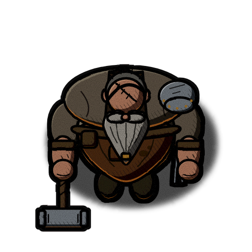
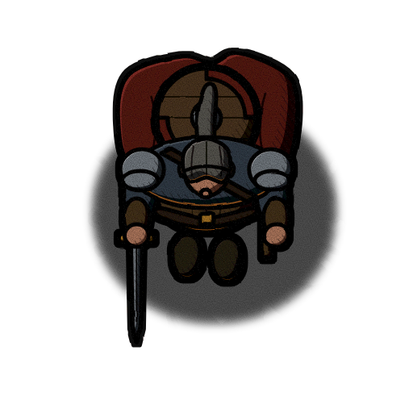
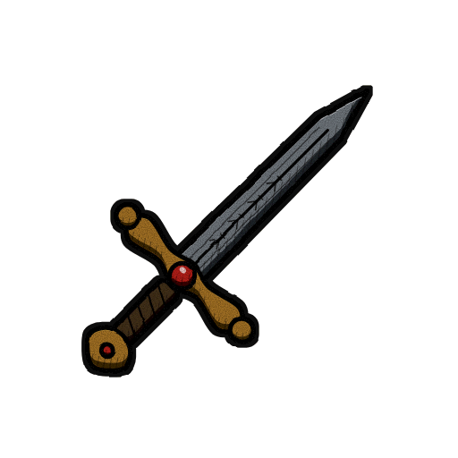
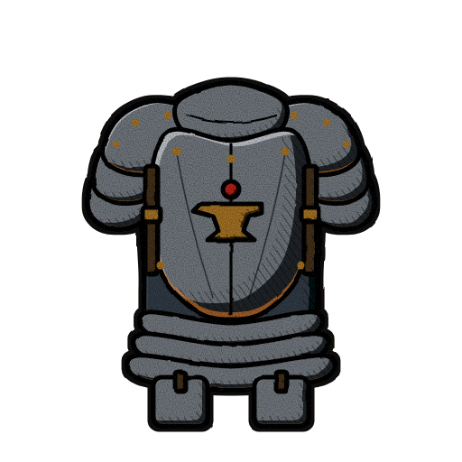
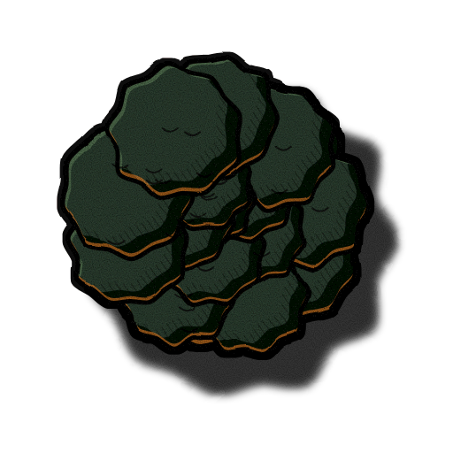
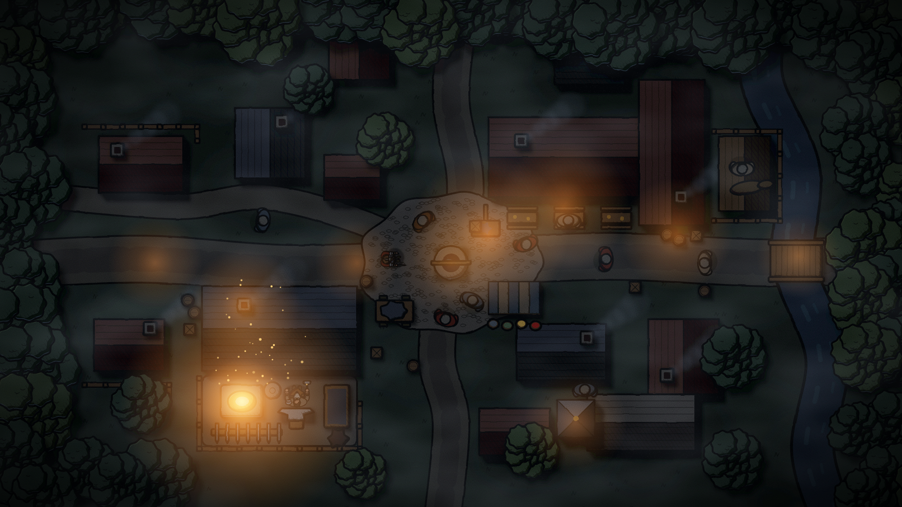
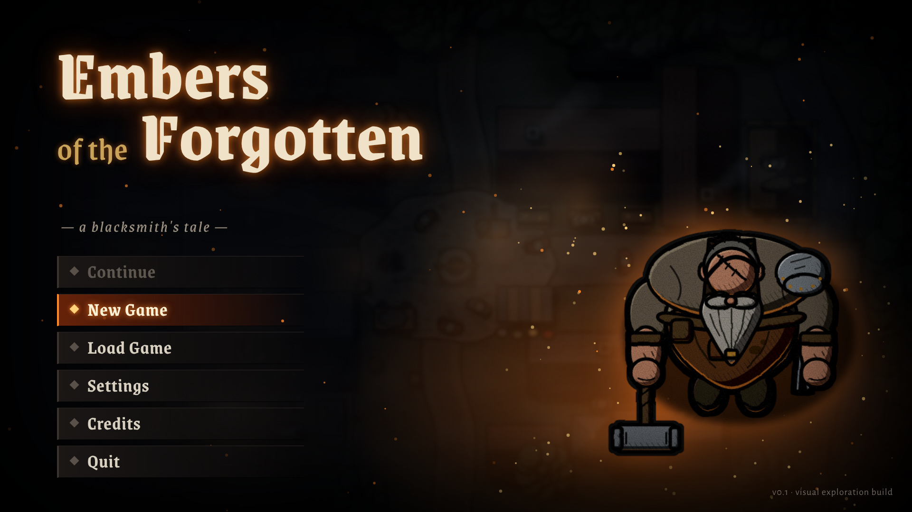
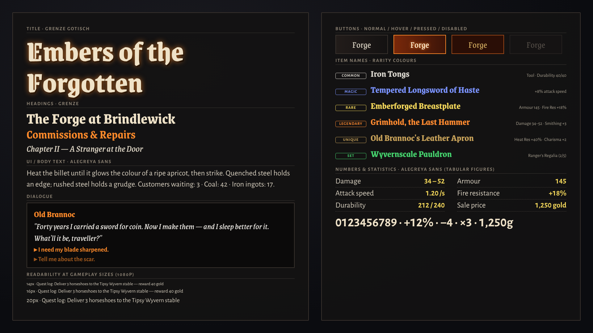

# 01 · Gothic Noir Top-Down — "Embers of the Forgotten"

> Direction 1 of 5 in the visual exploration package. Compare with
> `02_warm_storybook` ("The Old Anvil"), `03_bold_adventure` ("Forged Fortunes"),
> `04_ink_parchment` ("The Smith's Chronicle") and `05_production_light` ("Anvil & Ale").

Dark, atmospheric, illustrated fantasy: heavy black ink, exaggerated top-heavy
silhouettes, gritty texture and a cold night world cut open by warm forge-light.
The forge is literally the warmest, brightest thing in the village — the game's
visual heart is the smithy glowing in the dark.

The technique vocabulary is borrowed from the *Darkest Dungeon* school of
illustration (thick black inkwork, chunky hatching in shadow, desaturated
colour, stark value contrast, grain) and re-engineered for a **straight
top-down** village sim. Nothing from that game — characters, assets,
compositions, UI — is to be copied; only the rendering techniques are referenced.

---

## Rendering note (read first)

The eight example images in this folder are **procedural vector style studies**,
not final art. No AI image-generation model was available in the build
environment, so every image was drawn as SVG by Python
(`docs/visual_exploration/_generator/` — `styles.py` holds the palette and
style parameters, `svgcore.py` the shading/outline/filter code, `subjects.py`
the shared subject geometry) and rasterised with headless Chromium.

- They faithfully demonstrate palette, line weight, shading logic, lighting,
  proportions and typography — enough to judge the direction.
- They are simpler in form and detail than production art would be.
- All five directions share the same subject geometry and framing, so the
  differences you see are style, not content.
- `prompts.md` contains the prompts for producing production-quality versions
  with an image model, or for briefing an illustrator.

**Reference images:** the brief mentions four reference images; none were found
in the repository. Palette and prompts were derived from the written brief. If
the references are supplied later, re-check the palette, proportions and the
prompts in `prompts.md` against them.

---

## Example images

| # | File | Size | Shows |
|---|------|------|-------|
| 1 | [blacksmith.png](blacksmith.png) | 512×512, transparent | Protagonist, top-down, facing south |
| 2 | [adventurer.png](adventurer.png) | 512×512, transparent | Adventurer, same scale system |
| 3 | [sword.png](sword.png) | 512×512, transparent | Inventory icon |
| 4 | [armor.png](armor.png) | 512×512, transparent | Inventory icon (front view) |
| 5 | [tree.png](tree.png) | 512×512, transparent | Deciduous tree, top-down canopy |
| 6 | [town_view.png](town_view.png) | 1920×1080 | Village at night |
| 7 | [menu_screen.png](menu_screen.png) | 1920×1080 | Main menu |
| 8 | [font_reference.png](font_reference.png) | 1920×1080 | Typography sheet |

 

  

---

## Visual identity & rendering techniques

| Element | Treatment in this direction | Generator value (512 px sprite) |
|---|---|---|
| Ink | Near-black warm ink `#0d0b0a`, never pure black | `ink` |
| Contour line | Thick, uniform-ish outline around every shape | `line_w = 5.0` px |
| Silhouette outline | Extra dilated ink border around the whole sprite, so it separates from any background | `outer_w = 4` px dilation |
| Interior detail lines | Seams, folds, engravings — heavy, ~3 px | `detail()` width ×3.2 |
| Hand-inked wobble | Fractal-noise displacement of the whole sprite, so lines and edges feel brushed, not vector-perfect | `feTurbulence` 0.035 freq, displacement 2.6 |
| Base colour | Flat, desaturated fill | palette "base" |
| Cel shadow | One hard-edged shadow crescent, light from top-left | palette "shadow" |
| Hatching | Diagonal ink hatching (−35°, 1.6 px lines, 7 px spacing, ~55 % opacity) in the deepest band of the shadow | `hatch` pattern |
| Highlight | Thin, cold, light-side crescent — never a soft gradient | palette "light", 85 % opacity |
| Rim light (warm) | Orange forge rim `#ff8a2a` on the forward (bottom/south) edge of warm materials: skin, leather, metal, wood, cloth | `glow` |
| Rim light (cold) | Moon rim `#7f9cc0` on foliage, grass, stone, roofs, water | hard-coded in `svgcore.py` |
| Grain | Fine film-grain noise over every sprite and composition | `feTurbulence` 0.9 freq |
| Ground shadow | Black, 45 % opacity, slightly blurred ellipse | `ground_shadow()` |
| Compositions | Strong vignette, night, cold fog, warm light pools | town / menu |

Identity in one sentence: **ink first, then two hard values, then hatching, then
one sliver of light — and orange fire wherever the forge can see.**

---

## Colour palette

Each material has three roles: **light** (cold highlight sliver), **base**
(flat fill) and **shadow** (hard cel shadow, under the hatching). Values are
taken verbatim from `styles.py → "01_gothic_noir"`.

### Global colours

| Role | Hex | Use |
|---|---|---|
| Ink | `#0d0b0a` | All outlines, hatching, detail lines |
| Background / UI void | `#0b0c10` | Menu and UI backdrop, letterboxing, deepest night |
| Forge glow | `#ff8a2a` | Warm rim-light, forge pools, embers, title glow |
| Forge core | `#ffd27a` | Hottest centre of fire, lit windows, focused UI highlight |
| Moon rim | `#7f9cc0` | Cold rim on foliage / stone / roofs / water, fog tint |

### Material palette

| Material | Light | Base | Shadow |
|---|---|---|---|
| Skin | `#c99a7a` | `#a8735a` | `#4e2e24` |
| Beard (grey) | `#d4cfc4` | `#8f8a82` | `#3d3a37` |
| Hair | `#8a8580` | `#55524e` | `#232120` |
| Shirt (linen) | `#8a7e6a` | `#5a5042` | `#231f19` |
| Apron | `#7a4a2c` | `#4a2b19` | `#1c100a` |
| Leather | `#6b4a33` | `#42301f` | `#170f0a` |
| Strap | `#3a2a1e` | `#251a12` | `#0c0806` |
| Metal (steel) | `#c8ccd0` | `#6e747a` | `#23272c` |
| Gold / brass | `#e8b850` | `#a07028` | `#3e2a0e` |
| Cloak (red) | `#8a302a` | `#521c19` | `#1a0909` |
| Tunic (blue-grey) | `#56606a` | `#323a44` | `#101419` |
| Boot | `#4a3a30` | `#282019` | `#0c0907` |
| Wood | `#7a5a3a` | `#4a3522` | `#1a120b` |
| Foliage A | `#4f6a4c` | `#2a3b2e` | `#0e1611` |
| Foliage B (olive) | `#5d6e3e` | `#36442a` | `#131a10` |
| Grass / ground | `#323c33` | `#222a24` | `#101411` |
| Road / cobbles | `#5a5650` | `#3a3733` | `#1a1917` |
| Roof A (slate) | `#4e555e` | `#2e333a` | `#121519` |
| Roof B (tile) | `#6e4232` | `#432820` | `#1a0f0b` |
| Stone | `#7a7670` | `#4e4a44` | `#201e1b` |
| Water | `#2e4252` | `#1a2834` | `#080e14` |
| Gem (red) | `#ff6a4a` | `#b0201a` | `#3a0806` |
| Fire | `#ffe7a0` | `#ff8a2a` | `#a02a08` |

Palette rules:

- Saturation is reserved for **fire, gems, gold and the red cloak**. Everything
  else stays muted and slightly cold.
- The environment (grass, roofs, foliage, water) lives in a narrow band of dark
  green-blue-greys; characters and props sit 1–2 value steps lighter so they read
  on top of it.
- Shadows are near-black but keep a hue (`#1c100a` apron, `#0e1611` foliage) —
  never mix shadows with pure black, the ink already does that job.

---

## Lighting & shading approach

1. **Key light: top-left, cold and low-intensity** (moonlight / overcast dusk).
   It drives the cel shadow (bottom-right of every form), the hatching band
   beyond it and the thin highlight on the top-left edge.
2. **Fill: none.** Shadows are allowed to fall to near-black. Hatching, not
   ambient light, describes form inside them.
3. **Accent light: the forge (and inn, lanterns).** Rendered as a warm rim on the
   south (forward) edge of warm materials in sprites, and as real `PointLight2D`
   pools in-game. This gives the signature "lit from the fire in front of him"
   look.
4. **Cold rim** on foliage, stone and roofs separates environment masses from the
   dark ground without warming them.
5. **Atmosphere:** cold fog layers (`#7f9cc0` at low opacity) drifting over the
   ground, embers rising from the forge, a heavy screen-space vignette.
6. **Value structure:** at least 60 % of any frame is in the darkest two value
   steps; the brightest values appear only at light sources and at the focus of
   attention.

Baked vs dynamic: sprites carry the **baked** key light (top-left shadow,
hatching, highlight) and a modest baked warm rim. The in-game forge, inn and
lanterns add **dynamic** light via `PointLight2D` on top. Keep the baked rim
subtle (≤50 % opacity, as in the examples) so it does not fight dynamic light
coming from other directions; or bake the rim into a separate layer that is
modulated by proximity to the forge (see production notes).

---

## Character & object proportions

The neutral, shared design is pushed into a heavier, top-heavy silhouette.

| Measure (relative to shared neutral design) | Factor |
|---|---|
| Shoulder width | **1.14×** |
| Head size | **0.90×** |
| Belly / torso depth | **1.08×** |
| Tilt / lean | 0 (perfectly straight top-down) |

- The blacksmith reads as a **wide, heavy wedge** from above: broad shoulders and
  pauldron, small bald scarred scalp, huge braided beard and belly pushing forward
  (south). Heavy forearms and hammer extend the silhouette sideways.
- Adventurers use the same skeleton but slimmer; their identity comes from the
  **shoulder line** (pauldrons, shield on the back, cloak) and the weapon.
- Props are slightly oversized (hammer head, tongs, mugs, lanterns) so they read
  at gameplay zoom.
- Inventory icons are heroic and chunky: thick crossguards, oversized gems and
  rivets, deep fullers.
- Buildings: thick walls, steep heavy roofs, chimneys overscaled ~1.2×,
  slightly crooked timber and stone — lived-in and old.

---

## Suitability for straight top-down 2D

**What works**

- Thick ink outlines plus the 4 px silhouette border make sprites pop against
  busy ground textures — a genuine strength in top-down where characters overlap
  floor detail constantly.
- The exaggerated shoulder/head ratio makes characters **distinguishable from
  directly above**, where faces are invisible: bald scalp + beard (smith),
  ponytail + shield disc (adventurer), hood, hat brim, helmet crest.
- Night-plus-light-pools naturally guides the eye to interactive locations
  (forge, inn door, market stall).

**What is hard (and mitigations)**

| Risk | Mitigation |
|---|---|
| Faces, the main expressive tool of this genre, are invisible from straight above | Put personality into scalp, hair, beard, headgear, shoulder gear and props; use dialogue portraits (3/4 bust, same ink style) for expression |
| Night scenes reduce gameplay readability (paths, items on the ground, NPCs in shadow) | Keep a minimum ambient (`CanvasModulate` no darker than ~`#3a4050`), give interactables a subtle cold rim/outline highlight, characters always get the ink silhouette border, add a hover outline shader |
| Dark-on-dark environment can turn to mud on poor screens | Check every scene in greyscale; ensure ground vs. walkable path vs. obstacle differ by ≥1 clear value step; offer a brightness/gamma slider |
| Hatching and grain can shimmer or moiré when scaled/rotated | Bake hatching at final display scale; never rotate hatched sprites at runtime; keep grain as a screen-space shader, not baked into every sprite at runtime |
| Constant gloom fights the "warmth, lived-in" goal | Day cycle: daytime is overcast and desaturated but bright enough; night is the showcase; interiors (smithy, inn) are warm |
| Hard top-left baked shadow conflicts with dynamic lights from other angles | Keep baked shadow moderate; use normal maps so dynamic lights shade correctly |

Verdict: **suitable**, with discipline about ambient light levels and a
greyscale readability pass on every screen.

---

## Sprite & animation production considerations

| Topic | Recommendation |
|---|---|
| Directions | 4 directions (S, N, E, W) for the vertical slice; 8 for the blacksmith only if budget allows. Top-down limbs barely show, so 4 is usually enough |
| Mirroring | E/W mirroring is **not** free: the pauldron (left shoulder), hammer (right hand), tongs (left hip), sword/dagger sides would swap. Either accept the swap for background NPCs, or draw E and W separately for the protagonist and key characters, or split asymmetric props onto separate layers that are re-attached after flipping |
| Frame counts (per direction) | Idle 4–6 (beard/belly breath), walk 6–8, hammer strike 8–10 (anticipation, impact, recoil), carry 6, interact 4–6. NPCs: idle 4, walk 6 |
| Animation style | Snappy, few frames with strong key poses; smears and sparks on hammer impacts; ember particles carry motion in quiet scenes |
| Layering | Body / head-hair / apron-cloth / held prop / shoulder gear as separate layers on a `Skeleton2D` or cut-out rig — useful for equipment swaps (pauldrons, cloaks, shields) and for E/W prop handling |
| Rig vs frame-by-frame | Cut-out rig (`Skeleton2D` + `Polygon2D` or `RemoteTransform2D` on Sprite2D parts) suits this style: thick ink hides joints. Frame-by-frame only for hero actions (hammer strike) |
| Outlines: baked vs shader | **Bake** the inner ink lines and hatching (they are the style). The outer 4 px silhouette border can be a **canvas_item shader** instead: consistent across scaling, rig deformation and equipment layers, and togglable for hover/selection highlight |
| Normal maps | Recommended for characters and buildings near the forge. Generate from the base-colour layers (not the hatched final) with Laigter/SpriteIlluminator or paint simple 4-direction normals; assign via `CanvasTexture` (diffuse + normal) |
| Forge light in Godot | `PointLight2D` with a soft radial texture, colour `#ff8a2a`, energy 1.2–1.6, flicker via `AnimationPlayer` or a small script (±10 % energy, 8–12 Hz noise). `shadow_enabled` with `LightOccluder2D` on building walls for long shadows across the yard |
| Ambient | `CanvasModulate` around `#3a4050` (night) / `#9aa0a8` (day overcast); never darker than readability allows |
| Fog & grain | Screen-space: a full-screen `ColorRect` shader for grain + vignette; drifting fog as large semi-transparent sprites or a noise shader on a parallax layer |
| Particles | `GPUParticles2D` embers (orange → dark red, additive), chimney smoke (dark grey, alpha), quench steam |

---

## Advantages & disadvantages

| Advantages | Disadvantages |
|---|---|
| Very strong, memorable identity; screenshots stand out | Highest risk of readability problems at night and in dense scenes |
| Forge-as-light-source turns the core loop location into the visual centrepiece | Darkness can undercut the requested warmth and humour |
| Thick ink hides small drawing errors, rig joints and compression artefacts | Hatching and grain are labour-intensive to keep consistent across many artists/assets |
| Value contrast gives good silhouette separation for characters | Dynamic lighting setup (normal maps, occluders) adds technical work |
| Scales well to mature D&D themes (curses, monsters, dungeons) | Desaturated palette limits colour-coding for gameplay; must lean on rarity colours and UI |
| Godot 2D lights do much of the atmosphere at runtime | Marketing risk: may read as "horror" rather than "cosy sim" to some audiences |

---

## Estimated production difficulty

**Rating: 4 / 5** (hard). Higher than the clean/flat directions because each
asset needs ink, hard shadow, hatching, rim light and a normal map, and every
scene needs lighting work.

Assumptions: a modest but complete game — one village, its surroundings and
1–2 wilderness areas; ~40 % of hours spent at the forge; one experienced 2D
illustrator/animator (or equivalent outsourcing) plus a part-time technical
artist for Godot lighting/shaders. Ballparks include revisions; they exclude
marketing art and trailers.

| Asset group | Rough count | Person-months |
|---|---|---|
| Protagonist (4 dir, ~8 animations, layered equipment) | 1 rig, ~150–200 frames | 1.5–2 |
| Named NPCs / adventurers (4 dir, idle/walk/2 actions) | 12–15 | 3–4 |
| Background villagers (palette/part swaps) | 8–10 bases | 1 |
| Creatures / monsters (wilderness) | 6–10 | 2–3 |
| Dialogue portraits (3/4 bust, 2–4 expressions) | 15–20 | 2–2.5 |
| Item icons (weapons, armour, materials, consumables) | 150–250 | 3–4 |
| Buildings & interiors (smithy, inn, cottages, chapel…) | 12–18 + 3 interiors | 2.5–3 |
| Environment tiles & props (terrain, roads, foliage, clutter) | 250–400 tiles/props | 3–4 |
| UI (HUD, inventory, crafting, dialogue, menus) | ~25 screens | 1.5–2 |
| FX, lighting, normal maps, shaders, polish | — | 2–3 |
| **Total** | | **≈ 22–29 person-months** |

Using an image model (see `prompts.md`) for concept/first passes can save
perhaps 20–30 % on static assets (icons, props, portraits), but every output
still needs manual clean-up of outlines, palette lock and hatching consistency;
animation savings are small.

---

## Typography

Typography follows the same idea as the art: heavy, inked, slightly brutal
display lettering on top, very clean and readable text underneath.

### Recommended fonts (all SIL Open Font License, free for commercial use)

| Role | Font | Weights | Link |
|---|---|---|---|
| Title / logo | **Grenze Gotisch** | 700–800 (family 100–900) | <https://fonts.google.com/specimen/Grenze+Gotisch> |
| Headings, speaker names | **Grenze** | 600–700 | <https://fonts.google.com/specimen/Grenze> |
| Dialogue body | **Grenze** 400 italic, or Alegreya Sans 400 | 400 / 400i | <https://fonts.google.com/specimen/Grenze> |
| UI / body text | **Alegreya Sans** | 400 / 500 / 700 | <https://fonts.google.com/specimen/Alegreya+Sans> |
| Numbers & stats | **Alegreya Sans** 700, tabular lining figures | 700 | <https://fonts.google.com/specimen/Alegreya+Sans> |

Files are available from Google Fonts (TTF) or fontsource (`@fontsource/grenze-gotisch`,
`@fontsource/grenze`, `@fontsource/alegreya-sans`, WOFF2). The generator's
`fetch_fonts.sh` downloads them into `_generator/fonts/`. Ship the OFL licence
text with the game.

### Title font & lettering characteristics

- Grenze Gotisch is a blackletter/roman hybrid: gothic flavour with far better
  legibility than true Textura. Strong vertical strokes, sharp diamond terminals,
  compact counters.
- Logo: weight 700–800, slightly increased tracking (+2–4 %), warm off-white
  (`#ffd27a` → `#ff8a2a` vertical gradient) with a 3–4 px ink outline and an
  outer **ember glow** (`#ff8a2a`, blurred 12–24 px at 1080p). Optionally a few
  rising ember particles from the letter tops in the menu.
- Use the title face **only** for the logo, chapter/location cards and very
  large headings — never for body text.

### Readable UI font

- Alegreya Sans: humanist sans with calligraphic roots, so it matches the
  blackletter mood but stays highly legible at small sizes.
- Minimum sizes at the 1920×1080 reference: 20 px for body/UI labels, 18 px
  for secondary tooltips, 16 px absolute minimum.
- Text colour `#d8d4cc` (same as Common rarity) on panels of `#0b0c10`–`#2a2420`;
  disabled text `#6e6a64`.

### Heading & dialogue typography

- Headings and speaker names: Grenze 600–700, all caps or small-cap feel
  (+5 % tracking), colour `#e8b850` (gold light) or `#ffd27a` for focus.
- Dialogue body: Grenze 400 italic at 24–26 px for an in-world "spoken" voice,
  or Alegreya Sans 400 at 22–24 px if long dialogue needs maximum readability
  (offer this as an accessibility option).
- Dialogue box: dark panel `#0b0c10` at ~90 % opacity, 3 px ink border plus a
  1 px inner warm line `#a07028`, portrait on the left.

### Buttons

Normal: Grenze 600 `#d8d4cc` on dark panel. Hover: text `#ffd27a`, panel rim
lit with `#ff8a2a`, small ember glow. Pressed: text `#ff8a2a`, panel 1 value
step darker, 1–2 px downward offset. Disabled: `#6e6a64`, no glow, 60 % opacity
frame.

### Numbers & statistics

- Alegreya Sans 700 with **tabular lining figures** (`tnum`, `lnum`) so columns of
  damage, armour, prices and timers align and do not jitter when values change.
- Positive deltas `#45d46e`, negative `#ff6a4a`, neutral `#d8d4cc`; gold amounts
  `#e8b850` with a coin icon.
- Right-align numeric columns; use a thin space or `·` as thousands separator
  for large prices.

### Item rarity colours

Tuned for the dark UI background `#0b0c10`. Contrast ratios (WCAG 2.x) were
computed against the background and against a typical warm panel `#2a2420`.

| Rarity | Hex | vs `#0b0c10` | vs panel `#2a2420` | Notes |
|---|---|---|---|---|
| Common | `#d8d4cc` | 13.2 : 1 | 10.4 : 1 | Also default body-text colour |
| Magic | `#7b93ff` | 6.9 : 1 | 5.4 : 1 | Cool blue; same luminance as moon rim — don't place magic items on fog-tinted panels |
| Rare | `#f2d65a` | 13.5 : 1 | 10.6 : 1 | Brightest; can bloom in glow-heavy UI, keep glow off |
| Legendary | `#ff8a30` | 8.3 : 1 | 6.5 : 1 | Nearly identical to forge glow `#ff8a2a` — reserve the ember glow effect for Legendary names so the link is intentional, and keep forge-orange out of generic UI chrome |
| Unique | `#c9a35a` | 8.3 : 1 | 6.5 : 1 | Gold-brown; close in hue to Rare/Legendary — always pair with an icon frame or label, not colour alone |
| Set | `#45d46e` | 10.1 : 1 | 7.9 : 1 | The only green in the UI; avoid also using it for "positive delta" next to Set items, or shift deltas to an icon |

All pass WCAG AA (≥ 4.5 : 1) for normal text on both backgrounds. For colour-blind
players the Rare / Legendary / Unique trio is the weak spot: add a rarity word,
frame shape or pip count to the tooltip.

### Godot import notes

- Import `.ttf`/`.otf` (or `.woff2`) as **FontFile**; set antialiasing to
  *Grayscale*, hinting *Light*, subpixel positioning *Auto*.
- **Large titles:** enable *Multichannel Signed Distance Field* (MSDF) on the
  Grenze Gotisch import (pixel range 8–16, size 48) so the logo stays crisp at
  any scale and supports large outlines cheaply. Keep MSDF **off** for small UI
  fonts.
- Outlines/shadows: use the `Label`/theme settings `outline_size` (title 6–8 px,
  headings 2–3 px, colour `#0d0b0a`) and `shadow_color` (`#ff8a2a` at ~40 %
  alpha, `shadow_outline_size` 8–12 for an ember glow on the logo). Body UI text:
  1 px outline at most.
- **Tabular figures:** create a `FontVariation` resource based on Alegreya Sans
  Bold and set `opentype_features` to `tnum = 1` and `lnum = 1`; use that
  variation for all stat labels.
- Put all fonts and sizes into a single `Theme` resource
  (`res://ui/themes/theme_gothic.tres`) with type variations
  (`TitleLabel`, `HeadingLabel`, `DialogueLabel`, `StatLabel`).
- Grenze/Alegreya Sans cover Latin Extended; add a fallback font (e.g. Noto Sans)
  in the FontFile `fallbacks` list if localising beyond Latin scripts.
