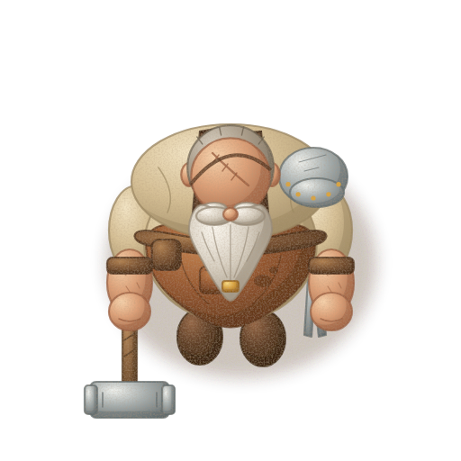
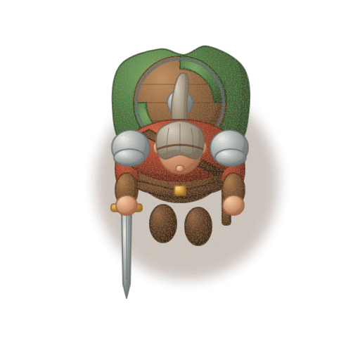
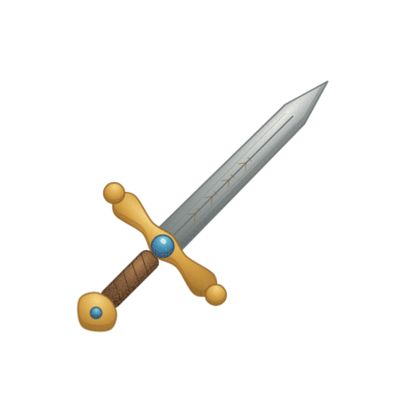
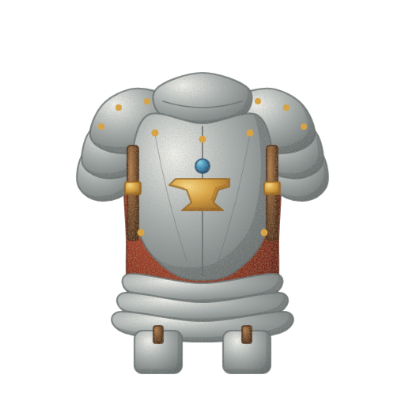
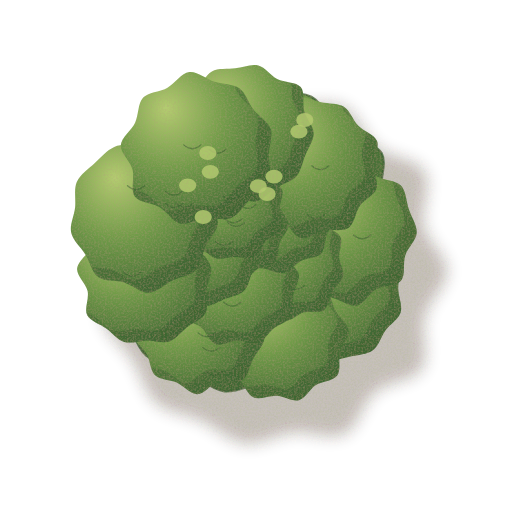
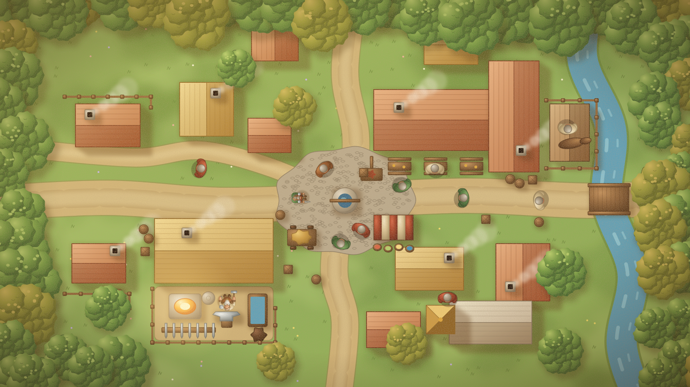
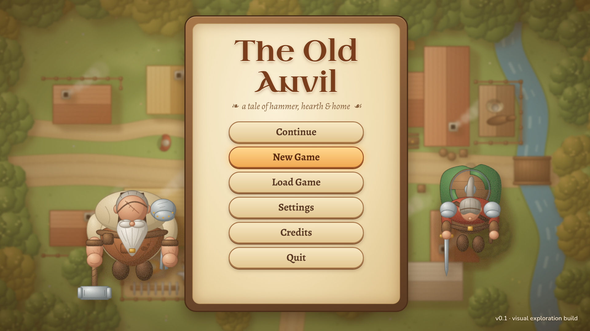
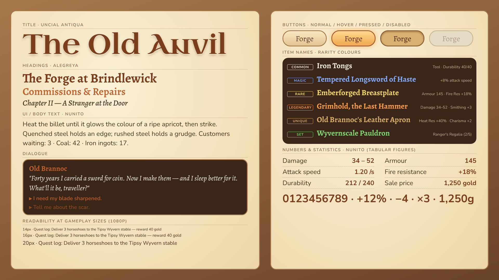

# 02 — Warm Storybook Village · working title *"The Old Anvil"*

> A hand-painted fantasy storybook for grown-ups: gouache-and-watercolour softness, golden
> afternoon light, rich natural materials and a village that feels lived in and welcoming —
> with enough age, scars and shadow in it that it never tips into nursery cartoon.

Part of the five-direction visual exploration for the DND Blacksmith game (Godot 4.x,
**straight top-down 2D** — the camera looks straight down at heads, shoulders, roofs and
canopies, not a 3/4 view). Sibling directions: 01 Gothic Noir, 03 Bold Readable Adventure
Sim, 04 Ink-and-Parchment, 05 Production-Light Indie.

Files in this folder:

| File | Content |
|---|---|
| `README.md` | This document — identity, palette, lighting, proportions, suitability, production, typography |
| `prompts.md` | Master style prompt + one detailed prompt per example image + consistency rules |
| `naming_guide.md` | Filenames, folder layout, dimensions, pivots, Godot import settings |
| 8 × `.png` | Style studies (see below) |

---

## Rendering note (read first)

The example images are **not** final art and were **not** made with an AI image model — no
image-generation model was available in the build environment. They are **procedural vector
illustrations**: SVG written by Python in `docs/visual_exploration/_generator/`
(`styles.py` holds the palette and style parameters under key `"02_warm_storybook"` /
`key="storybook"`, `svgcore.py` the shading and filter code, `subjects.py` the shared subject
geometry) and rasterised with headless Chromium. All five directions share identical subject
geometry, so differences you see are purely style — proportions, shading, line, palette and
type.

Treat them as faithful **style mock-ups**: they lock palette, light direction, edge treatment,
proportions and framing. A real painted version will have more brush variation, richer
textures and more storytelling detail. `prompts.md` is written for producing those
production-quality versions with an image model or for briefing an illustrator.

The brief referred to four reference images; **none were found in the repository**. If they
are supplied later, re-check the palette and prompts in this folder against them.

---

## The eight examples

| # | Preview | Subject | Canvas |
|---|---|---|---|
| 1 | [blacksmith.png](blacksmith.png) | Protagonist — retired adventurer turned smith, top-down, facing south | 512×512, transparent |
| 2 | [adventurer.png](adventurer.png) | Visiting adventurer, same scale system | 512×512, transparent |
| 3 | [sword.png](sword.png) | Inventory icon — rune longsword, 45° | 512×512, transparent |
| 4 | [armor.png](armor.png) | Inventory icon — plate cuirass, front view | 512×512, transparent |
| 5 | [tree.png](tree.png) | Top-down deciduous canopy | 512×512, transparent |
| 6 | [town_view.png](town_view.png) | Village in golden late-afternoon light | 1920×1080 |
| 7 | [menu_screen.png](menu_screen.png) | Main menu, "The Old Anvil" | 1920×1080 |
| 8 | [font_reference.png](font_reference.png) | Typography sheet | 1920×1080 |

 

  

---

## Visual identity

**Keywords:** hand-painted · gouache & watercolour · warm · soft-edged · golden hour ·
natural materials · gently rounded · mature storybook · cosy with undertones of age and mystery.

**Touchstones (spirit, not copying):** classic illustrated fairy-tale books and the
gouache/watercolour picture-book masters, read through an adult lens — weathered faces, scars,
worn leather, real weight in the tools.

What makes it *this* direction rather than a generic "cute" style:

- **No black linework.** Every shape is bounded by a thin, soft line in its *own* shadow hue,
  so edges read as painted rather than inked.
- **Colour carries form**, not line: each material has a light → base → shadow ramp that is
  warm-biased in the lights and earthy (not grey or blue) in the shadows.
- **Proportions are gently softened** (slightly larger head and belly) but anatomy stays
  grounded — the smith is a heavy, older man, not a chibi.
- **Mood through light, not darkness.** Warmth dominates; mystery comes from deep forest
  greens, dusk, firelight pools and the occasional night scene, not from a desaturated base.

### Rendering techniques used in the examples

| Technique | How it is done in the generator (`storybook`) | What a painter should do |
|---|---|---|
| Painted volume | Per-material **radial gradient**, centre biased to the top-left (light → base at 45 % → shadow at the rim) | Wet-in-wet gouache gradient, lights laid top-left |
| Form shadow | A **blurred shadow band** (~3 px blur, 45 % opacity, shadow hue) clipped *inside* each shape, offset away from the light | Soft core shadow on the bottom-right of every volume |
| Edges | **~2 px outline in the material's own shadow hue at 75 % opacity**; foliage clusters have *no* outline | Coloured line or simply a darker edge; never pure black |
| Interior detail | Seams, folds, engravings drawn in the material's shadow hue at ~80 % opacity | Dry-brush detail in local dark |
| Paper / gouache grain | Fractal-noise texture multiplied in warm brown at low alpha over each sprite | Visible paper tooth, subtle pigment granulation |
| Hand wobble | Low-frequency noise **displacement (scale 1.2)** on whole sprites | Natural hand-drawn imperfection; no ruler-straight lines |
| Ground shadows | Ellipse in `#4a2e14`, 28 % opacity, 9 px blur — warm, never black | Soft warm umber contact shadow |
| Foliage | Overlapping blob clusters, brightest clusters top-left drawn last, scallop leaf marks, **dappled light spots** in the light hue | Clustered leaf masses with sun-dapple highlights |
| Scene light | Golden late-afternoon; long, soft, warm shadows cast to the bottom-right | Same — key light from the top-left, low and warm |

---

## Colour palette

All values are taken directly from `styles.py` → `"02_warm_storybook"`. Each material role
has three tones: **light** (lit plane / highlight), **base** (local colour), **shadow** (form
shadow and outline).

### Global colours

| Role | Hex | Use |
|---|---|---|
| Outline / ink brown | `#5a3a24` | Lettering outlines, UI frames, the few places a neutral line is needed |
| UI dark wood background | `#2c2016` | Menu/panel background, tooltip base |
| Warm glow | `#ffb050` | Forge glow, lantern light, hover glow, selection |
| Warm glow (pale) | `#ffe0a0` | Glow core, title highlight, sparks |
| Ground-shadow tint | `#4a2e14` @ 28 % | Character / prop contact shadows |
| Cast-shadow tint | `#3a2a10` @ 30 % | Tree and building cast shadows |
| Parchment (panel fill) | `#f2e4c4` | Light UI panels, scroll backgrounds (re-uses the *shirt* light tone) |

### Material ramps

| Material | Light | Base | Shadow |
|---|---|---|---|
| Skin | `#f6d2ac` | `#dca078` | `#9a5e40` |
| Beard (grey/white) | `#fbf7ef` | `#d8d0c2` | `#958a78` |
| Hair (grey) | `#d8d0c2` | `#a89c8a` | `#6e6454` |
| Shirt / linen | `#f2e4c4` | `#d6c096` | `#9a8660` |
| Apron (tanned leather) | `#c4824e` | `#94562f` | `#5a3218` |
| Leather | `#b08050` | `#7d5534` | `#4a2e1a` |
| Straps / belts | `#8a5e3a` | `#62402a` | `#3a2416` |
| Steel | `#eef0ec` | `#a8b0b0` | `#626c6e` |
| Gold / brass | `#f8da86` | `#d9a441` | `#93621e` |
| Cloak (green wool) | `#7aa866` | `#4a7a44` | `#2a4a2a` |
| Tunic (madder red) | `#d4664a` | `#a2432c` | `#62241a` |
| Boots | `#946646` | `#5e3e26` | `#36220f` |
| Wood | `#c09060` | `#8e6640` | `#553a20` |
| Foliage (green) | `#b4cc70` | `#6f9a48` | `#365e30` |
| Foliage (autumn olive) | `#d0b860` | `#9a9a40` | `#5a6428` |
| Grass | `#b0c878` | `#8cae5c` | `#62863e` |
| Road / packed earth | `#e8d2a0` | `#cdb07a` | `#9a7e52` |
| Roof A — thatch | `#ecc878` | `#c99a48` | `#8a6428` |
| Roof B — clay tile | `#dc8a5e` | `#b05a3a` | `#743822` |
| Stone | `#e0d6c4` | `#b8a990` | `#7e7260` |
| Water | `#a0d4dc` | `#5aa0b8` | `#346c8a` |
| Gem (sapphire) | `#8ad8e8` | `#3a90b8` | `#1a4a6a` |
| Fire | `#fff2c0` | `#ffaa40` | `#c0501a` |

**Palette rules**

- Shadows shift towards warm umber/red-brown, never towards neutral grey or black. The
  only cool shadows are water and gems.
- Saturation peaks in the mid-tones (base); lights are creamy, shadows earthy.
- Accent colours (madder red tunic, green cloak, sapphire, fire) are reserved for focal
  points — characters, loot, forge. Environment stays in ochres, greens and stone.

---

## Lighting & shading

- **Key light:** warm, from the **top-left** (screen space), low "late afternoon" angle.
  Every asset — characters, icons, props, buildings — uses the same light direction so they
  can be mixed freely.
- **Form shading:** three-step ramp, soft transitions; core shadow on the bottom-right of
  each volume; no hard cel bands, no specular hot spots except a soft gleam on steel and gold.
- **Cast shadows:** warm, translucent, blurred; on the town map they fall toward the
  bottom-right and are moderately long (golden hour). Characters get a small soft contact
  ellipse only, so they work under any time-of-day setting.
- **Emissive:** forge, lanterns and windows use the glow pair `#ffb050` / `#ffe0a0` with a
  soft additive halo.
- **Time of day in-engine:** paint assets in neutral-warm daylight and do the day/dusk/night
  shift with `CanvasModulate` + `PointLight2D` (see production section). Only the hero
  background art (menu, key scenes) has the golden hour baked in.

---

## Character & object proportions

The shared neutral design is scaled per style in `subjects.py → PROPS["storybook"]`:

| Parameter | Storybook | Effect |
|---|---|---|
| Shoulder width | 1.00× | Natural build, not heroic |
| Head size | 1.04× | Slightly larger, friendlier, reads better from above |
| Belly size | 1.04× | Emphasises the smith's heavy, comfortable build |
| Tilt / exaggeration | 0 | No caricature lean |

- **Silhouette language:** rounded, soft corners; bulk is suggested with gentle bulges rather
  than angular planes. Tools and weapons keep believable proportions (the sledgehammer is
  heavy, the sword is a real longsword).
- **Top-down reading order** (largest → smallest): head/scalp, beard, shoulders and
  pauldron, belly/apron, held tools, feet. The beard ring and the single pauldron are the
  smith's identity markers from above.
- **Scale:** at game scale (128 px character canvas, see `naming_guide.md`) the smith's
  shoulders span about 1.3 tiles (≈ 84 px of a 64 px tile grid); the adventurer is ~15 %
  narrower. Doors are 1 tile wide; a cottage is about 3×3 tiles.
- **Icons:** sword at 45°, tip top-right; armour front-on and centred; both fill ~80 % of
  the canvas with breathing room for a frame.

---

## Suitability for straight top-down 2D

Honest assessment: **good, with contrast management.** The style is beautiful in stills,
but soft, outline-light painting is the hardest kind of art to keep readable when small,
moving sprites sit on a richly painted ground.

| Risk | Why it happens here | Mitigation |
|---|---|---|
| Characters blend into the ground | Soft edges, own-hue outlines, warm-on-warm palette | Keep ground tiles **lower contrast and lower saturation** than actors; give actors a 1–2 px darker rim (shadow hue, slightly stronger than in props); always draw the contact shadow |
| Top-down heads all look like ovals | Little silhouette variety from above | Distinct scalp/hair/hat shapes, colour-coded cloaks and shoulder gear; exaggerate shoulder props (pauldron, shield on back) |
| Interactables get lost | Painted props look like décor | A warm hover/rim glow (`#ffb050`) shader, subtle idle bob or sparkle on interactables |
| Mush at small zoom | Gradients and grain flatten when downsampled | Paint masters at 2× and downsample once with a good filter; avoid detail below ~3 px at final size; test at 1× zoom constantly |
| Busy village | Flowers, grass texture, clutter | Value-group the ground (paths lightest, grass mid, props framed); reserve the strongest accents for characters and loot |
| Night scenes go muddy | Warm palette darkened uniformly | Use `CanvasModulate` towards blue-violet plus warm `PointLight2D`s rather than darkening the art itself |

Straight top-down actually *helps* this style in one way: no 3/4 wall faces means fewer
painted planes per building, and roofs/canopies are large, satisfying painted shapes.

---

## Sprite & animation production

Painted frame-by-frame animation is the single biggest cost risk of this direction. Each
frame needs consistent texture, light and edge softness; at 8 directions × several actions it
explodes quickly.

**Recommended approach**

1. **Cut-out / skeletal rigging** for characters: paint parts separately (head, beard, torso,
   apron, arms ×2 segments, hands, held tool, feet) and rig them with Godot `Skeleton2D` +
   `Polygon2D` (mesh deformation for the belly/beard/cloak) and `AnimationPlayer`. From
   straight top-down, walk cycles are mostly shoulder sway, arm swing and feet peeking out —
   ideal for rigging.
2. **Limited frame counts** where hand-painting is unavoidable: walk 6 frames, idle 4,
   hammer strike 6, interact 4. Paint on 2s; let tweening and squash do the rest.
3. **4 directions** (S, N, E, W with E mirrored to W where the design allows — see the
   mirroring caveats in `naming_guide.md`); 8 directions only for the protagonist if budget
   allows.
4. **Layering:** separate layers for body, held item and FX so new weapons/tools don't
   require repainting the character; equipment swaps are a sprite swap on a bone.
5. **Texture consistency:** one shared paper-grain overlay (tileable, applied in a shader or
   at export) rather than painting grain per frame — keeps grain from "boiling" between
   frames. Same applies to edge wobble: bake it into parts, not per frame.
6. **Lighting baked vs dynamic:** bake only the soft top-left form shading into sprites.
   Time-of-day colour comes from `CanvasModulate`; forge/lantern light from `PointLight2D`
   (optionally with normal maps for the protagonist and key props only). Do **not** bake the
   long golden-hour cast shadows into reusable sprites — draw cast shadows as separate soft
   shadow sprites so they can be rotated/faded with time of day.
7. **FX** (sparks, smoke, forge glow, magic) as particles + small painted textures with
   additive blending — cheap and very effective in this style.

---

## Advantages & disadvantages

| Advantages | Disadvantages |
|---|---|
| Strong emotional pull: warmth, nostalgia, "I want to live here" | Highest per-asset painting cost of the five except possibly 01 |
| Fits a cosy-crafting + adventure loop and a lovable older protagonist | Readability on painted ground needs constant contrast discipline |
| Ages well; not tied to a pixel-art or flat-vector trend | Frame-by-frame animation is expensive; rigging requires a technical artist mindset |
| Natural materials (wood, leather, steel, stone) make crafted items look desirable | Hard to keep consistent across multiple artists or AI generations |
| Darkness and mystery can be added through light/time-of-day without changing the art | Risk of drifting into "childish" if proportions or saturation are pushed |
| Excellent marketing stills, store capsules and menu art | Soft alpha edges need careful export (halo artefacts) |

---

## Estimated difficulty of a complete game

**Difficulty: 4 / 5** (second-hardest of the five after/alongside Gothic Noir; hardest to keep
consistent).

**Assumptions:** a small but complete game — one village, 3–4 wilderness areas, ~6–8 hours
of play; one experienced 2D illustrator plus part-time help from a technical artist; cut-out
rigging for characters; AI image generation used only for ideation/paint-over, never shipped
unedited; a person-month = ~20 working days.

| Asset group | Rough count | Notes | Person-months |
|---|---|---|---|
| Hero characters (smith + 4–6 major NPCs) | 6–7 rigs | Parts painted, rigged, 4 directions, 6–10 actions each | 3–4 |
| Minor villagers / adventurers | 15–20 variants | Shared rig, palette/part swaps | 1.5–2 |
| Creatures / enemies | 8–12 | Rigged or 4–6 frame loops | 2–3 |
| Equipment icons (weapons, armour, materials, consumables) | 250–350 | Painted at 512, consistent frame, ~1–1.5 h each with template | 2.5–3.5 |
| Environment tiles & terrain transitions | 6–8 biomes × ~40 | Tileable, low-contrast ground | 2 |
| Props & décor | 200–300 | Barrels, crates, forge tools, flora | 2–3 |
| Buildings | 25–35 | Roof-dominant from top-down, damage/seasonal variants extra | 1.5–2 |
| UI (frames, buttons, panels, HUD, map) | ~150 elements | Wood/parchment kit, 9-slice | 1–1.5 |
| FX | 40–60 | Particles + painted sprites | 0.5–1 |
| Key art, menu, loading screens | 6–10 | Fully painted illustrations | 1–1.5 |
| **Total art** | | | **≈ 17–24 person-months** |

Roughly **1.3–1.6×** the effort of direction 05 (Production-Light) and similar to 01. With
AI-assisted paint-over pipelines and strict templates the lower bound is realistic; with
frame-by-frame animation instead of rigging, add 30–50 %.

---

## Typography

The typographic voice is a *well-loved storybook*: a rounded uncial for the title, a literary
calligraphic serif for headings and dialogue, a soft rounded sans for functional UI.

### Title font & lettering — **Uncial Antiqua**

- Rounded uncial book-hand: no hard capitals, open bowls, gentle serifs — reads as old,
  hand-lettered and friendly at once.
- Treatment: **warm cream fill** (`#f6efe0` → `#ffe0a0` subtle vertical gradient), **brown
  outline** `#5a3a24` (≈ 4–6 % of cap height), **soft drop shadow** `#2c2016` at 50–60 %,
  offset down-right (consistent with top-left light), 4–8 px blur.
- Use only for the game title, chapter/area titles and the occasional sign — never for
  running text; it becomes tiring and less legible below ~28 px.

### Headings & dialogue — **Alegreya**

- **Headings:** Alegreya 600–800 (SemiBold–ExtraBold), sentence or title case; warm cream on
  dark wood, ink brown `#5a3a24` on parchment.
- **Dialogue:** Alegreya Regular 400 for speech, *Italic* for thoughts, emphasis, item lore
  and narration. Calligraphic, literary, highly readable at 20–26 px.
- Speaker names: Alegreya 700 small caps (`smcp` feature) or Nunito 800 in the speaker's
  accent colour.

### Readable UI font — **Nunito**

- Rounded terminals echo the soft painted edges; generous x-height stays legible at 14–16 px.
- Body/UI labels 400–600; **buttons 700–800**; tooltips 400 with 600 for stat labels.
- Minimum sizes at 1920×1080 reference: body 18 px, small labels 15 px, buttons 24–28 px.

### Numbers & statistics

- **Nunito 700/800 with tabular figures** (`tnum`) so damage, prices and stat columns
  align and don't jitter when values change.
- Stat lines: label in Nunito 600 muted (`#d6c096` on dark wood), value in Nunito 800 cream;
  positive deltas `#82d870`, negative `#e0705a`; gold prices with a small coin icon in
  `#d9a441`.
- Large numbers (gold total, damage pop-ups) get the title treatment: cream fill, brown
  outline, soft shadow — but keep the Nunito digits for clarity.

### Item rarity colours

Tuned for the **dark wood** UI (`#2c2016`). Contrast ratios computed against the background
(WCAG; ≥ 4.5 is comfortable for text):

| Rarity | On dark wood | Contrast on `#2c2016` | On parchment `#f2e4c4` (raw) | Darker variant for parchment | Contrast on parchment |
|---|---|---|---|---|---|
| Common | `#f6efe0` | 13.8 : 1 | 1.1 : 1 ✗ | `#3a2a1a` | 10.9 : 1 |
| Magic | `#86aeff` | 7.2 : 1 | 1.8 : 1 ✗ | `#2a4c9a` | 6.4 : 1 |
| Rare | `#f8dc66` | 11.6 : 1 | 1.1 : 1 ✗ | `#7a5a00` | 5.1 : 1 |
| Legendary | `#ffa046` | 7.8 : 1 | 1.6 : 1 ✗ | `#a8460e` | 4.7 : 1 |
| Unique (gold/brown) | `#d8ae66` | 7.7 : 1 | 1.6 : 1 ✗ | `#6e4a1c` | 6.3 : 1 |
| Set | `#82d870` | 9.1 : 1 | 1.4 : 1 ✗ | `#2e6e2a` | 4.9 : 1 |

Notes:

- All six are comfortable on dark wood. On **light parchment panels the bright set is
  unreadable** — either use the darker variants above, or keep the bright colour and add a
  2–3 px `#2c2016` outline (Godot `outline_size`), which works for item *names* but is too
  heavy for body text.
- Rare (yellow) and Unique (gold) are close in hue; always pair rarity colour with a second
  cue — frame/border style, gem pip, or the rarity word in the tooltip — for colour-blind
  players. Legendary vs Unique similarly relies on value difference; keep the frame cue.
- Don't put rarity text on the golden-hour game world directly; use a tooltip panel.

### Recommended fonts (all SIL Open Font License — free for commercial use and embedding)

| Role | Font | Weights | Link |
|---|---|---|---|
| Title | Uncial Antiqua | 400 | <https://fonts.google.com/specimen/Uncial+Antiqua> |
| Headings & dialogue | Alegreya | 400, 400i, 600, 700, 800 | <https://fonts.google.com/specimen/Alegreya> |
| Small-caps alt. | Alegreya SC | 500, 700 | <https://fonts.google.com/specimen/Alegreya+SC> |
| UI & numbers | Nunito | 400, 600, 700, 800 (variable) | <https://fonts.google.com/specimen/Nunito> |

Also available via fontsource (`@fontsource/uncial-antiqua`, `@fontsource/alegreya`,
`@fontsource/nunito`). Ship the OFL licence text with the game (`res://assets/fonts/LICENSES/`).

### Godot 4 import notes

- Import `.ttf`/`.otf` as **FontFile**. Keep the static weights you use (or the variable
  Nunito with `FontVariation.variation_opentype` for `wght`).
- **Title (Uncial Antiqua):** enable **Multichannel Signed Distance Field** (MSDF) in the
  import dock so the title scales cleanly in the menu, logo animations and zoomed signs; set
  `msdf_pixel_range` ≥ 8 so a thick outline renders correctly.
- **Body/UI (Nunito, Alegreya):** regular raster import, antialiasing *Grayscale*, hinting
  *Light*, subpixel positioning *Auto*; generate mipmaps off for UI fonts.
- **Outline & shadow:** use `LabelSettings` (or Theme constants) — `outline_size` 4–6 and
  `outline_color #5a3a24` for titles; `shadow_color #2c2016` @ 0.55, `shadow_offset (3,4)`,
  `shadow_size` 4 for the soft drop shadow.
- **Tabular figures:** create a `FontVariation` resource on Nunito with
  `opentype_features = { "tnum": 1 }` (optionally `"lnum": 1`), save as
  `nunito_numbers_tnum.tres`, and assign it to stat labels via a Theme type variation
  (e.g. `StatValue`).
- **Small caps** for speaker names: a `FontVariation` on Alegreya with `{ "smcp": 1 }`.
- Build one `Theme` resource (`ui_theme_storybook.tres`) that sets default font Nunito,
  heading/dialogue type variations on Alegreya, and the rarity colours as named colours.
