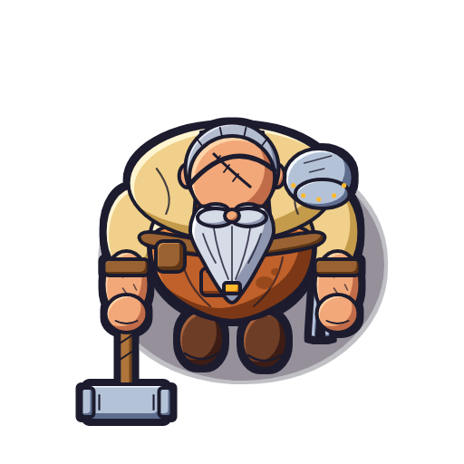
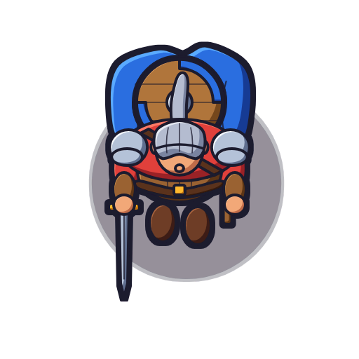
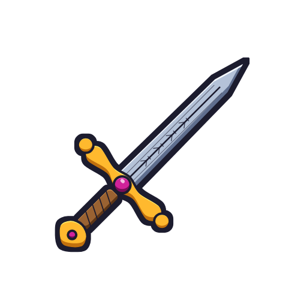
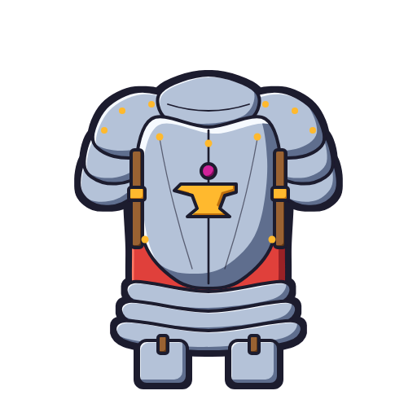
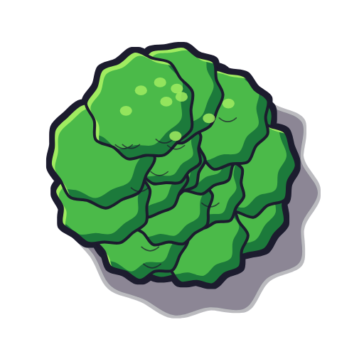
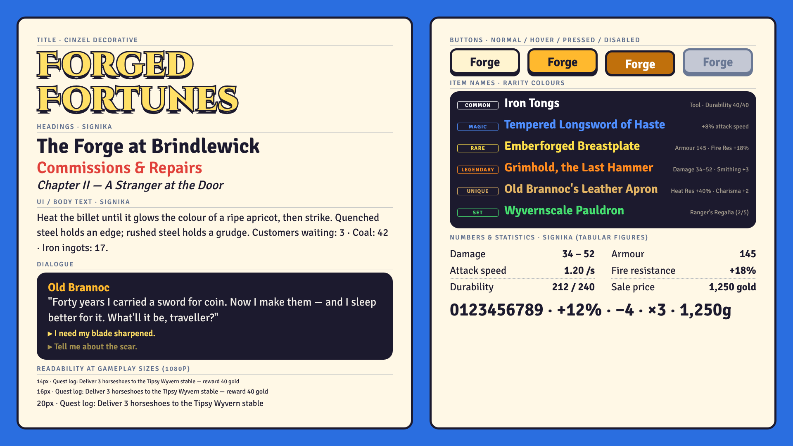
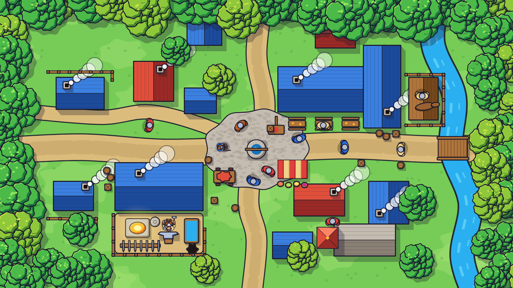
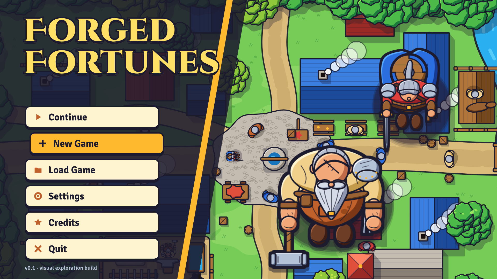

# 03 — Bold Readable Adventure Sim · "Forged Fortunes"

> Stylised fantasy artwork with confident outlines, expressive characters, distinct silhouettes, vibrant but controlled colour and excellent readability. Gameplay clarity first: you can tell the smith from a villager, a sword from a mace and a rare item from a common one at a glance.

This is one of five directions being compared for the DNDBlacksmith project (Godot 4.x, straight top-down 2D):

| # | Direction | Working title |
|---|-----------|---------------|
| 01 | Gothic Noir Top-Down | Embers of the Forgotten |
| 02 | Warm Storybook Village | The Old Anvil |
| **03** | **Bold Readable Adventure Sim** | **Forged Fortunes** |
| 04 | Ink-and-Parchment Fantasy | The Smith's Chronicle |
| 05 | Production-Light Indie Fantasy | Anvil & Ale |

Companion files: [`prompts.md`](prompts.md) (image-model / artist briefs) · [`naming_guide.md`](naming_guide.md) (file naming, sizes, Godot import).

---

## Rendering note — read first

The example images in this folder are **not AI-generated and not final art**. No image-generation model was available in the build environment, so each image is a **procedural vector illustration**: SVG written by Python in [`../_generator/`](../_generator/) (`styles.py` holds the palette, `svgcore.py` the shading/outline techniques, `subjects.py` the shared geometry) and rasterised with headless Chromium. All five directions use the same subject geometry, so differences between folders are purely stylistic.

Treat them as **faithful style studies / mock-ups**: palette, outline weight, shading logic, proportions and typography are exactly as specified here; anatomy, detail density and composition are simplified. [`prompts.md`](prompts.md) exists to produce production-quality versions with an image model or to brief an artist.

The original brief mentioned four reference images; **none were found in the repository**. Everything here is derived from the written brief. If the references turn up, re-check the palette, proportions and prompts against them.

---

## Example images

| | |
|---|---|
|    **blacksmith.png** — 512×512, transparent, facing south |    **adventurer.png** — 512×512, transparent, same scale system |
|    **sword.png** — 512×512 inventory icon |    **armor.png** — 512×512 inventory icon |
|    **tree.png** — 512×512 top-down canopy |    **font_reference.png** — 1920×1080 type sheet |

**town_view.png** — 1920×1080 straight top-down village at bright midday.

**menu_screen.png** — 1920×1080 main menu, "Forged Fortunes".

---

## Visual identity

- **Silhouette first.** Every sprite reads as a solid dark shape before any interior detail. The blacksmith is a wide oval with a beard wedge and a hammer head poking out; the adventurer is a narrower oval with a round shield disc on the back.
- **Two-weight outline.** A uniform dark navy line (`#1c1a2e`) of ~4 px (in 512 px master space) around every part, plus an **extra ~4 px outer silhouette contour** added to the whole sprite. The thicker outer contour separates the sprite from any background — grass, cobbles, a dark dungeon — with no extra work.
- **Interior detail lines** (seams, beard braids, apron pocket, rivets, fuller) are the same navy at ~2.6 px: lighter than the contour so the hierarchy is contour → part → detail.
- **Flat colour + hard cel bands.** Each part gets one flat saturated base, one hard-edged shadow band (light from the top-left, so shadow sits bottom-right) and one hard-edged highlight crescent top-left. No gradients, no texture, no noise, no blur.
- **Crisp vector edges.** Everything is clean shapes with round joins; no painterly rough edges.
- **Solid flat ground shadows.** An unblurred navy ellipse at ~28 % opacity under characters, props and trees.
- **Vibrant but controlled.** Saturated hue families (warm orange apron, cobalt cloak, tomato tunic, lime foliage) with a **navy-tinted shadow** colour in every ramp, so shadows harmonise instead of going muddy brown/grey.
- **Personality through shape**, not rendering: oversized beard, scar marks, eyepatch strap, gold beard-ring and big pauldron are all chunky, readable shapes.

### Rendering techniques (as used in the generator)

| Technique | Implementation (`key="bold"`) | Production equivalent |
|-----------|-------------------------------|-----------------------|
| Part outline | SVG stroke, `#1c1a2e`, width 4.0, round joins | Vector stroke or hand-inked line, constant width |
| Outer silhouette | `feMorphology` dilate radius 4 on SourceAlpha, flooded navy, merged under sprite | Bake in source art **or** Godot outline shader (see Production) |
| Shadow band | Offset "crescent" of the same shape filled with the ramp's shadow hex, clipped to the part | Hard-edged cel shadow layer |
| Highlight band | Smaller crescent offset toward the light (×0.45) in the light hex | Hard-edged highlight layer |
| Detail lines | Navy stroke ×2.6 scale | Thin ink lines |
| Ground shadow | Navy ellipse, opacity 0.28, no blur | Separate shadow sprite or baked |
| Texture | None | None — keep it clean |

---

## Colour palette

Each material role has a three-step ramp: **light** (highlight band), **base** (flat fill), **shadow** (cel band). Values are taken directly from `styles.py → "03_bold_adventure"`.

### Global colours

| Role | Hex | Use |
|------|-----|-----|
| Outline / ink | `#1c1a2e` | All outlines, detail lines, ground shadows (28 %), text outlines |
| UI background | `#1c1a2e` | Panels, tooltips, menu overlays |
| Accent glow | `#ffcc33` | Forge glow, selection, button hover, gold UI |
| Accent glow (hot core) | `#fff2a0` | Glow centres, sparks, pressed-button flash |

### Material ramps

| Role | Light | Base | Shadow | Where |
|------|-------|------|--------|-------|
| skin | `#ffd4a8` | `#f2a878` | `#c06c48` | Faces, forearms, scalp |
| beard | `#ffffff` | `#d6dbe8` | `#8e96b0` | Smith's grey braided beard |
| hair | `#e8ecf4` | `#b4bcd0` | `#7a84a0` | Grey hair fringe |
| shirt | `#fff4d0` | `#f0d08a` | `#c49a4c` | Linen shirts, sleeves |
| apron | `#e88a44` | `#c0602a` | `#7c3812` | Smith's leather apron |
| leather | `#d0924e` | `#9a6230` | `#5c3416` | Bracers, jerkin, grips, pouches |
| strap | `#7a4a2a` | `#5a321c` | `#341a0c` | Belts, straps, eyepatch |
| metal | `#f6faff` | `#b4c2d8` | `#5e6e8e` | Steel: blades, pauldrons, armour |
| gold | `#ffe866` | `#ffb92e` | `#c0700c` | Beard-ring, crossguard, emblems |
| cloak | `#5aaaff` | `#2a6ee0` | `#173a94` | Adventurer cloak, blue cloth |
| tunic | `#ff7a66` | `#e0403a` | `#9a2028` | Red cloth, banners |
| boot | `#a8643e` | `#6e3c26` | `#3c1e12` | Boots |
| wood | `#e0a060` | `#b0743a` | `#74461c` | Handles, shields, crates, fences |
| foliage | `#a0ec60` | `#4cba4a` | `#1e7a3a` | Tree canopies (primary) |
| foliage2 | `#d6e84a` | `#90c83a` | `#4a8a2a` | Variant canopies, bushes |
| grass | `#a4e274` | `#76cc56` | `#4aa044` | Ground |
| road | `#f6dea6` | `#dcbc7c` | `#ae8c4e` | Dirt roads, square |
| roof_a | `#ff8466` | `#e0503a` | `#9a2a26` | Red clay-tile roofs |
| roof_b | `#74b8ff` | `#3a80e0` | `#1e4c9c` | Blue slate roofs |
| stone | `#efebe3` | `#c4bcb0` | `#8a8074` | Walls, well, chapel |
| water | `#7ae0ff` | `#2ab0f0` | `#1274bc` | Stream, quench trough |
| gem | `#ff6ad0` | `#d0209a` | `#7a0a58` | Gems on sword, jewellery |
| fire | `#fff6a0` | `#ffa020` | `#e0400a` | Forge, torches, embers |

**Palette rules**

1. New materials get a three-step ramp whose shadow hue shifts toward blue/purple (navy-tinted), never toward black or grey.
2. Keep large ground areas (grass, road) at mid saturation so saturated characters and items pop on top of them.
3. Reserve the highest-saturation hues (gem magenta, fire yellow, rarity colours) for things the player should look at.
4. Every colour must sit against `#1c1a2e` outline — test new hues next to navy, not next to white.

---

## Lighting & shading

- **Single global key light from the top-left** (screen space, since the camera looks straight down). Shadow bands sit bottom-right of each part; highlight crescents top-left.
- **Bright midday** for the village: high-key, saturated, cheerful. Cast shadows of buildings and trees fall **toward the bottom-right** as hard-edged navy shapes at ~28–35 % opacity.
- **No ambient occlusion, no soft gradients.** Depth comes from overlap, outline and the cel band.
- **Glow is graphic, not photographic**: forge light is a set of concentric flat discs (`#fff2a0` core → `#ffcc33` → transparent) rather than a blurred bloom. In Godot, use an additive `PointLight2D` sparingly, or flat glow sprites.
- **Time of day / interiors**: do it with `CanvasModulate` and a few `PointLight2D`s rather than repainting assets. Keep night tinting gentle (towards `#3a4a8a`, not black) so outlines and rarity colours stay readable. Occasional darkness (forest at night, crypts) is achieved by modulation plus warm local light pools — the style supports it, but it is never murky.

---

## Character & object proportions

All characters share one proportion system, measured against the neutral design used for all five directions:

| Parameter | Multiplier | Why |
|-----------|------------|-----|
| Head | **1.12×** | Bigger heads carry expression (scar, eyepatch strap, beard) at small sizes |
| Shoulders | **1.04×** | Slightly broad = heroic, sturdy |
| Belly | **1.00×** | The smith's heavy build comes from the design, not exaggeration |

- **Straight top-down view**: we see the top of the head, shoulders, the beard projecting forward, belly, the backs/tops of arms, and the toes of boots. No faces in 3/4.
- **Characters** fit a 512 master canvas with the body occupying roughly the centre 60 %, leaving room for held props (sledgehammer, sword) and the outline.
- **Smith vs adventurer**: same head size and scale reference; the adventurer is ~15 % narrower across the shoulders and lacks the belly, which makes the two instantly distinguishable as silhouettes.
- **Props are oversized ~1.2–1.4×** relative to realism (hammer head, sword, shield) so equipment is identifiable at gameplay scale.
- **Inventory icons** (sword, armour) fill ~80 % of the canvas, are drawn front-on or 45° diagonal, and use the same outline and ramps as world sprites.
- **Buildings** are simplified to roof planes with a few strong features (chimney, ridge line, signboard), sized on a 64 px tile grid in game.

---

## Suitability for straight top-down 2D

**Honest verdict: of the five directions this is the strongest for readability.** Straight top-down is the hardest camera for character legibility (you mostly see heads and shoulders), and this style compensates directly:

- the thick outer contour separates sprites from busy ground;
- the bigger head and chunky accessories (beard, pauldron, shield disc) give each character a unique top-down silhouette;
- saturated, role-coded colours (cloak blue, tunic red, apron orange) let players identify NPC types by colour alone;
- equipment is legible on the character, which matters for a game about making and selling gear.

**Risks**

| Risk | Mitigation |
|------|------------|
| Looks generic / "mobile game" | Push personality in shapes and story props (scars, patched gear, notched blades, tavern clutter). Use the navy-tinted palette rather than pure primaries. Give the world landmarks (the Tipsy Wyvern signboard, the chapel, the forge chimney). |
| Too cheerful for darker moments | Use `CanvasModulate`, desaturated area palettes and warm light pools for forests at night and dungeons; the outline keeps it readable. |
| Visual noise in dense scenes (many outlines) | Background tiles use thinner or no outer contour; outer contour reserved for interactable sprites. Keep ground detail low-contrast. |
| Outlines shrinking/thickening when scaled | Author at a fixed scale ratio (see naming guide) or apply the outline by shader at runtime. |

---

## Sprite & animation production considerations

- **Clean vector-like shapes suit cut-out (skeletal) animation**: hands, hammer, beard, apron straps and cloak can be separate parts animated with Godot `Skeleton2D` / `Bone2D` or plain `AnimationPlayer` transforms. Flat fills and hard bands survive rotation without smearing.
- **Frame-by-frame also works at modest frame counts**: 4–6 frame walk, 6–8 frame hammer strike, 2–4 frame idle breathe. Cel shading means each frame is quick to paint.
- **Outlines must stay consistent across scaling.** Two options:
  - **Baked outlines** (recommended for characters/props): draw at the 512 master with 4 px part lines + 4 px outer contour, export at exactly 1/4 (128 px), giving ~1 px lines + ~1 px contour. Never export at arbitrary ratios. For a heavier in-game look, use 6 px master lines for 128 px exports.
  - **Shader outlines** (recommended for the outer contour on anything that scales, flashes or is selected): draw sprites without the outer contour and add it with a `CanvasItem` shader that samples alpha in 8 directions. Lets you widen the outline on hover, recolour it gold (`#ffcc33`) for selection or red for enemies, and keeps it a constant screen width at any zoom.
- **Palette / team-colour swaps for equipment variants**: author swappable materials (cloak, tunic, metal tier, gem) in their exact palette ramps and swap them with a palette-mapping shader (a small lookup texture: one row per variant). One sword sprite → iron/steel/mithril/gold variants; one villager → many clothing colours. Avoid anti-aliased intermediates on swappable regions or use an index/mask texture instead of hue matching.
- **Layered equipment**: since straight top-down shows little of the body, equipment layering (helmet, pauldrons, cloak, back-slung weapon) is cheap and very visible — a strong fit for a blacksmith game.
- **Effects**: sparks, glow and smoke should be flat shapes with navy outline or none (fire glows should be outline-free), driven by `GPUParticles2D` with small flat textures.

---

## Advantages and disadvantages

| Advantages | Disadvantages |
|------------|---------------|
| Best readability of the five at small sizes and in busy scenes | Most at risk of looking generic or "mobile" without strong art direction |
| Equipment and rarity are instantly legible — core to a smithing/shop game | Bright default mood fights the "occasional darkness / mystery" part of the brief |
| Flat fills + hard bands: fast to produce, easy to keep consistent across artists | Outlines add work to every asset and must be managed carefully across scales |
| Perfect for palette-swap shaders and modular equipment | Less "lived-in" texture than storybook or ink directions; warmth must come from props and lighting |
| Clean shapes vectorise and animate well (cut-out or frame-by-frame) | Saturated palettes are easy to overdo; needs a palette lock |
| Typography (Signika) is excellent for dense UI and numbers | Cinzel Decorative title must be handled with care to avoid a clip-art feel |

---

## Estimated production difficulty

**Rating: 3 / 5 (moderate).** Easier than painterly/ink directions to keep consistent; harder than the production-light direction because of outlines, cel bands and the expectation of polished, expressive characters.

**Assumptions**: a small-to-mid indie scope — one village plus 3–4 wilderness areas, ~40 hours of play; 8-direction characters (5 drawn + 3 mirrored where props allow); one artist experienced in vector/cel style, working from 512 masters; image-model drafts used for ideation only, every final asset redrawn/cleaned. Numbers are ballparks, not quotes.

| Asset group | Rough count | Notes | Person-months |
|-------------|-------------|-------|---------------|
| Main characters (smith + 3–4 key NPCs) | 5 × ~8 anims × 5 dirs | Cut-out rigs or 4–8 frames each | 3.0–4.0 |
| Villagers / adventurers (modular bodies + palette swaps) | 20–30 looks from ~6 bases | Palette shader does most variety | 2.0–3.0 |
| Enemies / creatures | 10–15 | Simpler animation sets | 2.0–3.0 |
| Equipment icons (weapons, armour, materials, consumables) | 250–350 | Base shapes + tier palette swaps | 2.5–3.5 |
| Equipment worn on characters (layers) | 40–60 | Visible top-down pieces only | 1.5–2.0 |
| Tilesets (village, forest, wilderness, interiors) | 6–8 sets, ~60 tiles each | Low-contrast ground, autotile | 2.0–3.0 |
| Buildings & large props | 25–40 | Roof-plane focus | 1.5–2.0 |
| Small props & decor | 120–180 | Barrels, crates, fences, signs | 1.5–2.0 |
| UI (theme, panels, buttons, HUD, shop, crafting) | 1 theme + ~40 screens | Signika + 9-slice | 1.5–2.5 |
| VFX (forge, sparks, hits, magic) | 30–50 | Flat shapes, particles | 1.0–1.5 |
| Key art / menu / marketing | 3–6 pieces | | 0.5–1.0 |
| **Total** | | | **≈ 19–28 person-months** |

Re-using the palette-swap pipeline aggressively (one sword → 6 tiers) is the biggest lever; without it the icon line roughly doubles.

---

## Typography

Typography follows the same "bold and readable" rules: thick navy outlines, hard drop shadows, chunky gold for showpiece text, a legibility-first sans for everything functional. All fonts are **SIL Open Font License** and can be shipped in a commercial Godot game.

### Title font & lettering — Cinzel Decorative 900

- Classical Roman capitals with swash flourishes on selected letters: reads as "fantasy" and "crafted" without being gothic or hard to read.
- Treatment in the menu: **chunky gold fill** (`#ffe866` top → `#ffb92e`, or flat `#ffb92e` with a `#ffe866` highlight band), **thick navy outline** `#1c1a2e` (~8–12 % of cap height), and a **hard, unblurred drop shadow** in navy offset down-right (matches the top-left light).
- Use only for the game title, chapter cards and the occasional legendary item name banner — never for running text.

### Readable UI font — Signika 400 / 500 / 600

- Humanist sans designed for wayfinding legibility; open apertures and generous x-height keep it clear at 14–18 px.
- **Body & UI**: Signika 400 (500 on dark panels for extra weight). Minimum in-game size 16 px at 1080p.
- Off-white text `#fff4d0` on `#1c1a2e` panels; navy text on light parchment panels.

### Headings & dialogue

| Use | Font | Size @1080p | Colour / effect |
|-----|------|-------------|-----------------|
| Screen headings | Signika 700 | 36–48 px | `#ffcc33`, 3 px navy outline |
| Panel headings | Signika 700 | 24–28 px | `#fff4d0` |
| Buttons | Signika 700 | 28–32 px | `#fff4d0`, 3 px navy outline; gold on hover |
| Dialogue body | Signika 500 | 22–24 px | `#fff4d0` on navy box, line-height 1.3 |
| Speaker name | Signika 700 | 24 px | Character's signature colour (e.g. apron orange `#e88a44` for the smith) |
| Tooltips | Signika 400/600 | 16–18 px | Item name in rarity colour, stats below |

### Numbers & statistics

- Signika 600/700 with **tabular figures** (OpenType `tnum`) so prices, damage and stats align in columns and don't jitter when they count.
- **Floating combat/price numbers**: Signika 700, 28–40 px, thick navy outline (4–6 px) so they read over any background. Colour coding: damage `#ffffff`, crits `#ffcc33`, healing `#46e070`, gold earned `#ffe14a`, loss/negative `#ff7a66`.
- Stat comparisons: up `#46e070`, down `#ff7a66`, unchanged `#b4bcd0`.

### Item rarity colours

Always rendered **with a navy `#1c1a2e` outline** (2–3 px) so they work on any background — light grass, sand roads or dark panels.

| Rarity | Hex | Contrast on `#1c1a2e` | Contrast on road `#f6dea6` (no outline) |
|--------|-----|-----------------------|----------------------------------------|
| Common | `#ffffff` | 17.0 : 1 | 1.3 : 1 |
| Magic | `#4f8fff` | 5.4 : 1 | 2.4 : 1 |
| Rare | `#ffe14a` | 13.0 : 1 | 1.0 : 1 |
| Legendary | `#ff8a1f` | 7.2 : 1 | 1.8 : 1 |
| Unique (gold/brown) | `#e2b464` | 8.9 : 1 | 1.5 : 1 |
| Set | `#46e070` | 9.8 : 1 | 1.3 : 1 |

**Notes**

- All six pass WCAG AA (4.5 : 1) on the navy UI background; Magic is the weakest (5.4 : 1) — use Signika 600+ for Magic item names.
- On light world backgrounds **none** are readable without the outline; the navy outline is mandatory for world-space labels and loot drops.
- Rare `#ffe14a` and Unique `#e2b464` are close in hue: always pair rarity colour with a secondary cue (icon frame shape, rarity word in the tooltip, border glow) for colour-blind players.
- Don't use the accent glow `#ffcc33` for non-rarity text in tooltips, to avoid confusion with Rare.

### Recommended fonts (free, Godot-ready)

| Role | Font | Weights | Link |
|------|------|---------|------|
| Title | Cinzel Decorative | 900 (700 fallback) | <https://fonts.google.com/specimen/Cinzel+Decorative> |
| Headings, UI, dialogue, numbers | Signika | 400, 500, 600, 700 | <https://fonts.google.com/specimen/Signika> |
| Optional sub-title / plaques | Cinzel | 700 | <https://fonts.google.com/specimen/Cinzel> |

The renders used the `@fontsource` packages of the same fonts (see `../_generator/fetch_fonts.sh`). For Godot, download the TTF/variable font from Google Fonts.

### Godot import notes

- Import `.ttf`/`.otf` as **FontFile**. Signika is available as a variable font — use a **FontVariation** to pick weight (`wght` 400–700) instead of shipping four files.
- **Title (Cinzel Decorative)**: enable **Multichannel Signed Distance Field (MSDF)** in the import settings so the title stays sharp when scaled or animated on the menu; set MSDF pixel range ≥ 8 to support thick outlines.
- **UI text (Signika)**: keep MSDF off for small sizes; use normal rasterisation with *Antialiasing: Grayscale*, *Hinting: Light*, *Subpixel Positioning: Auto*.
- **Outlines**: use `LabelSettings` (or the Theme) → *Outline Size* and *Outline Color* `#1c1a2e`; *Shadow Color* `#1c1a2e`, *Shadow Offset* (3, 4), *Shadow Size* 0 for the hard drop shadow.
- **Tabular figures**: create a `FontVariation` of Signika with OpenType feature `tnum = 1` and use it for prices, stats, timers and floating numbers.
- Define a project **Theme** resource with Signika as the default font, 20 px default size, and type variations (`HeaderLarge`, `ButtonBig`, `RarityLabel`) so every scene shares the same settings.
