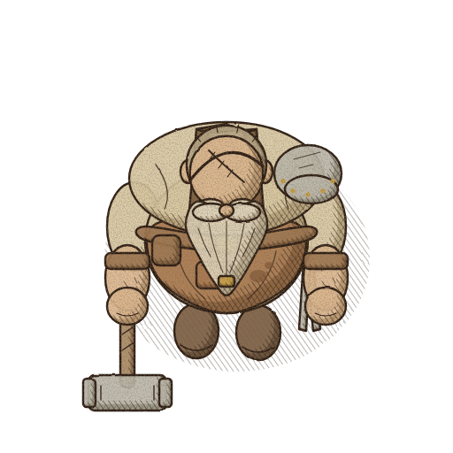
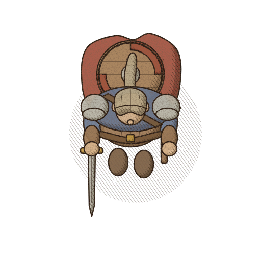
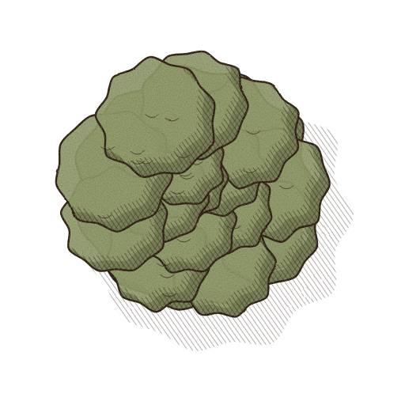
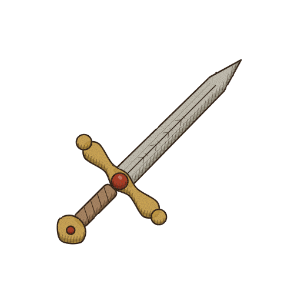
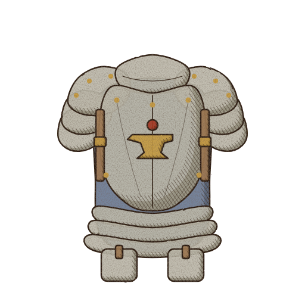
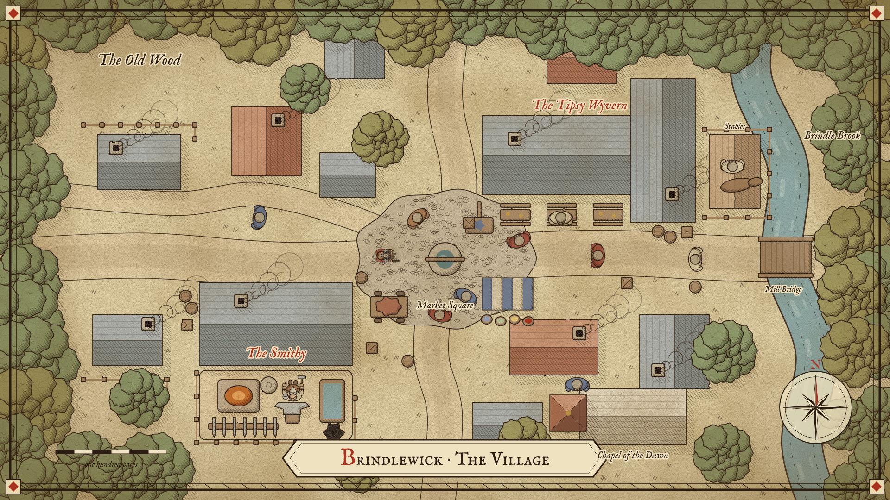
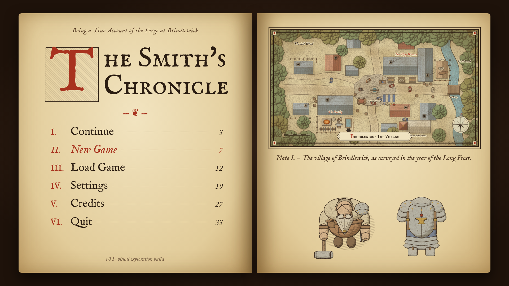
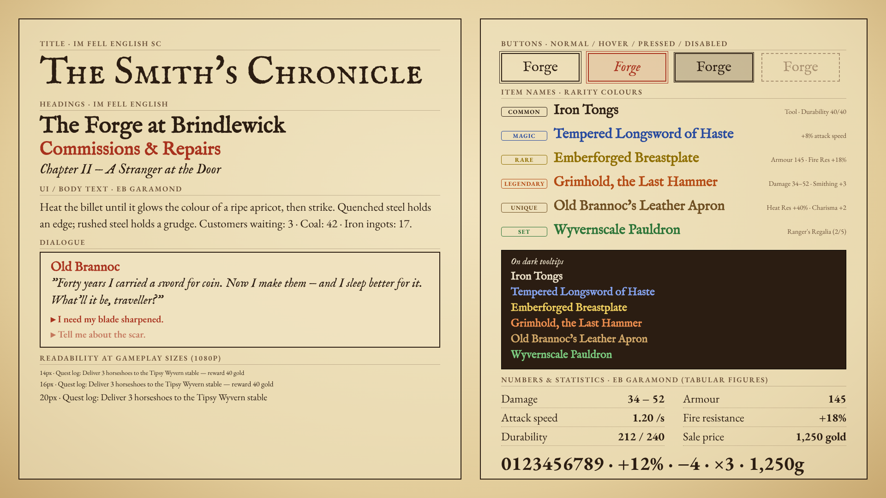

# 04 — Ink-and-Parchment Fantasy · "The Smith's Chronicle"

> Illustrated fantasy in the manner of engraved manuscripts, hand-drawn campaign maps and medieval
> book illustration: sepia ink linework, hatching instead of dark fills, pale watercolour washes,
> aged parchment, and a few carefully placed decorative elements (rubricated red initials,
> fleurons, cartouches, compass roses, map borders).

One of five directions being compared for the Godot 4.x straight top-down blacksmith game:
01 Gothic Noir ("Embers of the Forgotten"), 02 Warm Storybook ("The Old Anvil"),
03 Bold Readable Adventure Sim ("Forged Fortunes"), **04 Ink-and-Parchment ("The Smith's Chronicle")**,
05 Production-Light Indie ("Anvil & Ale"). All five use the same subjects and framing so they can
be compared side by side.

Companion files: [`prompts.md`](prompts.md) (image-model / artist briefs) and
[`naming_guide.md`](naming_guide.md) (file naming, sizes, Godot import).

---

## Rendering note (read first)

The example images in this folder are **procedural vector illustrations**, not AI-generated or
hand-painted art. No image-generation model was available in the build environment, so each image
was built as SVG by the Python generator in [`../_generator/`](../_generator/) (`styles.py` holds the
palette and line settings, `svgcore.py` the shading/hatching/filters, `subjects.py` the shared
geometry) and rasterised with headless Chromium (Playwright, `render.js`).

They are **faithful style studies / mock-ups**: palette, line weight, hatching logic, light
direction, proportions and typography are exactly what this direction proposes, but the drawing
itself is simplified geometry. Final art should be produced from [`prompts.md`](prompts.md) with an
image model or by briefing an illustrator.

The original brief mentioned four reference images; **none were found in the repository**. Nothing
here is matched to them. If they are supplied later, re-check the palette, proportions and prompts
against them.

---

## Example graphics

| # | File | Size | Content |
|---|------|------|---------|
| 1 | [blacksmith.png](blacksmith.png) | 512×512, transparent | Protagonist, straight top-down, facing south |
| 2 | [adventurer.png](adventurer.png) | 512×512, transparent | Visiting adventurer, same scale system |
| 3 | [sword.png](sword.png) | 512×512, transparent | Inventory icon, 45° diagonal |
| 4 | [armor.png](armor.png) | 512×512, transparent | Inventory icon, front view breastplate set |
| 5 | [tree.png](tree.png) | 512×512, transparent | Top-down deciduous canopy |
| 6 | [town_view.png](town_view.png) | 1920×1080 | Village as an illustrated map on parchment |
| 7 | [menu_screen.png](menu_screen.png) | 1920×1080 | Main menu as an open chronicle |
| 8 | [font_reference.png](font_reference.png) | 1920×1080 | Typography and rarity sheet |

The sprites are shown on transparency; in-game they sit on the parchment ground supplied by the
level background and a paper-texture shader (see *Sprite & animation production*).

---

## Visual identity

**Fantasy fiction:** the game *is* the chronicle. The village is a page of a smith's ledger and
campaign journal; the world map is a hand-drawn chart; menus are manuscript lines; loot names are
written in coloured inks. This gives the warmth and lived-in personality of the brief, with
mystery coming from margins, unmapped edges and ink blots rather than from darkness.

**Rendering techniques used in the examples (key `ink` in the generator):**

| Element | Technique | Value at 512 px master |
|---|---|---|
| Outline | Iron-gall sepia ink `#2b1d12`, round caps/joins | 2.4 px |
| Interior detail (seams, rivets, engraving, hair) | Same ink, thinner | ~1.6 px × detail weight |
| Hand-drawn wobble | Fractal-noise displacement of the whole sprite | strength 1.8, base freq 0.05 |
| Fills | Pale, low-saturation watercolour wash at 92 % opacity | palette *base* |
| Form shadow | Wash in palette *shadow* at 55 %, offset away from light | — |
| Shadow texture | Diagonal hatching (−35°) on the shadow side, cross-hatch (+35°) in the core shadow | lines 1.1 px, 5 px pitch |
| Ground shadow | Hatched ellipse (−35° hatch, 55 % opacity), never a dark blob | — |
| Paper grain | Fine noise in ink colour clipped to the sprite | base freq 0.7 |
| Background | Parchment `#e9d8b0` (compositions only, never baked into sprites) | — |
| Accent | Rubric red `#a8321e` for initials, map labels, important marks | — |

Decorative vocabulary (use sparingly, mostly in UI and maps): rubricated drop capitals, fleurons
(❦ ❧), cartouches for place names, compass rose, double-rule map borders with corner ornaments,
marginal pointing hands (☞) for hints, wax-seal discs for confirmations.

---

## Colour palette

Every material role has light / base / shadow values (from `styles.py`, `"04_ink_parchment"`).
Saturation is deliberately low: the ink carries the drawing, washes only tint it.

### Core colours

| Role | Hex | Use |
|---|---|---|
| Ink | `#2b1d12` | All linework, hatching, body text |
| Parchment | `#e9d8b0` | Page/ground colour, UI panels |
| Rubric red | `#a8321e` | Initials, headings accents, map labels, warnings |
| Forge glow | `#c8641e` | Fire, embers, warm light overlays |
| Forge glow (hot) | `#e8a050` | Glow core / highlight |

### Material roles

| Role | Light | Base | Shadow |
|---|---|---|---|
| skin | `#f0dcc0` | `#dcb890` | `#a8865e` |
| beard | `#f4ecdc` | `#ddd2b8` | `#a89a7c` |
| hair | `#e0d4bc` | `#b8a888` | `#86765a` |
| shirt | `#ece0c4` | `#d8c8a2` | `#a8946c` |
| apron | `#d0a880` | `#aa7c52` | `#7a5434` |
| leather | `#c8a47c` | `#a07a54` | `#6e5234` |
| strap | `#9a7650` | `#7a5a3a` | `#54402a` |
| metal | `#e6e2d8` | `#bcb8aa` | `#86826e` |
| gold | `#e6c674` | `#c69c44` | `#8a6a26` |
| cloak | `#c47a64` | `#a2503c` | `#6e3226` |
| tunic | `#94a2b4` | `#6a7a92` | `#4a566a` |
| boot | `#a88a68` | `#7c5e42` | `#54402c` |
| wood | `#d0b088` | `#aa8a64` | `#7a5e40` |
| foliage | `#bcc49a` | `#909c6c` | `#64704a` |
| foliage2 | `#c8c08a` | `#a49c62` | `#746c40` |
| grass | `#e8d9b2` | `#dccb9e` | `#c2ae80` |
| road | `#efe0bc` | `#ddc99e` | `#bba67c` |
| roof_a (tile) | `#d09a7a` | `#ae6e50` | `#7c4a34` |
| roof_b (slate) | `#aab0ac` | `#848c88` | `#5c6260` |
| stone | `#e2d6bc` | `#c6b698` | `#968466` |
| water | `#b4c8c0` | `#8eaaa6` | `#6a8682` |
| gem | `#d06a50` | `#a8321e` | `#6a1a0e` |
| fire | `#f4c070` | `#d0782a` | `#9a4012` |

Note that `grass` and `road` are almost the parchment itself: terrain is "unpainted page" with
light tint, so actors and buildings read against it by line and wash, not by heavy colour.

---

## Lighting & shading

* **Light source:** top-left (vector −1, −1 in screen space) for every asset, always. Form shadows
  sit bottom-right of each shape; cast/ground shadows fall toward the bottom-right.
* **Values are built from line density, not darkness of fill.** Order of escalation:
  1. wash in *base* (lit plane);
  2. *shadow* wash at ~55 % (turning plane);
  3. single hatch at **−35°** (shadow side);
  4. cross-hatch at **+35°** over it (core shadow, crevices, under brims and belts).
  Pure black areas do not exist; the darkest value is dense cross-hatch in `#2b1d12`.
* **Hatch lock:** pitch 5 px and line 1.1 px at 512 px master (≈ 1.25 px pitch and 0.28 px line at
  128 px — far too fine, see *Line weight for target size* in the naming guide; in-game hatching
  must be redrawn coarser or applied by shader).
* **Highlights** are left paper (reserved white of the wash), never painted white. Metal gets a
  thin unpainted streak plus a few short engraving lines.
* **Low-key washes:** washes stay pale even for dark materials; a black cloak is pale grey wash +
  heavy cross-hatching, not dark paint.

### Night, interiors and forge glow inside a manuscript look

A real manuscript has no lighting engine; the game should fake it the way an illuminator would:

| Situation | Technique in Godot |
|---|---|
| Night | `CanvasModulate` toward a cool sepia-indigo (≈ `#8a8aa0`), plus a shader that *adds* a −35° hatch overlay in screen space with density tied to darkness. Night reads as "the page has been shaded in", not as blackness. |
| Forge / lantern / hearth | `PointLight2D` (additive) with a soft texture tinted `#c8641e` → `#e8a050`; inside the light radius, the hatch overlay is masked out, so light literally "erases" the shading. |
| Dusk / torchlight | Warm wash overlay (`#e8a050` at 15–25 % in a multiply/overlay `ColorRect`). |
| Darkness, dungeons, mystery | Vignette of ink blots and cross-hatching at screen edges; unexplored areas left as blank parchment or "here be..." marginalia. |
| Magic | Rubric red or a single blue ink (`#284a9e`) linework that animates (line boil) — colour restraint makes it pop. |

---

## Character & object proportions

* Neutral, naturalistic proportions (generator factors: **head 0.98×, shoulders 1.0×, belly 1.0×**
  relative to the shared base geometry). No chibi enlargement — the style earns charm from line
  detail, not from big heads.
* The blacksmith is defined by mass: broad shoulders, big belly projecting beyond the beard, single
  steel pauldron, sledgehammer. The adventurer uses the same system but slimmer.
* Character occupies roughly 60–70 % of the 512 px canvas width including held weapon; feet/boots
  at ≈ y 0.80 of the canvas.
* Buildings and props are drawn at the same world scale as characters (1 tile = 64 px in game ≈ a
  person's shoulder width × 1.3). Maps may use cartographic exaggeration for labels and the compass
  rose only; gameplay objects stay to scale.

---

## Suitability for straight top-down 2D

**Natural fit.** Hand-drawn maps are *already* straight top-down: roofs as plan shapes, trees as
canopy scallops, roads as double lines. The town view proves the camera and the style agree, and
the world map, minimap, quest map and town view can share one visual language.

**Main risk — low value contrast.** Pale washes on a pale parchment ground mean characters and
interactive objects can melt into the page, especially at 128 px and when moving.

Mitigations (should be treated as rules, not options):

1. **Heavier silhouette line on actors**: outer contour at ~1.5× the interior line (characters,
   creatures, interactive props), environment keeps the standard weight.
2. **Coloured washes for interactables**: anything the player can use gets a saturated-ish wash
   accent (rubric red, gold, blue ink) that terrain never uses.
3. **Selection / hover**: a rubric-red ink circle (hand-drawn ring, line-boiled) under the target,
   or a red underline-style outline shader; not a glow, which breaks the style.
4. **Hatched ground shadows** under all actors to anchor them to the page.
5. Keep the terrain mostly flat tint; reserve hatching density for edges of buildings and woods.

---

## Sprite & animation production considerations

* **Line boiling as a feature:** re-trace or re-seed the wobble every 2–3 frames (8–12 fps "on twos")
  so idle sprites shimmer like fresh ink. Cheap to fake with a shader (animated noise displacement
  on the sprite's UVs), which also hides small inconsistencies between frames.
* **Frame-by-frame line art is expensive.** Each walk frame needs clean, consistent linework and
  hatching. Prefer 4 directions × 4–6 walk frames, short work loops (hammer strike 6–8 frames), and
  reuse via cut-out (separate hammer/tongs layers) where possible.
* **Hatching consistency:** hatch angle must stay −35°/+35° in screen space regardless of the
  sprite's facing or animation; mirrored sprites flip the hatch to +35° — so either don't mirror
  (draw east and west separately) or draw hatching via shader in screen space.
* **Paper texture by shader, not per sprite:** sprites ship as ink + wash on transparency. A
  full-screen paper grain/fibre texture is multiplied over the world in a `CanvasLayer`
  (or via a `BackBufferCopy` + screen shader). This keeps textures aligned across sprites, saves
  memory and allows the night-hatch trick above.
* **Downscaling fine lines:** 512 px masters with 2.4 px lines become 0.6 px at 128 px — lines
  vanish. Final sprites must be drawn (or redrawn/thickened) for target size; see
  [`naming_guide.md`](naming_guide.md).
* **Tilesets** suit the style well: parchment ground with tinted terrain patches, road and river as
  ink strokes, auto-tile edges as hand-drawn contour lines.

---

## Advantages and disadvantages

| Advantages | Disadvantages |
|---|---|
| Very distinctive; stands out from pixel-art and generic painted fantasy | Low value contrast on parchment — readability needs deliberate rules |
| Map-like top-down is a native fit; world/town/quest maps share one language | Fine linework does not survive downscaling; target-size drawing needed |
| Narrative framing (the smith's chronicle) ties UI, story and art together | Frame-by-frame inked animation is labour-intensive |
| Restrained palette is cheap to keep consistent; few colours to manage | Hatching must stay consistent across artists and AI outputs — easy to drift |
| Night and lighting can be done stylishly with shaders and overlays | Combat VFX and fast action feel at odds with a quiet manuscript look |
| Typography (Fell, Garamond) is free and characterful | Serif fonts at small sizes are harder to read than sans; UI needs care |
| Paper/grain/wobble handled globally by shaders | AI image models tend to over-saturate, add parchment backgrounds and fake text — post-processing load |

---

## Estimated difficulty of a complete game in this style

**Difficulty: 4 / 5** — high craft demand per asset (linework + hatching), animation cost and
readability engineering; offset by the restrained palette and global shaders.

Assumptions: a small "cosy-sim with light adventuring" scope — one village, 3–4 wilderness areas,
~25 named NPCs, ~150 craftable/lootable items; one experienced illustrator-animator plus AI
assistance for drafts; Godot shaders by a programmer; estimates are art only, ±40 %.

| Asset group | Rough count | Person-months |
|---|---|---|
| Characters (protagonist, ~25 NPCs, ~10 enemy types), 4 directions, idle/walk/work/attack | ~35 rigs · ~1,500 frames | 6–9 |
| Item icons (weapons, armour, materials, tools) | ~200 | 2–3 |
| Buildings & interiors (village, workshop, inn interior) | ~40 | 2–3 |
| Environment props & tilesets (village, forest, wilds, 3–4 biomes) | ~300 pieces, 4 tilesets | 3–4 |
| Maps (world, town, quest charts) | ~10 | 1 |
| UI (menus, ledger/crafting screens, frames, initials, fleurons) | ~120 elements | 1.5–2 |
| VFX (sparks, smoke, magic ink, hit marks) | ~30 effects | 1 |
| Shaders & art-tech (paper overlay, line boil, night hatch, outline) | — | 0.5–1 (programmer) |
| **Total** | | **≈ 17–24 person-months** |

With heavy AI generation plus manual cleanup the icon/prop rows can shrink by roughly a third; the
animation row does not shrink much, because frame-to-frame consistency still needs hand cleanup.

---

## Typography

The typefaces are chosen to look like 17th-century letterpress and scribal hands while staying
legible in a game UI. All are SIL Open Font License — free for commercial games, embeddable,
modifiable (keep the licence file in the project).

### Title font & lettering

**IM Fell English SC** — digital revival (by Igino Marini) of the Fell types, cut for Oxford's
John Fell in the 1670s–80s. Small-caps cut with irregular, slightly bruised letterpress edges, high
contrast and soft ink spread. The title is set in small caps with a **rubricated red drop capital**
(`#a8321e`, 2–3 lines tall, optionally inside a square cartouche with a fleuron) followed by ink
lettering `#2b1d12`. Use letter-spacing +2–4 % for the title; never bold-fake it.

### Headings & dialogue

**IM Fell English 400 + italic.** Headings in roman at 32–48 px (1080p), rubric initial optional for
chapter/quest headings. Dialogue body in roman at 22–26 px; speaker names and emphasis in italic;
narration/journal entries in italic. Fell is irregular by design — do not use it below ~20 px.

### Readable UI / body font

**EB Garamond 400–600** (Georg Duffner / Octavio Pardo). Much better hinting and stroke consistency
than Fell at small sizes. Use for menus, tooltips body, settings, inventory lists.
Minimum **16 px at 1080p** (scale with the UI), 18–20 px preferred for running text; 500–600 weight
on low-contrast parchment or dark tooltips.

### Numbers & statistics

EB Garamond **defaults to old-style figures** (numbers with ascenders/descenders like 3, 4, 5, 7, 9
dropping below the line). Charming in prose ("in the year 1347"), bad for stat columns, prices and
damage values — digits jump and columns don't align. For all stats use **EB Garamond 500/600 with
OpenType features `lnum` (lining figures) + `tnum` (tabular figures)** via a Godot `FontVariation`.
Right-align numeric columns; use the true minus `−` and multiplication `×`.

### Item rarity colour compatibility

White and yellow (the conventional "Common" and "Rare" colours) are **unreadable on parchment** —
white on `#e9d8b0` is 1.4:1 and a typical yellow ≈ 1.1:1. This direction therefore uses **two
matched sets**: ink-darkened variants for text on parchment, and bright variants for dark tooltips.
The hue identity is kept (blue = Magic, yellow-ochre = Rare, orange = Legendary, brown-gold = Unique,
green = Set); only value changes. Plain ink stands in for "white", dark ochre for yellow.

**On parchment `#e9d8b0`** (WCAG contrast ratio):

| Rarity | Hex | Contrast | Note |
|---|---|---|---|
| Common | `#2b1d12` | 11.6:1 | Plain ink replaces white |
| Magic | `#284a9e` | 5.8:1 | Blue ink |
| Rare | `#8e6e00` | 3.4:1 | Dark ochre replaces yellow — large/semibold text only |
| Legendary | `#b44a14` | 3.8:1 | Large/semibold text only |
| Unique | `#6e4e22` | 5.4:1 | Gold-brown |
| Set | `#2c7438` | 4.1:1 | Large/semibold text only |

**On dark tooltip** (`≈ #241a12`, dark leather/ink panel):

| Rarity | Hex | Contrast |
|---|---|---|
| Common | `#efe4cc` | 13.5:1 |
| Magic | `#86a4f0` | 7.0:1 |
| Rare | `#f0d060` | 11.3:1 |
| Legendary | `#f09050` | 7.2:1 |
| Unique | `#d4aa6a` | 7.9:1 |
| Set | `#7ccc80` | 8.8:1 |

Contrast notes: Rare, Legendary and Set on parchment fall below 4.5:1, so on parchment set item
names at ≥ 24 px or EB Garamond 600, or use slightly darker fallbacks for small text:
Rare `#735800` (4.8:1), Legendary `#963c10` (5.1:1), Set `#246030` (5.3:1). Always pair colour with
a second cue (rarity glyph or word in the tooltip) for colour-blind players — Legendary and Rare
ochres are close for protanopes.

### Recommended fonts (free, Godot-ready)

| Role | Font | Weights | Source |
|---|---|---|---|
| Title | IM Fell English SC | 400 | <https://fonts.google.com/specimen/IM+Fell+English+SC> |
| Headings, dialogue | IM Fell English | 400, 400 italic | <https://fonts.google.com/specimen/IM+Fell+English> |
| UI, body, numbers | EB Garamond | 400, 500, 600 (+ italics) | <https://fonts.google.com/specimen/EB+Garamond> |

The examples use the `@fontsource` WOFF2 builds in `../_generator/fonts/`; for Godot download the
TTF/OTF from Google Fonts (EB Garamond is a variable font there; static instances also exist).

### Godot import notes

* Import each file as **`FontFile`** (`.ttf`/`.otf`; Godot 4 also reads `.woff2`).
* **Title (IM Fell English SC):** enable **Multichannel Signed Distance Field** in the import dock
  (`multichannel_signed_distance_field = true`, `msdf_pixel_range` 8–16) so the title scales crisply
  for the menu and logo animation. Not needed for body text.
* **UI/body (EB Garamond):** normal rasterised font, `antialiasing = Grayscale`, hinting **Light**
  (keeps Garamond shapes while snapping verticals), `subpixel_positioning = Auto`,
  `generate_mipmaps = false` unless UI is scaled down in 3D/world space.
* **IM Fell:** hinting **None** or Light — the font's irregularity is intentional; strong hinting
  distorts it.
* **Numbers:** create a `FontVariation` resource on EB Garamond with
  `opentype_features = { "lnum": 1, "tnum": 1 }` (and `variation_embolden` 0; use real 500/600 weights
  or the variable `wght` axis via `variation_opentype`). Assign it to stat labels in the Theme.
* Put all four (Title, Heading, Body, Numbers) in a project **`Theme`** resource as named font
  types so swaps are one edit; set `oversampling` defaults and test at 1280×720 and 2560×1440.
* Keep `OFL.txt` for each family in `res://assets/fonts/` and list them in the credits.
