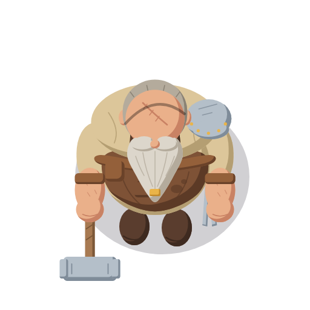
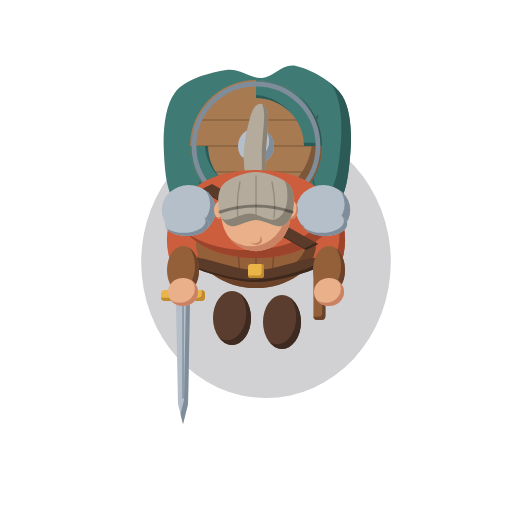
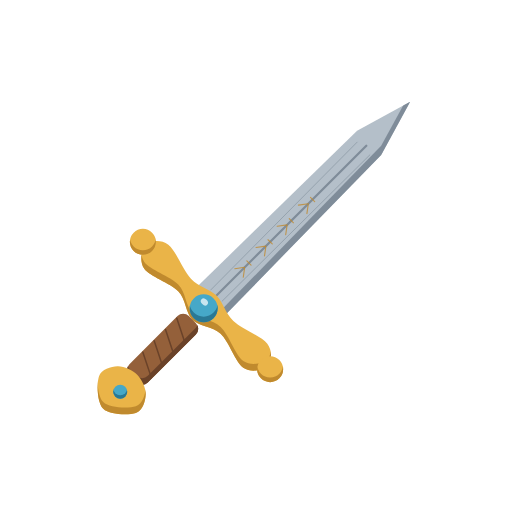
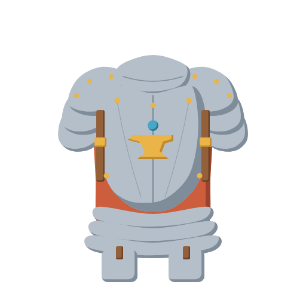
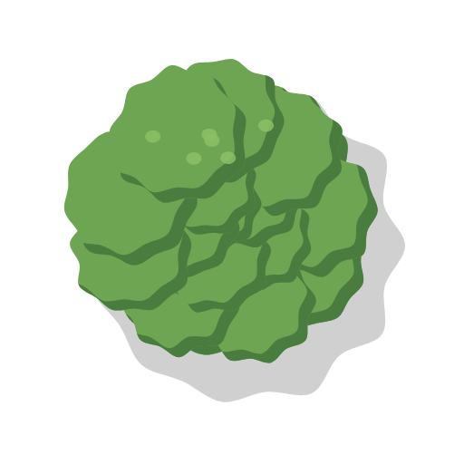
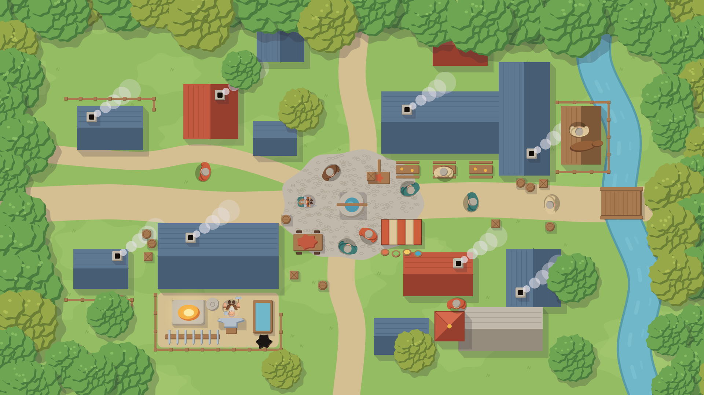
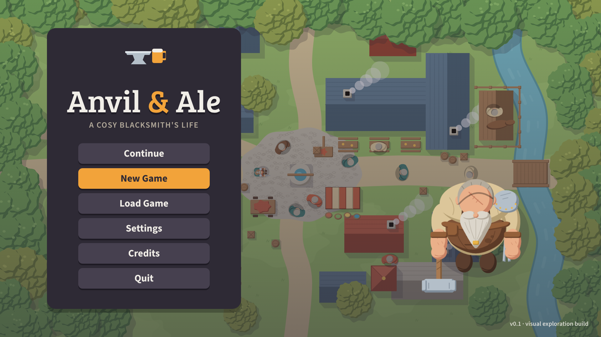
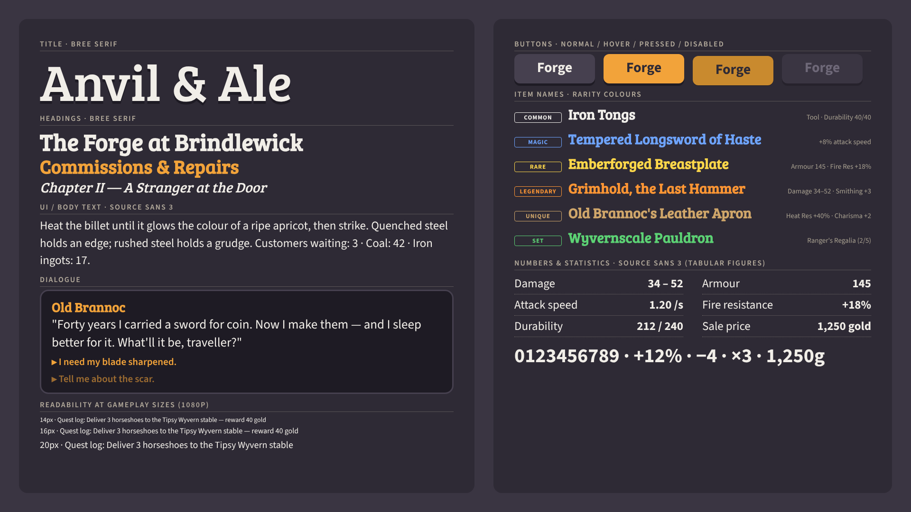

# 05 · Production-Light Indie Fantasy — "Anvil & Ale"

> Attractive, simplified 2D fantasy art built for efficient independent production:
> consistent proportions, clean shapes, minimal texture, cheap animation and reusable
> components — with just enough character (chunky friendly silhouettes, one warm accent,
> hand-made props) that it never reads as placeholder art.

This is direction **05** of five being compared for the Godot 4.x blacksmith game
(01 Gothic Noir, 02 Warm Storybook, 03 Bold Readable Adventure Sim, 04 Ink-and-Parchment,
**05 Production-Light**). All five share the same eight subjects and framing so they can be
compared side by side.

---

## Rendering note (read first)

The example images in this folder are **procedural vector illustrations**, not AI renders and
not final art. No AI image-generation model was available in the build environment, so each
image was drawn as SVG by Python (`docs/visual_exploration/_generator/` — `styles.py` holds the
palette and style switches, `svgcore.py` the shading technique, `subjects.py` the shared
geometry) and rasterised with headless Chromium (`render.js`).

They are faithful **style studies / mock-ups**: palette, shading logic, proportions and shape
language are exactly what this direction specifies, but drawing finesse, facial character and
prop detail are below production quality. Use [`prompts.md`](prompts.md) to generate
production-quality versions with an image model or to brief an artist.

Of the five directions, this is the one that can be produced **almost exactly like the
examples** directly in a vector tool (Inkscape, Affinity Designer, Illustrator) by a small team —
the mock-ups are already close to shippable in technique, just not in polish.

The brief referred to four reference images; **none were found in the repository**. All
decisions here are derived from the written brief. If the references turn up, re-check the
palette, proportions and prompts against them before production starts.

---

## The eight examples

| # | File | Size | What it shows |
|---|------|------|---------------|
| 1 | [`blacksmith.png`](blacksmith.png) | 512×512, transparent | Protagonist, straight top-down, facing south |
| 2 | [`adventurer.png`](adventurer.png) | 512×512, transparent | Same proportion system, slimmer build, sword drawn |
| 3 | [`sword.png`](sword.png) | 512×512, transparent | Inventory icon, 45° diagonal, tip top-right |
| 4 | [`armor.png`](armor.png) | 512×512, transparent | Inventory icon, breastplate set, front view |
| 5 | [`tree.png`](tree.png) | 512×512, transparent | Deciduous canopy from above, flat cast shadow |
| 6 | [`town_view.png`](town_view.png) | 1920×1080 | Village crossroads, smithy SW, inn NE, stream E |
| 7 | [`menu_screen.png`](menu_screen.png) | 1920×1080 | Main menu, flat buttons, clean panel |
| 8 | [`font_reference.png`](font_reference.png) | 1920×1080 | Typography sheet |

---

## 1. Visual identity

**One sentence:** clean flat shapes in a friendly, slightly chunky proportion system, lit by a
single hard shadow per shape, in a cheerful but not saccharine daylight palette, with a warm
amber accent that marks everything important (forge, gold, UI focus).

| Pillar | What it means in practice |
|--------|---------------------------|
| Flat, outline-free | No line art at all. Shapes are separated by value and hue, not by strokes. |
| Two tones per material | Base fill + one hard-edged shadow shape. No gradients, no texture, no soft brushes. |
| Primitive-based shapes | Ellipses, rounded rectangles, simple blobs. The same head, hand, boot and shoulder shapes are re-used across all characters. |
| Friendly chunk | Heads 1.16× and shoulders 0.96× relative to the shared baseline — reads as approachable and is easier to recognise at small sizes. |
| One accent | Amber `#f2a33a` / pale gold `#f7d27a` is reserved for fire, gold, magic glints and UI focus. Everything else stays mid-saturation. |
| Lived-in props | Character comes from hand-designed props (dented pauldron, beard ring, tankard signs), not from rendering detail. |

### Rendering techniques used in the examples (style key `prod`)

Taken directly from the generator code:

- **Fill:** every shape is filled with its material's *base* tone (`Painter.shape`, `prod` branch).
- **Shadow:** a "crescent" — the shape minus a copy of itself offset towards the light — is filled
  with the material's *shadow* tone. Offset = 0.8 × shape-specific size, light vector (−1, −1),
  i.e. **light from top-left, shadow on the bottom-right edge**. Hard edge, 100 % opacity.
- **Interior details** (seams, straps, fullers, braids) are drawn as round-capped strokes in the
  material's own *shadow* tone (≈2.2 px at 512 px canvas) — never black, never an outline.
- **Light tone** is used sparingly as small flat accent spots (e.g. six sunlit leaf dapples on
  the tree, metal glints), not as a modelling highlight.
- **Ground shadows:** flat ellipse in `#2e2a35` at 22 % opacity, no blur. Tree cast shadow:
  the canopy outline offset ~14 % right / 18 % down, same colour and opacity, no blur.
- **No sprite-level filter** — unlike the other four directions there is no grain, roughening
  displacement or outer outline pass. What you draw is what ships.

---

## 2. Colour palette

Each material role has three tones: **light** (accents only), **base** (main fill), **shadow**
(hard shadow shape and interior detail lines). Values are exactly those in
`_generator/styles.py` → `"05_production_light"`.

| Role | Light | Base | Shadow | Used for |
|------|-------|------|--------|----------|
| skin | `#f5c7a0` | `#eab08a` | `#c98264` | scalp, forearms, hands |
| beard | `#f1eee8` | `#dcd6cb` | `#b4ab9c` | grey braided beard |
| hair | `#d8d2c6` | `#b4ab9c` | `#8a8274` | hair fringe, ponytail |
| shirt | `#eee0bc` | `#dcc69a` | `#b49e72` | linen shirts, cream UI text |
| apron | `#9c6a48` | `#7e5236` | `#5c3a26` | smith's apron |
| leather | `#b4784c` | `#94603a` | `#6a4229` | jerkins, bracers, grips, pouches |
| strap | `#6a4632` | `#5a3a28` | `#3e281c` | belts, straps, buckles' backing |
| metal | `#dfe5ea` | `#b4bfc9` | `#7f8c99` | steel: blades, pauldrons, armour |
| gold | `#f6cf62` | `#eab448` | `#c08a2e` | beard ring, crossguard, emblems |
| cloak | `#4f8f88` | `#3f7a74` | `#2c5a56` | cloaks, adventurer cloth |
| tunic | `#e07450` | `#cc5e3e` | `#9c432c` | villager tunics, banners |
| boot | `#6e4c3a` | `#5a3d2e` | `#3e2a20` | boots |
| wood | `#c4946a` | `#a87a52` | `#7c5838` | trunks, shields, crates, stalls |
| foliage | `#8cc066` | `#6ea552` | `#4a7c40` | tree canopies |
| foliage2 | `#b4c25a` | `#96a848` | `#6a7e36` | variant trees, hedges |
| grass | `#a4c870` | `#94bc62` | `#7aa452` | ground tiles |
| road | `#e2d0a6` | `#d4bf92` | `#b49e74` | paths, square |
| roof_a | `#d66a4e` | `#c25a42` | `#963f2e` | terracotta / thatch-red roofs |
| roof_b | `#6e88a2` | `#5e7891` | `#465d73` | slate roofs (smithy) |
| stone | `#d6d0c4` | `#c0b8aa` | `#958c7e` | walls, well, chapel |
| water | `#80c4d4` | `#6fb7c9` | `#4f97ad` | stream, quench trough |
| gem | `#7ad0e0` | `#46a8c8` | `#2a7894` | gems, magic glints |
| fire | `#fbe6a0` | `#f2a33a` | `#d0662a` | forge, lanterns, embers |

| UI / global | Hex | Notes |
|-------------|-----|-------|
| UI background / "ink" / shadow colour | `#2e2a35` | dark plum; also the colour of every ground shadow (22 % opacity) |
| Accent | `#f2a33a` | amber — focus, primary button, forge glow |
| Accent light | `#f7d27a` | pale gold — hover, highlights, title shadow alternative |
| Panel (suggested) | `#3a3542` | one step lighter than the background, for raised panels |

**Palette rules:** 23 roles × 3 tones ≈ 70 colours plus the plum and the two accents — small
enough to memorise and to enforce with a quantise step. Shadow tones are all shifted slightly
warm-to-cool and darker by a similar amount, so a single shared "shadow logic" holds across
materials. Saturation stays medium; only fire/gold/accent go high.

---

## 3. Lighting & shading

- **One light, top-left, always.** Shadow shapes sit on the bottom-right of every form. Never
  flip the light per asset — it is what makes mixed-source assets look like one game.
- **Two tones only.** Base + one hard shadow. If something needs more form, split it into two
  shapes (e.g. beard braid segments), do not add a third tone or a gradient.
- **Shadow size** scales with the form: roughly 8–12 % of the shape's width for small parts,
  up to ~15 % for large volumes (canopy clusters, the belly).
- **Ground contact:** flat `#2e2a35` @ 22 % ellipse under characters and props; flat offset
  silhouette for trees and buildings (towards bottom-right).
- **Time of day and mood are done in-engine, not repainted.** Art is authored once in neutral
  daylight. In Godot:
  - `CanvasModulate` on the world for dusk (`#ffd2a8`-ish), night (`#5a6890`-ish) and interiors.
  - `PointLight2D` with a soft texture for the forge, lanterns and the inn windows; give the
    forge a small flicker (energy noise via `AnimationPlayer` or a script).
  - `LightOccluder2D` is optional; shadows from lights are rarely worth the cost in this style.
  - Put UI in a separate `CanvasLayer` so modulation never tints the HUD.
  - "Occasional darkness" (crypts, wilderness at night) comes from `CanvasModulate` + a few
    warm lights + darker ground tiles, not from new character art.

---

## 4. Proportions

All characters use one **shared body template** in a 512 px design space (export sizes are in
[`naming_guide.md`](naming_guide.md)).

| Measure | Baseline | This style | Effect |
|---------|----------|-----------|--------|
| Head size | 1.00 | **1.16** | friendlier, readable at 64–96 px |
| Shoulder width | 1.00 | **0.96** | compact, chunky silhouette |
| Belly (smith) | 1.00 | 0.98 | heavyset but tidy |

- **Blacksmith:** widest silhouette in the game — belly projecting forward (down-screen) under
  the beard, single pauldron breaking symmetry, hammer extending the silhouette on the viewer's
  left. Recognisable from silhouette alone.
- **Adventurer:** same head and hand primitives, ~20 % narrower torso, round shield disc on the
  back as the identifying shape.
- **Villagers:** the adventurer body template with swapped heads/hair/clothing layers.
- **Props:** sized to the 48 px tile — barrels ≈ 0.75 tile, crates 1 tile, anvil 1 × 0.75,
  carts 2 × 1. Doors ≈ 1 tile wide so characters (1 tile shoulder width) fit visually.
- **Icons** (sword, armour) ignore world scale; they fill ~80 % of their square with a
  consistent margin.

---

## 5. Suitability for straight top-down 2D (honest assessment)

**Strengths**
- Flat shapes read cleanly from directly above; tops of heads, shoulders, roofs and canopies
  are naturally simple shapes, which is exactly what this style draws best.
- A fixed top-left shadow gives depth cues without the 3/4 perspective cheat.
- Grid-friendly: roofs, walls, fences and paths decompose into tiles and modular pieces.

**Weaknesses**
- Straight top-down characters are hard to make expressive — faces are barely visible. This style
  has even less detail to carry it, so personality must come from **head-top features**
  (eyepatch strap, scarred scalp, ponytail, hats), **silhouette props** and **animation**.
- Flat shading can flatten height differences (a wall top vs the ground). Mitigate with the cast
  shadow offset and darker `stone` shadow tone on wall tops.
- Facing direction is subtle from above. Keep a forward-projecting element on every character
  (beard, belly, held weapon, boot toes) so south/north are distinguishable.

**Verdict:** well suited. Among the five directions it is the least likely to break when seen
from directly above, because it never relies on painted volume.

---

## 6. Sprite & animation production

| Topic | Recommendation |
|-------|----------------|
| Rig | **Cut-out / modular rig** in Godot (`Skeleton2D` + `Polygon2D`, or plain `Node2D` hierarchy of `Sprite2D` parts animated with `AnimationPlayer`). Flat shapes with no outlines hide joint seams well. Frame-by-frame only for effects. |
| Directions | 4 directions: S, N, W authored; **E = W mirrored** (`flip_h`). Two caveats: (1) asymmetric details (smith's single pauldron on his left, hammer in right hand, tongs at left hip) swap sides — accept it for villagers, author E separately for the smith; (2) mirroring moves the hard shadow from bottom-right to bottom-left, so in a modular rig keep shadow shapes on separate child sprites and swap them for the E variant (or accept it for small/background characters). |
| Frame counts | Idle 4 (breathing/beard sway), walk 6 (4 acceptable for villagers), run 6, hammer strike 6, attack 4–6, hit 2, use/interact 4. 8–10 fps for walk, 12 fps for strikes. |
| Paper-doll equipment | Separate layers: `body`, `head`, `hair`, `beard`, `torso`, `shoulder_l`, `shoulder_r`, `hand_l`, `hand_r`, `weapon`, `offhand`, `back`. Equipment pieces share the rig's pivot points, so one sword animates on every character. |
| Palette swaps | A palette-swap shader (lookup by base/shadow colour → `sampler2D` palette row) turns one villager into many. Works perfectly here because every sprite uses a known, small set of exact colours — enforce *no anti-aliased intermediates inside shapes* (only at edges). |
| Shared body template | One villager body × N heads × N clothing palettes × N hats ≈ 30+ distinct villagers from ~10 drawn parts. |
| Tilesets | 48 px tiles. Grass/road/stone/water as Godot `TileMapLayer` with **terrain sets** (match corners and sides, 47-tile blob or the cheaper 16-tile corner set). Two-tone flat art needs few tile variants — 3–4 decor variants per terrain prevent repetition. |
| Buildings | Modular roof/wall kits on the tile grid; roofs as separate sprites so they can fade when the player walks inside. |
| Effects | Flat shapes too: sparks as amber/pale-gold diamonds (`GPUParticles2D`), smoke as plum-tinted circles at low opacity. |

---

## 7. Advantages and disadvantages

| Advantages | Disadvantages |
|-----------|---------------|
| Cheapest and fastest of the five to produce; vector sources re-export at any resolution | **Risk of looking generic** — flat vector fantasy is common in mobile/indie |
| Very consistent output across several artists or outsourced work | Less atmospheric than 01/02/04; darkness and mystery rely on engine lighting |
| Palette swaps and paper-doll layers work naturally | Small faces and limited detail reduce expressiveness of the protagonist |
| Readable at small sizes; good for busy village scenes | Image models tend to add gradients/texture — needs a clean-up pass |
| Engine lighting (CanvasModulate/Light2D) composes well over flat art | Lower "screenshot appeal" without careful composition |

### Avoiding the generic look — concrete mitigations

1. **Signature shapes:** every major character gets one memorable silhouette element (the smith's
   single dented pauldron and gold beard ring; the adventurer's round shield disc). Buildings get
   one hand-designed feature each (the Tipsy Wyvern's hanging wyvern sign, the smithy chimney).
2. **Accent discipline:** amber `#f2a33a` appears only on important things — forge, gold, quest
   markers, UI focus. Scarcity makes it a brand colour.
3. **Hand-made props:** spend saved rendering time on bespoke props with history (repaired
   barrels, mismatched shutters, adventurer trophies in the smithy) rather than generic crates.
4. **Characterful animation:** squash on hammer impact, beard sway, a tired idle for the old
   smith, ale slosh at the inn. Motion carries personality the flat art cannot.
5. **Slightly irregular geometry:** draw roofs and fences a few degrees off-true and blobs with
   small wobble (the generator uses ~6–7 % radial wobble) — perfect geometry looks stock.
6. **Bespoke typography:** Bree Serif title with flat offset shadow gives a pub-sign identity.

---

## 8. Estimated production difficulty

**Rating: 2 / 5** — the cheapest of the five directions.

**Assumptions:** a small but complete game (one village + 3–4 wilderness/dungeon areas,
~15–20 h of play); one experienced 2D artist working in vector, plus part-time animation;
person-month = ~20 working days; includes revisions but not marketing art.

| Asset group | Rough count | Notes |
|-------------|-------------|-------|
| Hero characters (smith, key NPCs) | 6–8 | fully rigged, 4 dirs, 6–8 animations each |
| Villagers / adventurers | 30+ visible variants | from 1–2 body templates + layers + palette swaps |
| Enemies / creatures | 12–18 | 4 dirs, 4–5 animations |
| Equipment paper-doll pieces | 60–80 | also used for icons |
| Inventory/UI icons | 150–200 | 64 px + 128 px exports from the same vector |
| Terrain tilesets | 6–8 | grass, road, stone, water, forest floor, dungeon |
| Buildings / interiors | 20–30 modular | roof/wall kits |
| Props | 120–180 | many reused with palette swaps |
| UI theme | 1 Theme resource | ~25 styled controls, flat StyleBoxFlat — little bitmap art |
| VFX | 20–30 | particles + flat sprites |

| Discipline | Person-months (ballpark) |
|------------|--------------------------|
| Character & creature art + rigging | 3–4 |
| Animation | 3–4 |
| Environment (tiles, buildings, props) | 3–4 |
| Icons & equipment | 1.5–2 |
| UI art & theme | 0.5–1 |
| VFX | 0.5–1 |
| **Total art** | **≈ 11–16 person-months** |

For comparison, the painted/hatched directions (01, 02, 04) are likely 1.5–2.5× this, mainly in
characters, animation and environments.

---

## 9. Typography

### Fonts

| Use | Font | Weights | Notes |
|-----|------|---------|-------|
| Title / logo | **Bree Serif** | 400 | friendly slab serif with a warm pub-sign feel; cream `#eee0bc` fill, flat offset shadow in `#2e2a35` (or accent) |
| Headings | **Bree Serif** | 400 | 28–40 px at 1080p |
| UI, body, dialogue | **Source Sans 3** | 400 / 600 / 700 | variable font, excellent hinting and wide language coverage |
| Numbers & stats | **Source Sans 3** | 600 / 700 | tabular lining figures (`tnum`, `lnum`) |

Two families only — fewer files, one licence type, a simpler Theme.

### Title lettering characteristics
- Bree Serif's soft slabs and rounded terminals echo the rounded-rectangle shape language.
- Cream fill, **flat hard shadow** offset down-right (matching the world's light) — no glow,
  no bevel, no gradient. Optional amber ampersand in "Anvil & Ale" as the single accent.
- Letter-spacing +2–4 % at display sizes; never all-caps for long strings.

### UI, headings and dialogue
- UI labels: Source Sans 3 600, 20–24 px at 1080p; body text 400, 22–26 px; minimum 18 px.
- Headings: Bree Serif, cream on plum; one size step per level (40 / 32 / 26).
- Dialogue: Source Sans 3 400, 24–28 px, line height 1.35, speaker name in Bree Serif with the
  speaker's signature colour (smith = amber). Use `RichTextLabel` with BBCode for emphasis
  (600 weight, not italics).
- Buttons: flat `StyleBoxFlat`, radius 6–8 px. Normal plum-lighter `#3a3542` + cream text;
  hover `#f7d27a` text or border; pressed amber `#f2a33a` fill with plum text; disabled cream
  at 40 % opacity.

### Numbers & statistics
- Source Sans 3 600/700 with `tnum` so columns of damage, weight and price align.
- Right-align numeric columns; positive deltas in Set-green `#5cd274`, negative in tunic red
  `#e07450`; gold values preceded by a small gold-coin icon rather than coloured text.

### Item rarity colours on the plum UI (`#2e2a35`)

| Rarity | Hex | Contrast vs `#2e2a35` | vs panel `#3a3542` | Notes |
|--------|-----|-----------------------|--------------------|-------|
| Common | `#f2f0ec` | 12.3 : 1 | 10.4 : 1 | near-white; distinct from cream `#eee0bc` mainly by context |
| Magic | `#6ea4ff` | 5.6 : 1 | 4.8 : 1 | passes WCAG AA for normal text; use weight 600 |
| Rare | `#ffd84a` | 10.1 : 1 | 8.6 : 1 | close to accent-light `#f7d27a` — keep accent off item names |
| Legendary | `#ff9634` | 6.5 : 1 | 5.5 : 1 | **almost identical to accent `#f2a33a` (1.04 : 1)** — never place on amber fills; add a small icon/frame |
| Unique | `#cfa66a` | 6.2 : 1 | 5.3 : 1 | close in hue to Legendary; pair with a distinct frame shape |
| Set | `#5cd274` | 7.3 : 1 | 6.2 : 1 | conflicts with red/green colour-blindness against Legendary — add set icon |

All six pass AA (≥ 4.5 : 1) on both backgrounds. Because Rare/Legendary/Unique sit next to the
amber accent, **rarity must never be colour-only**: add a frame shape or small glyph per rarity
in the inventory slot.

### Recommended free fonts (SIL Open Font License)

| Font | Google Fonts | npm (fontsource) |
|------|--------------|------------------|
| Bree Serif | <https://fonts.google.com/specimen/Bree+Serif> | `@fontsource/bree-serif` |
| Source Sans 3 | <https://fonts.google.com/specimen/Source+Sans+3> | `@fontsource-variable/source-sans-3` |

OFL permits embedding in a commercial game; ship the `OFL.txt` in `res://assets/fonts/`.

### Godot import notes
- Import `.ttf`/`.otf` as **`FontFile`**. Keep the variable Source Sans 3 file; create
  **`FontVariation`** resources for weights (`variation_opentype = {"wght": 600}`) instead of
  shipping three static files.
- **Numbers:** a `FontVariation` `source_sans_3_num.tres` with `opentype_features = {"tnum": 1,
  "lnum": 1}` and weight 600; assign it to stat labels via a Theme type variation (e.g.
  `StatLabel`).
- **Title:** enable **Multichannel Signed Distance Field** (MSDF) on the Bree Serif import so the
  logo scales crisply for menu animation; pixel range 8. UI text stays normal rasterised with
  hinting *Light* and subpixel positioning *Auto*.
- **Shadow/outline:** use `Label` theme constants `shadow_offset_x/y` (3–4 px at 1080p,
  shadow colour `#2e2a35`) for the flat title shadow; `outline_size` only for text drawn over
  the world (damage numbers: 4 px plum outline).
- Set a project-wide default font in a **Theme** resource (`res://ui/theme/main_theme.tres`) and
  in Project Settings → GUI → Theme → Custom Font.
- Antialiasing: on (grayscale); this is not a pixel-art style.
