# 06 — Ballpoint Sketch Fantasy · "The Inkbound Forge"

> Fantasy drawn with a blue ballpoint pen in an architect's sketchbook: confident but imperfect
> contours, lines gone over twice, visible construction lines, crosshatching for every shadow, and
> a red pen kept back for what matters — magic, gems, forge fire and the things the player can use.
> The world sits on a separate, tileable sheet of squared notebook paper.

An additional direction alongside the original five (01 Gothic Noir, 02 Warm Storybook,
03 Bold Adventure, 04 Ink-and-Parchment, 05 Production-Light) for the Godot 4.x straight top-down
blacksmith game. It uses the same subjects and framing, so it can be compared side by side with
01–05; its closest sibling is [04 Ink-and-Parchment](../04_ink_parchment/README.md).

Companion files: [`prompts.md`](prompts.md) (image-model / artist briefs) and
[`naming_guide.md`](naming_guide.md) (file naming, sizes, paper textures, Godot import).

---

## Rendering note (read first)

The example images in this folder are **procedural vector illustrations**, not AI-generated or
hand-drawn art. No image-generation model was available in the build environment, so each image
was built as SVG by the Python generator in [`../_generator/`](../_generator/) and rasterised with
headless Chromium (Playwright, `render.js`) — the same pipeline and the same shared subject
geometry (`subjects.py`, `town.py`) as directions 01–05. The style lives under the key `ballpoint`:
`styles.py` (`"06_ballpoint_sketch"`) holds the palette, hatch tones and fonts, `svgcore.py` the
double-pass pen line, hatching and construction lines, `town.py` / `compositions.py` the village,
annotations, menu, scene composite and paper sheets.

They are **style studies / mock-ups**: palette, line logic, hatch conventions, red-accent rules,
paper/layer separation, proportions and typography are exactly what this direction proposes, but
the drawing itself is simplified geometry with a noise wobble — a real pen drawing will be far
livelier. Final art should be produced from [`prompts.md`](prompts.md) with an image model or by
briefing an illustrator.

**Missing reference images.** The client supplied two new reference images for this direction
(the first one defines the architectural-sketchbook look). **Neither was present in the repository
or in the build session**, so nothing here is matched to them; the direction was built from the
written description only. Once the references are added (e.g. under
`docs/visual_exploration/references/`), re-check the line weight, hatch density, amount of
construction lines, blue/red values and the master prompt in [`prompts.md`](prompts.md) against
them, and attach them as image references for generation.

---

## Example graphics

| # | File | Size | Content |
|---|------|------|---------|
| 1 | [blacksmith.png](blacksmith.png) | 512×512, transparent | Protagonist, straight top-down, facing south |
| 2 | [adventurer.png](adventurer.png) | 512×512, transparent | Visiting adventurer, red-ink cloak |
| 3 | [sword.png](sword.png) | 512×512, transparent | Inventory icon, 45° diagonal, red gem |
| 4 | [armor.png](armor.png) | 512×512, transparent | Inventory icon, front-view breastplate set |
| 5 | [tree.png](tree.png) | 512×512, transparent | Top-down deciduous canopy |
| 6 | [town_view.png](town_view.png) | 1920×1080 | Brindlewick on tiled grid paper, with architect annotations |
| 7 | [menu_screen.png](menu_screen.png) | 1920×1080 | Main menu, hand-drawn buttons on grid paper |
| 8 | [font_reference.png](font_reference.png) | 1920×1080 | Typography and rarity sheet (paper and dark tooltip) |
| 9 | [paper_grid.png](paper_grid.png) | 512×512, seamless tile | Squared notebook paper, 32 px squares |
| 10 | [paper_plain.png](paper_plain.png) | 512×512, seamless tile | Plain paper alternative |
| 11 | [scene_composite.png](scene_composite.png) | 1920×1080 | In-game mock-up: sprite layers ≈1.8× over grid paper, smithy interior, HUD |
| 12 | [paper_comparison.png](paper_comparison.png) | 1920×1080 | Same sprites on grid paper / plain paper / transparency |

<p>
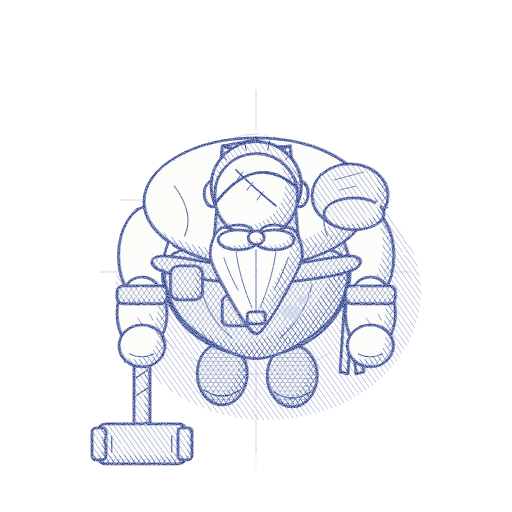
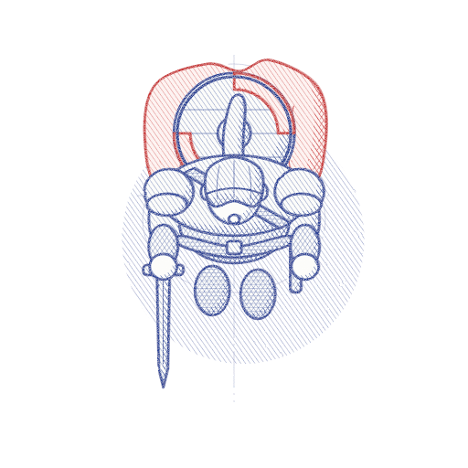
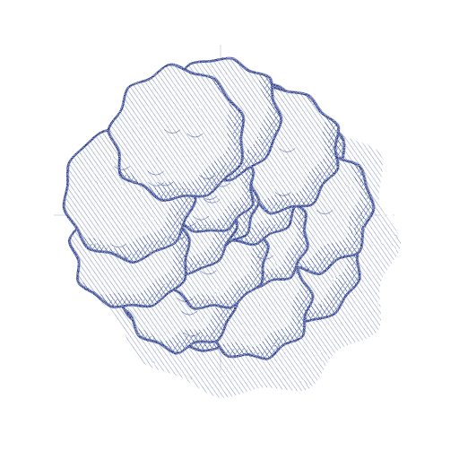
</p>
<p>
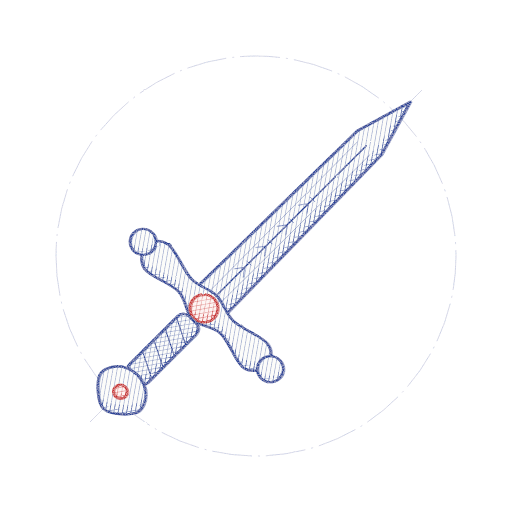
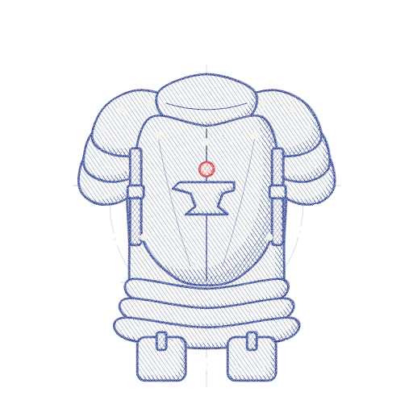
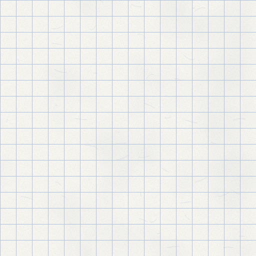
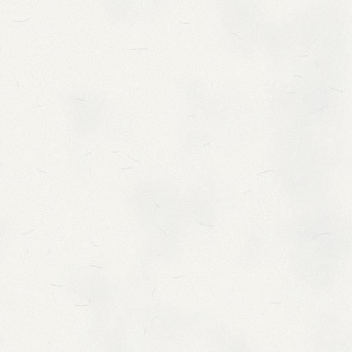
</p>

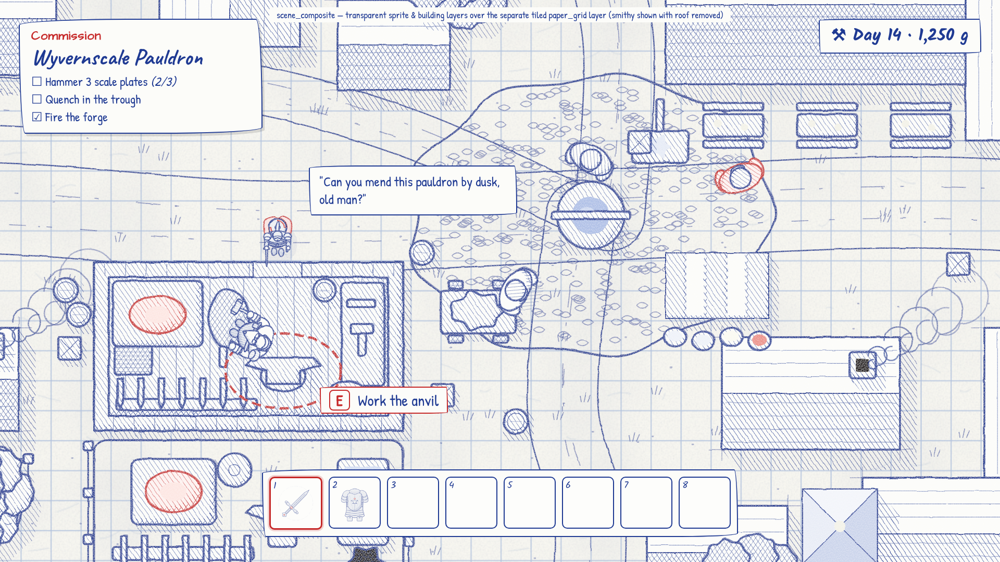
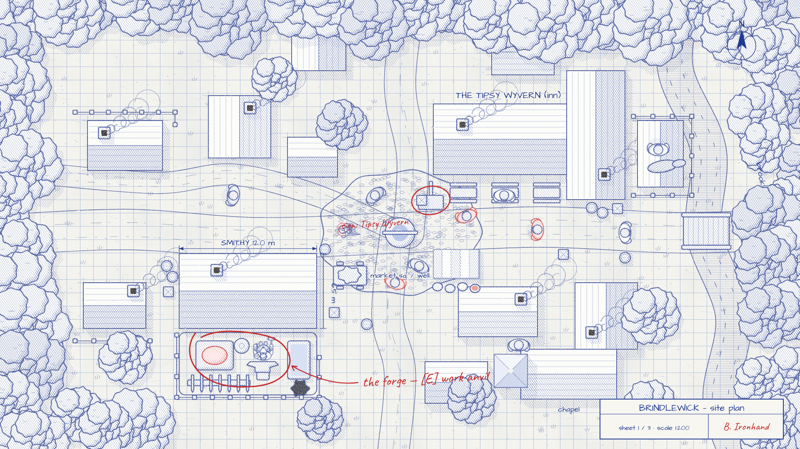
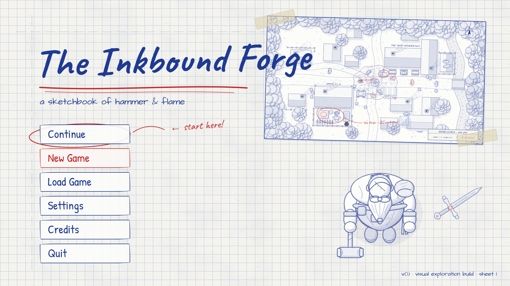
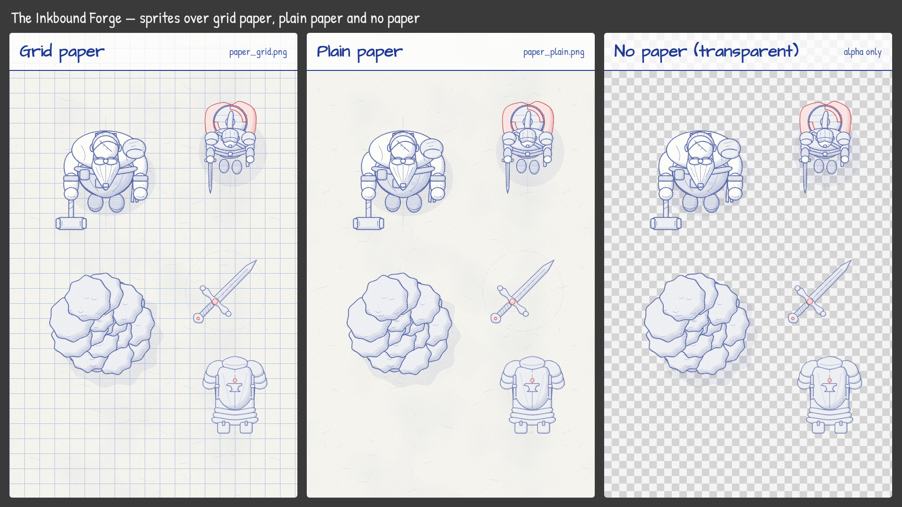
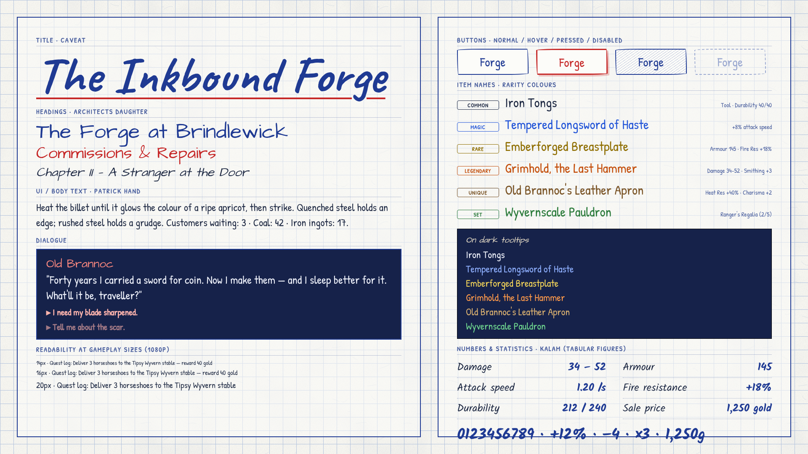

The five sprites are shown on transparency. In-game they sit on the separate paper layer (see
*Paper & layer architecture*); `paper_comparison.png` shows the identical sprites on both papers
and on a checkerboard to prove nothing is baked in.

---

## Visual identity

**Fantasy fiction:** the game is the smith's own sketchbook. Old Brannoc plans blades, measures
his workshop and maps the village in blue biro on squared paper; the red pen marks what matters —
an enchanted gem, the forge fire, a customer's cloak, "talk to him", "pick up". Where 04 is a
finished chronicle, 06 is the working drawing: honest, fast, a bit messy, and always legible.

**Rendering techniques used in the examples (key `ballpoint` in the generator):**

| Element | Technique | Value at 512 px master |
|---|---|---|
| Line | Ballpoint blue `#1f3a93`, round caps/joins | ~2.0 px |
| Double pass | Every contour drawn twice: second pass lighter and slightly offset, like a pen going back over a line | offset ≈ 1 px, lower opacity |
| Wobble | Slight noise displacement of the line | rough 1.6 (04 uses 1.8) |
| Fills | **Opaque** very pale paper-white / pale-blue tints (no transparency) | palette *light/base* |
| Tone | Hatch density per material, 0 (clean paper) → 3 (triple hatch) | see *Hatch tone table* |
| Shadow side | Dense diagonal hatch plus crosshatch on the side away from the light | light top-left |
| Ground shadow | Hatched ellipse, never a filled blob | — |
| Construction lines | Faint axes, guide circles and overshooting strokes around standalone sprites | very low opacity |
| Red accent | Red ballpoint `#c62828` for gems/magic, forge fire, the adventurer's cloak; red annotations (circled targets, arrows, hand notes) in compositions | — |
| Annotations | Town only: architect-style labels, leader lines and dimension lines in blue | — |
| Paper | Separate tileable texture (`paper_grid.png`, `paper_plain.png`), **never** in sprites | 32 px squares |

The opaque pale fill is the key decision: the paper's grid lines must stop at a sprite's contour,
otherwise characters look like transparent wireframes and silhouettes collapse. The fill is
"paper the pen didn't touch", tinted so faintly blue that it reads as white.

---

## Colour palette

Effectively a **two-ink palette** (blue and red) on off-white paper. Fill tints exist only to
separate overlapping shapes; value comes from hatching, not from fill colour.

### Core colours

| Role | Hex | Use |
|---|---|---|
| Ballpoint blue | `#1f3a93` | All linework, hatching, annotations, UI text and frames |
| Red accent | `#c62828` | Gems/magic, fire, key equipment, interaction marks, title underline |
| Red glow (soft) | `#e86a5a` | Forge/magic glow core in compositions |
| Paper | `#f7f6f0` | Background texture base, UI panels |
| Paper rules | blue-grey, low contrast (sample from `paper_grid.png`) | 32 px grid on `paper_grid.png` |
| Tooltip ink-navy | dark navy (≈ `#16224a`) | Dark tooltip panels for the light rarity set |

### Material fill tints (light / base / shadow) and hatch tone

From `styles.py`, `"06_ballpoint_sketch"`. **Tone** is the number of hatch layers on the lit body
of the shape (0 = clean paper, 1 = single hatch, 2 = crosshatch, 3 = triple hatch); shadow sides
always get more.

| Role | Light | Base | Shadow | Tone |
|---|---|---|---|---|
| skin | `#fbfbfd` | `#f6f7fb` | `#dfe4f2` | 0 |
| beard | `#ffffff` | `#f8f9fc` | `#e2e7f4` | 0 |
| hair | `#eef1f9` | `#e4e9f5` | `#c9d2ea` | 1 |
| shirt | `#fbfbfd` | `#f5f6fb` | `#dde3f1` | 0 |
| apron | `#e9edf7` | `#dfe5f3` | `#c3cde7` | 2 |
| leather | `#e6eaf6` | `#dae1f1` | `#bcc7e4` | 2 |
| strap | `#d6ddef` | `#c9d2ea` | `#aab8de` | 3 |
| metal | `#ffffff` | `#f1f4fa` | `#d4dcef` | 1 |
| gold | `#fbfaf2` | `#f3f2e8` | `#dcdcd0` | 1 |
| cloak (red ink) | `#fdf1f0` | `#f8dedb` | `#e9b0aa` | 1 |
| tunic | `#eff2f9` | `#e6ebf6` | `#cfd8ee` | 1 |
| boot | `#d9dfef` | `#ccd4ea` | `#aebbe0` | 3 |
| wood | `#f2f4fa` | `#e9edf7` | `#cdd6ec` | 1 |
| foliage | `#eef2f8` | `#e3e9f5` | `#c7d2eb` | 1 |
| foliage2 | `#e6ebf6` | `#d9e0f1` | `#bcc8e6` | 2 |
| grass | `#f7f6f0` | `#f7f6f0` | `#d9dfef` | 0 |
| road | `#fbfaf6` | `#f4f3ec` | `#dfe3ee` | 0 |
| roof_a | `#f3f5fa` | `#e8ecf6` | `#cbd4eb` | 1 |
| roof_b | `#e4e9f5` | `#d7deef` | `#b9c5e3` | 2 |
| stone | `#f6f7fb` | `#eceff7` | `#d0d8ec` | 1 |
| water | `#e2e9f7` | `#d3ddf2` | `#aebfe6` | 1 |
| gem (red ink) | `#f9d9d5` | `#ec8f86` | `#c62828` | 2 |
| fire (red ink) | `#fde6e2` | `#f4a9a0` | `#c62828` | 1 |

Red-ink roles (`gem`, `fire`, `cloak`) are drawn and hatched in `#c62828` instead of blue. `grass`
and `road` are the paper itself: terrain is "undrawn page", so anything drawn reads against it.

---

## Lighting & shading

* **Light source:** top-left for every asset (vector −1, −1 in screen space). Shadow sides bottom-
  right; ground shadows fall bottom-right.
* **Value = hatch density.** Escalation on any shape:
  1. clean paper (pale fill only) — lit planes;
  2. single diagonal hatch, parallel strokes falling top-right → bottom-left — material tone 1 or
     turning planes;
  3. crosshatch over it — tone 2, shadow side;
  4. third direction (near-horizontal) — tone 3 materials, core shadows, under belts and brims.
  Never solid fills. The darkest value is tight triple hatch.
* **Hatch lock:** one stroke direction set for the whole game, in screen space; spacing ~4–6 px at
  512 px master, stroke ~1 px. Strokes may overshoot contours by 1–3 px (it is a pen), but never
  into neighbouring objects.
* **Highlights** are untouched paper. Metal: a clean streak plus a few short "glint" ticks.
* **Construction lines** are drawn before the contour and left visible at ~15–25 % strength: a
  centre axis, a head circle, a footprint ellipse. They belong to standalone sprites and close-ups;
  in-game world tiles keep them minimal so the screen does not turn to noise.

### Night, interiors and forge glow in pen

A ballpoint drawing cannot get darker by changing colour, only by adding strokes. The game should
fake light the way a sketcher would:

| Situation | Technique in Godot |
|---|---|
| Night | Screen-space hatch overlay (`night_hatch.gdshader`) adding diagonal → cross → triple hatch as darkness rises, plus a mild `CanvasModulate` toward cool paper (≈ `#c9cfe0`). Night = "the page has been shaded in", never black. |
| Forge / hearth / lantern | `PointLight2D` whose mask **erases** the night hatch inside its radius, ringed by short radiating red strokes (`#c62828`); the fire sprite itself is red-hatched with a soft `#e86a5a` core. Light is literally a clearing in the hatching. |
| Interiors | Roof sprite fades out; walls get a dense hatched inner edge (tone 3 strip) so the room reads as a cut-away plan; light pools from windows/forge are hatch-free. |
| Magic | Red ink only, with faster line boil (every frame instead of every 2–3) and a few loose spiral strokes. |
| Danger / mystery | Edge vignette of scribbled crosshatching; unexplored map areas left as blank grid paper. |

---

## Character & object proportions

* Neutral, naturalistic proportions — same as 04 (generator factors **head 0.98×, shoulders 1.0×,
  belly 1.0×** of the shared base geometry). Charm comes from the line, not from big heads.
* The blacksmith reads by mass and a few heavy-hatch accents: broad shoulders, belly beyond the
  clean-paper beard, single pauldron, hammer, tone-3 boots and straps.
* Character ≈ 60–70 % of the 512 px canvas width including held weapon; feet at ≈ y 0.80.
* Buildings and props share the world scale of the characters (1 tile = 64 px = two paper squares).
  Annotations and dimension lines may be any size; gameplay objects stay to scale.

---

## Suitability for straight top-down 2D

**Strong fit.** Architectural sketches are plans and elevations; a plan view of a village with
roofs, canopies and dimension lines is exactly what an architect's sketchbook contains. The grid
paper doubles as a readable movement grid and makes scale obvious.

**Main risk — everything is the same blue.** Monochrome line art can turn into a uniform texture,
especially with construction lines and grid behind it. Rules:

1. **Opaque pale fills** on every sprite so the grid stops at the silhouette (see palette).
2. **Silhouette weight:** actors and interactables get a slightly heavier, double-passed outer
   contour; terrain and background buildings use a single, lighter pass.
3. **Tone contrast:** keep characters' lit areas clean paper (tone 0) and place their heavy hatch
   on small, characteristic parts (boots, straps, apron) — a bright figure with dark accents pops
   against a sparsely hatched ground.
4. **Red only for interaction and importance:** hover/target = hand-drawn red circle, red arrow or
   a short red note ("talk", "forge"). Terrain never uses red.
5. **Hatched ground shadows** under all actors and props.
6. **Grid stays faint:** rules at low contrast, never darker than tone-1 hatching.

---

## Consistency across categories

The pen look must hold from a 64 px icon to a full town. The same five rules apply everywhere —
blue line, double pass on silhouettes, opaque pale fill, hatch tone per material, red only for
importance — plus these category rules:

| Category | Rules |
|---|---|
| **Characters** | Clean-paper skin, beards and shirts (tone 0); leather/apron 2, boots/straps 3. Heaviest double-passed contour in the game. Faces never shown (top-down): identity via hair/scalp hatching, beard shape, gear. Red only for a signature item (adventurer's cloak, a magic amulet), max ~10 % of the sprite. Construction lines only on portraits/codex art, not on in-game frames. |
| **Equipment** | Icons are "design sketches": faint centre axis and a guide circle around the gem or pommel; metal tone 1 with a clean highlight streak; grips and straps tone 2–3. Gems, runes and enchantments in red. Weapons 45° tip top-right, armour front view — same as 01–05. Held/world versions drop construction lines and use 2 px minimum line at target size. |
| **Interiors** | Shown as cut-away plans (roof removed, as in `scene_composite.png`): wall thickness drawn as a double line with tone-3 hatch inside, plank floors as sparse parallel strokes (tone 0–1, follow the board direction), stone floors as loose cobble outlines. Furniture tone 1, its shadow sides crosshatched. Forge fire red. |
| **Buildings** | Roofs are plan shapes: ridge line drawn first as a construction line, then tiles (roof_a, tone 1) or slates (roof_b, tone 2) as short stroke rows; shadow-side roof plane gets crosshatch. Chimneys and doors slightly heavier. Annotations (name label, dimension line) belong to the town/map view only, not to the in-game building sprite. |
| **Landscapes** | Ground = paper (tone 0). Paths edged by two loose lines, grass as sparse tick clusters, water as tone-1 horizontal ripple strokes with denser hatch along the banks, trees as scalloped canopy outlines with tone 1–2 hatch and a hatched cast shadow. Keep detail density lowest here so actors and buildings stay readable. |

---

## Paper & layer architecture

The paper is a **separate background layer**, never part of any sprite. This is what allows grid
or plain paper, day/night treatment and clean sprite re-use.

```text
CanvasLayer -10  Paper          TextureRect / Parallax2D / Sprite2D with region, texture repeat on
Node2D (world)   TileMapLayers  ground marks, paths, water (transparent PNGs)
                 Y-sorted       buildings, trees, props, characters (transparent PNGs, opaque fills)
CanvasLayer  5   Overlays       night hatch, red interaction marks (world-anchored)
CanvasLayer 10   HUD / UI       blue-ink panels, Patrick Hand text
```

**World space vs screen space paper.** If the paper is a fixed screen-space background, the
grid stays still while the world scrolls over it: sprites appear to slide across the page and the
grid "swims" against the drawing — it breaks the illusion that the world is drawn *on* this sheet.
**Anchor the paper in world space** so it scrolls 1:1 with the camera:

* `Parallax2D` with `scroll_scale = (1, 1)`, `repeat_size = (512, 512)` and a 512 px tile, or
* a world-sized `Sprite2D` / `TextureRect` with `texture_repeat = Enabled` and `region_enabled`, or
* a full-screen `ColorRect` on the bottom `CanvasLayer` with a shader sampling the paper texture at
  `world_pos = (SCREEN_UV * screen_size) / zoom + camera_offset` (pass the camera transform as a
  uniform) — the cheapest option for large or infinite maps.

Screen-space paper is right only for menus and full-screen UI, where nothing scrolls. With zoom,
scale the paper with the world (a grid square stays half a tile); never keep the grid fixed while
sprites zoom.

---

## Sprite & animation production considerations

* **Line boil as a feature:** draw 2–3 "boil" variants of each held pose (same pose, re-traced) and
  cycle them at 8–10 fps, or fake it with a UV-noise shader re-seeded every 2–3 frames. Boil makes
  idle sprites feel alive and hides small frame-to-frame differences — a real cost saver.
* **Frame counts (per direction):** idle 2–3 boil frames; walk 6 frames; hammer strike 6–8;
  talk/gesture 4; pick up / hand over 4–5. 4 directions (S, N, E, W).
* **Hatch consistency:** hatch direction is locked in *screen* space and per-material tone is fixed
  (table above). Mirroring a sprite mirrors its hatch and its light side — draw E and W separately
  for asymmetric characters, or apply shadow hatching via shader.
* **Re-use:** construction-free in-game frames; separate layers for hammer, tongs, shield and cloak
  so cut-out animation and equipment swaps work; red items as separate layers so they can be
  re-coloured or boiled faster. Building interiors and roofs are separate sprites.
* **Downscaling:** a 2 px line at 512 px becomes 0.5 px at 128 px and vanishes. Draw at target
  size or with thickened masters (see [`naming_guide.md`](naming_guide.md)); fine hatching should
  be coarsened, not just scaled.
* **Tilesets:** easy — terrain is mostly paper. Path edges, river banks and field borders as
  auto-tiled pen strokes; variation via 3–4 boil variants per tile.

---

## Advantages and disadvantages

| Advantages | Disadvantages |
|---|---|
| Unusual, instantly recognisable "sketchbook game" identity | Monochrome blue can flatten into a single texture without strict tone/silhouette rules |
| Straight top-down = architectural plan; the grid makes scale and movement readable | Fine lines and hatching do not survive downscaling; target-size drawing needed |
| Two-ink palette is trivially consistent; red gives a free, unmistakable interaction language | Frame-by-frame line work is labour-intensive (eased by boil and cut-out) |
| Paper as a separate tiled layer: cheap, swappable, enables pen-style night | Red accents compete with Legendary orange and warning UI — needs rules |
| Imperfection is a feature: boil and wobble hide small inconsistencies | Warmth and "cosy" mood are weaker than 02; atmosphere relies on writing and annotation |
| Handwriting fonts unify UI and world, and are free | Handwriting fonts lack tabular figures; long texts tire faster than a book face |
| Works well for codex, crafting blueprints, maps and quest notes | AI models tend to add perspective, coloured pens, paper backgrounds and fake handwriting — post-processing load |

---

## Estimated difficulty of a complete game in this style

**Difficulty: 4 / 5** (lower end) — linework and hatching per frame cost as much as in 04, but the
two-ink palette, opaque single-tint fills and tolerated imperfection (boil, wobble) make
consistency and cleanup cheaper.

Assumptions as for 04, so the figures compare directly: one village, 3–4 wilderness areas, ~25
named NPCs, ~150 craftable/lootable items, **4-direction characters**, one experienced
illustrator-animator plus AI assistance for drafts, shaders by a programmer; art only, ±40 %.

| Asset group | Rough count | Person-months |
|---|---|---|
| Characters (protagonist, ~25 NPCs, ~10 enemy types), 4 directions, idle/walk/work/attack | ~35 rigs · ~1,500 frames | 5.5–8 |
| Item icons (weapons, armour, materials, tools) | ~200 | 1.5–2.5 |
| Buildings & interiors (village, workshop, inn interior; roof + interior per building) | ~40 | 2–3 |
| Environment props & tilesets (village, forest, wilds, 3–4 biomes) | ~300 pieces, 4 tilesets | 2.5–3.5 |
| Maps and annotated plans (world, town, quest notes) | ~10 | 0.5–1 |
| UI (menus, crafting blueprints, frames, hand-drawn buttons, icons) | ~120 elements | 1.5–2 |
| VFX (sparks, red magic strokes, hit scribbles) | ~30 effects | 1 |
| Paper textures & shaders (paper layer, line boil, night hatch, red select ring) | — | 0.5–1 (programmer) |
| **Total** | | **≈ 15–22 person-months** |

Roughly 10 % below 04 (≈ 17–24 pm): no wash colours to paint or palette-map, and animation cleanup
is lighter because boil is part of the look. Heavy AI drafting shrinks icons and props further;
animation consistency still needs hand cleanup.

---

## Typography

Handwriting faces that look written with the same pen, ordered from fastest (title) to most
legible (UI). All are SIL Open Font License — free for commercial games, embeddable, modifiable
(keep the licence file in the project).

### Title font & lettering

**Caveat 700** (Impallari Type) — fast, confident pen handwriting with natural joins. The title
"The Inkbound Forge" is set in blue `#1f3a93` with a **red scribbled underline** (`#c62828`, one
or two loose strokes, slightly overshooting). Optionally a double-pass shadow (second copy
offset 1–2 px at low opacity) to echo the line technique. MSDF import for scaling.

### Headings, labels & annotations

**Architects Daughter** (Kimberly Geswein) — upper/lowercase print lettering in the style of an
architect's drawings. Headings 30–44 px at 1080p, map and town labels, dimension notes, quest
titles. Pairs with leader lines and arrows; red for interaction notes, blue for everything else.

### Readable UI / body / dialogue font

**Patrick Hand** (Patrick Wagesreiter) — very legible, evenly spaced handwriting that holds up at
small sizes. Menus, tooltips, settings, inventory lists and dialogue. Minimum **18 px at 1080p**,
20–24 px for dialogue. Speaker names in Architects Daughter or Patrick Hand in red only when the
speaker is interactive-relevant (quest giver).

### Numbers & statistics

**Kalam 400/700** (Indian Type Foundry) — clear handwritten lining numerals, more regular than
Caveat's and with distinct 1/7 and 3/8. Use 700 for damage, prices and key stats, 400 elsewhere.
Handwriting fonts **lack true tabular figures** (`tnum` has no effect), so digits differ in width:
**right-align stat columns in fixed-width containers** (`Label` with
`horizontal_alignment = RIGHT` inside a `Control` of fixed `custom_minimum_size.x`, or a
`GridContainer` column), and use the true minus `−` and multiplication `×`.

### Item rarity colour compatibility

Two matched sets keep the hue identity (white/ink, blue, yellow-ochre, orange, gold-brown, green)
and change only the value: ink-dark variants for text on paper, bright variants on dark tooltips.

**On paper `#f7f6f0`** (WCAG contrast ratio):

| Rarity | Hex | Contrast | Note |
|---|---|---|---|
| Common | `#1f2a44` | 13.2:1 | Dark ink replaces white |
| Magic | `#2456d8` | 5.7:1 | Brighter than the ballpoint blue `#1f3a93` so it differs from body text |
| Rare | `#8f6e00` | 4.4:1 | Dark ochre replaces yellow — ≥ 20 px or Kalam/Patrick at 22 px+ |
| Legendary | `#c4500e` | 4.3:1 | Large text only |
| Unique | `#7a5426` | 6.2:1 | Gold-brown |
| Set | `#2a7a3a` | 4.9:1 | |

**On dark navy-ink tooltip** (≈ `#16224a`):

| Rarity | Hex | Contrast |
|---|---|---|
| Common | `#eef1fa` | 13.7:1 |
| Magic | `#8fb0ff` | 7.2:1 |
| Rare | `#f5d659` | 10.8:1 |
| Legendary | `#ff9a4a` | 7.3:1 |
| Unique | `#d9b070` | 7.6:1 |
| Set | `#70d890` | 8.7:1 |

**Legendary vs red accent.** Legendary `#c4500e` sits close to the red pen `#c62828`, and red
already means "interact here". Mitigation: red ink is reserved for **world interaction and magic**
and is never used for item-name text; Legendary keeps a clearly orange hue and is always paired
with a second cue — the word "Legendary" in the tooltip, a tag, and a double-ruled orange frame on
the item slot. Do not use the red accent on dark tooltips (2.7:1 on `#16224a`); use the light set.
For colour-blind players every rarity gets a tag or frame shape, never colour alone.

### Recommended fonts (free, Godot-ready)

| Role | Font | Weights | Source |
|---|---|---|---|
| Title | Caveat | 700 (variable 400–700) | <https://fonts.google.com/specimen/Caveat> |
| Headings, labels, annotations | Architects Daughter | 400 | <https://fonts.google.com/specimen/Architects+Daughter> |
| UI, body, dialogue | Patrick Hand | 400 | <https://fonts.google.com/specimen/Patrick+Hand> |
| Numbers, stats | Kalam | 400, 700 | <https://fonts.google.com/specimen/Kalam> |

The examples use the WOFF2 builds in `../_generator/fonts/` (fetched by `fetch_fonts.sh`); for
Godot download the TTFs from Google Fonts.

### Godot import notes

* Import each file as **`FontFile`**.
* **Caveat (title):** enable **Multichannel Signed Distance Field** (`msdf_pixel_range` 8–16) for
  the menu title and logo animation.
* **Patrick Hand / Kalam / Architects Daughter:** rasterised, `antialiasing = Grayscale`, hinting
  **Light** (None if strokes look distorted — the irregularity is intentional),
  `subpixel_positioning = Auto`, mipmaps off.
* Put Title, Heading, Body and Numbers into one project **`Theme`** as type variations
  (`TitleLabel`, `HeadingLabel`, `DialogueLabel`, `StatLabel`) so swaps are one edit; test at
  1280×720 and 2560×1440.
* Keep `OFL.txt` for each family in `res://assets/fonts/` and list them in the credits.
