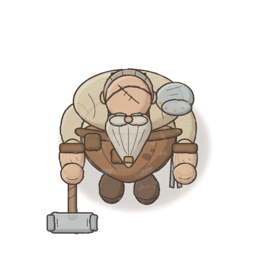
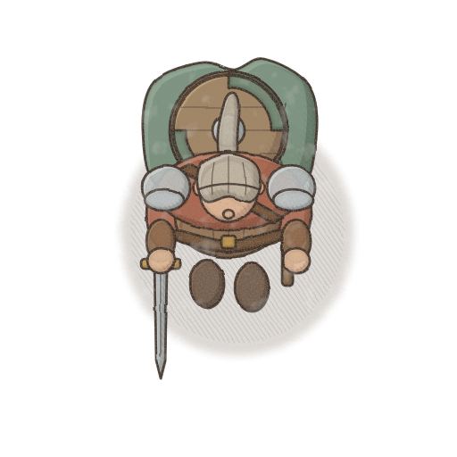
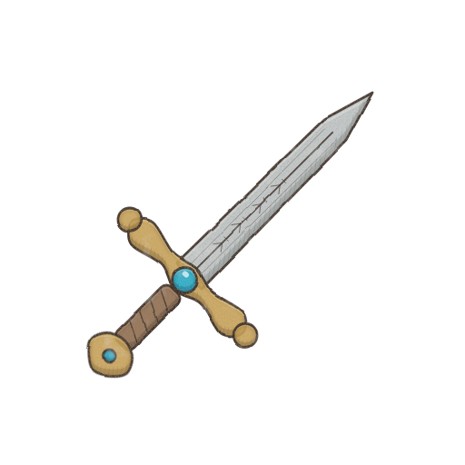
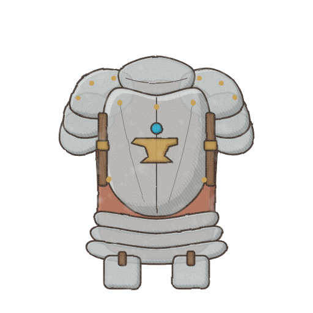
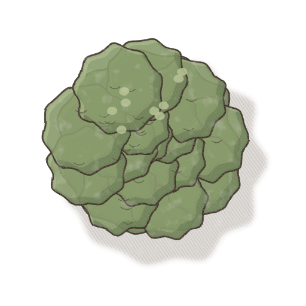
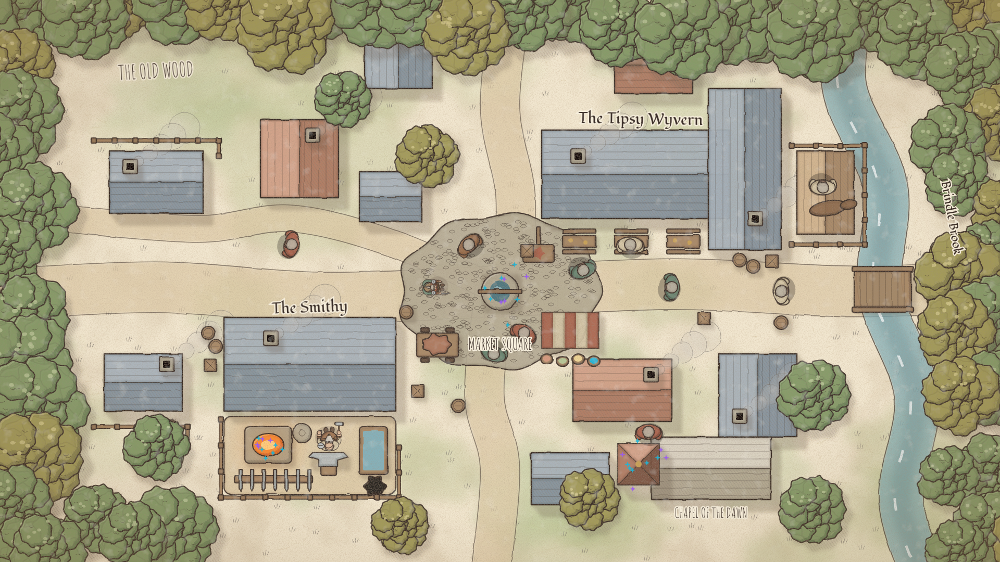
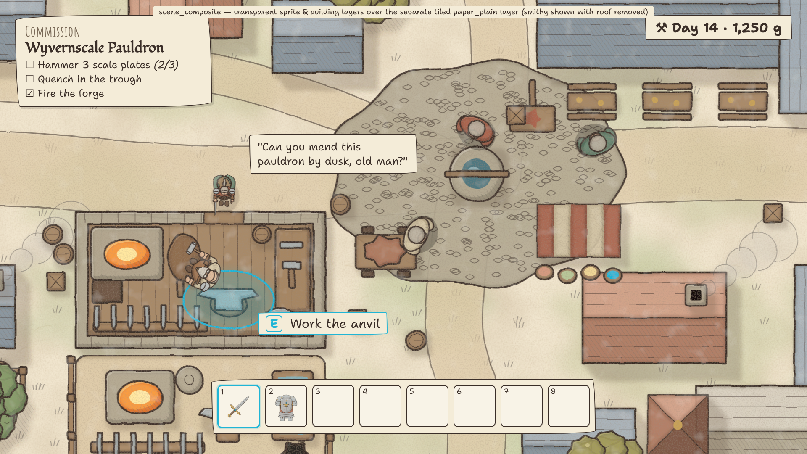
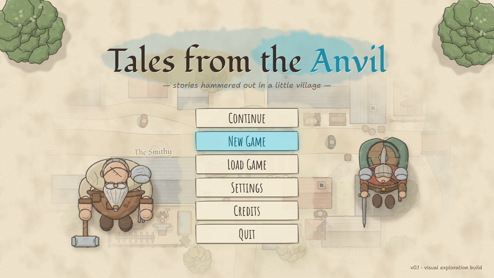
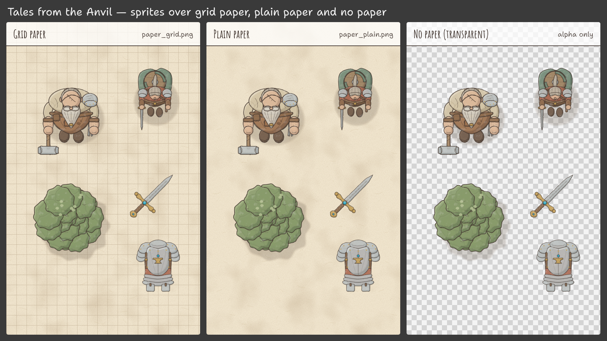
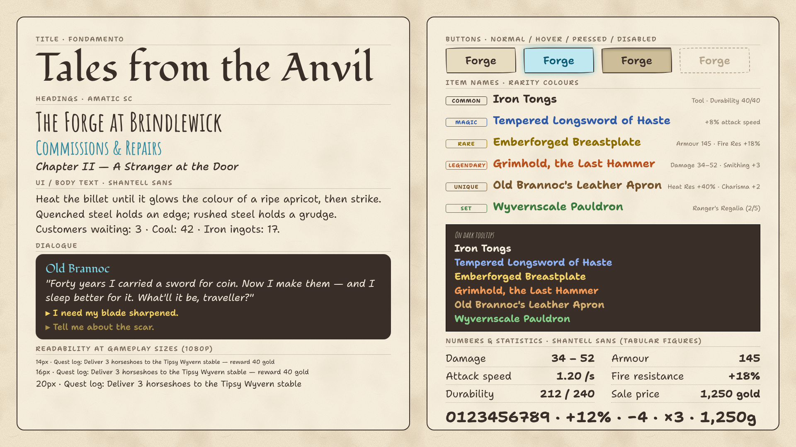

# 07 — Illustrated Sketchbook Fantasy · working title *"Tales from the Anvil"*

> A fantasy world drawn straight into a travelling illustrator's sketchbook: loose, expressive
> dark-brown ink lines, pencil marks left visible in the shadows, transparent watercolour washes
> in muted natural colours, and the warm paper itself showing between and through everything —
> with the occasional vivid flash of teal or violet wherever magic is at work.

Part of the visual exploration for the DND Blacksmith game (Godot 4.x, **straight top-down 2D** —
the camera looks straight down at heads, shoulders, roofs and canopies, not a 3/4 view). It was
added after the original five directions (01 Gothic Noir, 02 Warm Storybook, 03 Bold Readable
Adventure Sim, 04 Ink-and-Parchment, 05 Production-Light Indie) together with 06 Ballpoint Sketch,
and uses the **same subjects, framing and shared subject geometry** so it can be compared side by
side with them.

Files in this folder:

| File | Content |
|---|---|
| `README.md` | This document — identity, palette, lighting, proportions, suitability, paper/layer architecture, production, typography |
| `prompts.md` | Master style prompt + one detailed prompt per example image (11 assets) + consistency rules |
| `naming_guide.md` | Filenames, folder layout, dimensions, paper textures, pivots, transparency, Godot import settings |
| 12 × `.png` | Style studies (see below) |

---

## Rendering note (read first)

The example images are **not** final art and were **not** made with an AI image model — no
image-generation model was available in the build environment. They are **procedural vector
illustrations**: SVG written by Python in [`../_generator/`](../_generator/) and rasterised with
headless Chromium — the same pipeline and the same shared subject geometry as directions 01–05.

- `styles.py` → `"07_illustrated_sketchbook"` (`key="sketchbook"`) holds the palette, ink, pencil,
  accent colours, line width and roughness.
- `svgcore.py` holds the sketchbook shape painter (watercolour fill, edge darkening, pencil hatch,
  doubled ink line) and the sprite filter (wobble, paper grain, watercolour blooms).
- `subjects.py` holds the shared geometry and the per-style proportions (`PROPS["sketchbook"]`);
  `town.py` and `compositions.py` build the town, menu, typography sheet and scene composite.

Treat the images as faithful **style studies**: they lock palette, line language, shading logic,
light direction, proportions, the paper/sprite layer split and the typography. A real illustrator
(or a well-steered image model) will add far more life to the line — varied pressure, lost-and-found
edges, real pigment granulation and backruns. [`prompts.md`](prompts.md) is written for producing
those production-quality versions.

### Missing reference images

The client's brief says this direction is inspired by **the second of two newly supplied reference
images**. **Neither of the two new reference images was present in the repository or in the build
session** when this package was made, so nothing here is matched to them — the direction was built
from the written description only. When the references are added (suggested location:
`docs/visual_exploration/references/`), re-check the palette, line weight, proportions and the
master prompt in `prompts.md` against the second image before any batch generation.

---

## The twelve examples

| # | Preview | Subject | Canvas |
|---|---|---|---|
| 1 | [blacksmith.png](blacksmith.png) | Protagonist — retired adventurer turned smith, top-down, facing south | 512×512, transparent |
| 2 | [adventurer.png](adventurer.png) | Visiting adventurer, same scale system | 512×512, transparent |
| 3 | [sword.png](sword.png) | Inventory icon — longsword with teal gem, 45° | 512×512, transparent |
| 4 | [armor.png](armor.png) | Inventory icon — plate breastplate, front view | 512×512, transparent |
| 5 | [tree.png](tree.png) | Top-down deciduous canopy | 512×512, transparent |
| 6 | [town_view.png](town_view.png) | Brindlewick village over tiled plain paper, small hand-lettered labels | 1920×1080 |
| 7 | [menu_screen.png](menu_screen.png) | Main menu, "Tales from the Anvil" | 1920×1080 |
| 8 | [font_reference.png](font_reference.png) | Typography sheet, incl. rarity names on paper and on a dark tooltip | 1920×1080 |
| 9 | [paper_plain.png](paper_plain.png) | **Primary background:** seamless warm sketchbook paper | 512×512, tileable, opaque |
| 10 | [paper_grid.png](paper_grid.png) | Optional seamless squared paper (crafting / blueprint screens) | 512×512, tileable, opaque |
| 11 | [scene_composite.png](scene_composite.png) | Transparent layers at ~1.8× over tiled plain paper; smithy interior with roof removed; HUD | 1920×1080 |
| 12 | [paper_comparison.png](paper_comparison.png) | The same sprites over grid paper, plain paper and no paper (checkerboard) | 1920×1080 |

 

  











---

## Visual identity

**Keywords:** sketchbook · loose ink · visible pencil · transparent watercolour · paper showing
through · muted natural colour · vivid magic accents · organic shapes · friendly but grown-up ·
hand-lettered.

**Touchstones (spirit, not copying):** travel and field sketchbooks, illustrators' location
journals, concept sketch pages for fantasy films and books — drawings made quickly, on the spot,
with the construction still visible.

What makes it *this* direction:

- **The paper is a layer of the world.** The warm sketchbook page is a separate, tiled background
  that shows between sprites and lightly through the washes. Sprites never carry paper.
- **Expressive irregular ink line.** Dark sepia-brown `#3a2e28`, wobbly, slightly doubled
  (a second, thinner pass a fraction off-register), as if drawn fast with a dip pen or brush pen.
- **Pencil left in.** Grey graphite hatching in the shadow areas — construction marks are part of
  the look, not something to clean up.
- **Watercolour fills, not paint.** Flat-ish transparent washes with a darker pigment rim inside
  each shape, soft blooms and granulation; form comes from line + pencil + one soft shadow wash.
- **Muted base, vivid magic.** Everything natural is greyed and earthy; only magic (teal
  `#1fb5d6`, violet `#9a5cf0`) and fire (warm orange) are allowed to be saturated.

### How 07 differs from its closest siblings

| | 02 Warm Storybook | 04 Ink & Parchment | **07 Illustrated Sketchbook** |
|---|---|---|---|
| Medium | Polished painted gouache | Engraving / manuscript pen work | Loose ink + pencil + transparent watercolour |
| Line | No dark outlines; soft line in each material's own shadow hue | Fine, controlled sepia line, systematic cross-hatching | Irregular, doubled dark-brown ink line; loose pencil hatching only in shadows |
| Volume | Radial gradients, blended form shadow | Hatching density, pale washes | Flat-ish wash + darker pigment rim + one soft shadow band + pencil |
| Light / mood | Golden-hour, warm, saturated mid-tones | Drawn map, neutral, scholarly | Neutral daylight, muted, calm; vivid only for magic and fire |
| Ground | Opaque painted terrain | Parchment map with decorative dressing (cartouches, compass, borders) | The sketchbook paper itself, with loose washes and pencil grass marks |
| Framing idea | Storybook cover | Chronicle / campaign map | An illustrator's field sketchbook |
| Characters | Gently softened, painterly | Engraved, slightly formal | Friendly, expressive, slightly larger heads, still adult |

In short: 02 is **finished painting**, 04 is **engraved document**, 07 is **live drawing**.

### Rendering techniques used in the examples

| Technique | How it is done in the generator (`sketchbook`) | What an illustrator should do |
|---|---|---|
| Watercolour fill | Base colour at **~88–90 % opacity**, so a hint of the paper shows through | Flat-ish transparent wash, one or two layers |
| Pigment edge-darkening | A ~7 px stroke in the material's shadow hue, **32 % opacity, 1.6 px blur**, clipped *inside* the shape | Let pigment pool at the edge of the wash (the classic dried-wash rim) |
| Form shadow | Soft **blurred shadow band** (2.5 px blur, 38 % opacity) offset away from the top-left light | One soft second wash on the shadow side |
| Pencil hatching | Grey graphite `#6e6862`, 0.8 px lines, 4.5 px spacing at **−35°**, 55 % opacity, only in the shadow crescent | Loose diagonal pencil strokes in shadows, unerased construction lines |
| Highlight | Light tone crescent at 55 %, 2 px blur, on the top-left | Lift-out / leave paper |
| Ink outline | **Doubled:** main pass 2.6 px `#3a2e28` @ 88 %, plus a thinner ~1.2 px pass @ 55 % offset ≈ (0.9, 0.8) px | Quick, confident contour; let a second stroke wander off-register in places |
| Interior detail | Seams, folds, beard braids in ink, ~1.8× detail width, 85 % opacity | Fewer, more expressive marks than 04 |
| Hand wobble | Noise displacement on the whole sprite (base frequency 0.03, **scale 2.6** — stronger than 02's 1.2) | Natural irregular line; nothing ruled |
| Paper grain / granulation | Fine fractal noise (0.6) in warm brown composited *inside* the sprite's fills | Granulating pigments, paper tooth inside the wash |
| Watercolour blooms | Low-frequency noise producing slightly lighter mottled patches inside fills | Backruns / cauliflower blooms, used sparingly |
| Ground shadow | Blurred `#6a5a4a` wash @ 22 % (4 px blur) + pencil hatch @ 45 % | Soft wash puddle plus a few pencil strokes |
| Foliage | Clustered blobs **with** ink line (unlike 02), scallop leaf marks, pale dapple spots | Loose leaf masses, outline broken in places |

---

## Colour palette

All values are taken directly from `styles.py` → `"07_illustrated_sketchbook"`. Each material role
has three tones: **light** (lit plane / lifted highlight), **base** (main wash), **shadow** (second
wash, edge rim).

### Global colours

| Role | Hex | Use |
|---|---|---|
| Ink (sepia-brown) | `#3a2e28` | All outlines, interior detail, lettering, Common rarity on paper |
| Pencil (graphite) | `#6e6862` | Shadow hatching, ground-shadow strokes, grass marks, construction lines |
| Paper (plain sketchbook) | `#f1e6cf` | The tiled background layer (`paper_plain.png` averages ≈ this value); light UI panels |
| Magic accent 1 — teal | `#1fb5d6` | Gems, runes, enchantment glow, magical interactables, selection |
| Magic accent 2 — violet | `#9a5cf0` | Secondary magic (arcane, curses, portals), quest markers |
| Forge glow | `#ff9a3a` | Forge, lanterns, hearth, sparks (warm orange) |
| Forge glow (pale) | `#ffd27a` | Glow core, sparks, window light |
| Ground-shadow wash | `#6a5a4a` @ 22 % | Contact shadows (plus pencil hatch) |

### Material ramps

| Material | Light | Base | Shadow |
|---|---|---|---|
| Skin | `#f6e0c8` | `#e2bc9c` | `#a8806a` |
| Beard (grey/white) | `#f6f3ec` | `#dcd6ca` | `#9e978a` |
| Hair (grey) | `#e2dccf` | `#bdb4a4` | `#857c6c` |
| Shirt / linen | `#efe6d2` | `#d6c8a8` | `#9c8c6c` |
| Apron (tanned leather) | `#c89c78` | `#9c704e` | `#644632` |
| Leather | `#c09a74` | `#8e6c4e` | `#5c4634` |
| Straps / belts | `#9a7a5c` | `#76583e` | `#4c3828` |
| Steel | `#eceeec` | `#bcc2c2` | `#7c8686` |
| Gold / brass | `#eed496` | `#c8a258` | `#8a6a34` |
| Cloak (sage wool) | `#a2b8a6` | `#6e8a76` | `#3e5446` |
| Tunic (faded madder) | `#d49a80` | `#ac6650` | `#704030` |
| Boots | `#9a7c66` | `#6c5444` | `#43342a` |
| Wood | `#d2b48e` | `#a68664` | `#6a5240` |
| Foliage (green) | `#b8c698` | `#879c6c` | `#526a46` |
| Foliage (olive / autumn) | `#cfc488` | `#a49c5c` | `#6a6640` |
| Grass (wash) | `#d8dcb4` | `#b9c08e` | `#8c9468` |
| Road / packed earth (wash) | `#efe2c6` | `#ddc9a6` | `#b29a76` |
| Roof A — terracotta | `#d4a28a` | `#b07a62` | `#78503e` |
| Roof B — slate | `#a8b4bc` | `#8494a0` | `#56646e` |
| Stone | `#dcd4c4` | `#b4aa94` | `#7c7462` |
| Water (wash) | `#b6d4d8` | `#86b0b8` | `#507880` |
| Gem / magic (teal) | `#a8f4ff` | `#1fb5d6` | `#0a6a8a` |
| Fire | `#ffe7a0` | `#ff9a3a` | `#c8501a` |

**Palette rules**

- **Muted by default.** Natural materials sit at low-to-medium saturation and lean grey-green,
  grey-brown and sage. If a natural colour starts to "pop", grey it towards the paper.
- **Two vivid families only:** magic (teal/violet) and fire (orange). That scarcity is what makes
  them read as special — and it doubles as a gameplay signal (see *Suitability*).
- **Ink is never black** — always the sepia-brown `#3a2e28`. Pencil is a neutral warm grey and only
  ever appears in shadows and ground marks.
- **The paper is the lightest value** in most of the world; white highlights are lifted sparingly
  (steel glints, beard, linen).
- Teal `#1fb5d6` is only 2.0 : 1 against the paper — fine for glows and gems, **never for text**
  (use the gem shadow `#0a6a8a`, 4.9 : 1, if teal text is needed on paper).

---

## Lighting & shading

- **Key light:** neutral soft daylight from the **top-left** (screen space), as in all directions,
  so assets can be mixed. No baked golden hour — the paper should look like paper under daylight.
- **Form shading:** one base wash, one soft shadow wash on the bottom-right, a darker pigment rim at
  the edges, pencil hatching inside the shadow, a lifted highlight on the top-left. No gradients,
  no cel bands, no specular hot spots beyond small lifted glints on steel and gold.
- **Cast / contact shadows:** soft brown-grey wash puddles plus a few pencil strokes; short and
  close to the object. Trees and buildings get their shadow as a separate soft wash shape offset to
  the bottom-right.
- **Emissive / magic:** forge and lantern glows in `#ff9a3a` / `#ffd27a`; magic in teal and violet.
  These are the only places where colour may bloom past the ink line (as if the wash ran).

### Day / night in-engine

Two options, depending on what the paper should "mean":

| Option | Setup | Look | Use for |
|---|---|---|---|
| **A — tint paper and sprites together** (recommended for gameplay) | Paper sits in the world canvas; one `CanvasModulate` (day `#ffffff` → dusk `#e0c8c0` → night `#6a7090`) tints everything; `PointLight2D` (forge, lanterns, magic) lights paper and sprites | Unified: the whole page goes dusky, as if the sketchbook were read by lamplight; forge light warms the paper too | The village, wilderness, interiors |
| **B — paper excluded** | Paper on its own `CanvasLayer` (layer −1, `follow_viewport_enabled = true` so it stays world-anchored) with no or a weaker `CanvasModulate`; world `CanvasModulate` tints only sprites | Night is "drawn" onto a daylight page: sprites dim, paper stays cream. Strong illustration effect, but at night the dark sprites sit on a bright page — sticker-like and lower contrast for light-coloured actors | Map, journal, codex, menus, flashback/storybook sequences |

Option A is the default: it keeps sprites and page in the same light and avoids the "cut-out pasted
on" look. With B, raise ink-line opacity on actors at night so they don't fade into the bright page.

---

## Character & object proportions

Same shared subject geometry as 01–05; only the per-style scale factors differ
(`subjects.py → PROPS["sketchbook"]`):

| Parameter | Sketchbook | (02 Storybook for comparison) | Effect |
|---|---|---|---|
| Shoulder width | 1.00× | 1.00× | Natural build, not heroic |
| Head size | **1.08×** | 1.04× | A touch larger and friendlier; heads read better from above |
| Belly size | 1.04× | 1.04× | The smith's heavy, comfortable build |
| Tilt / exaggeration | 0 | 0 | No caricature lean |

- **Friendly, not childish.** Expressiveness comes from the *line* (gesture, wobble, quick marks for
  scars, braids, stitching) and slightly larger heads — not from big eyes, short limbs or chibi
  ratios. Scars, the eyepatch strap, weathered leather and the heavy sledgehammer stay.
- **Silhouette language:** organic and slightly lumpy, never geometric; tools and weapons keep
  believable weight and size.
- **Top-down reading order:** head/scalp, beard (with ring), shoulders and the single pauldron,
  belly/apron, held tool, feet. For the adventurer: the round shield on the back is the largest
  shape.
- **Scale:** at game scale (128 px character canvas on a 64 px tile grid, see `naming_guide.md`)
  the smith's shoulders span ≈ 1.3 tiles; the adventurer is ≈ 15 % narrower.
- **Icons:** sword at 45°, tip top-right; armour front-on and centred; both ≈ 80 % of the canvas.

---

## Suitability for straight top-down 2D

Honest assessment: **good for the world, with a real contrast risk for actors.** Loose organic
shapes and a page-like ground suit a camera that looks straight down — roofs, canopies, roads and
streams read like a sketched plan. The danger is value: **soft muted washes over a cream page**
give characters and interactables little separation from the ground, especially at 128 px and in
motion.

| Risk | Why it happens here | Mitigation |
|---|---|---|
| Actors melt into the page | Muted fills, light paper, ground = paper + pale washes | **Heavier ink outline on actors** (≈ 1.3–1.5× the environment line; at 128 px final size ≈ 2 px vs 1.5 px) and full-opacity ink; environment line lighter and more broken |
| Interactables look like décor | Everything is drawn the same way | **Saturated accent on interactables only:** a teal (magic) or warm-orange (craft/forge) wash touch, gem, or rim; terrain never uses these colours |
| Characters float | Pale contact shadow on pale paper | **Soft drop wash** under every actor (`#6a5a4a` @ 22–30 % + pencil strokes), always present, slightly stronger than in props |
| Busy line work | Every object is outlined | Keep ground marks (grass ticks, washes) sparse and in pencil grey, not ink; leave large areas of bare paper |
| Heads look alike from above | Ovals | Distinct scalp/hair/hat shapes, cloak colours from the muted set, shoulder gear |
| Selection / hover | Glow shaders look digital | Hand-drawn teal ink ring under the target (line-boiled), or a teal outline shader with wobble |
| Night | Washes go muddy when darkened | Option A tinting + warm `PointLight2D`s; keep the ink line darker than the modulated page |

Test rule: put every new actor sprite on `paper_plain.png` at 1× zoom and squint; if the ink
silhouette doesn't win, thicken the outer line before changing colours.

---

## Paper & layer architecture

The paper is **always a separate layer** — never baked into sprites. This is what lets sprites be
reused on plain paper, grid paper, a dark UI or nothing at all
([paper_comparison.png](paper_comparison.png)).

```text
World (Node2D, y_sort_enabled)
├── PaperBackground      Sprite2D / TextureRect, paper_plain tiled, z_index -100   ← bottom
├── GroundWashes         TileMapLayer: grass washes, roads, water as washes (semi-transparent)
├── GroundMarks          TileMapLayer / decals: pencil grass ticks, stones (pencil grey)
├── Entities (y-sort)    characters, trees, buildings, props (transparent sprites + soft shadows)
├── FX                   sparks, smoke, magic (additive / soft)
└── PaperGrainOverlay    optional: paper texture, multiply, 6–10 %, z_index +100   ← top
CanvasModulate           day/night (option A); PointLight2D for forge, lanterns, magic
UI (CanvasLayer)         HUD, menus — on paper panels, unaffected by world modulate
```

- **Tiled background.** `paper_plain.png` (512×512, seamless) repeats across the playable area via
  `texture_repeat = Enabled` on a `Sprite2D` with `region_enabled` (region = level bounds) or a
  `TextureRect` with *Tile* stretch. See `naming_guide.md` for import settings.
- **World-space anchoring.** The paper lives in the world (or on a `CanvasLayer` with
  `follow_viewport_enabled`) so it scrolls and zooms with the camera. A screen-fixed paper makes the
  world "swim" over the grain — very noticeable with a fibrous texture.
- **Scale.** One paper texel = one world pixel at 1× zoom (512 px tile = 8 game tiles). Don't
  scale the paper to fit tiles; its repeat should not align with the 64 px grid, which hides the
  repetition.
- **Optional unifying overlay.** A second, offset copy of the paper texture in world space on top
  of everything with a multiply shader at **6–10 %** (`render_mode blend_mul;`
  `COLOR = mix(vec4(1.0), texture(TEXTURE, UV), strength);`). This puts the same grain *into* the
  sprites so they feel drawn on the page without baking paper into them. Keep it below ~10 % or
  the ink line greys out; disable it on UI.
- **Ground = paper.** Grass areas are pale washes with pencil tick marks over bare paper; roads and
  water are washes with a loose ink edge. Ground tiles are therefore **semi-transparent wash tiles**
  over the paper, not opaque terrain.
- **Grid paper** (`paper_grid.png`) is an alternative page for crafting, blueprint or inventory
  screens; it is optional for the world and not recommended under gameplay (the grid competes with
  the tile grid).

---

## Organic shape rules

| Subject | Rules |
|---|---|
| **Trees** | Canopy built from 9–15 irregular leaf clusters, never a circle; outline broken in places; brightest clusters top-left drawn last; a few scallop leaf marks and pale lifted dapples; trunk/roots only peeking out; shadow as a separate soft wash to the bottom-right |
| **Rocks** | Lumpy polygons with rounded corners, 1–2 internal crack lines, pencil hatch on the bottom-right faces, granulating grey wash; vary size within a cluster (1 big, 2–3 small); moss as a sage wash patch, no outline |
| **Buildings** | Seen as roofs: slightly irregular rectangles (no ruled edges), shingle/thatch rows suggested by a few broken ink strokes, not drawn tile by tile; ridge line wobbly; chimney with a loose smoke wash; walls only visible where a roof is cut away (interiors) |
| **Characters** | Organic, slightly lumpy silhouettes; gesture first; ink marks for identity details (scars, braids, stitching); faces never visible from top-down; colour from the muted set, with any magical item carrying the teal/violet accent |
| **Water & roads** | Washes with soft, uneven edges and a loose single ink line on one or both banks; water gets a few pencil ripple marks; no hard tile seams |
| **General** | Nothing ruler-straight; let the ink line occasionally overshoot or not close; avoid symmetry except where function demands it (armour, wells) |

---

## Sprite & animation production

The good news: **flat-ish watercolour fills are cheap** — one wash, one shadow wash, a rim. The
cost lives in the ink line, which must stay consistent across frames.

**Recommended approach**

1. **Cut-out / skeletal rigs** for characters (`Skeleton2D` + `Polygon2D` + `AnimationPlayer`):
   draw parts separately (head, beard, torso/apron, upper/lower arms, hands, held tool, feet,
   cloak/shield). From straight top-down, walks are mostly shoulder sway, arm swing and feet peeking
   out — ideal for rigging. Overlap joints so the ink line hides seams.
2. **Keep fills flat-ish.** Avoid gradients inside parts; a part that rotates should not carry a
   baked shadow that contradicts the top-left light — keep the shadow wash small and near the
   bottom-right edge, or use a shader-driven shadow side.
3. **Pencil/ink boil variants.** Draw 2–3 variants of each part's line (or each frame) and cycle
   them at 6–8 fps "on twos" for a living-line idle; alternatively an animated noise-displacement
   shader on the sprite UVs (subtle, 0.5–1 px at final size). Use boil consciously: on idle and UI,
   not on every moving object.
4. **Limited frame-by-frame** only where rigs fail (hammer strike 6 frames, FX, creatures):
   walk 6, idle 4 (or boil), interact 4.
5. **4 directions** (S, N, E, W); see the mirroring caveats in `naming_guide.md` — the cast is
   asymmetric and the pencil hatch angle (−35°) flips under mirroring.
6. **Grain by overlay, not per frame.** Never paint paper texture into frames; the world-space
   paper overlay supplies grain consistently and stops it "swimming" between frames.
7. **FX** (sparks, smoke, magic) as soft wash particles and ink-flick sprites; magic in teal/violet
   with additive blend. These are cheap and very characterful in this style.

---

## Advantages & disadvantages

| Advantages | Disadvantages |
|---|---|
| Distinctive, warm and personal — feels hand-made without being nostalgic pastiche | Value contrast of actors on the cream page needs rules (heavier actor line, accents, drop wash) |
| Watercolour fills are flat-ish and fast; paper does a lot of the work for free | Ink line must stay consistent per frame and across artists — easy to drift into either "too clean" or "too messy" |
| Muted base makes magic and loot instantly special (teal/violet = magic) | Muted palette can feel low-energy in combat or busy scenes |
| Paper as a separate layer: sprites reusable on any background, UI and world share one page | Soft wash edges need careful alpha handling (halos, ghosting) |
| Friendly, expressive characters broaden appeal while keeping the adult tone | Hand-lettered fonts are less neutral than a plain sans; UI needs size discipline |
| Map, journal and codex screens fit naturally (it *is* a sketchbook) | AI models tend to bake paper, frames and fake handwriting into outputs — post-processing load |
| Boiling line and paper overlay handled globally by shaders | Risk of looking "unfinished" in store stills if the line work is weak |

---

## Estimated difficulty of a complete game

**Difficulty: 3.5 / 5** — easier to paint than 02 (flat washes instead of gradients, paper provides
the ground), harder to keep consistent than 05 (expressive ink line per frame/part, boil variants).

**Assumptions (comparable to 02's ≈ 17–24 person-months):** a small but complete game — one
village, 3–4 wilderness areas, ~6–8 hours of play; one experienced 2D illustrator with
ink-and-watercolour skills plus part-time help from a technical artist; **4-direction characters**
on cut-out rigs; AI image generation only for ideation and paint-over, never shipped unedited;
a person-month = ~20 working days.

| Asset group | Rough count | Notes | Person-months |
|---|---|---|---|
| Hero characters (smith + 4–6 major NPCs) | 6–7 rigs | Parts inked + washed, rigged, 4 directions, 6–10 actions, 2–3 line-boil variants for idle | 3–4 |
| Minor villagers / adventurers | 15–20 variants | Shared rig, part and wash-colour swaps | 1.5–2 |
| Creatures / enemies | 8–12 | Rigged or 4–6 frame loops | 2–3 |
| Equipment icons | 250–350 | Ink + one wash + pencil, consistent frame; ~1 h each with template | 2–3 |
| Ground: paper + wash tiles & transitions | 6–8 biomes × ~30 | Mostly semi-transparent washes and pencil decals over shared paper — cheaper than painted terrain | 1–1.5 |
| Props & décor | 200–300 | Barrels, crates, forge tools, flora, rocks | 2–2.5 |
| Buildings (roofs + cut-away interiors) | 25–35 | Roof-dominant; interiors for smithy, inn and key buildings | 1.5–2 |
| UI (paper panels, hand-drawn buttons, HUD, map) | ~150 elements | 9-slice paper/ink kit; text set in engine | 1–1.5 |
| FX | 40–60 | Wash particles, ink flicks, magic | 0.5–1 |
| Key art, menu, loading screens | 6–10 | Full sketchbook spreads | 1–1.5 |
| **Total art** | | | **≈ 15.5–22 person-months** |

Roughly **1.4–1.5×** the effort of 05 (Production-Light) and a little below 02. Frame-by-frame
animation instead of rigs adds 30–50 %; drawing boil variants for every action (instead of idle
only or a shader) adds ~10–15 %.

---

## Typography

The typographic voice is *the illustrator's own hand*: a calligraphic fantasy title, hand-lettered
capitals for headings, and an informal but highly legible hand-drawn sans for everything the player
has to read quickly.

### Title font & lettering — **Fondamento**

- Calligraphic fantasy hand with broad-nib contrast; reads as hand-lettered and slightly old without
  becoming blackletter.
- Treatment: ink `#3a2e28` on paper, optionally with a thin second ink pass offset 1–2 px
  (echoing the doubled outline) and a small teal or violet flourish/watercolour splash behind;
  no gloss, no bevel.
- Use for the game title, area/chapter titles and signs only; not for running text.

### Headings — **Amatic SC 700**

- Tall, narrow hand-lettered capitals — expressive and very "sketchbook".
- **Only at large sizes, ≥ 32 px at 1080p** (headings, panel titles, tab labels). Its thin strokes
  and condensed shapes become hard to read below that; never for body, buttons with long labels or
  numbers. Prefer 700 over 400.

### UI, body & dialogue — **Shantell Sans**

- Informal, hand-drawn letterforms derived from handwriting but engineered for legibility (open
  shapes, generous x-height).
- Body/UI 400–500, buttons and labels 600–700, dialogue 400 (italic for thoughts/narration).
- **Minimum 16 px at 1080p, 18 px preferred** for running text and tooltips; buttons 24–28 px.
- The Google Fonts variable version also exposes stylistic axes (informality, bounce, spacing — per
  the Google Fonts listing, verify in the downloaded file); for UI keep them at their neutral/off
  settings so text doesn't jitter; a little informality can be used for dialogue.

### Numbers & statistics

- **Shantell Sans 600/700 with tabular figures.** The `@fontsource` Shantell Sans latin subset used
  by the generator lists **`tnum` in its OpenType feature table**, so tabular figures are available
  (verify again in the TTF you ship; if a build lacks `tnum`, right-align stat values in
  fixed-width columns instead).
- Stat lines: label in Shantell 500 ink-grey, value in Shantell 700 ink; positive deltas Set green,
  negative Legendary orange-brown; magical bonuses may use teal on dark tooltips only.
- Never set numbers in Amatic SC or Fondamento.

### Item rarity colours

Two matched sets: **ink-dark** for text on warm paper, **light** for dark tooltips. Hue identity is
kept (white → ink, blue, yellow-ochre, orange, gold-brown, green); only value changes. Contrast is
WCAG ratio, computed against paper `#f1e6cf` and against the dark tooltip at its lightest assumed
value (ink `#3a2e28`; a darker tooltip only improves the ratios).

**On paper `#f1e6cf`:**

| Rarity | Hex | Contrast | Note |
|---|---|---|---|
| Common | `#3a2e28` | 10.6 : 1 | Plain ink replaces white |
| Magic | `#2f5aa8` | 5.4 : 1 | |
| Rare | `#8a6c00` | 4.0 : 1 | Dark ochre replaces yellow — large/semibold only |
| Legendary | `#b8501c` | 4.0 : 1 | Large/semibold only |
| Unique (gold/brown) | `#74522a` | 5.7 : 1 | |
| Set | `#3a7a3c` | 4.2 : 1 | Large/semibold only |

**On dark tooltip (`#3a2e28` or darker):**

| Rarity | Hex | Contrast on `#3a2e28` |
|---|---|---|
| Common | `#f4ecdc` | 11.2 : 1 |
| Magic | `#8eb2f2` | 6.1 : 1 |
| Rare | `#f2d266` | 8.9 : 1 |
| Legendary | `#f29a56` | 6.0 : 1 |
| Unique | `#d6b072` | 6.4 : 1 |
| Set | `#84d088` | 7.1 : 1 |

Notes:

- Rare, Legendary and Set fall just below 4.5 : 1 on paper. Use them for item **names** at ≥ 24 px
  or Shantell 600+, or switch to darker fallbacks for small text: Rare `#7a5f00` (4.9 : 1),
  Legendary `#a24618` (5.0 : 1), Set `#336c35` (5.1 : 1). On a darker or wash-tinted paper panel
  (e.g. `#e6d8b8`) the original values drop to ~3.5 : 1 — use the fallbacks there.
- Rare vs Unique and Rare vs Legendary are close for protanopes; always pair colour with a second cue
  (rarity word, gem pip, frame style).
- The magic accent teal `#1fb5d6` is **not** a rarity colour and is unreadable as text on paper
  (2.0 : 1).

### Recommended fonts (all SIL Open Font License — free for commercial use and embedding)

| Role | Font | Weights | Link |
|---|---|---|---|
| Title | Fondamento | 400 (+ italic) | <https://fonts.google.com/specimen/Fondamento> |
| Headings (≥ 32 px) | Amatic SC | 700 (400) | <https://fonts.google.com/specimen/Amatic+SC> |
| UI, body, dialogue, numbers | Shantell Sans | 400–700 used (variable 300–800) | <https://fonts.google.com/specimen/Shantell+Sans> |

The examples use the `@fontsource` WOFF2 builds fetched by `../_generator/fetch_fonts.sh`
(`fondamento`, `amatic-sc`, `shantell-sans`). For Godot, download the TTFs from Google Fonts and ship
each family's `OFL.txt` in `res://assets/fonts/LICENSES/`.

### Godot 4 import notes

- Import as **`FontFile`**.
- **Title (Fondamento):** enable **Multichannel Signed Distance Field** (`msdf_pixel_range` 8–16)
  so the title scales cleanly in the menu, logo animation and zoomed signs.
- **Amatic SC:** raster import, antialiasing *Grayscale*, hinting *Light*; it is only used large,
  so MSDF is optional.
- **Shantell Sans:** raster import, antialiasing *Grayscale*, hinting *Light*, subpixel positioning
  *Auto*, mipmaps off. Use the variable TTF with `FontVariation.variation_opentype` for `wght`
  (400/600/700) and keep the stylistic axes neutral for UI.
- **Numbers:** a `FontVariation` on Shantell Sans with `opentype_features = { "tnum": 1 }` and
  weight 600 or 700, saved as `shantell_numbers_tnum.tres`, assigned via a Theme type variation
  (`StatValue`). Right-align numeric columns; use the true minus `−`.
- **Outline:** none for body text on paper. For labels over the world (village names, floating
  numbers) use `outline_size` 3–4 in paper colour `#f1e6cf` at ~0.8 alpha — a "knock-out" that keeps
  ink text readable over washes.
- One `Theme` resource (`ui_theme_sketchbook.tres`): default font Shantell Sans, `Heading` type
  variation on Amatic SC 700 (min 32 px), `Title` on Fondamento, both rarity sets as named colours.
