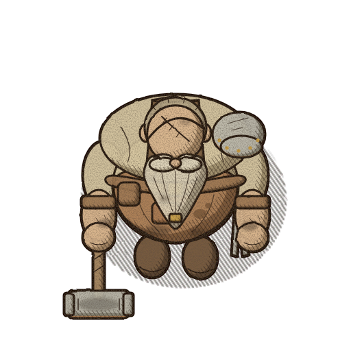
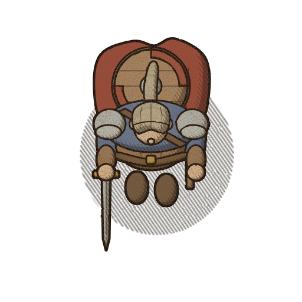
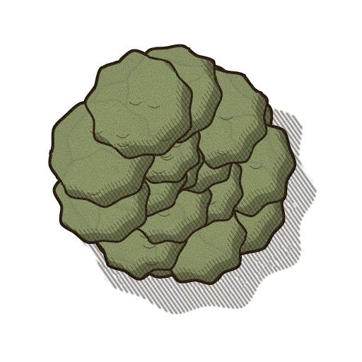
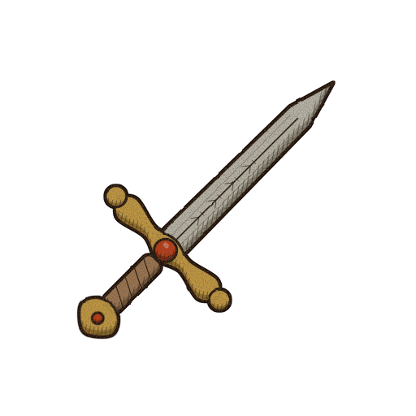
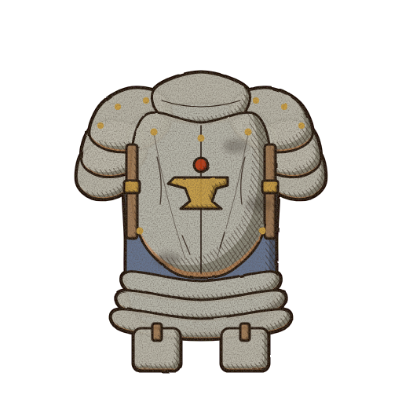
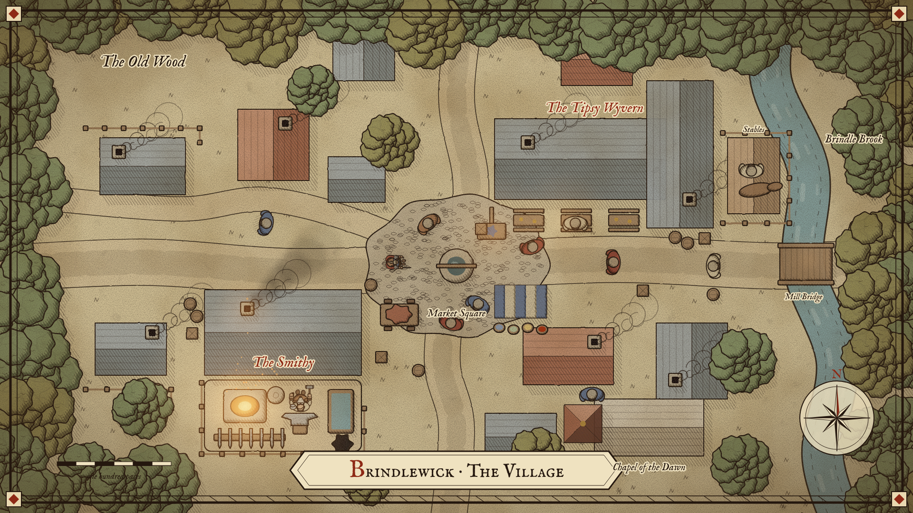
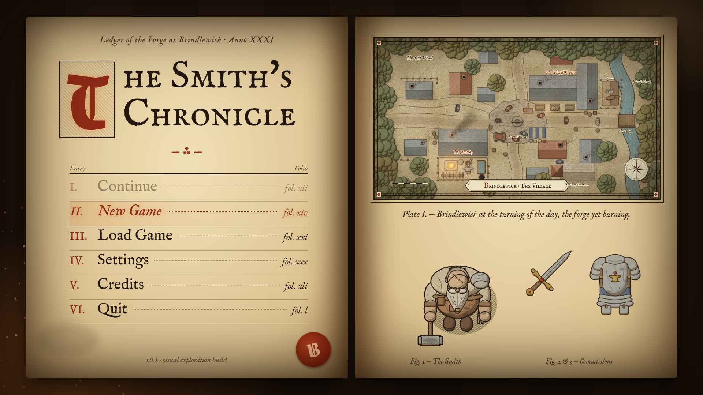
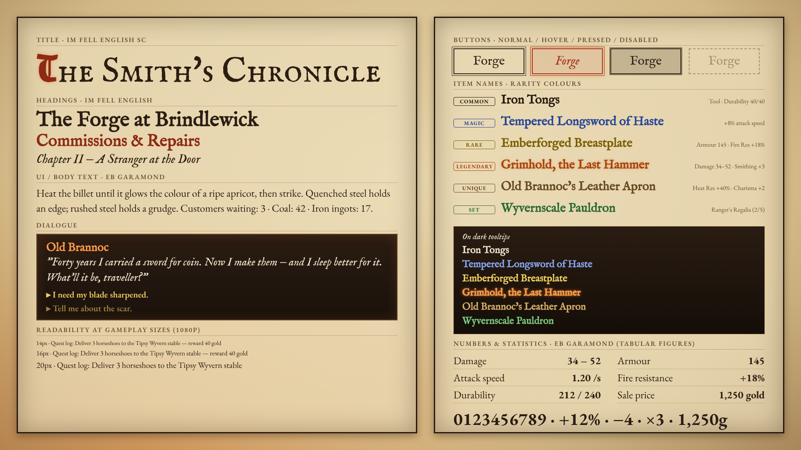

# 08 — Ink & Parchment, Gothic-Tempered (hybrid) · "The Smith's Chronicle"

> Direction 04 (Ink-and-Parchment) with a measured seasoning of direction 01 (Gothic Noir):
> roughly **85 % Ink & Parchment, 15 % Gothic Noir**. It must read *first* as a manuscript-and-map
> game — sepia ink, hatching, pale washes, aged parchment — and only on a second look reveal the
> darker inks, deeper shadows, soot, and a forge that glows a little harder against its surroundings.
> Gothic Noir enriches; it never replaces. No horror, no oppressive darkness.

The working title is the same as 04, **"The Smith's Chronicle"**, kept on purpose: this is a
tempered version of 04, not a new identity.

**Folder number:** the client suggested `06_ink_parchment_gothic/`, but 06 (Ballpoint Sketch) and 07
(Illustrated Sketchbook) were already taken, so this direction is **08**. The content is unchanged.

Parent directions: [`../04_ink_parchment/`](../04_ink_parchment/) (base, ≈ 85 %) and
[`../01_gothic_noir/`](../01_gothic_noir/) (seasoning, ≈ 15 %). Anything not restated here — proportions,
hatch angles, light direction, sprite production, fonts, Godot import — **is inherited from 04 unchanged**.

Companion files: [`prompts.md`](prompts.md) (image-model / artist briefs) and
[`naming_guide.md`](naming_guide.md) (file naming, sizes, Godot import, extra overlay/light assets).

---

## Rendering note (read first)

The example images are **procedural vector style studies**, not AI-generated or hand-painted art.
No image-generation model was available in the build environment, so each image was built as SVG by
the Python generator in [`../_generator/`](../_generator/) and rasterised with headless Chromium
(Playwright, `render.js`) — the same pipeline, subject geometry and framing as every other direction.

Technically, 08 is the 04 `ink` painter with a `noir` flag (`styles.py` entry
`"08_ink_parchment_gothic"`, `noir=0.15`). Everything the flag changes is listed in
[*What differs from 04*](#what-differs-from-04-exactly). The images show palette, line weight,
shadow depth, glow placement and typography faithfully; the drawing is simplified geometry. Final art
should be produced from [`prompts.md`](prompts.md).

**Reference images:** none were provided for this hybrid. It is derived entirely from the written
brief and from directions 04 and 01. (The four references mentioned in the original brief were also
never found in the repository.) If references are supplied later, re-check the palette and the dial
values below against them.

---

## Example graphics

| # | File | Size | Content |
|---|------|------|---------|
| 1 | [blacksmith.png](blacksmith.png) | 512×512, transparent | Protagonist, straight top-down, facing south; soot on forearms, apron, scalp, hammer |
| 2 | [adventurer.png](adventurer.png) | 512×512, transparent | Visiting adventurer, same scale system, darker shadow side |
| 3 | [sword.png](sword.png) | 512×512, transparent | Inventory icon, 45° diagonal; ember rim on gold and gem |
| 4 | [armor.png](armor.png) | 512×512, transparent | Inventory icon, front view; darkened creases and soot |
| 5 | [tree.png](tree.png) | 512×512, transparent | Top-down canopy; heavier line, deeper shadow side |
| 6 | [town_view.png](town_view.png) | 1920×1080 | Illustrated village map "at the turning of the day" |
| 7 | [menu_screen.png](menu_screen.png) | 1920×1080 | Main menu as a smith's ledger on a forge-lit workbench |
| 8 | [font_reference.png](font_reference.png) | 1920×1080 | Typography and rarity sheet |

For the side-by-side check, open the same file in [`../04_ink_parchment/`](../04_ink_parchment/) and
[`../01_gothic_noir/`](../01_gothic_noir/): 08 should look like 04 with the lights turned down a notch
and the forge turned up — never like a lightened 01.

---

## Visual summary

A smith's chronicle written in iron-gall ink on parchment that has hung near a forge for thirty
years. Same village map, same hatching, same pale washes and manuscript UI as 04, but the ink is
darker and heavier, shadows sit deeper, the page carries soot and wear, and warm forge light pushes
against a slightly dimmer world. By day the village is fully readable and comfortable; at dusk, at
night and indoors the Gothic share rises and the forge, the inn and anything magical or legendary
becomes the focus.

### The Ink & Parchment base (≈ 85 %)

Unchanged from 04: sepia ink linework with slight hand wobble; values built from hatching (−35°) and
cross-hatching (+35°), never from black fills; pale low-saturation washes with highlights left as
paper; light from the top-left; naturalistic proportions; terrain as near-unpainted page; the town as
an illustrated map with double-rule border, cartouche, compass rose and rubricated labels; UI framed
as a manuscript/ledger; IM Fell + EB Garamond typography; restrained earthy palette.

### The Gothic Noir seasoning (≈ 15 %)

Borrowed from 01 as *techniques*, at reduced strength, and only where the brief allows:

* **Heavier ink:** darker ink and +25 % line weight, plus a thin dilated silhouette outline (01 uses
  a 4 px dilation; 08 uses 1.2 px).
* **Deeper shadows:** stronger shadow wash and cross-hatch, so form reads with more contrast.
* **Ember rim-light:** a thin warm crescent on the top edge of metal, gold, gems and fire only — the
  01 "forge light catches the steel" idea, at 40 % strength, never on cloth, skin or wood.
* **Soot and wear:** low-frequency dark mottling and local soot smudges where a smithy would put them.
* **Warmer forge against darker surroundings:** a dimmed world and additive warm glows at fire and
  lantern sources, with a few embers.
* **Dramatic emphasis reserved** for magic, legendary items, danger and mystery.

Nothing else from 01 is used: no near-black ink, no top-heavy exaggerated silhouettes, no cold night
palette by day, no fog, no dark leather UI as the default frame.

---

## What differs from 04, exactly

Every difference in the examples comes from code guarded by `noir` in the generator
(`svgcore.py`, `subjects.py`, `town.py: noir_seasoning`, `compositions.py: menu_inkgothic`,
`NOIR_FONT_CSS`).

| Parameter | 04 Ink & Parchment | 08 Gothic-Tempered | Change |
|---|---|---|---|
| Ink | `#2b1d12` | `#24170e` | darker, warmer |
| Line weight (512 px master) | 2.4 px | 3.0 px | +25 % |
| Silhouette outline | none | +1.2 px dilated ink outline around the whole sprite | new |
| Hand wobble | 1.8 | 2.0 | +11 % |
| Shadow wash opacity | 0.55 | 0.62 | +13 % |
| Cross-hatch opacity | 0.60 | 0.70 | +17 % |
| Ember rim-light | — | `#e0782a` at 40 %, metal / gold / gem / fire only | new |
| Paper grain | fine, ink-coloured | slightly coarser and darker | +~10 % |
| Soot grain | — | low-frequency mottling `#1a120c` clipped to the sprite | new |
| Local soot | — | blacksmith forearms, apron hem, scalp, hammer head; armour creases | new |
| Palette | 04 values | same hues, shadow values ~15–30 % darker; gem/legendary moved to ember red | see below |
| Rubric red | `#a8321e` | `#8e2a16` (deep red-brown) | darker |
| Forge glow | `#c8641e` / `#e8a050` | `#e0782a` / `#ffc070` | warmer, brighter |
| Background parchment | `#e9d8b0` | `#e2cea2` | slightly aged |
| Town grading | small multiply forge glow | dusk multiply 6 %→15 %, soot plume, screen-blend glows, embers | new |
| Town vignette | `#6a4a20` at 45 % | `#3a2410` at 50 % | firmer, darker |
| Menu | open chronicle on a desk | smith's ledger on a forge-lit workbench | reframed |
| Fonts | Fell SC / Fell / Garamond | same + Grenze Gotisch for initials only | +1 family |

### Measured result

Mean luminance (0–255, opaque pixels only) of the eight images, and how far 08 moves from 04 toward
01 (*Gothic shift* = (L₀₄ − L₀₈) / (L₀₄ − L₀₁)):

| Image | 04 | 08 | 01 | Gothic shift |
|---|---|---|---|---|
| tree | 126 | 115 | 28 | 0.11 |
| adventurer | 104 | 92 | 26 | 0.16 |
| armor | 148 | 135 | 67 | 0.16 |
| town_view (turning of the day) | 147 | 129 | 32 | 0.16 |
| font_reference | 193 | 165 | 27 | 0.17 |
| blacksmith | 134 | 118 | 42 | 0.17 |
| menu_screen | 157 | 133 | 23 | 0.17 |
| sword | 127 | 106 | 41 | 0.24 |

Hue, linework, layout, palette roles and typography are entirely 04. On value, the studies were tuned to sit at **0.11–0.17**, which is on the ≈15 % target. The sword is the exception at 0.24: on a thin icon the heavier outline is a large share of the pixels. For production, treat **0.25 as the hard ceiling for daytime sprites and screens** and **0.15–0.20 as the aim**. (An earlier pass of these studies measured 0.16–0.35 and was pulled back by using 04's light and base colours unchanged, deepening only the shadow tones, and lowering the dusk grade and soot.)

---

## Colour palette

From `styles.py`, `"08_ink_parchment_gothic"`. Same structure and hues as 04; light values barely
move, shadow values are deeper. The ember range is the only notable new colour.

### Core colours

| Role | Hex | Use |
|---|---|---|
| Ink | `#24170e` | All linework, hatching, body text |
| Parchment | `#e2cea2` | Page/ground colour, UI panels |
| Rubric (deep red-brown) | `#8e2a16` | Initials, heading accents, map labels, seal |
| Soot | `#1a120c` | Soot/grime overlays only (never as linework or fill) |
| Ember | `#e0782a` | Forge glow, rim-light on metal, legendary accents, focus |
| Ember (hot) | `#ffc070` | Glow core, embers, fire highlight |
| Night ambient (limited blue-grey) | ≈ `#6c6a80` | `CanvasModulate` at night (Godot), see dial |

### Material roles

Light and base values are identical to 04; only the shadow tones are deepened by about 15 %, and gem and fire move to ember. This keeps lit planes as bright as 04: darker darks, not darker lights.

| Role | Light | Base | Shadow | vs 04 |
|---|---|---|---|---|
| skin | `#f0dcc0` | `#dcb890` | `#8e714f` | shadow −15 % |
| beard | `#f4ecdc` | `#ddd2b8` | `#8e8269` | shadow −15 % |
| hair | `#e0d4bc` | `#b8a888` | `#71644c` | shadow −15 % |
| shirt | `#ece0c4` | `#d8c8a2` | `#8e7d5b` | shadow −15 % |
| apron | `#d0a880` | `#aa7c52` | `#67472c` | shadow −15 % |
| leather | `#c8a47c` | `#a07a54` | `#5d452c` | shadow −15 % |
| strap | `#9a7650` | `#7a5a3a` | `#473623` | shadow −15 % |
| metal | `#e6e2d8` | `#bcb8aa` | `#716e5d` | iron, deeper shadow |
| gold | `#e6c674` | `#c69c44` | `#755a20` | muted gold |
| cloak | `#c47a64` | `#a2503c` | `#5d2a20` | shadow −15 % |
| tunic | `#94a2b4` | `#6a7a92` | `#3e495a` | limited dark blue-grey |
| boot | `#a88a68` | `#7c5e42` | `#473625` | shadow −15 % |
| wood | `#d0b088` | `#aa8a64` | `#674f36` | shadow −15 % |
| foliage | `#bcc49a` | `#909c6c` | `#555f3e` | shadow −15 % |
| foliage2 | `#c8c08a` | `#a49c62` | `#625b36` | shadow −15 % |
| grass | `#e8d9b2` | `#dccb9e` | `#a4936c` | still "unpainted page" |
| road | `#efe0bc` | `#ddc99e` | `#9e8d69` | shadow −15 % |
| roof_a | `#d09a7a` | `#ae6e50` | `#693e2c` | shadow −15 % |
| roof_b | `#aab0ac` | `#848c88` | `#4e5351` | shadow −15 % |
| stone | `#e2d6bc` | `#c6b698` | `#7f7056` | shadow −15 % |
| water | `#b4c8c0` | `#8eaaa6` | `#5a716e` | shadow −15 % |
| gem | `#f08a50` | `#b8360f` | `#5a1406` | moved to ember red |
| fire | `#ffcf80` | `#e0782a` | `#962e0a` | hotter |

Saturation stays as low as 04; only gem and fire are allowed to be vivid, because they carry the
Gothic emphasis.

---

## Where each influence appears

Shares are design targets for *that element*, not averages. Most of the screen by day is ≥ 90 % I&P;
the Gothic share is concentrated in a few places.

| Element | I&P | Gothic | Concrete treatment |
|---|---|---|---|
| Town layout, buildings, roads | 95 % | 5 % | 04 map geometry and labels; only heavier line and deeper roof shadow side |
| Terrain, grass, roads by day | 95 % | 5 % | Near-unpainted page; coarser grain; no darkening |
| Ordinary daytime scenes | 90 % | 10 % | Full daylight, no global grade; firmer vignette at screen edge only |
| Characters overall | 85 % | 15 % | 04 proportions and washes; +25 % line, 1.2 px silhouette, deeper shadow wash |
| Blacksmith (protagonist) | 80 % | 20 % | + soot on forearms, apron hem, scalp, hammer head; ember rim on pauldron and hammer |
| Adventurers | 80 % | 20 % | Darker shadow side, worn kit, ember rim on steel; "from a more dangerous world" |
| Townsfolk | 90 % | 10 % | Line weight only; no soot unless their trade (miller, collier) earns it |
| Trees, foliage | 90 % | 10 % | Heavier contour, deeper canopy shadow; hatched ground shadow kept |
| Ordinary items (tools, common gear) | 85 % | 15 % | Engraved line, deeper hatching, wear marks |
| Magical metals | 70 % | 30 % | Ember or blue-ink rim, slightly stronger value contrast |
| Legendary / unique items | 65 % | 35 % | Ember rim + emissive mask (soft glow in-game), darkest cross-hatch on the shadow side |
| Dusk (scene grade) | 80 % | 20 % | Diagonal multiply 6 %→15 %, lamps on, soot plumes visible |
| Night | 70–75 % | 25–30 % | `CanvasModulate` + hatch overlay + additive lights at forge, inn, lanterns |
| Forge / smithy interior | 70–75 % | 25–30 % | Dimmer ambient, strongest glow on the screen, embers, sooty walls |
| Inn interior | 75 % | 25 % | Hearth and candle pools, warm, cosy rather than threatening |
| Danger / mystery moments | 70 % | 30 % | Edge vignette of ink + soot, ember or rubric cues, heavier cross-hatch |
| Special effects (sparks, magic) | 70 % | 30 % | Additive glows allowed; drawn ink shapes for the effect itself |
| UI framework, menus, panels | 90 % | 10 % | Parchment panels, ink rules; heavier borders, page-edge burn shadows |
| Main menu (key art) | 80 % | 20 % | Ledger on a forge-lit workbench, embers; the pages themselves stay pure I&P |
| Typography structure | 90 % | 10 % | 04 fonts and hierarchy; Grenze Gotisch initial only |
| Dialogue box | 75 % | 25 % | Dark leather box with ember speaker name (as in the font sheet) |
| Tooltips / item presentation | 80 % | 20 % | Dark tooltip; Legendary with faint ember glow; layout as 04 |

---

## The dial: quantifying the 15 %

These are the numbers to hold production to. Values are at the 512 px master unless stated.

| Dial | 04 | 08 target | Hard limit |
|---|---|---|---|
| Ink colour | `#2b1d12` | `#24170e` | never darker than `#1e130b`; never pure black |
| Line weight | 2.4 px | 3.0 px (+25 %) | +35 % |
| Silhouette outline (actors, interactables) | 0 | +1.2 px | 2 px (01 uses 4) |
| Shadow depth (shadow wash / cross-hatch) | 0.55 / 0.60 | 0.62 / 0.70 (+~15 %) | 0.72 / 0.80 |
| Gothic shift index (see *Measured result*) | 0 | ≈ 0.15 | 0.25 for any daytime sprite or screen |
| Daytime global darkening | 0 | 0 (edge vignette only, ≤ 50 % at the extreme corners) | no full-screen grade by day |
| Dusk darkening | — | multiply 6 % → 15 % diagonal | 25 % |
| Night darkening | `CanvasModulate` ≈ `#8a8aa0` | ≈ `#6c6a80` (≈ −45 % luminance) | lit ground ≥ 40 % of daytime luminance; paths and doors always legible |
| Interior darkening (forge, inn) | — | ambient ≈ `#8a7a6a`, light pools to full value | nothing interactive darker than the night limit |
| Strong light sources | — | ≤ 3 per screen (forge counts as one) | 3; extra lights are faint (≤ 20 %) |
| Ember rim-light | — | 40 % on metal/gold/gem/fire | never on skin, cloth, wood, foliage, roofs |
| Gothic-only colour (ember, soot, deep shadow) by day | — | ≤ 10 % of screen area | 10 % |
| Same, at night/interiors | — | ≤ 25 % | 30 % |
| Soot coverage on a sprite | — | 3–8 % of its area, opacity 0.2–0.35 | 12 % |

**Ember accent — reserved list.** Ember orange (`#e0782a` / `#ffc070`) and its glow may appear
*only* on: forge fire, hearths, candles and lanterns; hot metal on the anvil and sparks; magical
metals; legendary items (icon rim, name text, emissive mask); danger cues; UI focus/hover state and
the dialogue speaker name. Everything else uses the 04 palette. If ember appears on clothing, roofs,
foliage or terrain, it is drift.

**Rubric `#8e2a16`** keeps 04's role (initials, labels, seal, selection ring) — it is the I&P accent,
not a Gothic one.

---

## Lighting & shading

* **Light source and hatching:** as 04 — top-left, form shadow bottom-right, −35° hatch,
  +35° cross-hatch, hatched ground shadows, highlights as reserved paper, no black fills.
* **Darker darks, not darker lights.** The seasoning deepens the *shadow* side (wash 0.62,
  cross-hatch 0.70) and the ink; the lit plane and paper highlights stay as bright as 04. This keeps
  the page airy while increasing contrast.
* **Rim-light** is a thin ember crescent on the upper edge of metal, gold, gems and fire. In-game it
  is either baked (masters as shown) or supplied by Light2D near the forge — not both at full
  strength.
* **Soot** is a separate concern from shading: low-frequency mottling plus local smudges where use
  would put them (hands, hem, hammer, creases). In production it lives on an overlay layer (see
  *Godot implementation*).

### Scene types

| Scene | Treatment |
|---|---|
| Day (village) | 04 look; no global grade; firmer edge vignette; forge visible as a small warm spot |
| Dusk ("turning of the day", as in the town study) | Diagonal multiply 6 %→15 % toward bottom-right; screen-blend glows at forge (strongest), inn door/sign, beer-garden lanterns; soot plume over the smithy chimney; a few embers |
| Night | 04's night method, one step darker: `CanvasModulate` ≈ `#6c6a80`, screen-space hatch overlay with density tied to darkness, additive `PointLight2D` that erases the hatch inside its radius |
| Forge interior | Dim warm ambient, forge as the strongest light on the screen, embers, sooty walls and floor overlay; anvil and tools keep a readable silhouette via the 1.2 px outline |
| Inn interior | Hearth and candles as two or three warm pools; cosy, not threatening; dark corners hatched, not blacked out |
| Danger / mystery | Ink-and-soot vignette at screen edges, heavier cross-hatch, rubric or ember cue on the threat |
| Magic / legendary | Ember (or blue ink `#26449a` for arcane) linework plus additive glow; the one place glow may be strong by day |

---

## Character & object proportions

Unchanged from 04: naturalistic proportions (head 0.98×, shoulders 1.0×, belly 1.0× of the base
geometry), no chibi enlargement, no 01-style top-heavy exaggeration. Feet at ≈ y 0.80 of the canvas,
character 60–70 % of canvas width including the weapon, 1 tile = 64 px. Gothic seasoning never changes
a silhouette; it only changes line, shadow and surface.

---

## Suitability for straight top-down 2D

**Natural fit, slightly better than 04 for gameplay.** The map-like top-down language is inherited
wholesale, and the seasoning directly addresses 04's main weakness, low value contrast on parchment:
the +25 % line, the 1.2 px silhouette outline and the deeper shadow side make actors and interactables
separate from the page more easily at 128 px. Dynamic light also reads well top-down, because the
glow pools fall on the flat ground plane the camera looks at.

Readability rules from 04 still apply (heavier actor contour, coloured washes for interactables,
rubric selection ring, hatched ground shadows, flat terrain). Additional rules for 08:

1. Night and interior ambient never drop below the *Night darkening* limit; paths, doors, NPCs and
   pickups must stay legible without relying on a light.
2. Selection ring is rubric `#8e2a16` by day; at night it may gain a faint ember underlay so it reads
   on the darker ground.
3. Soot never sits on the silhouette edge of an actor (it would eat the outline) or on faces.

---

## Strengths

* Keeps 04's distinctive identity, map-native top-down fit and narrative framing (the chronicle).
* Better value contrast and actor separation than 04 at gameplay sizes.
* The forge becomes the visual heart of the village, as in 01, without 01's cost or gloom.
* Gives day/night, interiors, magic and legendary loot a clear "special" register while everyday
  scenes stay calm and readable.
* Most of the seasoning (dusk/night grade, glows, soot, embers) is engine-side and global, so it can
  be tuned late without repainting.
* Same fonts as 04 plus one free family; rarity system works on parchment and on dark tooltips.

## Possible risks

| Risk | Mitigation |
|---|---|
| **Drift toward 01** — every artist and model pass adds "a bit more mood" | The dial table and Gothic shift index; review every batch against 04 and 01 (squint test) |
| Thin icons (swords, staves) drift darker because outline weight dominates (sword study: 0.24) | Use 2.6 px instead of 3.0 px for thin icons, keep lit planes as reserved paper, re-measure |
| Soot reads as dirt or noise at 128 px | Low-frequency only, ≤ 8 % coverage; apply as an overlay that can be faded |
| Ember used everywhere loses its meaning | Reserved list; ember outside it is rejected in review |
| Baked rim-light plus dynamic Light2D double-lights metal near the forge | Keep baked rim at 40 %, cap Light2D energy near forge, test both together |
| Two registers (day I&P vs night Gothic) feel like two games | Same ink, palette and hatching in both; change only grade, lights and overlay density |
| Grenze Gotisch initials creep into headings or body text | Initials only — enforced by the Theme (no Grenze font type for labels) |
| Image models over-darken and over-saturate when told "gothic" | Prompts never say "dark fantasy" or "gothic" without the I&P anchors and limits (see prompts.md) |

---

## Production complexity

**Rating: 4 / 5** (same band as 04, upper end). The per-asset craft is 04's; the additions are mostly
engine-side lighting/VFX and a wear/soot pass.

Assumptions: identical to 04 — one village, 3–4 wilderness areas, ~25 named NPCs, ~150 items; one
experienced illustrator-animator with AI assistance for drafts; a programmer for shaders; art only,
±40 %. Lighting uses `PointLight2D` without normal maps (01's normal-map pipeline is *not* adopted).

| Delta vs 04 | Person-months |
|---|---|
| Soot/wear overlay textures and per-asset wear masks (characters, armour, smithy, tools) | +0.5–1 |
| Emissive / ember masks for legendary and magical items, magic VFX at higher strength | +0.5 |
| Lighting pass: light textures, night/interior/dusk grading, glow tuning per scene | +0.5–1 |
| Shader/art-tech additions (soot overlay, dusk grade, emissive pass) | +0.25–0.5 (programmer) |
| Slightly heavier linework (no extra assets; slightly slower cleanup) | +0–0.5 |
| **Total** | **≈ 19–27 person-months** (04: 17–24), i.e. **+10–15 %** |

Relative art cost on the package scale (Production-Light = 1.0): **≈ 1.75** (04 ≈ 1.6, 01 ≈ 1.9).
Night and interior variants are *not* separate art — they are modulate + lights + overlays — which is
why the increase stays modest.

---

## Keeping the mix controlled and consistent

### Do / don't

| Do | Don't |
|---|---|
| Start every asset from the 04 brief, then add the listed Gothic accents for that asset | Start from "dark fantasy" and lighten it |
| Deepen shadows and ink; keep lit planes and paper highlights bright | Darken the whole asset or the parchment |
| Put soot where use puts it (hands, hem, tools, creases, chimneys) | Spread uniform grime everywhere |
| Use ember only from the reserved list | Use ember on clothes, roofs, foliage, terrain or UI chrome |
| Do night, dusk and interiors with `CanvasModulate` + Light2D + overlays | Repaint night versions of sprites or tiles |
| Keep ≤ 3 strong light sources per screen | Light every lantern at full strength |
| Keep 04 proportions and silhouettes | Borrow 01's exaggerated, top-heavy shapes or near-black ink |
| Keep labels, cartouches, compass, borders exactly as 04 | Replace manuscript UI with dark leather panels (dark is for tooltips/dialogue only) |

### Review checklist (per asset or screen)

1. Does it read as Ink & Parchment at first glance (ink line, hatching, pale wash, paper)?
2. Line weight 3.0 px (+1.2 px silhouette on actors/interactables) at master, ink `#24170e`?
3. Shadow side deeper than 04, lit side not darker than 04?
4. Ember only on reserved-list elements; ≤ 10 % Gothic-only colour by day?
5. Soot ≤ 8 % coverage, low-frequency, not on faces or silhouette edges?
6. ≤ 3 strong lights on screen; forge the strongest where present?
7. Gothic shift index ≤ 0.25 by day (≤ 0.4 at night/interiors)?
8. Readable at 128 px and at 1280×720; interactables distinct from terrain?
9. No pure black, no oversaturation outside gem/fire/magic?

### Squint test against 04 and 01

Put the new asset or screenshot next to the matching file in `04_ink_parchment/` and
`01_gothic_noir/`, then squint (or blur by ~8 px / view at 64 px wide, greyscale):

* **Pass:** it groups clearly with 04 — same pale overall value, same paper-dominated structure —
  with slightly darker shapes and one or two warm hot-spots.
* **Fail:** it looks like a lightened 01 (dark mass with lit islands), or indistinguishable from 04
  (seasoning absent).
* **Numeric version:** compute the Gothic shift index from mean greyscale luminance (as in
  *Measured result*); target ≈ 0.15, ceiling 0.25 by day.

### Godot implementation

* **Night, dusk, interiors:** `CanvasModulate` for ambient (day `#ffffff`, dusk ≈ `#d8c8b0`, night
  ≈ `#6c6a80`, forge interior ≈ `#8a7a6a`), driven by an `AnimationPlayer` or time-of-day script.
  Do not repaint assets. Keep 04's `night_hatch.gdshader`; raise its maximum density by ~25 %.
* **Glow:** additive `PointLight2D` (`blend_mode = Add`) with soft radial textures; forge `#e0782a`
  energy 1.0–1.4 with ±10 % flicker, inn/lanterns `#ffc070` energy 0.5–0.8, candles 0.3–0.5. Light
  masks the night hatch inside its radius (04 technique). No `LightOccluder2D` or normal maps by
  default — they push toward 01 in look and in cost.
* **Soot and wear:** an overlay, not baked. Either a world-space `fx_soot_overlay` texture multiplied
  in a `CanvasLayer` (masked by `fx_soot_mask_*` around the smithy and chimneys), or a per-sprite
  shader parameter `soot_amount` sampling a shared noise texture through the sprite's wear mask
  (`*_wear.png`). Global strength can then be dialled from one place.
* **Embers and sparks:** `GPUParticles2D` with `fx_ember_*` textures, additive material, short life;
  at most one ember emitter per light source.
* **Legendary/magic emphasis:** emissive mask (`*_emit.png`) drawn additively above the sprite with a
  slow pulse; tooltip names use the dark-tooltip Legendary colour plus a text shadow glow.
* **Paper, line boil, outline:** as 04 (`paper_overlay`, `line_boil`, `actor_outline`). The actor
  outline shader may provide the 1.2 px silhouette instead of baking it.
* **Vignette:** a full-screen `ColorRect` radial gradient `#3a2410`, 0 % in the centre to ≤ 50 % at
  the corners; raise slightly for danger moments, never cover the play area.

---

## Typography

Same system as 04 — see [`../04_ink_parchment/README.md#typography`](../04_ink_parchment/README.md#typography)
for full rationale, sizes and Godot import notes, which all still apply. Differences:

| Role | Font | Change vs 04 |
|---|---|---|
| Title | IM Fell English SC | ink `#24170e`; drop capital moves to Grenze Gotisch |
| Illuminated initials only | **Grenze Gotisch** 800 | new; rubric `#8e2a16`, optional faint ember text-glow; in a double-ruled box with hatched ground (menu) |
| Headings, dialogue | IM Fell English 400 + italic | secondary headings may use rubric `#8e2a16` |
| UI, body, numbers | EB Garamond 400–600 (`lnum` + `tnum` for stats) | unchanged |

* **Grenze Gotisch is decoration, not text.** One letter at a time, ≥ 96 px, only as a chapter/title
  initial or the wax-seal monogram. It never sets words.
* **Flair, not loss of readability:** heavier panel borders, a dark leather dialogue box with an
  ember speaker name (`#ff9a48`), choices in light gold (`#f0d060`), a faint forge glow in one corner
  of full-screen sheets. Body text sizes and minimums are 04's (EB Garamond ≥ 16 px at 1080p).
* **Buttons:** normal (ink border), hover (rubric border, italic, faint ember underlay/glow),
  pressed (darker wash), disabled (≈ 40 % ink, dashed border).
* Source: <https://fonts.google.com/specimen/Grenze+Gotisch> (SIL OFL, variable 100–900; use 800).
  Import as `FontFile`, MSDF on (it is used large and may animate), hinting None.

### Item rarity colours

Hues as 04; values retuned to the darker ink and the slightly darker parchment. WCAG contrast
computed against parchment `#e2cea2` (the darkest panel tone used) and against the dark tooltip
(`#2a1c12` → `#140e08` gradient; value at the lighter end shown, i.e. worst case).

**On parchment `#e2cea2`:**

| Rarity | Hex | Contrast | Note |
|---|---|---|---|
| Common | `#24170e` | 11.3:1 | Plain ink replaces white |
| Magic | `#26449a` | 5.7:1 | Blue ink |
| Rare | `#7a5e00` | 4.0:1 | Large/semibold only |
| Legendary | `#a8400e` | 4.0:1 | Large/semibold only; + faint ember text-shadow |
| Unique | `#664820` | 5.4:1 | Gold-brown |
| Set | `#2a6a34` | 4.2:1 | Large/semibold only |

**On dark tooltip (`#2a1c12`):**

| Rarity | Hex | Contrast |
|---|---|---|
| Common | `#efe4cc` | 13.1:1 |
| Magic | `#8aa6f2` | 6.9:1 |
| Rare | `#f0d060` | 10.9:1 |
| Legendary | `#ff9a48` | 7.8:1 (+ ember glow) |
| Unique | `#d8ae6a` | 8.0:1 |
| Set | `#7ccc80` | 8.5:1 |

Rare, Legendary and Set on parchment are below 4.5:1, as in 04: set them at ≥ 24 px or EB Garamond
600, or use small-text fallbacks Rare `#6a5200` (4.8:1), Legendary `#8a3410` (5.3:1), Set `#245a2c`
(5.3:1). On lighter panels (`#e9d8b0`) the main values gain ~0.4. The ember glow is decoration only —
contrast is measured without it. Always pair colour with a rarity tag or glyph; Legendary and Rare
remain close for protanopes.
