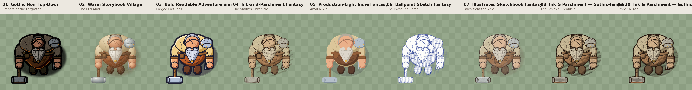
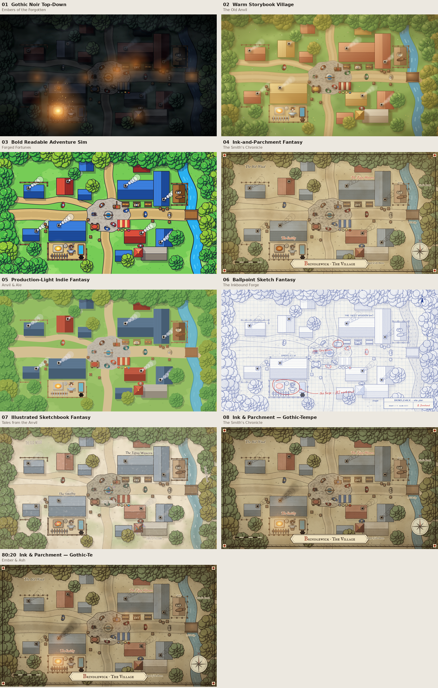
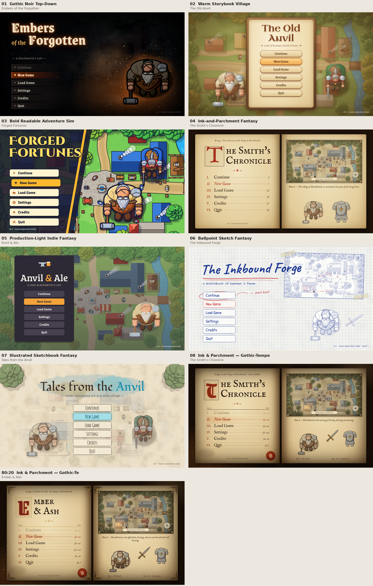
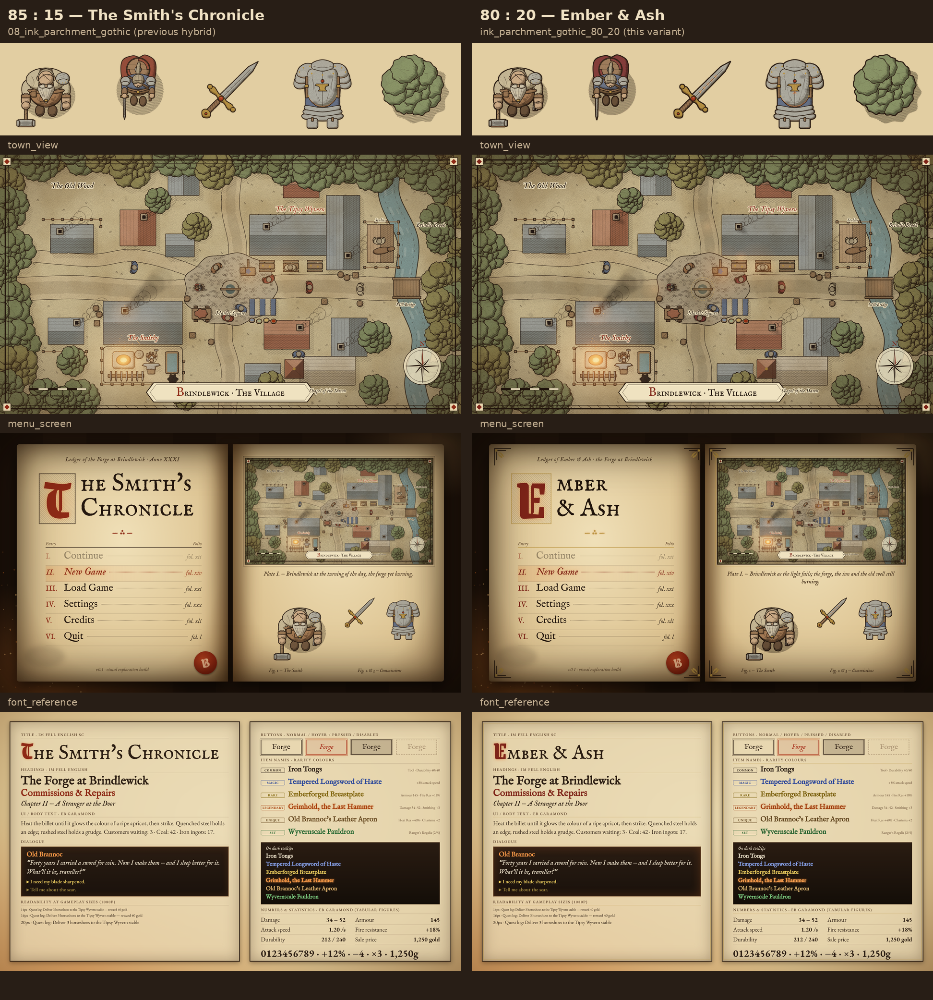
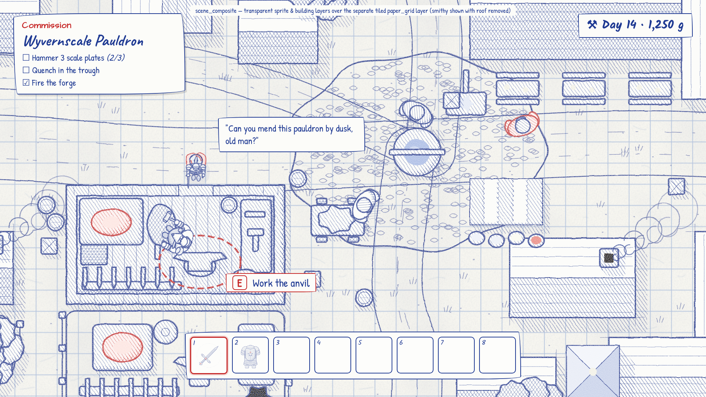
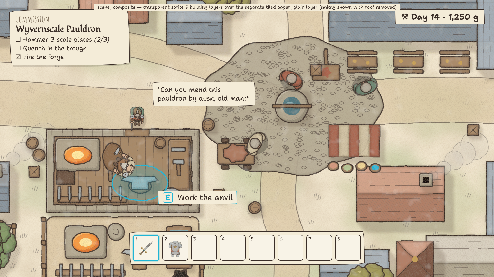

# Blacksmith Game — Visual Style Exploration

This package compares **seven distinct graphical directions plus two controlled hybrids** (08 at 85:15, and its 80:20 variant *Ember & Ash*) for our Godot 4.x fantasy blacksmith game, so we can choose the game's artistic identity before full visual production begins.

All nine folders show the **same subjects with the same framing**:

- the protagonist (an older, heavyset retired adventurer who runs the village smithy)
- a visiting adventurer
- a sword and a set of armour
- a tree
- the same village map
- a main menu
- a typography sheet

The only thing that changes between directions is the rendering, the palette, the proportions and the UI language, so the differences are easy to compare.

> **Game context:** straight top-down 2D (the camera looks straight down: tops of heads, shoulders, roofs and tree canopies). The game is set in a small medieval fantasy village in a D&D-inspired world: the blacksmith workshop, the neighbouring inn, adventurers, villagers, forests and wilderness. The intended tone is warm and lived-in, with mystery and occasional darkness.

---

## How the example graphics were made (read first)

No AI image-generation model was available in the build environment. Rather than leave empty placeholders, **every example image was illustrated procedurally**:

- Python generates the SVG.
- Headless Chromium rasterises it to PNG.
- The source is in [`_generator/`](_generator/).

The same subject geometry (`subjects.py`, `town.py`) is passed through the style "painters" (`styles.py`, `svgcore.py`). This keeps the subjects identical and makes the comparison fair.

- **What the images reliably show:** palette, value structure, outline language, shading logic, lighting mood, proportions, top-down readability, UI and typography. That is enough to judge and choose a direction.
- **What they don't show:** final production polish. Brush work, painterly texture and fine illustration detail will be much richer in real assets. Each style's `prompts.md` contains the master prompt and the eight per-asset prompts for producing production-quality versions with an image model, or for briefing an artist.
- **Reference images:** none of the reference images mentioned in the briefs were found in this repository or in the build session. That covers the four original references and the two newer ones for directions 06 and 07: the architectural ballpoint sketchbook and the soft illustrated sketchbook. All directions were built from the written briefs. When the references are added (suggested location: `docs/visual_exploration/references/`), re-check each `prompts.md` against them. The prompts describe techniques, not camera angles, so they should adapt easily.

All eight standard graphics exist for all nine folders (72 images). Directions 06 and 07 also each include `paper_grid.png`, `paper_plain.png`, `scene_composite.png` and `paper_comparison.png` (8 more images). **No image files remain ungenerated.**

---

## The seven directions

| # | Folder | Visual direction | Working title | Short description |
|---|---|---|---|---|
| 1 | [`01_gothic_noir/`](01_gothic_noir/) | Gothic Noir Top-Down | **Embers of the Forgotten** | Heavy black ink, hatching, exaggerated silhouettes, cold night world lit by warm forge-light (technique inspired by *Darkest Dungeon*) |
| 2 | [`02_warm_storybook/`](02_warm_storybook/) | Warm Storybook Village | **The Old Anvil** | Mature hand-painted storybook look: soft gradients, paper grain, coloured outlines, golden-hour warmth |
| 3 | [`03_bold_adventure/`](03_bold_adventure/) | Bold Readable Adventure Sim | **Forged Fortunes** | Thick navy outlines, flat cel shading, vibrant but controlled colour, maximum gameplay clarity |
| 4 | [`04_ink_parchment/`](04_ink_parchment/) | Ink-and-Parchment Fantasy | **The Smith's Chronicle** | Sepia ink, cross-hatching, pale washes, manuscript and map dressing on parchment |
| 5 | [`05_production_light/`](05_production_light/) | Production-Light Indie Fantasy | **Anvil & Ale** | No outlines, two-tone flat shapes, strict palette, modular, built for a small team |
| 6 | [`06_ballpoint_sketch/`](06_ballpoint_sketch/) | Ballpoint Sketch Fantasy | **The Inkbound Forge** | Blue ballpoint pen on squared notebook paper, cross-hatching, construction lines, architect-style annotations, selective red accents |
| 7 | [`07_illustrated_sketchbook/`](07_illustrated_sketchbook/) | Illustrated Sketchbook Fantasy | **Tales from the Anvil** | Irregular sepia ink, pencil hatching and transparent watercolour on warm sketchbook paper, muted colours with vivid teal and violet magic |
| 8 | [`08_ink_parchment_gothic/`](08_ink_parchment_gothic/) | Ink & Parchment, Gothic-Tempered *(hybrid: ≈85% 04 + ≈15% 01)* | **The Smith's Chronicle** | Still reads first as Ink & Parchment. Heavier ink, deeper hatching, soot and wear, ember rim light on metal and gems, warmer forge and inn glows, firmer vignette, and a forge-lit ledger menu |
| 8b | [`ink_parchment_gothic_80_20/`](ink_parchment_gothic_80_20/) | Ink & Parchment, Gothic-Tempered **80:20** *(variant of 08)* | **Ember & Ash** | Same compositions as 08 with the Gothic share raised to ≈20%: stronger ink and hatching, deeper shadows, burgundy and charcoal accents, scratches and soot, ember-lit runes, more candle and lantern light, and a gilt-ornamented ledger menu. See the [85:15 vs 80:20 comparison](ink_parchment_gothic_80_20/comparison_85_15_vs_80_20.png). |

Each folder contains:

| File | Contents |
|---|---|
| `blacksmith.png`, `adventurer.png`, `sword.png`, `armor.png`, `tree.png` | 512×512 transparent sprites / icons |
| `town_view.png`, `menu_screen.png`, `font_reference.png` | 1920×1080 complete compositions |
| `paper_grid.png`, `paper_plain.png` *(06, 07 only)* | 512×512 seamlessly tileable paper textures: a separate background layer, never baked into sprites |
| `scene_composite.png`, `paper_comparison.png` *(06, 07 only)* | In-game mock-up with transparent layers over paper (including the smithy interior with its roof removed), and the same sprites over grid paper, plain paper and no paper |
| `README.md` | Visual identity, rendering techniques, palette, lighting, proportions, top-down suitability, sprite and animation production, pros and cons, difficulty estimate, **typography system** |
| `prompts.md` | Master style prompt, eight detailed per-asset prompts, technical requirements, transparency and framing rules, consistency guidance |
| `naming_guide.md` | Filenames, dimensions, orientation, scale, transparency, pivots and anchoring, Godot import settings |

---

## Comparison table

Ratings run from 1 (low) to 5 (high). For **production complexity** and **animation difficulty**, a higher number means *harder*.

| Criterion | 01 Gothic Noir | 02 Warm Storybook | 03 Bold Adventure | 04 Ink & Parchment | 05 Production-Light | 06 Ballpoint Sketch | 07 Illustrated Sketchbook | 08 Ink & Parchment, Gothic-Tempered | 08b Gothic-Tempered 80:20 |
|---|---|---|---|---|---|---|---|---|---|
| **Artistic identity** | Very strong, instantly recognisable; owns "darkness + forge-light" | Strong and charming; the familiar "cosy fantasy" market | Clear but more conventional; risk of looking like mobile or casual games | Very distinctive; rare in top-down games | Moderate; needs signature touches to avoid looking generic | Very distinctive; a living architect's notebook, unusual in games | Distinctive and warm; a loose illustrator's sketchbook | Ink & Parchment identity with more weight and age; feels like an older, more lived-in chronicle | More distinctive than 08: runes, scratches and gilt give items and UI a stronger signature |
| **Atmosphere** | Moody, mysterious, dangerous; warmth lives only at the forge | Welcoming, nostalgic, warm, lived-in | Upbeat, energetic, adventurous | Scholarly, mythic, "a legend being written" | Friendly, cosy, light | Inventive, personal, "the smith's own design notes"; cooler and more cerebral | Gentle, curious, hand-made; magic glows against muted earth tones | Warm-but-gloomy; tactile and slightly gritty; the forge and inn glow against dimmer surroundings, with no horror | Grittier and moodier: richer forge, candle and lantern light; still warm, with no horror |
| **Readability (top-down gameplay)** | 3 – outlines help, but night palettes and fog hurt; needs lighting discipline | 3 – soft edges blend into painted ground; needs contrast management | **5** – best silhouettes and separation | 3 – low value contrast on parchment; actors need heavier lines and colour washes | 4 – clean shapes, but missing outlines need careful value separation | 3–4: opaque pale fills give strong silhouettes on the grid, and red marks interactions; but a single ink colour weakens material separation | 3: muted washes on cream paper risk low actor contrast; needs heavier ink on actors and accent colours on interactables | **4**: heavier silhouette line and deeper shadows fix 04's actor-contrast weakness; the dusk dimming must stay capped | 4: actors read as well as 08; daytime streets sit at the upper comfortable limit of dimming |
| **Production complexity** | 4 | 4 | 3 | 4 | **2** | 4 (hatching density and double-line pass need discipline) | 3–4 (loose ink and washes are forgiving; textures stay subtle) | 4 (04 plus lighting, wear and VFX passes; night via Light2D/modulate, not repainting) | 4 (08 plus wear, rune and extra-light passes) |
| **Animation difficulty** | 4 (ink and hatching must stay consistent per frame; can be eased with shader outlines and Light2D) | 4 (painted frames are costly, so use cut-out / skeletal rigs) | 3 (clean shapes suit cut-out or modest frame-by-frame) | 4 (line work and hatching per frame; "line boil" can become a feature) | **2** (two-tone shapes, modular rigs, palette swaps) | 3 (pen "line boil" variants are a feature; mostly one colour) | 3 (cut-out rigs with ink and wash parts; pencil boil optional) | 4 (as 04; soot and glow live in overlay and light layers) | 4 (as 08; runes and embers on emissive layers) |
| **Typography** | Grenze Gotisch / Grenze / Alegreya Sans | Uncial Antiqua / Alegreya / Nunito | Cinzel Decorative / Signika | IM Fell English SC / IM Fell English / EB Garamond | Bree Serif / Source Sans 3 | Caveat / Architects Daughter / Patrick Hand / Kalam | Fondamento / Amatic SC / Shantell Sans | IM Fell English SC / IM Fell English / EB Garamond, with Grenze Gotisch for initials only | As 08; burgundy blackletter initials, gilt rules |
| **Rarity colours** | Excellent on near-black UI; Legendary orange sits close to forge glow | Good on dark wood; parchment panels need darker variants | Excellent with navy text outline on any background | Needs two sets (ink-dark on parchment, light on dark tooltips) | Good on the plum UI; Legendary is close to the amber accent | Two sets: ink-dark on paper, light on navy tooltips; Legendary orange sits near the red accent | Two sets: ink-dark on paper, light on dark tooltips | Two sets as 04 (slightly deeper); Legendary gets a faint ember glow, kept apart from forge light by tags | As 08, slightly deeper; Legendary carries a stronger ember glow |
| **Relative art cost** (Production-Light = 1.0) | ≈ 1.9 | ≈ 1.6 | ≈ 1.4 | ≈ 1.6 | **1.0** | ≈ 1.45 | ≈ 1.4 | ≈ 1.7 | ≈ 1.8 |
| **Suitability for this game** | High for a darker, story-driven game; fits the "retired adventurer with a past" angle best | **Very high**: matches the warmth, personality and lived-in village of the brief, and keeps room for darkness | High for a systems/crafting-heavy game where equipment readability is crucial | High for a narrative/lore game; the map-like top-down view fits naturally | High when budget and schedule matter most; easiest to scale to a full game | High for a crafting- and design-centred game: blueprints, commissions and the forge as a workshop of ideas; very consistent across characters, gear, interiors, buildings and landscapes | **Very high**: friendly and expressive, but mature; strong alternative to 02 with a cheaper, more forgiving pipeline and a visible paper identity | **Very high**: keeps 04's map/ledger identity and readability, and adds the warmth-in-darkness of the forge the brief asks for | **Very high for items, forge, interiors, night and UI**; use 08's (85:15) values for daytime exteriors (a scene-dependent dial) |

**About the cost figures:** each style README contains a detailed person-month estimate, but those estimates were scoped independently. For example, the Bold Adventure estimate assumes eight-direction characters, while the others assume four. Directions 06 and 07 rely on a separate tiled paper layer, which keeps sprite production simpler. The *relative art cost* row above normalises them to the same scope (four directions, the same asset counts). Use it to compare the directions; use the per-style tables for that style's own breakdown.

### Observations to guide the decision

- **The brief's tone** (warmth, personality, mystery, occasional darkness, lived-in) is covered most completely by **02 Warm Storybook**. **01 Gothic Noir** delivers the mystery and darkness best but sacrifices day-to-day warmth.
- **Gameplay clarity** in a crafting and equipment game favours **03 Bold Adventure**. Its outline-and-cel language also makes item tiers and rarity instantly readable.
- **04 Ink & Parchment** is the most original identity and turns the top-down camera into a strength, because the world reads as a living map. It needs extra work on actor contrast.
- **05 Production-Light** is the safe production bet. A useful hybrid is possible: keep Production-Light's modular two-tone pipeline for the world and characters, and borrow one signature layer from another direction, such as Storybook UI and lighting or Ink & Parchment maps and menus.
- **06 Ballpoint Sketch** makes the craft itself the identity: the whole game looks like the smith's design notebook. It works consistently across characters, equipment, interiors, buildings and landscapes, and the red ink gives a clear interaction language. It is cooler in mood than the brief's "warmth", so lean on writing, red highlights and forge light to compensate.
- **07 Illustrated Sketchbook** covers the brief's warmth and personality almost as well as 02. Its separate paper layer and loose ink-and-wash language make it more forgiving to produce. Of the seven, it is the strongest alternative to 02.
- **08 Ink & Parchment, Gothic-Tempered** is the controlled answer to "04, but warmer-gloomier and easier to read". Day scenes, layout, UI structure and typography stay Ink & Parchment. The Gothic Noir share (heavier line, deeper shadow, soot, ember light) goes where the brief wants drama: the forge, the inn at night, magic and legendary items. The key discipline is a fixed "dial": cap daytime darkening and the number of glowing light sources per screen.
- **08b Ember & Ash (80:20)** tests whether a little more Gothic Noir helps. It does for equipment, the forge, the menu and night scenes: ember-lit runes, scratches and gilt make them more distinctive. Ordinary daytime streets are at the upper limit of acceptable dimming. The practical recommendation is a **scene-dependent dial**: 80:20 for items, forge, interiors, night and UI accents, and 85:15 for daytime exteriors and characters. See the [side-by-side comparison](ink_parchment_gothic_80_20/comparison_85_15_vs_80_20.png).
- **Combining directions works best by layer**, not by mixing rendering techniques on the same object. For example, use one direction for the world, another for UI and menus, and another for codex or map screens.

---

## Visual comparison index

### Side-by-side sheets

| Asset | Comparison sheet |
|---|---|
| Blacksmith | [comparison/blacksmith_comparison.png](comparison/blacksmith_comparison.png) |
| Adventurer | [comparison/adventurer_comparison.png](comparison/adventurer_comparison.png) |
| Sword | [comparison/sword_comparison.png](comparison/sword_comparison.png) |
| Armour | [comparison/armor_comparison.png](comparison/armor_comparison.png) |
| Tree | [comparison/tree_comparison.png](comparison/tree_comparison.png) |
| Town view | [comparison/town_view_comparison.png](comparison/town_view_comparison.png) |
| Menu screen | [comparison/menu_screen_comparison.png](comparison/menu_screen_comparison.png) |
| Font reference | [comparison/font_reference_comparison.png](comparison/font_reference_comparison.png) |





### Paper layers (06 and 07)

Directions 06 and 07 keep the paper as a **separate, seamlessly tileable background layer**. Sprites, buildings and landscape stay transparent, so the paper can scroll in world space, be swapped (grid or plain), or be tinted for day and night without re-exporting art.

| | 06 Ballpoint Sketch | 07 Illustrated Sketchbook |
|---|---|---|
| Grid paper (tileable 512×512) | [paper_grid.png](06_ballpoint_sketch/paper_grid.png) *(primary)* | [paper_grid.png](07_illustrated_sketchbook/paper_grid.png) |
| Plain paper (tileable 512×512) | [paper_plain.png](06_ballpoint_sketch/paper_plain.png) | [paper_plain.png](07_illustrated_sketchbook/paper_plain.png) *(primary)* |
| Sprites over grid / plain / no paper | [paper_comparison.png](06_ballpoint_sketch/paper_comparison.png) | [paper_comparison.png](07_illustrated_sketchbook/paper_comparison.png) |
| In-game composite (layers over paper, smithy interior, HUD) | [scene_composite.png](06_ballpoint_sketch/scene_composite.png) | [scene_composite.png](07_illustrated_sketchbook/scene_composite.png) |

### Hybrid dial: 85:15 vs 80:20



### Paper-layer composites




### All example images

| Asset | 01 Gothic Noir | 02 Warm Storybook | 03 Bold Adventure | 04 Ink & Parchment | 05 Production-Light | 06 Ballpoint Sketch | 07 Illustrated Sketchbook | 08 Ink & Parchment, Gothic-Tempered | 08b 80:20 |
|---|---|---|---|---|---|---|---|---|---|
| Blacksmith | [png](01_gothic_noir/blacksmith.png) | [png](02_warm_storybook/blacksmith.png) | [png](03_bold_adventure/blacksmith.png) | [png](04_ink_parchment/blacksmith.png) | [png](05_production_light/blacksmith.png) | [png](06_ballpoint_sketch/blacksmith.png) | [png](07_illustrated_sketchbook/blacksmith.png) | [png](08_ink_parchment_gothic/blacksmith.png) | [png](ink_parchment_gothic_80_20/blacksmith.png) |
| Adventurer | [png](01_gothic_noir/adventurer.png) | [png](02_warm_storybook/adventurer.png) | [png](03_bold_adventure/adventurer.png) | [png](04_ink_parchment/adventurer.png) | [png](05_production_light/adventurer.png) | [png](06_ballpoint_sketch/adventurer.png) | [png](07_illustrated_sketchbook/adventurer.png) | [png](08_ink_parchment_gothic/adventurer.png) | [png](ink_parchment_gothic_80_20/adventurer.png) |
| Sword | [png](01_gothic_noir/sword.png) | [png](02_warm_storybook/sword.png) | [png](03_bold_adventure/sword.png) | [png](04_ink_parchment/sword.png) | [png](05_production_light/sword.png) | [png](06_ballpoint_sketch/sword.png) | [png](07_illustrated_sketchbook/sword.png) | [png](08_ink_parchment_gothic/sword.png) | [png](ink_parchment_gothic_80_20/sword.png) |
| Armour | [png](01_gothic_noir/armor.png) | [png](02_warm_storybook/armor.png) | [png](03_bold_adventure/armor.png) | [png](04_ink_parchment/armor.png) | [png](05_production_light/armor.png) | [png](06_ballpoint_sketch/armor.png) | [png](07_illustrated_sketchbook/armor.png) | [png](08_ink_parchment_gothic/armor.png) | [png](ink_parchment_gothic_80_20/armor.png) |
| Tree | [png](01_gothic_noir/tree.png) | [png](02_warm_storybook/tree.png) | [png](03_bold_adventure/tree.png) | [png](04_ink_parchment/tree.png) | [png](05_production_light/tree.png) | [png](06_ballpoint_sketch/tree.png) | [png](07_illustrated_sketchbook/tree.png) | [png](08_ink_parchment_gothic/tree.png) | [png](ink_parchment_gothic_80_20/tree.png) |
| Town view | [png](01_gothic_noir/town_view.png) | [png](02_warm_storybook/town_view.png) | [png](03_bold_adventure/town_view.png) | [png](04_ink_parchment/town_view.png) | [png](05_production_light/town_view.png) | [png](06_ballpoint_sketch/town_view.png) | [png](07_illustrated_sketchbook/town_view.png) | [png](08_ink_parchment_gothic/town_view.png) | [png](ink_parchment_gothic_80_20/town_view.png) |
| Menu screen | [png](01_gothic_noir/menu_screen.png) | [png](02_warm_storybook/menu_screen.png) | [png](03_bold_adventure/menu_screen.png) | [png](04_ink_parchment/menu_screen.png) | [png](05_production_light/menu_screen.png) | [png](06_ballpoint_sketch/menu_screen.png) | [png](07_illustrated_sketchbook/menu_screen.png) | [png](08_ink_parchment_gothic/menu_screen.png) | [png](ink_parchment_gothic_80_20/menu_screen.png) |
| Font reference | [png](01_gothic_noir/font_reference.png) | [png](02_warm_storybook/font_reference.png) | [png](03_bold_adventure/font_reference.png) | [png](04_ink_parchment/font_reference.png) | [png](05_production_light/font_reference.png) | [png](06_ballpoint_sketch/font_reference.png) | [png](07_illustrated_sketchbook/font_reference.png) | [png](08_ink_parchment_gothic/font_reference.png) | [png](ink_parchment_gothic_80_20/font_reference.png) |

### Shared subject definitions (identical across directions)

- **Blacksmith ("Old Brannoc"):** seen from straight above, facing south. He has a bald, scarred scalp with a grey fringe, an eyepatch strap, and a large grey braided beard with a gold ring. He wears a leather apron over a big belly, has one old steel adventuring pauldron and leather bracers, holds a sledgehammer in his right hand and carries tongs at his hip.
- **Adventurer:** the same proportion system, but slimmer. A round shield is slung over the cloak, with a ponytail, pauldrons and a leather jerkin. A drawn sword is held point-forward and a dagger hangs at the hip.
- **Sword:** inventory icon on a 45° diagonal with the tip at top-right. Fullered blade, curled gold guard, central gem, wrapped grip.
- **Armour:** front-view inventory icon. Breastplate with an anvil emblem, gorget, three-lame pauldrons, faulds and tassets.
- **Tree:** a deciduous canopy of clustered foliage seen from above, with its cast shadow toward bottom-right.
- **Town (Brindlewick):** the same map in every direction.
  - Crossroads square with a well and market stall.
  - The smithy with its open forge yard (SW).
  - *The Tipsy Wyvern* inn, L-shaped, with a stable and beer garden (NE).
  - Cottages, a chapel, a stream with a bridge (E) and forest edges (N/W).
  - Villagers, the blacksmith at his anvil, and an adventurer arriving.
- **Lighting convention:** key light from the top-left in every direction. Each direction's own time of day: Gothic = night, Storybook = golden afternoon, Bold = midday, Ink = drawn map, Production-Light = neutral day, Ink & Parchment, Gothic-Tempered = the same map at the turning of the day, Ballpoint = site plan on grid paper, Sketchbook = soft daylight on warm paper.

---

## Typography at a glance

All fonts are SIL Open Font License (Google Fonts) and work in Godot 4 as `.ttf`, `.otf` or `.woff2` `FontFile` resources. The rarity families (white, blue, yellow, orange, gold/brown, green) are tuned per direction; see each `font_reference.png` and the README's Typography section.

| Direction | Title | Headings / dialogue | UI / body | Numbers |
|---|---|---|---|---|
| 01 Gothic Noir | Grenze Gotisch | Grenze | Alegreya Sans | Alegreya Sans (tnum) |
| 02 Warm Storybook | Uncial Antiqua | Alegreya | Nunito | Nunito (tnum) |
| 03 Bold Adventure | Cinzel Decorative | Signika | Signika | Signika (tnum) |
| 04 Ink & Parchment | IM Fell English SC | IM Fell English | EB Garamond | EB Garamond (lnum + tnum) |
| 05 Production-Light | Bree Serif | Bree Serif | Source Sans 3 | Source Sans 3 (tnum) |
| 06 Ballpoint Sketch | Caveat | Architects Daughter | Patrick Hand | Kalam (right-aligned columns) |
| 07 Illustrated Sketchbook | Fondamento | Amatic SC (≥32 px) | Shantell Sans | Shantell Sans (tnum) |
| 08 Ink & Parchment, Gothic-Tempered | IM Fell English SC, with Grenze Gotisch initials | IM Fell English | EB Garamond | EB Garamond (lnum + tnum) |
| 08b Gothic-Tempered 80:20 | IM Fell English SC, with burgundy Grenze Gotisch initials | IM Fell English | EB Garamond | EB Garamond (lnum + tnum) |

| Rarity | 01 | 02 | 03 | 04 (parchment / dark tooltip) | 05 | 06 (paper / navy tooltip) | 07 (paper / dark tooltip) | 08 (parchment / dark tooltip) | 08b 80:20 (parchment / dark tooltip) |
|---|---|---|---|---|---|---|---|---|---|
| Common (white) | `#d8d4cc` | `#f6efe0` | `#ffffff` | `#2b1d12` / `#efe4cc` | `#f2f0ec` | `#1f2a44` / `#eef1fa` | `#3a2e28` / `#f4ecdc` | `#24170e` / `#efe4cc` | `#20140c` / `#efe4cc` |
| Magic (blue) | `#7b93ff` | `#86aeff` | `#4f8fff` | `#284a9e` / `#86a4f0` | `#6ea4ff` | `#2456d8` / `#8fb0ff` | `#2f5aa8` / `#8eb2f2` | `#26449a` / `#8aa6f2` | `#24409a` / `#8aa6f2` |
| Rare (yellow) | `#f2d65a` | `#f8dc66` | `#ffe14a` | `#8e6e00` / `#f0d060` | `#ffd84a` | `#8f6e00` / `#f5d659` | `#8a6c00` / `#f2d266` | `#7a5e00` / `#f0d060` | `#735800` / `#f0d060` |
| Legendary (orange) | `#ff8a30` | `#ffa046` | `#ff8a1f` | `#b44a14` / `#f09050` | `#ff9634` | `#c4500e` / `#ff9a4a` | `#b8501c` / `#f29a56` | `#a8400e` / `#ff9a48` (+glow) | `#9e3a0c` / `#ffa050` (+glow) |
| Unique (gold/brown) | `#c9a35a` | `#d8ae66` | `#e2b464` | `#6e4e22` / `#d4aa6a` | `#cfa66a` | `#7a5426` / `#d9b070` | `#74522a` / `#d6b072` | `#664820` / `#d8ae6a` | `#5e421c` / `#dab470` |
| Set (green) | `#45d46e` | `#82d870` | `#46e070` | `#2c7438` / `#7ccc80` | `#5cd274` | `#2a7a3a` / `#70d890` | `#3a7a3c` / `#84d088` | `#2a6a34` / `#7ccc80` | `#26622f` / `#7ccc80` |

---

## Regenerating the examples

See [`_generator/README.md`](_generator/README.md). In short:

```bash
cd docs/visual_exploration/_generator
./fetch_fonts.sh            # downloads the OFL fonts (not committed)
python3 build.py            # renders all 80 images
python3 compare_hybrids.py  # rebuilds the 85:15 vs 80:20 sheet (needs Node + Playwright Chromium)
python3 comparison.py       # rebuilds the comparison sheets
```
