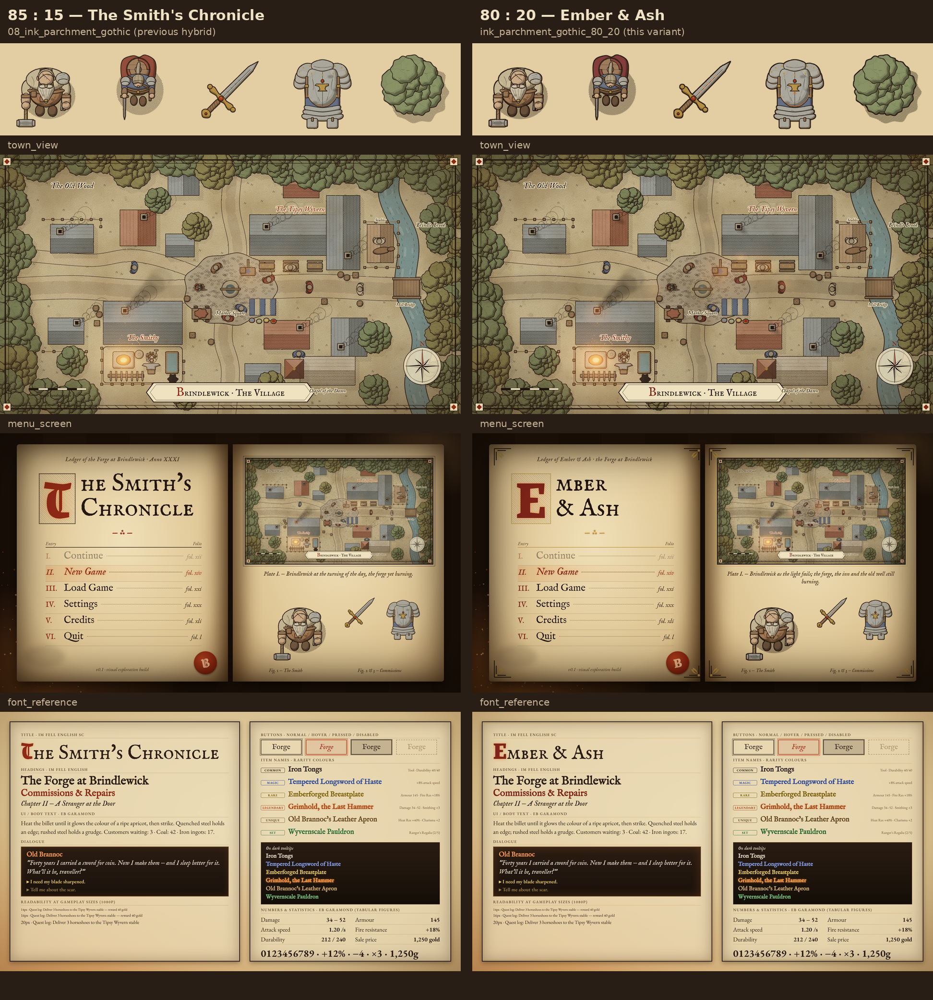
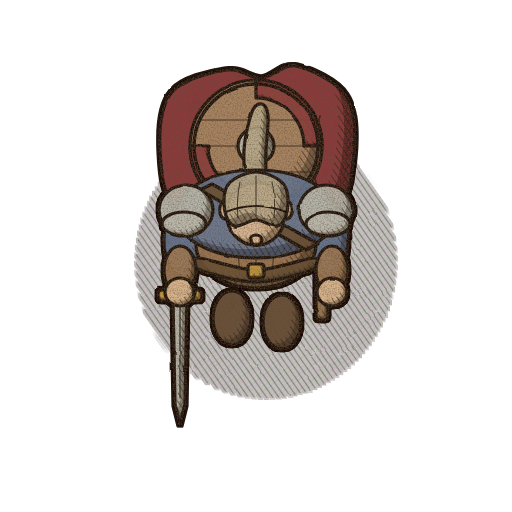
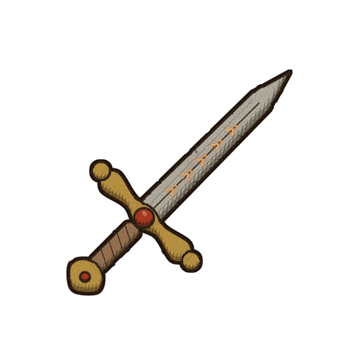
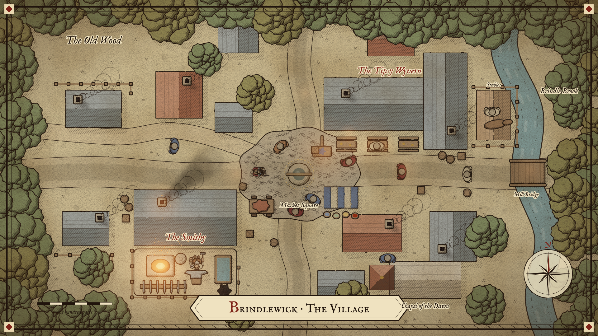
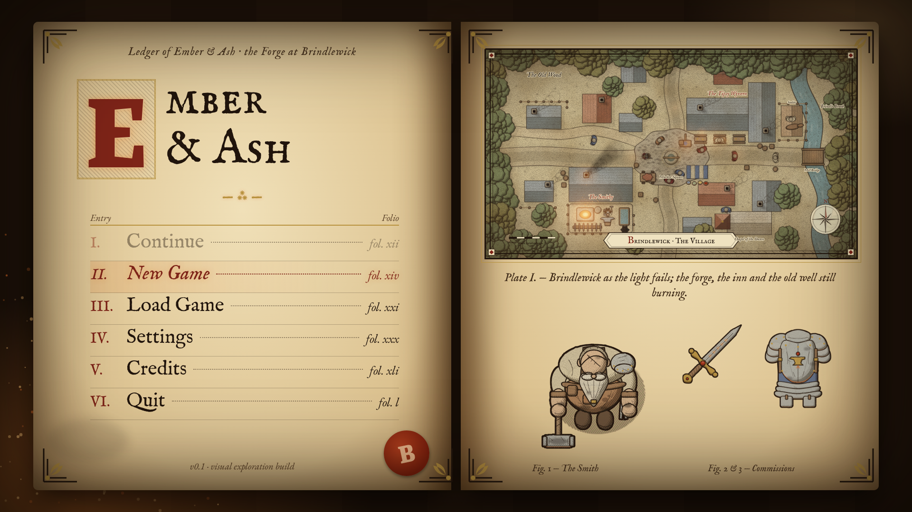
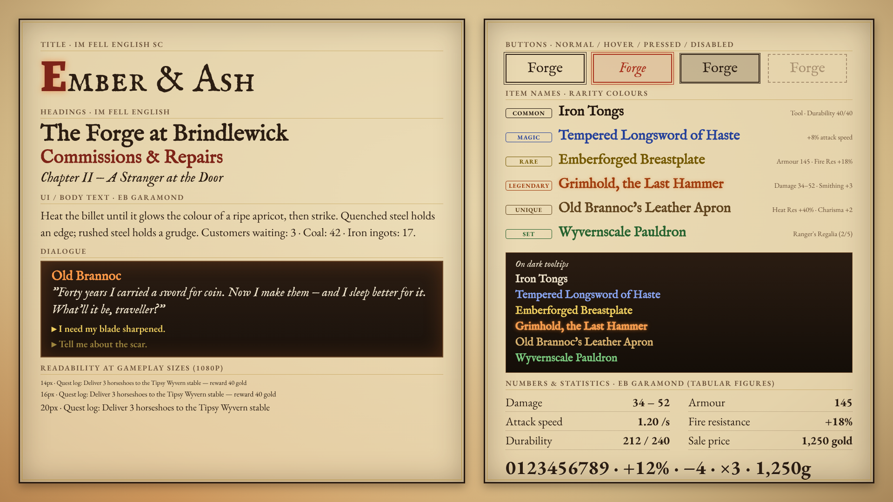

# Ink & Parchment / Gothic Noir 80:20 · "Ember & Ash"

> A derivative of the 85:15 hybrid in [`../08_ink_parchment_gothic/`](../08_ink_parchment_gothic/),
> with the Gothic Noir share raised from **≈ 15 % to ≈ 20 %**: roughly **80 % Ink & Parchment,
> 20 % Gothic Noir**. Composition, proportions, perspective, rendering technique and identity are
> 08's. What changes is a notch more ink, shadow, wear, soot and ember light. It must still read
> *first* as a manuscript-and-map game — sepia ink, hatching, pale washes, aged parchment — and never
> as Gothic Noir with a parchment overlay. Warm, readable daytime environments are preserved.

**Working title:** **"Ember & Ash"** (the client's menu title for this exploration). 08 kept 04's
"The Smith's Chronicle"; the new title is the only identity-level change and lives in the menu and
typography sheet.

**Folder name:** `ink_parchment_gothic_80_20/` is unnumbered, exactly as the client specified. It is a
variant of 08, not a new direction 09.

**Question this exploration answers:** does a modest increase in Gothic Noir give a richer, grittier,
more distinctive identity *without* losing the charm, warmth and readability of Ink & Parchment?
The answer is in [*Verdict / evaluation*](#verdict--evaluation) at the end.

Parent directions: [`../08_ink_parchment_gothic/`](../08_ink_parchment_gothic/) (direct parent, 85:15),
[`../04_ink_parchment/`](../04_ink_parchment/) (base) and [`../01_gothic_noir/`](../01_gothic_noir/)
(seasoning). Anything not restated here — hatch angles, light direction, sprite production, fonts,
Godot import — **is inherited from 08 (and through it, 04) unchanged**.

Companion files: [`prompts.md`](prompts.md) (image-model / artist briefs) and
[`naming_guide.md`](naming_guide.md) (file naming, sizes, Godot import, overlay/emit/light assets,
85:15 ↔ 80:20 interchangeability).

---

## Rendering note (read first)

The example images are **procedural vector style studies**, not AI-generated or hand-painted art.
No image-generation model was available in the build environment, so each image was built as SVG by
the Python generator in [`../_generator/`](../_generator/) and rasterised with headless Chromium
(Playwright, `render.js`) — the same pipeline, subject geometry and framing as every other direction.

Technically, this variant is the same 04 `ink` painter that produces 08, with `noir=0.20` instead of
`0.15` (`styles.py` entry `"ink_parchment_gothic_80_20"`). Every noir-guarded parameter scales by
**t = noir / 0.15 = 1.33** from its 85:15 value; a few extra detail passes switch on at t > 1.1
(listed below). The 85:15 renders in `08_ink_parchment_gothic/` are byte-identical to before, so the
two folders are a clean A/B pair. The side-by-side sheet is produced by
[`../_generator/compare_hybrids.py`](../_generator/compare_hybrids.py).

The images show palette, line weight, shadow depth, wear, glow placement and typography faithfully;
the drawing itself is simplified geometry. Final art should be produced from [`prompts.md`](prompts.md).

**Reference images:** none were provided. The variant is derived from the client brief, the latest
08 artwork and directions 04/01. If references are supplied later, re-check palette and dial values.

---

## Example graphics

| # | File | Size | Content |
|---|------|------|---------|
| 1 | [blacksmith.png](blacksmith.png) | 512×512, transparent | Protagonist, straight top-down, facing south; heavier soot, apron cracks, scratched pauldron and hammer face |
| 2 | [adventurer.png](adventurer.png) | 512×512, transparent | Visiting adventurer; muted burgundy cloak, darker shadow side |
| 3 | [sword.png](sword.png) | 512×512, transparent | Inventory icon, 45° diagonal; ember-lit runes along the fuller, edge nicks, ember rim on gold and gem |
| 4 | [armor.png](armor.png) | 512×512, transparent | Inventory icon, front view; scratches, soot in creases, small ember-lit rune under the anvil emblem |
| 5 | [tree.png](tree.png) | 512×512, transparent | Top-down canopy; heavier contour, deeper overlap shadow |
| 6 | [town_view.png](town_view.png) | 1920×1080 | Illustrated village map "as the light fails": soot streaks, lantern pools, rune ring at the well |
| 7 | [menu_screen.png](menu_screen.png) | 1920×1080 | "Ember & Ash" main menu as a smith's ledger, gilt corner ornaments |
| 8 | [font_reference.png](font_reference.png) | 1920×1080 | Typography and rarity sheet |
| 9 | [comparison_85_15_vs_80_20.png](comparison_85_15_vs_80_20.png) | 1944×2082 | Side-by-side: 08 (85:15) left, this variant (80:20) right — sprites, town, menu, fonts |

**How to read the comparison sheet:** it should look like 08 with the ink pressed harder, the forge
fed and the page handled for longer — not like a different game. At thumbnail size the left and right
columns should be hard to tell apart; differences should appear on a second look (runes, scratches,
soot streaks, gilt ornament, burgundy initial).

---

## Visual summary

The same smith's chronicle as 08 — village map, hatching, pale washes, manuscript UI — but the ledger
has now hung beside the forge for another decade. Ink is pressed harder and the silhouette line is
firmer; shadows sit a step deeper; leather has cracked, steel carries scratches and nicks; soot
streaks the roofs below each chimney and darkens the busiest streets; the forge, inn windows,
lanterns and the old well's rune ring glow a little more. Magical and legendary metal now *shows*
its nature: runes along the sword's fuller and under the armour emblem burn ember-orange. The menu
gains a burgundy blackletter "E", restrained gilt corner ornaments and a hotter forge in the corner.
By day the village is still a warm, readable parchment map.

### The Ink & Parchment base (≈ 80 %)

Unchanged from 04/08: sepia ink linework with slight hand wobble; values from hatching (−35°) and
cross-hatching (+35°), never black fills; pale low-saturation washes with highlights left as paper;
light from the top-left; naturalistic proportions; terrain as near-unpainted page; the town as an
illustrated map with double-rule border, cartouche, compass rose and rubricated labels; UI as a
manuscript ledger; IM Fell + EB Garamond typography; restrained earthy palette. **Lit planes keep
04's light and base colours exactly.**

### The Gothic Noir seasoning (≈ 20 %)

The same techniques as 08, each about one third stronger, plus four new detail passes:

* **Stronger ink and crosshatching:** ink `#20140c`, line 3.2 px, 1.5 px silhouette dilation,
  cross-hatch 0.733.
* **Deeper shadows, more contrast:** shadow wash 0.643; shadow tones −20 % vs 04 (08: −15 %).
* **More weathering:** stronger soot grain, blacksmith soot ×1.33, *new* apron cracks, hammer-face
  and pauldron scratches, sword edge nicks, armour scratches.
* **Richer dark accents:** charcoal/dark-brown straps and boots (base −10 %), muted burgundy cloak,
  muted burgundy rubric `#7e2418`, deeper soot `#16100b`.
* **More pronounced light:** ember rim 0.53 (08: 0.40); town glows ×1.2, 29 embers, five extra
  lantern/candle pools; menu forge glow 0.60.
* **Dramatic treatment of magic and legendary items:** ember-lit runes (blade fuller, armour) and a
  faint gold rune ring with glow at the old well — the first *magical illumination* in the studies.
* **Darker atmosphere in the town:** soot streaks below every chimney, faint soot darkening along the
  main streets, dusk grade to 19 %, vignette 55 %.
* **Restrained gold:** gilt `#b8923e` for ornaments and rules only (menu, font sheet).

Still not used from 01: near-black ink, exaggerated top-heavy silhouettes, cold night palette by
day, fog, dark leather UI as the default frame, normal-mapped lighting.

---

## What changed from 85:15

All values from `styles.py`, `svgcore.py`, `subjects.py`, `town.py: noir_seasoning` and
`compositions.py` (`menu_inkgothic`, `NOIR_FONT_CSS` + gilt overrides). Scaled values = 85:15 × 1.33
unless marked.

| Parameter | 04 Ink & Parchment | 85:15 (08) | 80:20 (this) |
|---|---|---|---|
| Ink | `#2b1d12` | `#24170e` | `#20140c` |
| Line weight (512 px master) | 2.4 px | 3.0 px | 3.2 px |
| Silhouette dilation | — | 1.2 px | 1.5 px |
| Hand wobble | 1.8 | 2.0 | 2.1 |
| Shadow wash opacity | 0.55 | 0.62 | 0.643 |
| Cross-hatch opacity | 0.60 | 0.70 | 0.733 |
| Ember rim (metal / gold / gem / fire) | — | 0.40 | 0.53 |
| Soot grain alpha slope / offset | — | 1.0 / −0.72 | 1.15 / −0.78 |
| Blacksmith local soot | — | ×1.0 | ×1.33 (capped at 0.5 opacity) |
| Shadow tones vs 04 | — | −15 % | −20 % |
| Strap / boot base | 04 | 04 | −10 % (charcoal / dark-brown accent) |
| Cloak (light / base / shadow) | 04 red-brown | `#c47a64` / `#a2503c` / `#5d2a20` | muted burgundy `#b46e66` / `#8e3e3c` / `#4a1a1a` |
| Gem | cyan (04) | `#f08a50` / `#b8360f` / `#5a1406` | `#f08a50` / `#b02e10` / `#4e1004` |
| Fire | 04 | `#ffcf80` / `#e0782a` / `#962e0a` | `#ffd488` / `#e8762a` / `#8e2808` |
| Rubric | `#a8321e` | `#8e2a16` | `#7e2418` (muted burgundy) |
| Gilt (restrained gold) | — | — | `#b8923e` (new) |
| Soot | — | `#1a120c` | `#16100b` |
| Forge glow | `#c8641e` / `#e8a050` | `#e0782a` / `#ffc070` | `#e6702a` / `#ffc070` |
| Background parchment | `#e9d8b0` | `#e2cea2` | `#dcc79a` |
| Wear detail (cracks, scratches, nicks) | — | — | new at t > 1.1: apron cracks, hammer face, pauldron, sword edge, armour |
| Runes | — | engraved, unlit | ember-lit: glow `#e6702a` (blurred) + core `#ffc070`, sword fuller and armour emblem |
| Town dusk multiply | — | 6 % → 15 % | 6 % → 19 % |
| Town glows / embers | — | ×1.0 / 22 | ×1.2 / 29 |
| Town soot | — | smithy plume | plume ×1.33 + streaks below every chimney + 7 % darkening along main streets |
| Town extra lights | — | forge, inn door, beer garden | + 5 lantern/candle pools (street, inn windows) + gold dashed rune ring and glow at the old well |
| Town vignette | `#6a4a20` 45 % | `#3a2410` 50 % | `#3a2410` 55 % |
| Menu | open chronicle | ledger, "The Smith's Chronicle" | ledger, "Ember & Ash", gilt corners/rules/initial frame/map outline |
| Menu forge glow / embers / outer vignette | — | 0.55 / ×1.0 / 0.75 | 0.60 / ×1.33 / 0.78 |
| Font sheet | 04 | Grenze initial, ember Legendary | + burgundy initial with ember glow, burgundy h2, gilt inner frame and label rules, warmer dialogue glow |

### Measured result

Mean luminance (0–255, opaque pixels) and the *Gothic shift* index, (L₀₄ − L) / (L₀₄ − L₀₁): 0 = pure
04, 1 = pure 01. Luminance columns re-measured from the PNGs in this repository; the index moves by
±0.01 depending on the alpha threshold used.

| Image | 04 | 85:15 | 80:20 | 01 | Shift 85:15 | Shift 80:20 | Δ |
|---|---|---|---|---|---|---|---|
| tree | 123 | 111 | 108 | 26 | 0.11 | 0.14 | +0.03 |
| font_reference | 192 | 165 | 165 | 27 | 0.17 | 0.17 | 0 |
| menu_screen | 157 | 134 | 133 | 23 | 0.17 | 0.18 | +0.01 |
| town_view | 147 | 129 | 124 | 32 | 0.16 | 0.20 | +0.04 |
| armor | 148 | 135 | 131 | 67 | 0.16 | 0.21 | +0.05 |
| blacksmith | 134 | 117 | 112 | 38 | 0.17 | 0.23 | +0.06 |
| adventurer | 105 | 92 | 84 | 20 | 0.15 | 0.25 | +0.10 |
| sword | 126 | 106 | 98 | 41 | 0.24 | **0.32** | +0.08 |

* **Sprites land at 0.21–0.25** — on target for ≈ 20 %, with the adventurer at the daytime ceiling
  (the burgundy cloak and darker strap/boot accents cover a large share of its area).
* **The sword is over** at 0.32: on a thin icon the 3.2 px line plus 1.5 px dilation is a large share
  of all pixels, and the runes add dark ground for their glow. **Mitigation:** thin icons (swords,
  daggers, staves, wands, arrows) use a **2.8 px** line and 1.2 px dilation, keep the unpainted
  highlight streak along the blade, and let the runes carry the 80:20 character instead of the line.
  Re-measure; target ≤ 0.30.
* **Menu and fonts barely move** in mean luminance (0.17 → 0.18, 0.17 → 0.17) because the gilt
  ornament and stronger glow offset the darker ink. Their change is in *contrast and ornament*, not
  overall darkness — which is what the brief asks of UI.
* **Town +0.04:** the dusk grade and soot streaks darken it measurably while it stays daytime-legible.

### Proposed dial ceilings for 80:20

| Context | Aim | Hard ceiling |
|---|---|---|
| Daytime sprites, characters and exterior screens | 0.20 | **0.25** |
| Items and icons (incl. magical, legendary) | 0.25 | **0.30** |
| Dusk screens | 0.25 | 0.30 |
| Night, forge and inn interiors | 0.30 | **0.35** (0.40 absolute, as 08) |
| UI screens (menu, panels, sheets) | 0.15–0.20 | 0.25 — measure contrast, not darkness |

---

## Colour palette

From `styles.py`, `"ink_parchment_gothic_80_20"`. Same structure and hues as 04/08; light and base
values are 04's; shadow values are deeper. New roles: muted burgundy and gilt.

### Core colours

| Role | Hex | Use |
|---|---|---|
| Ink | `#20140c` | All linework, hatching, body text |
| Parchment | `#dcc79a` | Page/ground, UI panels (darkest panel tone) |
| Rubric (muted burgundy) | `#7e2418` | Initials, heading accents, map labels, seal, selection ring |
| Gilt (restrained gold) | `#b8923e` | Ornaments, rules, frames only — never text (1.8:1 on parchment) |
| Soot | `#16100b` | Soot/grime overlays and streaks only |
| Ember | `#e6702a` | Forge glow, rim-light, rune glow, legendary accents, focus |
| Ember (hot) | `#ffc070` | Glow and rune cores, embers, fire highlight |
| Night ambient (limited blue-grey) | ≈ `#66647a` | `CanvasModulate` at night in 80:20 scenes |

### Material roles

Light and base identical to 04 (except strap/boot base, −10 %, and the burgundy cloak); shadows
−20 % vs 04.

| Role | Light | Base | Shadow | vs 08 |
|---|---|---|---|---|
| skin | `#f0dcc0` | `#dcb890` | `#866b4b` | shadow −5 % |
| beard | `#f4ecdc` | `#ddd2b8` | `#867b63` | shadow −5 % |
| hair | `#e0d4bc` | `#b8a888` | `#6b5e48` | shadow −5 % |
| shirt | `#ece0c4` | `#d8c8a2` | `#867656` | shadow −5 % |
| apron | `#d0a880` | `#aa7c52` | `#614329` | shadow −5 % |
| leather | `#c8a47c` | `#a07a54` | `#584129` | shadow −5 % |
| strap | `#9a7650` | `#6d5134` | `#433321` | base −10 %: dark-brown accent |
| metal | `#e6e2d8` | `#bcb8aa` | `#6b6858` | shadow −5 % |
| gold | `#e6c674` | `#c69c44` | `#6e541e` | shadow −5 % |
| cloak | `#b46e66` | `#8e3e3c` | `#4a1a1a` | muted burgundy |
| tunic | `#94a2b4` | `#6a7a92` | `#3b4454` | shadow −5 % |
| boot | `#a88a68` | `#6f543b` | `#433323` | base −10 %: charcoal-brown accent |
| wood | `#d0b088` | `#aa8a64` | `#614b33` | shadow −5 % |
| foliage | `#bcc49a` | `#909c6c` | `#50593b` | shadow −5 % |
| foliage2 | `#c8c08a` | `#a49c62` | `#5c5633` | shadow −5 % |
| grass | `#e8d9b2` | `#dccb9e` | `#9b8b66` | still "unpainted page" |
| road | `#efe0bc` | `#ddc99e` | `#958463` | shadow −5 % |
| roof_a | `#d09a7a` | `#ae6e50` | `#633b29` | shadow −5 % |
| roof_b | `#aab0ac` | `#848c88` | `#494e4c` | shadow −5 % |
| stone | `#e2d6bc` | `#c6b698` | `#786951` | shadow −5 % |
| water | `#b4c8c0` | `#8eaaa6` | `#546b68` | shadow −5 % |
| gem | `#f08a50` | `#b02e10` | `#4e1004` | deeper ember red |
| fire | `#ffd488` | `#e8762a` | `#8e2808` | hotter core, deeper base |

Only gem, fire, runes and magic may be vivid. Burgundy and gilt are *muted* accents, not new
saturated hues.

---

## Where each influence appears (80:20)

Shares are design targets for that element. Compared with 08 most rows move by ~5 points; the
largest increases are on items, the forge, interiors and UI accents.

| Element | I&P | Gothic | Concrete treatment (vs 08) |
|---|---|---|---|
| Town layout, buildings, roads | 90 % | 10 % | 08 geometry; + soot streaks under chimneys, faint soot along main streets |
| Terrain, grass, roads by day | 92 % | 8 % | Near-unpainted page; parchment one step older (`#dcc79a`) |
| Ordinary daytime scenes | 85 % | 15 % | No global grade by day; vignette ≤ 55 % at corners; ≤ 2 faint lantern pools |
| Characters overall | 80 % | 20 % | 3.2 px line, 1.5 px silhouette, deeper shadows; burgundy/charcoal accents |
| Blacksmith (protagonist) | 75 % | 25 % | + soot ×1.33, apron cracks, scratched pauldron and hammer face, ember rim 0.53 |
| Adventurers | 75 % | 25 % | Burgundy cloak, darker straps/boots, edge nicks; ember glint on steel |
| Townsfolk | 85 % | 15 % | Line weight and shadow depth only; trade-based soot |
| Trees, foliage | 88 % | 12 % | Heavier contour, deeper overlap shadow; no soot except near the smithy |
| Ordinary items | 80 % | 20 % | Engraved line, deeper hatching, scratches and nicks |
| Magical metals | 65 % | 35 % | Ember-lit or blue-ink runes, emissive mask, stronger value contrast |
| Legendary / unique items | 60 % | 40 % | Burning runes, ember rim 0.53, pulsing `_emit`, darkest cross-hatch on shadow side |
| Dusk (scene grade) | 75 % | 25 % | Multiply 6 % → 19 %, lamps and inn windows on, soot plumes and streaks |
| Night | 65–70 % | 30–35 % | `CanvasModulate` ≈ `#66647a` + hatch overlay + additive lights |
| Forge / smithy interior | 65–70 % | 30–35 % | Strongest glow on screen, embers ×1.33, sooty walls, scratched tools |
| Inn interior | 70 % | 30 % | Hearth and candle pools; warm, cosy, not threatening |
| Danger / mystery | 65 % | 35 % | Ink + soot vignette, rune or ember cue on the threat |
| Magical illumination (rune rings, wards) | 65 % | 35 % | Gilt dashed ring + soft ember/gold glow; the one magic light allowed by day |
| UI framework, panels | 85 % | 15 % | Parchment panels, heavier borders, gilt inner rule |
| Main menu (key art) | 75 % | 25 % | Ledger, gilt corner ornaments, hotter forge; pages stay pure I&P |
| Typography structure | 88 % | 12 % | 04 fonts; burgundy Grenze initial with faint ember glow |
| Dialogue box | 70 % | 30 % | Dark leather, warmer inner glow, ember speaker name |
| Tooltips / item presentation | 75 % | 25 % | Dark tooltip; Legendary with stronger ember glow |

---

## The dial: quantifying the 20 %

Values at the 512 px master unless stated. "85:15" column repeats 08 for direct comparison.

| Dial | 85:15 | 80:20 target | Hard limit |
|---|---|---|---|
| Ink colour | `#24170e` | `#20140c` | never darker than `#1c120a`; never pure black |
| Line weight | 3.0 px | 3.2 px (+33 % vs 04); thin icons 2.8 px | +40 % vs 04 (3.4 px) |
| Silhouette outline | 1.2 px | 1.5 px; thin icons 1.2 px | 2 px |
| Shadow wash / cross-hatch | 0.62 / 0.70 | 0.643 / 0.733 | 0.72 / 0.80 |
| Gothic shift index | ≈ 0.15 (≤ 0.25) | see *Proposed dial ceilings* | 0.25 day · 0.30 items · 0.35 night/interiors |
| Daytime global darkening | 0 | 0; vignette ≤ 55 % at corners | no full-screen grade by day |
| Dusk darkening | 6 % → 15 % | 6 % → 19 % | 25 % |
| Night darkening | ≈ `#6c6a80` | ≈ `#66647a` | lit ground ≥ 40 % of daytime luminance; paths and doors always legible |
| Interior darkening | ≈ `#8a7a6a` | ≈ `#827262` | nothing interactive darker than the night limit |
| Strong light sources | ≤ 3 | ≤ 3 strong + ≤ 5 faint (≤ 25 %) | faint pools never brighter than the inn door |
| Ember rim-light | 0.40 | 0.53 | 0.60; metal/gold/gem/fire only |
| Rune glow | — | ember `#e6702a` blur + `#ffc070` core, magical/legendary only | ≤ 1 lit rune group per item |
| Gothic-only colour by day | ≤ 10 % of screen | ≤ 12 % | 15 % |
| Same, night/interiors | ≤ 25 % | ≤ 30 % | 35 % |
| Soot coverage on a sprite | 3–8 % | 5–10 %, opacity 0.25–0.45 | 12 %, opacity 0.5 |
| Wear marks (scratches, cracks, nicks) | — | 2–5 lines per surface, ink at 50–70 % | never across faces or the silhouette edge |
| Gilt | — | ornaments, rules, frames, map outline | never text, never on sprites except gold materials |

**Ember accent — reserved list** (as 08, plus runes): forge fire, hearths, candles and lanterns; hot
metal and sparks; magical metals and **runes**; legendary items (rim, name text, emissive mask);
magical illumination (rune rings, wards); danger cues; UI focus/hover and the dialogue speaker name.
Anywhere else it is drift.

**Burgundy `#7e2418`** takes over 08's rubric role (initials, labels, seal, selection ring) and is
also the cloak family. **Gilt `#b8923e`** is decoration: frames, corner ornaments, rules, fleurons.

---

## Lighting & shading

* **Light source and hatching:** as 04/08 — top-left, form shadow bottom-right, −35° hatch, +35°
  cross-hatch, hatched ground shadows, highlights as reserved paper, no black fills.
* **Darker darks, not darker lights** — even more important at 80:20. Lit planes stay 04-bright; the
  extra 5 % lives in shadow tones, ink, wear and accents.
* **Rim-light** 0.53 ember crescent on metal, gold, gems and fire. Baked *or* Light2D near the forge,
  not both at full strength.
* **Runes** are the new dramatic device: drawn in ink on the metal, then lit with an ember glow
  (blurred `#e6702a`) and a thin `#ffc070` core. They belong to magical/legendary items and magical
  places only. In-game the glow is an `_emit` mask, not baked.
* **Wear** (scratches, cracks, nicks) is drawn linework at reduced ink opacity, carried in the
  `_g20` overlay layer (see [`naming_guide.md`](naming_guide.md)); **soot** stays an overlay driven by `_wear` masks so it can be dialled per scene.

### Scene types

| Scene | Treatment at 80:20 |
|---|---|
| Day (village) | 04/08 look; no global grade; vignette ≤ 55 %; soot streaks under chimneys allowed but street darkening off (or ≤ 4 %) — see verdict |
| Dusk ("as the light fails", town study) | Multiply 6 % → 19 % toward bottom-right; glows ×1.2 at forge (strongest), inn door, inn windows, lanterns; soot plume and streaks; 29 embers; rune ring glow at the well |
| Night | `CanvasModulate` ≈ `#66647a`, hatch overlay +30 % density vs 04, additive lights erase the hatch inside their radius |
| Forge interior | Dim warm ambient ≈ `#827262`, forge strongest, embers ×1.33, sooty walls, scratched tools; 1.5 px outline keeps silhouettes |
| Inn interior | Hearth + two candle pools; dark corners hatched, not blacked out |
| Danger / mystery | Ink + soot vignette up to 70 %, heavier cross-hatch, rune or ember cue |
| Magic / legendary | Lit runes, ember or blue-ink (`#24409a`) linework, additive glow; may be strong by day |

---

## Character & object proportions

Unchanged from 04/08: naturalistic proportions, no chibi enlargement, no 01 top-heavy exaggeration.
Feet at ≈ y 0.80, character 60–70 % of canvas width incl. weapon, 1 tile = 64 px. The 80:20 seasoning
never changes a silhouette, pivot or canvas — only line, shadow, wear, soot and emissive layers.

---

## Suitability for straight top-down 2D

**Natural fit; marginally better actor separation than 08, marginally less daytime airiness.** The
3.2 px line and 1.5 px silhouette make actors and interactables pop from the page at 128 px even more
clearly than 08 — the blacksmith and armour read instantly in the comparison sheet. Lit runes and
lantern pools sit on the flat ground plane the camera sees, so magical and light cues read well
top-down.

Costs: the darker parchment, street soot and 19 % dusk make the daytime map slightly browner; the
burgundy cloak and darker boots make the adventurer a heavier dark mass. Both are within limits but
close to them.

Rules (08's, plus):

1. Night and interior ambient never drop below the night limit; paths, doors, NPCs and pickups stay
   legible without a light.
2. Selection ring burgundy `#7e2418` by day, with a faint ember underlay at night.
3. Soot and wear never on faces or the silhouette edge.
4. Street soot is a mood layer: off (or ≤ 4 %) on daytime gameplay screens, on at dusk/night.
5. Lit runes must not be confused with pickup/interaction highlights — interaction stays the burgundy
   ring.

---

## Strengths

* **More distinctive identity at no cost to the base:** runes, scratches, gilt and burgundy give the
  game a recognisable "forge-worn ledger" signature that 08 only hinted at.
* **Items gain story:** the sword's burning runes and the armour's ember rune say "magical" without a
  tooltip — exactly what a blacksmith game sells.
* **Stronger menu:** "Ember & Ash" with a burgundy initial, gilt corners and hotter forge reads as a
  finished title screen; pages remain pure I&P and fully legible.
* **Better actor separation** at gameplay size (heavier outline).
* **Magical illumination exists:** the rune ring at the well proves magic light can be drawn in the
  manuscript language (gilt dashed ring + glow) rather than as generic VFX.
* **Fully interchangeable with 85:15:** same canvases, pivots, geometry; the dial can be set per scene.
* UI contrast holds: every rarity colour still clears 4:1 on the darkest parchment.

## Possible risks

| Risk | Mitigation |
|---|---|
| **Drift toward 01** — 80:20 is one more step on a slope | Hard ceilings above; review every batch against 08 *and* 04; reject anything that fails the squint test against 08 |
| Thin icons too dark (sword 0.32) | 2.8 px line / 1.2 px dilation on thin icons, keep blade highlight, re-measure ≤ 0.30 |
| Characters lose warmth (adventurer 0.25; burgundy cloak heavy) | Use 85:15 values for characters on daytime exteriors; keep cloak base `#a2503c` there |
| Street soot reads as dirt/smudge bands by day | Street soot is a dusk/night layer; ≤ 4 % by day or off |
| Runes everywhere lose meaning | Runes only on magical/legendary items and magical places; ≤ 1 lit rune group per item |
| Blackletter capitals can misread as two letters (the first render's "E" read as "IE") | Fixed in the studies by setting the "E" in Grenze 800; keep Grenze Gotisch only for letters that stay legible (T, B, C, D…), test every initial at 720p |
| Gilt used as text colour (1.8:1) | Gilt is ornament-only, enforced in the Theme |
| Parchment `#dcc79a` makes small text and Rare/Legendary weaker | Use the small-text fallbacks below; panels may use `#e2cea2` |
| More light pools compete with the forge | ≤ 3 strong lights; extra pools ≤ 25 % energy |
| Image models over-darken at "20 % gothic" | Prompts name techniques and limits, never "darker"; measure each batch |

---

## Production complexity

**Rating: 4 / 5** (as 08, slightly higher within the band). Per-asset craft is 08's; the additions
are three passes.

Assumptions as 04/08 — one village, 3–4 wilderness areas, ~25 named NPCs, ~150 items; one
illustrator-animator with AI drafts; a programmer for shaders; art only, ±40 %.

| Delta vs 08 | Person-months |
|---|---|
| Wear pass: scratches, cracks, nicks on characters, armour, weapons, tools | +0.5 |
| Rune pass: rune linework + `_emit` masks on magical/legendary items (~30–40 items) and magic places | +0.25–0.5 |
| Light pass: extra lantern/window pools, rune-ring lights, per-scene dial presets (85:15 / 80:20) | +0.25 |
| UI ornament: gilt corner/rule set, custom initials | +0.1–0.25 |
| **Total** | **≈ 20–28.5 person-months** (08: 19–27), i.e. **+5 %** over 08 |

Relative art cost (Production-Light = 1.0): **≈ 1.8** (08 ≈ 1.75, 04 ≈ 1.6, 01 ≈ 1.9). Night,
dusk and interior variants remain lighting, not art. Running a scene-dependent dial adds no art cost
— only one extra preset resource and QA of both presets.

---

## Keeping the mix controlled and consistent

### Do / don't

| Do | Don't |
|---|---|
| Start every asset from the 08 brief, then apply the 80:20 accents for that asset | Start from "dark fantasy" or from 01 and lighten |
| Deepen shadows, ink and wear; keep lit planes 04-bright | Darken the parchment further or the lit sides |
| Put wear and soot where use puts them | Scratch or soot every surface evenly |
| Light runes only on magical/legendary things | Light runes on ordinary gear for "flavour" |
| Use gilt for frames, rules, ornaments | Use gilt for body text or large fills |
| Use burgundy for initials, labels, seal, cloaks | Spread burgundy into roofs, terrain or UI chrome |
| Do night/dusk/interiors with modulate + lights + overlays | Paint `_night` or `_dark` art |
| Set the dial per scene (see verdict) | Ship one global 80:20 for every daytime exterior |
| Keep 04/08 proportions and canvases | Change silhouettes or pivots between 85:15 and 80:20 |

### Review checklist (per asset or screen)

1. Reads as Ink & Parchment at first glance?
2. Line 3.2 px (thin icons 2.8 px), silhouette 1.5 px (thin icons 1.2 px), ink `#20140c`?
3. Shadow side deeper than 08, lit side not darker than 04?
4. Ember only on the reserved list; runes only on magical/legendary; gilt only as ornament?
5. Soot 5–10 %, wear 2–5 lines per surface; nothing on faces or silhouette edges?
6. ≤ 3 strong lights, forge strongest; faint pools ≤ 25 %?
7. Gothic shift within the ceilings (0.25 day, 0.30 items, 0.35 night/interiors)?
8. Readable at 128 px and 1280×720; interactables distinct from lit runes and terrain?
9. Squint test against the matching 08 asset passes (groups with 08, not with 01)?

### Squint test against 08, 04 and 01

Place the asset beside its counterparts in `08_ink_parchment_gothic/`, `04_ink_parchment/` and
`01_gothic_noir/`; blur ~8 px or view at 64 px wide in greyscale.

* **Pass:** indistinguishable in mass from 08, clearly in the 04 family; on closer look darker
  edges, wear and one or two warm hot-spots.
* **Fail:** dark mass with lit islands (01), or differences visible at thumbnail size.
* **Numeric:** Gothic shift from mean luminance; aim 0.20, ceilings as above.

### Godot implementation

As 08, with these 80:20 values (store both presets in one `style_dial.tres`, see
[`naming_guide.md`](naming_guide.md)):

* **Ambient:** `CanvasModulate` day `#ffffff`, dusk ≈ `#d4c2a8`, night ≈ `#66647a`, forge interior
  ≈ `#827262`. `night_hatch.gdshader` max density +30 % vs 04.
* **Dusk grade:** `dusk_grade.gdshader`, multiply 6 % → 19 % diagonal.
* **Glow:** additive `PointLight2D`; forge `#e6702a` energy 1.2–1.7 ±10 % flicker; inn door/windows
  and lanterns `#ffc070` 0.6–1.0; candles 0.35–0.6; extra faint pools ≤ 0.25; rune ring light gold
  `#e0b860` 0.3–0.5 with slow pulse.
* **Soot and wear:** `soot_overlay.gdshader` through `_wear` masks; `soot_strength` day 0.6
  (85:15 value) / dusk 0.8 / interiors 0.9; street soot is a placed `fx_soot_mask_streets` faded in
  with the dusk grade. Scratches, cracks, the extra line weight and the deeper shadow step live in a
  per-sprite `_g20` overlay layer on top of the 85:15 colour sprite, so a scene can switch it on or off.
* **Runes / legendary:** `_emit` masks drawn additively, `light_mode = Unshaded`, pulse 0.6–1.0 over
  ~2 s; tooltip Legendary uses `#ffa050` with text-shadow glow.
* **Embers:** `GPUParticles2D`, amount ×1.33 vs 08, ≤ 1 emitter per light source.
* **Outline:** `actor_outline` shader width parameter carries 1.2 ↔ 1.5 px (master scale), so the
  outline can follow the per-scene dial without re-export.
* **Vignette:** radial `#3a2410`, ≤ 55 % at corners; danger up to 70 %.

---

## Typography

Same system as 08/04 — see [`../08_ink_parchment_gothic/README.md#typography`](../08_ink_parchment_gothic/README.md#typography)
and [`../04_ink_parchment/README.md#typography`](../04_ink_parchment/README.md#typography). Differences:

| Role | Font | Change vs 08 |
|---|---|---|
| Title | IM Fell English SC, ink `#20140c` | "Ember & Ash"; initial "E" in Grenze 800 (Grenze Gotisch "E" misreads as "IE") |
| Illuminated initials only | Grenze Gotisch 800, or Grenze 800 where the blackletter form misreads (e.g. "E") | burgundy `#7e2418` with ember text-glow (`0 0 14px` at 60 %); menu initial box framed in gilt with hatched ground |
| Headings, dialogue | IM Fell English 400 + italic | secondary headings burgundy `#7e2418` |
| UI, body, numbers | EB Garamond 400–600 (`lnum` + `tnum`) | unchanged |
| Ornament | — | gilt `#b8923e` rules, inner panel frame (1 px, inset 8 px), corner ornaments, label underlines |

* **Menu header:** "Ledger of Ember & Ash · the Forge at Brindlewick"; plate caption "Brindlewick as
  the light fails; the forge, the inn and the old well still burning." (IM Fell English italic).
* **Aged manuscript feel** comes from IM Fell, burgundy rubrication and gilt rules — not from
  blackletter body text. Grenze Gotisch remains one letter at a time, ≥ 96 px.
* **Dialogue box:** dark leather (`#2a1c12` → `#1a120c`), inner ember glow raised to 22 %, speaker
  name `#ff9a48`, choices `#f0d060`.
* **Buttons:** as 08; hover = burgundy border, italic, ember glow.
* The wax seal monogram in the study still shows "B" (Brindlewick); for the final title consider an
  "E&A" or anvil monogram.

### Item rarity colours

WCAG contrast against parchment `#dcc79a` (darkest panel tone, worst case) and `#e2cea2` (08's
panel), and against the dark tooltip `#2a1c12` (lighter end of the gradient, worst case).

**On parchment:**

| Rarity | Hex | vs `#dcc79a` | vs `#e2cea2` | Note |
|---|---|---|---|---|
| Common | `#20140c` | 10.9:1 | 11.6:1 | Plain ink |
| Magic | `#24409a` | 5.6:1 | 6.0:1 | Blue ink |
| Rare | `#735800` | 4.1:1 | 4.4:1 | Large/semibold only |
| Legendary | `#9e3a0c` | 4.1:1 | 4.4:1 | Large/semibold only; + faint ember text-shadow |
| Unique | `#5e421c` | 5.6:1 | 6.0:1 | Gold-brown |
| Set | `#26622f` | 4.4:1 | 4.7:1 | Large/semibold only on `#dcc79a` |

**On dark tooltip `#2a1c12`:**

| Rarity | Hex | Contrast |
|---|---|---|
| Common | `#efe4cc` | 13.1:1 |
| Magic | `#8aa6f2` | 6.9:1 |
| Rare | `#f0d060` | 10.9:1 |
| Legendary | `#ffa050` | 8.2:1 (+ ember glow) |
| Unique | `#dab470` | 8.4:1 |
| Set | `#7ccc80` | 8.5:1 |

Rare, Legendary and Set on `#dcc79a` are below 4.5:1: set them at ≥ 24 px or EB Garamond 600, or use
small-text fallbacks Rare `#634c00` (4.9:1), Legendary `#7e2e0a` (5.6:1), Set `#245a2c` (4.9:1).
Burgundy `#7e2418` (headings) is 5.9:1. Gilt `#b8923e` is 1.8:1 — ornament only. Contrast is measured
without glows. Pair colour with a tag or glyph; Legendary and Rare remain close for protanopes.

---

## Verdict / evaluation

**Does a modest increase in Gothic Noir produce a richer, grittier, more distinctive identity without
losing the charm, warmth and readability of Ink & Parchment?**

**Yes — for items, the forge, interiors, night and UI accents. Only partly for daytime exteriors and
characters**, where 80:20 is at the upper edge of comfortable and 85:15 remains the better default.

What the images and numbers show:

* **Items: clear win.** The ember-lit runes, edge nicks and scratches are the most valuable thing in
  this variant: the sword and armour now look *made and used*, and magical. Armour stays comfortable
  (0.21). The sword exceeds the daytime ceiling (0.32) for a fixable reason — line weight on a thin
  shape — not because the rune idea is too dark.
* **Blacksmith: win.** Scratched pauldron, cracked apron and extra soot add grit while the figure
  stays warm and pale on its lit side (0.23).
* **Adventurer: neutral to slightly negative.** At 0.25 it sits on the ceiling; the burgundy cloak and
  darker boots make the visitor heavier without adding information. The 85:15 version is warmer.
* **Tree: no meaningful change** (0.14). Either value works; nature does not need the extra step.
* **Town: gains mood, loses a little daylight.** Soot streaks, lantern pools and the rune ring at the
  well add story, and the map is still fully legible (0.20). But the browner parchment and the soot
  bands along the main streets read as grime at gameplay zoom; as a daytime exterior this is near the
  upper comfortable limit. At dusk and night the same layers are exactly right.
* **Menu: strongest win.** "Ember & Ash", gilt corners, burgundy initial and hotter forge make the
  title screen feel finished and more distinctive than 08, while the ledger pages stay pure,
  readable Ink & Parchment (shift 0.18). The first render's blackletter E read as "IE" beside
  "MBER"; the initial is now set in Grenze 800 (the non-blackletter sister face) and reads cleanly.
* **Typography: small, positive.** Burgundy headings, gilt rules and a warmer dialogue glow add flair
  at no readability cost; all rarity colours still clear 4:1.
* **Identity check:** across the comparison sheet the right column still unmistakably reads as Ink &
  Parchment. It does *not* become Gothic Noir with a parchment overlay — but it has used up most of
  the headroom. A 75:25 step would cross that line on daytime screens.

**Recommendation: adopt a scene-dependent dial**, not a single ratio.

| Context | Dial |
|---|---|
| Items and icons (esp. magical/legendary), weapons, armour, tools | **80:20** (thin icons with 2.8 px line) |
| Forge / smithy interior, inn interior, other interiors | **80:20** |
| Dusk and night exteriors | **80:20** (dusk 19 %, street soot on) |
| Menus, title, dialogue, tooltips, UI accents | **80:20** ("Ember & Ash" treatment) |
| Daytime exteriors (village, wilderness) | **85:15** values (dusk grade off, street soot off, parchment `#e2cea2`) |
| Characters on daytime exteriors | **85:15** values (1.2 px silhouette, `_g20` layer off, 08 cloak/strap/boot via palette remap) |

Because both presets share canvases, pivots, geometry and palette roles, and differ only in line,
shadow, wear, soot and emissive layers (see [`naming_guide.md`](naming_guide.md)), this costs one
preset resource and a QA pass — not a second art set. Adopt "Ember & Ash" as the working title, fix
the menu initial and the thin-icon line weight, and re-measure the first production batch against
the ceilings above.
